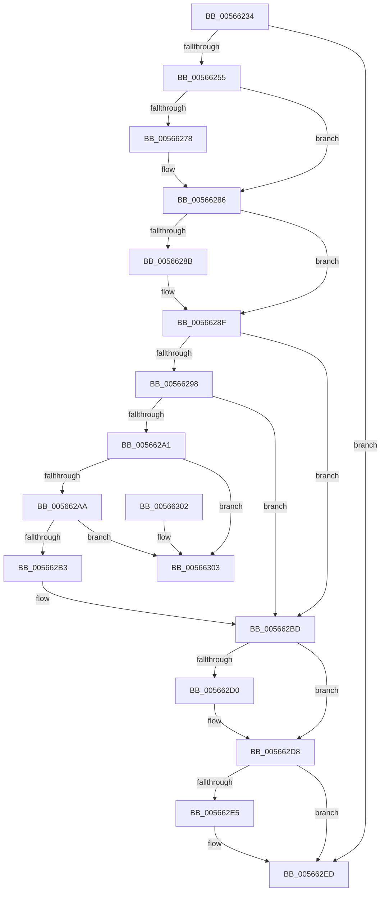

# IommupFreeSystemContext

- RVA: `0x00566234`–`0x0056630A` (길이 `214` bytes)
- VA: `0x0000000140566234`
- 실행 섹션: `.text`
- PDB 이름 있음: `예`; PDB Function 태그: `아니요`
- unwind 정보 RVA: `0x00069AD0`
- 디코드: `61`개 명령, `214/214` bytes 표시
- 미해석 바이트: `0` (있으면 어셈블리에 `.byte`로 보존)

> 이 문서는 커널 이미지의 기계어와 PDB 기호를 분석해 생성했습니다. 4번과 5번은 함수 원형과 자료형을 바이너리 사용 방식에서 추정한 C 해석이며 원본 소스 복구 결과는 아닙니다.

## 1. Dependencies

- 직접 호출 지점: **5**; 고유 호출 대상: **5**
- 직접 호출자로 확인된 함수: **1**
- RIP 상대 이미지 참조: **2**

### Outgoing calls
- `0x00566267` → [KeAbPreAcquire](../21/KeAbPreAcquire_function_00210230.md) (function, `0x00210230`)
- `0x00566281` → [ExfAcquirePushLockExclusiveEx](../20/ExfAcquirePushLockExclusiveEx_function_0020FC90.md) (function, `0x0020FC90`)
- `0x005662D3` → [ExfTryToWakePushLock](../26/ExfTryToWakePushLock_function_00265DD0.md) (function, `0x00265DD0`)
- `0x005662DB` → [KeAbPostRelease](../2E/KeAbPostRelease_function_002E1600.md) (function, `0x002E1600`)
- `0x005662E8` → [HalpMmAllocCtxFree](../3E/HalpMmAllocCtxFree_function_003E1904.md) (function, `0x003E1904`)

### Direct callers
- [IommuFreeLibraryContext](IommuFreeLibraryContext_function_005657B4.md) at `0x0056583B`

### Static image references
- `0x00566255` → RVA `0x00F8FB00` (`.data`; read)
- `0x005662C1` → RVA `0x00F8FB00` (`.data`; read/write)

## 2. Other-region calls and transfers

- 다른 실행 섹션으로 향하는 call: **0**
- 별도 외부 분기/꼬리 이동을 확인하지 못했습니다.

## 3. Assembly (complete function range)

```asm
00566234  48 89 5C 24 08                  mov qword ptr [rsp + 8], rbx
00566239  48 89 6C 24 10                  mov qword ptr [rsp + 0x10], rbp
0056623E  48 89 74 24 18                  mov qword ptr [rsp + 0x18], rsi
00566243  57                              push rdi
00566244  48 83 EC 20                     sub rsp, 0x20
00566248  83 79 10 00                     cmp dword ptr [rcx + 0x10], 0
0056624C  48 8B D9                        mov rbx, rcx
0056624F  0F 84 98 00 00 00               je 0x1405662ed
00566255  48 8D 2D A4 98 A2 00            lea rbp, [rip + 0xa298a4]
0056625C  45 33 C0                        xor r8d, r8d
0056625F  48 8B CD                        mov rcx, rbp
00566262  33 D2                           xor edx, edx
00566264  40 32 F6                        xor sil, sil
00566267  E8 C4 9F CA FF                  call 0x140210230
0056626C  F0 48 0F BA 6D 00 00            lock bts qword ptr [rbp], 0
00566273  48 8B F8                        mov rdi, rax
00566276  73 0E                           jae 0x140566286
00566278  4C 8B C5                        mov r8, rbp
0056627B  48 8B D0                        mov rdx, rax
0056627E  48 8B CD                        mov rcx, rbp
00566281  E8 0A 9A CA FF                  call 0x14020fc90
00566286  48 85 FF                        test rdi, rdi
00566289  74 04                           je 0x14056628f
0056628B  C6 47 0A 01                     mov byte ptr [rdi + 0xa], 1
0056628F  48 8D 43 20                     lea rax, [rbx + 0x20]
00566293  48 39 00                        cmp qword ptr [rax], rax
00566296  75 25                           jne 0x1405662bd
00566298  48 8D 43 30                     lea rax, [rbx + 0x30]
0056629C  48 39 00                        cmp qword ptr [rax], rax
0056629F  75 1C                           jne 0x1405662bd
005662A1  48 8B 0B                        mov rcx, qword ptr [rbx]
005662A4  48 39 59 08                     cmp qword ptr [rcx + 8], rbx
005662A8  75 59                           jne 0x140566303
005662AA  48 8B 43 08                     mov rax, qword ptr [rbx + 8]
005662AE  48 39 18                        cmp qword ptr [rax], rbx
005662B1  75 50                           jne 0x140566303
005662B3  48 89 08                        mov qword ptr [rax], rcx
005662B6  40 B6 01                        mov sil, 1
005662B9  48 89 41 08                     mov qword ptr [rcx + 8], rax
005662BD  48 83 C8 FF                     or rax, 0xffffffffffffffff
005662C1  F0 48 0F C1 05 36 98 A2 00      lock xadd qword ptr [rip + 0xa29836], rax
005662CA  24 06                           and al, 6
005662CC  3C 02                           cmp al, 2
005662CE  75 08                           jne 0x1405662d8
005662D0  48 8B CD                        mov rcx, rbp
005662D3  E8 F8 FA CF FF                  call 0x140265dd0
005662D8  48 8B CD                        mov rcx, rbp
005662DB  E8 20 B3 D7 FF                  call 0x1402e1600
005662E0  40 84 F6                        test sil, sil
005662E3  74 08                           je 0x1405662ed
005662E5  48 8B D3                        mov rdx, rbx
005662E8  E8 17 B6 E7 FF                  call 0x1403e1904
005662ED  48 8B 5C 24 30                  mov rbx, qword ptr [rsp + 0x30]
005662F2  48 8B 6C 24 38                  mov rbp, qword ptr [rsp + 0x38]
005662F7  48 8B 74 24 40                  mov rsi, qword ptr [rsp + 0x40]
005662FC  48 83 C4 20                     add rsp, 0x20
00566300  5F                              pop rdi
00566301  C3                              ret
00566302  CC                              int3
00566303  B9 03 00 00 00                  mov ecx, 3
00566308  CD 29                           int 0x29
```

## 4. C-style interpretation (structured pseudocode)

```c
__int64 __fastcall IommupFreeSystemContext(__int64 a1, int a2, int a3)
{
    __int64 result;
    __int64 v_rsi;
    __int64 v_rsp;
    unsigned __int64 v_stack_p10;
    unsigned __int64 v_stack_p18;
    unsigned __int64 v_stack_p8;

    v_stack_p8 = v_rbx;
    v_stack_p10 = v_rbp;
    v_stack_p18 = v_rsi;
    v_rsp = (v_rsp) - (32);
    if ((*(unsigned int *)(a1 + 16)) == 0) goto loc_005662ED;
    a3 = 0;
    a2 = 0;
    v_rsi = 0;
    result = KeAbPreAcquire(v_rip + 10655908, a2, a3, a4);
    if (!(condition_is_above_or_equal)) {
        a3 = v_rip + 10655908;
        a2 = result;
        a1 = v_rip + 10655908;
        result = ExfAcquirePushLockExclusiveEx(a1, a2, a3, a4);
    }
    if (result != 0) {
        *(unsigned __int8 *)(result + 10) = 1;
    }
    if ((*(unsigned __int64 *)(a1 + 32)) != (a1 + 32)) goto loc_005662BD;
    if ((*(unsigned __int64 *)(a1 + 48)) != (a1 + 48)) goto loc_005662BD;
    if ((*(unsigned __int64 *)(*(unsigned __int64 *)(a1) + 8)) != a1) goto loc_00566303;
    if ((*(unsigned __int64 *)(*(unsigned __int64 *)(a1 + 8))) != a1) goto loc_00566303;
    *(unsigned __int64 *)(*(unsigned __int64 *)(a1 + 8)) = *(unsigned __int64 *)(a1);
    *(unsigned __int64 *)(*(unsigned __int64 *)(a1) + 8) = *(unsigned __int64 *)(a1 + 8);
loc_005662BD:
    result = (*(unsigned __int64 *)(a1 + 8)) | (-1);
    result = (unsigned __int8)((result) & (6));
    if (((unsigned __int8)(result)) == 2) {
        a1 = v_rip + 10655908;
        result = ExfTryToWakePushLock(a1, a2, a3, a4);
    }
    result = KeAbPostRelease(v_rip + 10655908, a2, a3, a4);
    if (1 != 0) {
        a2 = a1;
        result = HalpMmAllocCtxFree(v_rip + 10655908, a2, a3, a4);
    }
    v_rsp = (v_rsp) + (32);
    return result;
loc_00566303:
    return result;
}
```

## 5. (Beta) C Style

```c
int64_t IommupFreeSystemContext(void *Arg1, int32_t Arg2, int32_t Arg3)
{
    uint8_t *arg1 = (uint8_t *)Arg1;

    int64_t result;
    int64_t local_rsi;
    int64_t local_rsp;
    uint64_t v_stack_p10;
    uint64_t v_stack_p18;
    uint64_t v_stack_p8;

    v_stack_p8 = local_rbx;
    v_stack_p10 = local_rbp;
    v_stack_p18 = local_rsi;
    local_rsp = (local_rsp) - (32);
    if ((*(uint32_t *)(arg1 + 0x10)) == 0) goto loc_005662ED;
    Arg3 = 0;
    Arg2 = 0;
    local_rsi = 0;
    result = KeAbPreAcquire(v_rip + 10655908, Arg2, Arg3, a4);
    if (!(condition_is_above_or_equal)) {
        Arg3 = v_rip + 10655908;
        Arg2 = result;
        Arg1 = v_rip + 10655908;
        result = ExfAcquirePushLockExclusiveEx(Arg1, Arg2, Arg3, a4);
    }
    if (result != 0) {
        *(uint8_t *)(result + 0xA) = 1;
    }
    if ((*(uint64_t *)(arg1 + 0x20)) != (Arg1 + 32)) goto loc_005662BD;
    if ((*(uint64_t *)(arg1 + 0x30)) != (Arg1 + 48)) goto loc_005662BD;
    if ((*(uint64_t *)(*(uint64_t *)(arg1) + 0x8)) != Arg1) goto loc_00566303;
    if ((*(uint64_t *)(*(uint64_t *)(arg1 + 0x8))) != Arg1) goto loc_00566303;
    *(uint64_t *)(*(uint64_t *)(arg1 + 0x8)) = *(uint64_t *)(arg1);
    *(uint64_t *)(*(uint64_t *)(arg1) + 0x8) = *(uint64_t *)(arg1 + 0x8);
loc_005662BD:
    result = (*(uint64_t *)(arg1 + 0x8)) | (-1);
    result = (uint8_t)((result) & (6));
    if (((uint8_t)(result)) == 2) {
        Arg1 = v_rip + 10655908;
        result = ExfTryToWakePushLock(Arg1, Arg2, Arg3, a4);
    }
    result = KeAbPostRelease(v_rip + 10655908, Arg2, Arg3, a4);
    if (1 != 0) {
        Arg2 = Arg1;
        result = HalpMmAllocCtxFree(v_rip + 10655908, Arg2, Arg3, a4);
    }
    local_rsp = (local_rsp) + (32);
    return result;
loc_00566303:
    return result;
}
```

### 관측된 메모리 오프셋

구조체 형식이 확인되지 않은 접근은 인자 기준의 오프셋으로만 기록했습니다.

| 기준 인자 | 오프셋 표현 | 폭 (bit) | 접근 |
|---|---:|---:|---|
| `Arg1` | `+ 0x0` | `64` | `R` |
| `Arg1` | `+ 0x8` | `64` | `R` |
| `Arg1` | `+ 0x10` | `32` | `R` |
| `Arg1` | `+ 0x20` | `64` | `R` |
| `Arg1` | `+ 0x30` | `64` | `R` |

## 6. Execution-region graph

[열기: 2D/3D 그래프와 함수 탐색 컨트롤 패널](../../../control-panel.html?section=text&rva=0x00566234&view=graph)

- 2D 그래프는 위에서 아래로 흐르고, 3D 그래프는 빈 공간을 드래그해 회전합니다. Shift+드래그는 이동, 휠은 확대·축소, 함수 노드 선택은 대상 보고서 이동입니다.

### Static fallback


