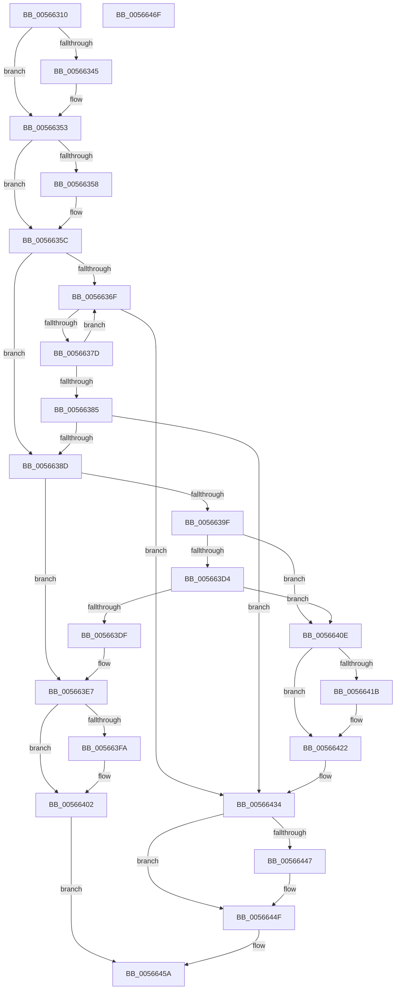

# IommupGetSystemContext

- RVA: `0x00566310`–`0x00566470` (길이 `352` bytes)
- VA: `0x0000000140566310`
- 실행 섹션: `.text`
- PDB 이름 있음: `예`; PDB Function 태그: `아니요`
- unwind 정보 RVA: `0x0005C954`
- 디코드: `96`개 명령, `352/352` bytes 표시
- 미해석 바이트: `0` (있으면 어셈블리에 `.byte`로 보존)

> 이 문서는 커널 이미지의 기계어와 PDB 기호를 분석해 생성했습니다. 4번과 5번은 함수 원형과 자료형을 바이너리 사용 방식에서 추정한 C 해석이며 원본 소스 복구 결과는 아닙니다.

## 1. Dependencies

- 직접 호출 지점: **10**; 고유 호출 대상: **8**
- 직접 호출자로 확인된 함수: **3**
- RIP 상대 이미지 참조: **5**

### Outgoing calls
- `0x00566335` → [KeAbPreAcquire](../21/KeAbPreAcquire_function_00210230.md) (function, `0x00210230`)
- `0x0056634E` → [ExfAcquirePushLockExclusiveEx](../20/ExfAcquirePushLockExclusiveEx_function_0020FC90.md) (function, `0x0020FC90`)
- `0x00566392` → [HalpMmAllocCtxAlloc](../3E/HalpMmAllocCtxAlloc_function_003E10B8.md) (function, `0x003E10B8`)
- `0x005663A8` → [memset](../6C/memset_function_006C6C40.md) (function, `0x006C6C40`)
- `0x005663D6` → [IommupHvCreateSvmPasidSpace](IommupHvCreateSvmPasidSpace_function_0056703C.md) (function, `0x0056703C`)
- `0x005663E2` → [HalpMmAllocCtxFree](../3E/HalpMmAllocCtxFree_function_003E1904.md) (function, `0x003E1904`)
- `0x005663FD` → [ExfTryToWakePushLock](../26/ExfTryToWakePushLock_function_00265DD0.md) (function, `0x00265DD0`)
- `0x00566405` → [KeAbPostRelease](../2E/KeAbPostRelease_function_002E1600.md) (function, `0x002E1600`)
- `0x0056644A` → [ExfTryToWakePushLock](../26/ExfTryToWakePushLock_function_00265DD0.md) (function, `0x00265DD0`)
- `0x00566452` → [KeAbPostRelease](../2E/KeAbPostRelease_function_002E1600.md) (function, `0x002E1600`)

### Direct callers
- [IommuGetLibraryContext](IommuGetLibraryContext_function_00565990.md) at `0x005659BF`
- [IommuGetConfiguration](../../init/C2/IommuGetConfiguration_function_00C24F80.md) at `0x00C24FA2`
- [IommuHvGetConfiguration](../../init/C2/IommuHvGetConfiguration_function_00C24FD0.md) at `0x00C25003`

### Static image references
- `0x00566326` → RVA `0x00F8FB00` (`.data`; read)
- `0x0056635C` → RVA `0x00F8FB10` (`.data`; read)
- `0x005663CB` → RVA `0x00FC1710` (`.data`; read)
- `0x005663EB` → RVA `0x00F8FB00` (`.data`; read/write)
- `0x0056642D` → RVA `0x00F8FB10` (`.data`; write)

## 2. Other-region calls and transfers

- 다른 실행 섹션으로 향하는 call: **0**
- 별도 외부 분기/꼬리 이동을 확인하지 못했습니다.

## 3. Assembly (complete function range)

```asm
00566310  48 89 5C 24 08                  mov qword ptr [rsp + 8], rbx
00566315  48 89 6C 24 10                  mov qword ptr [rsp + 0x10], rbp
0056631A  48 89 74 24 18                  mov qword ptr [rsp + 0x18], rsi
0056631F  57                              push rdi
00566320  48 83 EC 20                     sub rsp, 0x20
00566324  8B F9                           mov edi, ecx
00566326  48 8D 35 D3 97 A2 00            lea rsi, [rip + 0xa297d3]
0056632D  48 8B CE                        mov rcx, rsi
00566330  45 33 C0                        xor r8d, r8d
00566333  33 D2                           xor edx, edx
00566335  E8 F6 9E CA FF                  call 0x140210230
0056633A  F0 48 0F BA 2E 00               lock bts qword ptr [rsi], 0
00566340  48 8B D8                        mov rbx, rax
00566343  73 0E                           jae 0x140566353
00566345  4C 8B C6                        mov r8, rsi
00566348  48 8B D0                        mov rdx, rax
0056634B  48 8B CE                        mov rcx, rsi
0056634E  E8 3D 99 CA FF                  call 0x14020fc90
00566353  48 85 DB                        test rbx, rbx
00566356  74 04                           je 0x14056635c
00566358  C6 43 0A 01                     mov byte ptr [rbx + 0xa], 1
0056635C  48 8B 05 AD 97 A2 00            mov rax, qword ptr [rip + 0xa297ad]
00566363  48 8D 2D A6 97 A2 00            lea rbp, [rip + 0xa297a6]
0056636A  48 3B C5                        cmp rax, rbp
0056636D  74 1E                           je 0x14056638d
0056636F  8B 48 10                        mov ecx, dword ptr [rax + 0x10]
00566372  48 8B D8                        mov rbx, rax
00566375  3B CF                           cmp ecx, edi
00566377  0F 84 B7 00 00 00               je 0x140566434
0056637D  48 8B 00                        mov rax, qword ptr [rax]
00566380  48 3B C5                        cmp rax, rbp
00566383  75 EA                           jne 0x14056636f
00566385  3B CF                           cmp ecx, edi
00566387  0F 84 A7 00 00 00               je 0x140566434
0056638D  BA 40 00 00 00                  mov edx, 0x40
00566392  E8 21 AD E7 FF                  call 0x1403e10b8
00566397  48 8B D8                        mov rbx, rax
0056639A  48 85 C0                        test rax, rax
0056639D  74 48                           je 0x1405663e7
0056639F  33 D2                           xor edx, edx
005663A1  48 8B C8                        mov rcx, rax
005663A4  44 8D 42 40                     lea r8d, [rdx + 0x40]
005663A8  E8 93 08 16 00                  call 0x1406c6c40
005663AD  89 7B 10                        mov dword ptr [rbx + 0x10], edi
005663B0  48 8D 43 20                     lea rax, [rbx + 0x20]
005663B4  48 89 40 08                     mov qword ptr [rax + 8], rax
005663B8  48 89 00                        mov qword ptr [rax], rax
005663BB  48 8D 43 30                     lea rax, [rbx + 0x30]
005663BF  48 89 40 08                     mov qword ptr [rax + 8], rax
005663C3  48 89 00                        mov qword ptr [rax], rax
005663C6  48 83 63 18 00                  and qword ptr [rbx + 0x18], 0
005663CB  80 3D 3E B3 A5 00 00            cmp byte ptr [rip + 0xa5b33e], 0
005663D2  74 3A                           je 0x14056640e
005663D4  8B CF                           mov ecx, edi
005663D6  E8 61 0C 00 00                  call 0x14056703c
005663DB  85 C0                           test eax, eax
005663DD  79 2F                           jns 0x14056640e
005663DF  48 8B D3                        mov rdx, rbx
005663E2  E8 1D B5 E7 FF                  call 0x1403e1904
005663E7  48 83 C8 FF                     or rax, 0xffffffffffffffff
005663EB  F0 48 0F C1 05 0C 97 A2 00      lock xadd qword ptr [rip + 0xa2970c], rax
005663F4  24 06                           and al, 6
005663F6  3C 02                           cmp al, 2
005663F8  75 08                           jne 0x140566402
005663FA  48 8B CE                        mov rcx, rsi
005663FD  E8 CE F9 CF FF                  call 0x140265dd0
00566402  48 8B CE                        mov rcx, rsi
00566405  E8 F6 B1 D7 FF                  call 0x1402e1600
0056640A  33 C0                           xor eax, eax
0056640C  EB 4C                           jmp 0x14056645a
0056640E  48 8B 05 FB 96 A2 00            mov rax, qword ptr [rip + 0xa296fb]
00566415  48 39 68 08                     cmp qword ptr [rax + 8], rbp
00566419  74 07                           je 0x140566422
0056641B  B9 03 00 00 00                  mov ecx, 3
00566420  CD 29                           int 0x29
00566422  48 89 03                        mov qword ptr [rbx], rax
00566425  48 89 6B 08                     mov qword ptr [rbx + 8], rbp
00566429  48 89 58 08                     mov qword ptr [rax + 8], rbx
0056642D  48 89 1D DC 96 A2 00            mov qword ptr [rip + 0xa296dc], rbx
00566434  48 83 C8 FF                     or rax, 0xffffffffffffffff
00566438  F0 48 0F C1 05 BF 96 A2 00      lock xadd qword ptr [rip + 0xa296bf], rax
00566441  24 06                           and al, 6
00566443  3C 02                           cmp al, 2
00566445  75 08                           jne 0x14056644f
00566447  48 8B CE                        mov rcx, rsi
0056644A  E8 81 F9 CF FF                  call 0x140265dd0
0056644F  48 8B CE                        mov rcx, rsi
00566452  E8 A9 B1 D7 FF                  call 0x1402e1600
00566457  48 8B C3                        mov rax, rbx
0056645A  48 8B 5C 24 30                  mov rbx, qword ptr [rsp + 0x30]
0056645F  48 8B 6C 24 38                  mov rbp, qword ptr [rsp + 0x38]
00566464  48 8B 74 24 40                  mov rsi, qword ptr [rsp + 0x40]
00566469  48 83 C4 20                     add rsp, 0x20
0056646D  5F                              pop rdi
0056646E  C3                              ret
0056646F  CC                              int3
```

## 4. C-style interpretation (structured pseudocode)

```c
__int64 __fastcall IommupGetSystemContext(int a1, int a2, int a3)
{
    __int64 result;
    __int64 v_rsp;
    unsigned __int64 v_stack_p10;
    unsigned __int64 v_stack_p18;
    unsigned __int64 v_stack_p8;

    v_stack_p8 = v_rbx;
    v_stack_p10 = v_rbp;
    v_stack_p18 = v_rsi;
    v_rsp = (v_rsp) - (32);
    a3 = 0;
    a2 = 0;
    result = KeAbPreAcquire(v_rip + 10655699, a2, a3, a4);
    if (!(condition_is_above_or_equal)) {
        a3 = v_rip + 10655699;
        a2 = result;
        a1 = v_rip + 10655699;
        result = ExfAcquirePushLockExclusiveEx(a1, a2, a3, a4);
    }
    if (result != 0) {
        *(unsigned __int8 *)(result + 10) = 1;
    }
    if ((*(unsigned __int64 *)(v_rip + 10655661)) == (v_rip + 10655654)) goto loc_0056638D;
loc_0056636F:
    if (((unsigned int)((unsigned int)(*(unsigned int *)(*(unsigned __int64 *)(v_rip + 10655661) + 16)))) == ((unsigned int)((unsigned int)(a1)))) goto loc_00566434;
    if ((*(unsigned __int64 *)(*(unsigned __int64 *)(v_rip + 10655661))) != (v_rip + 10655654)) goto loc_0056636F;
    if (((unsigned int)((unsigned int)(*(unsigned int *)(*(unsigned __int64 *)(v_rip + 10655661) + 16)))) == ((unsigned int)((unsigned int)(a1)))) goto loc_00566434;
loc_0056638D:
    result = HalpMmAllocCtxAlloc((unsigned int)(*(unsigned int *)(*(unsigned __int64 *)(v_rip + 10655661) + 16)), 64, a3, a4);
    if (result == 0) goto loc_005663E7;
    a2 = 0;
    result = memset(result, a2, a2 + 64, a4);
    *(unsigned int *)(result + 16) = (unsigned int)((unsigned int)(a1));
    *(unsigned __int64 *)(result + 32 + 8) = result + 32;
    *(unsigned __int64 *)(result + 32) = result + 32;
    *(unsigned __int64 *)(result + 48 + 8) = result + 48;
    *(unsigned __int64 *)(result + 48) = result + 48;
    if ((*(unsigned __int8 *)(v_rip + 10859326)) == 0) goto loc_0056640E;
    result = IommupHvCreateSvmPasidSpace((unsigned int)((unsigned int)((unsigned int)(a1))), a2, a2 + 64, a4);
    if (!sign_flag) goto loc_0056640E;
    result = HalpMmAllocCtxFree((unsigned int)((unsigned int)((unsigned int)(a1))), result, a2 + 64, a4);
loc_005663E7:
    result = (result) | (-1);
    result = (unsigned __int8)((result) & (6));
    if (((unsigned __int8)(result)) == 2) {
        a1 = v_rip + 10655699;
        result = ExfTryToWakePushLock(a1, result, a2 + 64, a4);
    }
    result = KeAbPostRelease(v_rip + 10655699, result, a2 + 64, a4);
    result = 0;
    goto loc_0056645A;
loc_0056640E:
    if ((*(unsigned __int64 *)(*(unsigned __int64 *)(v_rip + 10655483) + 8)) != (v_rip + 10655654)) {
        a1 = 3;
    }
    *(unsigned __int64 *)(result) = *(unsigned __int64 *)(v_rip + 10655483);
    *(unsigned __int64 *)(result + 8) = v_rip + 10655654;
    *(unsigned __int64 *)(*(unsigned __int64 *)(v_rip + 10655483) + 8) = 0;
    *(unsigned __int64 *)(v_rip + 10655452) = 0;
loc_00566434:
    result = (*(unsigned __int64 *)(v_rip + 10655483)) | (-1);
    result = (unsigned __int8)((result) & (6));
    if (((unsigned __int8)(result)) == 2) {
        a1 = v_rip + 10655699;
        result = ExfTryToWakePushLock(a1, result, a2 + 64, a4);
    }
    result = KeAbPostRelease(v_rip + 10655699, result, a2 + 64, a4);
loc_0056645A:
    v_rsp = (v_rsp) + (32);
    return result;
}
```

## 5. (Beta) C Style

```c
int64_t IommupGetSystemContext(int32_t Arg1, int32_t Arg2, int32_t Arg3)
{
    int64_t result;
    int64_t local_rsp;
    uint64_t v_stack_p10;
    uint64_t v_stack_p18;
    uint64_t v_stack_p8;

    v_stack_p8 = local_rbx;
    v_stack_p10 = local_rbp;
    v_stack_p18 = local_rsi;
    local_rsp = (local_rsp) - (32);
    Arg3 = 0;
    Arg2 = 0;
    result = KeAbPreAcquire(v_rip + 10655699, Arg2, Arg3, a4);
    if (!(condition_is_above_or_equal)) {
        Arg3 = v_rip + 10655699;
        Arg2 = result;
        Arg1 = v_rip + 10655699;
        result = ExfAcquirePushLockExclusiveEx(Arg1, Arg2, Arg3, a4);
    }
    if (result != 0) {
        *(uint8_t *)(result + 0xA) = 1;
    }
    if ((*(uint64_t *)(v_rip + 0xA297AD)) == (v_rip + 10655654)) goto loc_0056638D;
loc_0056636F:
    if (((uint32_t)((uint32_t)(*(uint32_t *)(*(uint64_t *)(v_rip + 0xA297AD) + 0x10)))) == ((uint32_t)((uint32_t)(Arg1)))) goto loc_00566434;
    if ((*(uint64_t *)(*(uint64_t *)(v_rip + 0xA297AD))) != (v_rip + 10655654)) goto loc_0056636F;
    if (((uint32_t)((uint32_t)(*(uint32_t *)(*(uint64_t *)(v_rip + 0xA297AD) + 0x10)))) == ((uint32_t)((uint32_t)(Arg1)))) goto loc_00566434;
loc_0056638D:
    result = HalpMmAllocCtxAlloc((uint32_t)(*(uint32_t *)(*(uint64_t *)(v_rip + 0xA297AD) + 0x10)), 64, Arg3, a4);
    if (result == 0) goto loc_005663E7;
    Arg2 = 0;
    result = memset(result, Arg2, Arg2 + 64, a4);
    *(uint32_t *)(result + 0x10) = (uint32_t)((uint32_t)(Arg1));
    *(uint64_t *)(result + 0x20 + 0x8) = result + 32;
    *(uint64_t *)(result + 0x20) = result + 32;
    *(uint64_t *)(result + 0x30 + 0x8) = result + 48;
    *(uint64_t *)(result + 0x30) = result + 48;
    if ((*(uint8_t *)(v_rip + 0xA5B33E)) == 0) goto loc_0056640E;
    result = IommupHvCreateSvmPasidSpace((uint32_t)((uint32_t)((uint32_t)(Arg1))), Arg2, Arg2 + 64, a4);
    if (!sign_flag) goto loc_0056640E;
    result = HalpMmAllocCtxFree((uint32_t)((uint32_t)((uint32_t)(Arg1))), result, Arg2 + 64, a4);
loc_005663E7:
    result = (result) | (-1);
    result = (uint8_t)((result) & (6));
    if (((uint8_t)(result)) == 2) {
        Arg1 = v_rip + 10655699;
        result = ExfTryToWakePushLock(Arg1, result, Arg2 + 64, a4);
    }
    result = KeAbPostRelease(v_rip + 10655699, result, Arg2 + 64, a4);
    result = 0;
    goto loc_0056645A;
loc_0056640E:
    if ((*(uint64_t *)(*(uint64_t *)(v_rip + 0xA296FB) + 0x8)) != (v_rip + 10655654)) {
        Arg1 = 3;
    }
    *(uint64_t *)(result) = *(uint64_t *)(v_rip + 0xA296FB);
    *(uint64_t *)(result + 0x8) = v_rip + 10655654;
    *(uint64_t *)(*(uint64_t *)(v_rip + 0xA296FB) + 0x8) = 0;
    *(uint64_t *)(v_rip + 0xA296DC) = 0;
loc_00566434:
    result = (*(uint64_t *)(v_rip + 0xA296FB)) | (-1);
    result = (uint8_t)((result) & (6));
    if (((uint8_t)(result)) == 2) {
        Arg1 = v_rip + 10655699;
        result = ExfTryToWakePushLock(Arg1, result, Arg2 + 64, a4);
    }
    result = KeAbPostRelease(v_rip + 10655699, result, Arg2 + 64, a4);
loc_0056645A:
    local_rsp = (local_rsp) + (32);
    return result;
}
```

## 6. Execution-region graph

[열기: 2D/3D 그래프와 함수 탐색 컨트롤 패널](../../../control-panel.html?section=text&rva=0x00566310&view=graph)

- 2D 그래프는 위에서 아래로 흐르고, 3D 그래프는 빈 공간을 드래그해 회전합니다. Shift+드래그는 이동, 휠은 확대·축소, 함수 노드 선택은 대상 보고서 이동입니다.

### Static fallback


