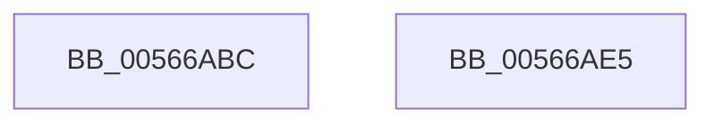

# IommupHvAttachDeviceDomain

- RVA: `0x00566ABC`–`0x00566AE6` (길이 `42` bytes)
- VA: `0x0000000140566ABC`
- 실행 섹션: `.text`
- PDB 이름 있음: `예`; PDB Function 태그: `아니요`
- unwind 정보 RVA: `0x0005C788`
- 디코드: `10`개 명령, `42/42` bytes 표시
- 미해석 바이트: `0` (있으면 어셈블리에 `.byte`로 보존)

> 이 문서는 커널 이미지의 기계어와 PDB 기호를 분석해 생성했습니다. 4번과 5번은 함수 원형과 자료형을 바이너리 사용 방식에서 추정한 C 해석이며 원본 소스 복구 결과는 아닙니다.

## 1. Dependencies

- 직접 호출 지점: **1**; 고유 호출 대상: **1**
- 직접 호출자로 확인된 함수: **2**
- RIP 상대 이미지 참조: **1**

### Outgoing calls
- `0x00566ADB` → [guard_dispatch_icall](../6B/guard_dispatch_icall_function_006BAAD0.md) (function, `0x006BAAD0`)

### Direct callers
- [HalpIommuUnblockDevice](../4C/HalpIommuUnblockDevice_function_004C6250.md) at `0x004C63A7`
- [HalpIommuJoinDmaDomain](../55/HalpIommuJoinDmaDomain_function_005554E8.md) at `0x0055553A`

### Static image references
- `0x00566AC6` → RVA `0x00FC1E10` (`.data`; read)

## 2. Other-region calls and transfers

- 다른 실행 섹션으로 향하는 call: **0**
- 별도 외부 분기/꼬리 이동을 확인하지 못했습니다.

## 3. Assembly (complete function range)

```asm
00566ABC  48 83 EC 28                     sub rsp, 0x28
00566AC0  48 83 64 24 48 00               and qword ptr [rsp + 0x48], 0
00566AC6  48 8B 05 43 B3 A5 00            mov rax, qword ptr [rip + 0xa5b343]
00566ACD  89 54 24 48                     mov dword ptr [rsp + 0x48], edx
00566AD1  48 8D 54 24 48                  lea rdx, [rsp + 0x48]
00566AD6  44 88 44 24 4C                  mov byte ptr [rsp + 0x4c], r8b
00566ADB  E8 F0 3F 15 00                  call 0x1406baad0
00566AE0  48 83 C4 28                     add rsp, 0x28
00566AE4  C3                              ret
00566AE5  CC                              int3
```

## 4. C-style interpretation (structured pseudocode)

```c
__int64 __fastcall IommupHvAttachDeviceDomain(__int64 a1, int a2, unsigned __int8 a3)
{
    __int64 result;
    __int64 v_rsp;
    unsigned __int64 v_stack_p20;
    unsigned __int8 v_stack_p24;

    v_rsp = (v_rsp) - (40);
    v_stack_p20 = a2;
    v_stack_p24 = a3;
    result = guard_dispatch_icall(a1, v_stack_p20, a3, a4);
    v_rsp = (v_rsp) + (40);
    return result;
}
```

## 5. (Beta) C Style

```c
int64_t IommupHvAttachDeviceDomain(int64_t Arg1, int32_t Arg2, uint8_t Arg3)
{
    int64_t result;
    int64_t local_rsp;
    uint64_t v_stack_p20;
    uint8_t v_stack_p24;

    local_rsp = (local_rsp) - (40);
    v_stack_p20 = Arg2;
    v_stack_p24 = Arg3;
    result = guard_dispatch_icall(Arg1, v_stack_p20, Arg3, a4);
    local_rsp = (local_rsp) + (40);
    return result;
}
```

## 6. Execution-region graph

[열기: 2D/3D 그래프와 함수 탐색 컨트롤 패널](../../../control-panel.html?section=text&rva=0x00566ABC&view=graph)

- 2D 그래프는 위에서 아래로 흐르고, 3D 그래프는 빈 공간을 드래그해 회전합니다. Shift+드래그는 이동, 휠은 확대·축소, 함수 노드 선택은 대상 보고서 이동입니다.

### Static fallback


