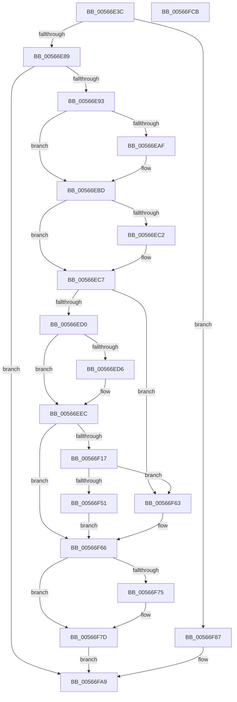

# IommupHvAttachPasidDeviceDomain

- RVA: `0x00566E3C`–`0x00566FCC` (길이 `400` bytes)
- VA: `0x0000000140566E3C`
- 실행 섹션: `.text`
- PDB 이름 있음: `예`; PDB Function 태그: `아니요`
- unwind 정보 RVA: `0x000C4E70`
- 디코드: `114`개 명령, `400/400` bytes 표시
- 미해석 바이트: `0` (있으면 어셈블리에 `.byte`로 보존)

> 이 문서는 커널 이미지의 기계어와 PDB 기호를 분석해 생성했습니다. 4번과 5번은 함수 원형과 자료형을 바이너리 사용 방식에서 추정한 C 해석이며 원본 소스 복구 결과는 아닙니다.

## 1. Dependencies

- 직접 호출 지점: **9**; 고유 호출 대상: **6**
- 직접 호출자로 확인된 함수: **1**
- RIP 상대 이미지 참조: **6**

### Outgoing calls
- `0x00566E9F` → [KeAbPreAcquire](../21/KeAbPreAcquire_function_00210230.md) (function, `0x00210230`)
- `0x00566EB8` → [ExfAcquirePushLockExclusiveEx](../20/ExfAcquirePushLockExclusiveEx_function_0020FC90.md) (function, `0x0020FC90`)
- `0x00566F0C` → [guard_dispatch_icall](../6B/guard_dispatch_icall_function_006BAAD0.md) (function, `0x006BAAD0`)
- `0x00566F46` → [guard_dispatch_icall](../6B/guard_dispatch_icall_function_006BAAD0.md) (function, `0x006BAAD0`)
- `0x00566F5C` → [guard_dispatch_icall](../6B/guard_dispatch_icall_function_006BAAD0.md) (function, `0x006BAAD0`)
- `0x00566F78` → [ExfTryToWakePushLock](../26/ExfTryToWakePushLock_function_00265DD0.md) (function, `0x00265DD0`)
- `0x00566F80` → [KeAbPostRelease](../2E/KeAbPostRelease_function_002E1600.md) (function, `0x002E1600`)
- `0x00566FA2` → [guard_dispatch_icall](../6B/guard_dispatch_icall_function_006BAAD0.md) (function, `0x006BAAD0`)
- `0x00566FB2` → [_security_check_cookie](../6A/_security_check_cookie_function_006AC640.md) (function, `0x006AC640`)

### Direct callers
- [IommupDomainAttachPasidDevice](../54/IommupDomainAttachPasidDevice_function_0054F984.md) at `0x0054FB70`
- [IommupDomainAttachPasidDevice](../54/IommupDomainAttachPasidDevice_function_0054F984.md) at `0x0054FBFD`

### Static image references
- `0x00566E4F` → RVA `0x00E0A740` (`.data`; read)
- `0x00566EDB` → RVA `0x00E10408` (`.data`; read/write)
- `0x00566F05` → RVA `0x00FC1E08` (`.data`; read)
- `0x00566F24` → RVA `0x00FC1E90` (`.data`; read)
- `0x00566F51` → RVA `0x00FC1E20` (`.data`; read)
- `0x00566F9B` → RVA `0x00FC1E10` (`.data`; read)

## 2. Other-region calls and transfers

- 다른 실행 섹션으로 향하는 call: **0**
- 별도 외부 분기/꼬리 이동을 확인하지 못했습니다.

## 3. Assembly (complete function range)

```asm
00566E3C  48 89 5C 24 20                  mov qword ptr [rsp + 0x20], rbx
00566E41  55                              push rbp
00566E42  56                              push rsi
00566E43  57                              push rdi
00566E44  41 56                           push r14
00566E46  41 57                           push r15
00566E48  48 8B EC                        mov rbp, rsp
00566E4B  48 83 EC 70                     sub rsp, 0x70
00566E4F  48 8B 05 EA 38 8A 00            mov rax, qword ptr [rip + 0x8a38ea]
00566E56  48 33 C4                        xor rax, rsp
00566E59  48 89 45 F0                     mov qword ptr [rbp - 0x10], rax
00566E5D  33 C0                           xor eax, eax
00566E5F  0F 57 C0                        xorps xmm0, xmm0
00566E62  48 21 45 B0                     and qword ptr [rbp - 0x50], rax
00566E66  33 F6                           xor esi, esi
00566E68  48 89 45 E0                     mov qword ptr [rbp - 0x20], rax
00566E6C  4D 8B F8                        mov r15, r8
00566E6F  89 45 E8                        mov dword ptr [rbp - 0x18], eax
00566E72  48 8B DA                        mov rbx, rdx
00566E75  89 45 D8                        mov dword ptr [rbp - 0x28], eax
00566E78  0F 11 45 B8                     movups xmmword ptr [rbp - 0x48], xmm0
00566E7C  0F 11 45 C8                     movups xmmword ptr [rbp - 0x38], xmm0
00566E80  45 85 C9                        test r9d, r9d
00566E83  0F 85 FE 00 00 00               jne 0x140566f87
00566E89  83 7A 08 01                     cmp dword ptr [rdx + 8], 1
00566E8D  0F 84 16 01 00 00               je 0x140566fa9
00566E93  48 8D 7A 68                     lea rdi, [rdx + 0x68]
00566E97  45 33 C0                        xor r8d, r8d
00566E9A  48 8B CF                        mov rcx, rdi
00566E9D  33 D2                           xor edx, edx
00566E9F  E8 8C 93 CA FF                  call 0x140210230
00566EA4  F0 48 0F BA 2F 00               lock bts qword ptr [rdi], 0
00566EAA  4C 8B F0                        mov r14, rax
00566EAD  73 0E                           jae 0x140566ebd
00566EAF  4C 8B C7                        mov r8, rdi
00566EB2  48 8B D0                        mov rdx, rax
00566EB5  48 8B CF                        mov rcx, rdi
00566EB8  E8 D3 8D CA FF                  call 0x14020fc90
00566EBD  4D 85 F6                        test r14, r14
00566EC0  74 05                           je 0x140566ec7
00566EC2  41 C6 46 0A 01                  mov byte ptr [r14 + 0xa], 1
00566EC7  39 73 5C                        cmp dword ptr [rbx + 0x5c], esi
00566ECA  0F 85 93 00 00 00               jne 0x140566f63
00566ED0  40 38 73 60                     cmp byte ptr [rbx + 0x60], sil
00566ED4  75 16                           jne 0x140566eec
00566ED6  B8 01 00 00 00                  mov eax, 1
00566EDB  F0 0F C1 05 25 95 8A 00         lock xadd dword ptr [rip + 0x8a9525], eax
00566EE3  FF C0                           inc eax
00566EE5  C6 43 60 01                     mov byte ptr [rbx + 0x60], 1
00566EE9  89 43 30                        mov dword ptr [rbx + 0x30], eax
00566EEC  8B 43 30                        mov eax, dword ptr [rbx + 0x30]
00566EEF  48 8D 4D E0                     lea rcx, [rbp - 0x20]
00566EF3  21 75 E8                        and dword ptr [rbp - 0x18], esi
00566EF6  89 45 B0                        mov dword ptr [rbp - 0x50], eax
00566EF9  C6 45 B4 01                     mov byte ptr [rbp - 0x4c], 1
00566EFD  48 8B 45 B0                     mov rax, qword ptr [rbp - 0x50]
00566F01  48 89 45 E0                     mov qword ptr [rbp - 0x20], rax
00566F05  48 8B 05 FC AE A5 00            mov rax, qword ptr [rip + 0xa5aefc]
00566F0C  E8 BF 3B 15 00                  call 0x1406baad0
00566F11  8B F0                           mov esi, eax
00566F13  85 C0                           test eax, eax
00566F15  78 4F                           js 0x140566f66
00566F17  33 C0                           xor eax, eax
00566F19  48 8D 55 B8                     lea rdx, [rbp - 0x48]
00566F1D  0F 57 C0                        xorps xmm0, xmm0
00566F20  48 89 45 D8                     mov qword ptr [rbp - 0x28], rax
00566F24  48 8B 05 65 AF A5 00            mov rax, qword ptr [rip + 0xa5af65]
00566F2B  48 8D 4D B0                     lea rcx, [rbp - 0x50]
00566F2F  0F 11 45 B8                     movups xmmword ptr [rbp - 0x48], xmm0
00566F33  C7 45 B8 01 00 00 00            mov dword ptr [rbp - 0x48], 1
00566F3A  0F 11 45 C8                     movups xmmword ptr [rbp - 0x38], xmm0
00566F3E  C6 45 C8 01                     mov byte ptr [rbp - 0x38], 1
00566F42  4C 89 7D C0                     mov qword ptr [rbp - 0x40], r15
00566F46  E8 85 3B 15 00                  call 0x1406baad0
00566F4B  8B F0                           mov esi, eax
00566F4D  85 C0                           test eax, eax
00566F4F  79 12                           jns 0x140566f63
00566F51  48 8B 05 C8 AE A5 00            mov rax, qword ptr [rip + 0xa5aec8]
00566F58  48 8D 4D B0                     lea rcx, [rbp - 0x50]
00566F5C  E8 6F 3B 15 00                  call 0x1406baad0
00566F61  EB 03                           jmp 0x140566f66
00566F63  FF 43 5C                        inc dword ptr [rbx + 0x5c]
00566F66  48 83 C8 FF                     or rax, 0xffffffffffffffff
00566F6A  F0 48 0F C1 07                  lock xadd qword ptr [rdi], rax
00566F6F  24 06                           and al, 6
00566F71  3C 02                           cmp al, 2
00566F73  75 08                           jne 0x140566f7d
00566F75  48 8B CF                        mov rcx, rdi
00566F78  E8 53 EE CF FF                  call 0x140265dd0
00566F7D  48 8B CF                        mov rcx, rdi
00566F80  E8 7B A6 D7 FF                  call 0x1402e1600
00566F85  EB 22                           jmp 0x140566fa9
00566F87  8B 42 30                        mov eax, dword ptr [rdx + 0x30]
00566F8A  48 8B 49 20                     mov rcx, qword ptr [rcx + 0x20]
00566F8E  89 45 B0                        mov dword ptr [rbp - 0x50], eax
00566F91  8A 42 34                        mov al, byte ptr [rdx + 0x34]
00566F94  48 8D 55 B0                     lea rdx, [rbp - 0x50]
00566F98  88 45 B4                        mov byte ptr [rbp - 0x4c], al
00566F9B  48 8B 05 6E AE A5 00            mov rax, qword ptr [rip + 0xa5ae6e]
00566FA2  E8 29 3B 15 00                  call 0x1406baad0
00566FA7  8B F0                           mov esi, eax
00566FA9  8B C6                           mov eax, esi
00566FAB  48 8B 4D F0                     mov rcx, qword ptr [rbp - 0x10]
00566FAF  48 33 CC                        xor rcx, rsp
00566FB2  E8 89 56 14 00                  call 0x1406ac640
00566FB7  48 8B 9C 24 B8 00 00 00         mov rbx, qword ptr [rsp + 0xb8]
00566FBF  48 83 C4 70                     add rsp, 0x70
00566FC3  41 5F                           pop r15
00566FC5  41 5E                           pop r14
00566FC7  5F                              pop rdi
00566FC8  5E                              pop rsi
00566FC9  5D                              pop rbp
00566FCA  C3                              ret
00566FCB  CC                              int3
```

## 4. C-style interpretation (structured pseudocode)

```c
__int64 __fastcall IommupHvAttachPasidDeviceDomain(__int64 a1, __int64 a2, __int64 a3, int a4)
{
    __int64 result;
    __int64 v_rsi;
    __int64 v_rsp;
    unsigned __int64 v_stack_m38;
    unsigned int v_stack_m40;
    unsigned __int64 v_stack_m48;
    unsigned int v_stack_m50;
    unsigned __int64 v_stack_m60;
    unsigned __int64 v_stack_m68;
    unsigned __int64 v_stack_m70;
    unsigned __int8 v_stack_m74;
    unsigned __int64 v_stack_m78;
    unsigned __int64 v_stack_p20;

    v_stack_p20 = v_rbx;
    v_rsp = (v_rsp) - (112);
    result = (*(unsigned __int64 *)(v_rip + 9058538)) ^ (v_rsp);
    v_stack_m38 = result;
    result = 0;
    v_rsi = 0;
    v_stack_m48 = 0;
    v_stack_m40 = 0;
    v_stack_m50 = 0;
    v_stack_m70 = v_xmm0;
    v_stack_m60 = v_xmm0;
    if (a4 != 0) goto loc_00566F87;
    if ((*(unsigned int *)(a2 + 8)) == 1) goto loc_00566FA9;
    a3 = 0;
    a2 = 0;
    result = KeAbPreAcquire(a2 + 104, a2, a3, a4);
    if (!(condition_is_above_or_equal)) {
        a3 = a2 + 104;
        a2 = result;
        a1 = a2 + 104;
        result = ExfAcquirePushLockExclusiveEx(a1, a2, a3, a4);
    }
    if (result != 0) {
        *(unsigned __int8 *)(result + 10) = 1;
    }
    if ((*(unsigned int *)(a2 + 92)) != 0) goto loc_00566F63;
    if ((*(unsigned __int8 *)(a2 + 96)) == 0) {
        result = 1;
        result = (unsigned int)((result) + 1);
        *(unsigned __int8 *)(a2 + 96) = 1;
        *(unsigned int *)(a2 + 48) = (unsigned int)(result);
    }
    v_stack_m78 = (unsigned int)((unsigned int)(*(unsigned int *)(a2 + 48)));
    v_stack_m74 = 1;
    v_stack_m48 = v_stack_m78;
    result = guard_dispatch_icall(v_stack_m48, a2, a3, a4);
    if (sign_flag) goto loc_00566F66;
    result = 0;
    v_stack_m50 = 0;
    v_stack_m70 = v_xmm0;
    v_stack_m70 = 1;
    v_stack_m60 = v_xmm0;
    v_stack_m60 = 1;
    v_stack_m68 = a3;
    result = guard_dispatch_icall(v_stack_m78, v_stack_m70, a3, a4);
    if (!sign_flag) goto loc_00566F63;
    result = guard_dispatch_icall(v_stack_m78, v_stack_m70, a3, a4);
    goto loc_00566F66;
loc_00566F63:
loc_00566F66:
    result = (result) | (-1);
    result = (unsigned __int8)((result) & (6));
    if (((unsigned __int8)(result)) == 2) {
        a1 = a2 + 104;
        result = ExfTryToWakePushLock(a1, v_stack_m70, a3, a4);
    }
    result = KeAbPostRelease(a2 + 104, v_stack_m70, a3, a4);
    goto loc_00566FA9;
loc_00566F87:
    v_stack_m78 = (unsigned int)((unsigned int)(*(unsigned int *)(v_stack_m70 + 48)));
    v_stack_m74 = (unsigned __int8)(*(unsigned __int8 *)(v_stack_m70 + 52));
    result = guard_dispatch_icall(*(unsigned __int64 *)(a2 + 104 + 32), v_stack_m78, a3, a4);
loc_00566FA9:
    a1 = (v_stack_m38) ^ (v_rsp);
    result = _security_check_cookie(a1, v_stack_m78, a3, a4);
    v_rsp = (v_rsp) + (112);
    return result;
}
```

## 5. (Beta) C Style

```c
int64_t IommupHvAttachPasidDeviceDomain(void *Arg1, void *Arg2, int64_t Arg3, int32_t Arg4)
{
    uint8_t *arg1 = (uint8_t *)Arg1;
    uint8_t *arg2 = (uint8_t *)Arg2;

    int64_t result;
    int64_t local_rsi;
    int64_t local_rsp;
    uint64_t v_stack_m38;
    uint32_t v_stack_m40;
    uint64_t v_stack_m48;
    uint32_t v_stack_m50;
    uint64_t v_stack_m60;
    uint64_t v_stack_m68;
    uint64_t v_stack_m70;
    uint8_t v_stack_m74;
    uint64_t v_stack_m78;
    uint64_t v_stack_p20;

    v_stack_p20 = local_rbx;
    local_rsp = (local_rsp) - (112);
    result = (*(uint64_t *)(v_rip + 0x8A38EA)) ^ (local_rsp);
    v_stack_m38 = result;
    result = 0;
    local_rsi = 0;
    v_stack_m48 = 0;
    v_stack_m40 = 0;
    v_stack_m50 = 0;
    v_stack_m70 = v_xmm0;
    v_stack_m60 = v_xmm0;
    if (Arg4 != 0) goto loc_00566F87;
    if ((*(uint32_t *)(arg2 + 0x8)) == 1) goto loc_00566FA9;
    Arg3 = 0;
    Arg2 = 0;
    result = KeAbPreAcquire(Arg2 + 104, Arg2, Arg3, Arg4);
    if (!(condition_is_above_or_equal)) {
        Arg3 = Arg2 + 104;
        Arg2 = result;
        Arg1 = Arg2 + 104;
        result = ExfAcquirePushLockExclusiveEx(Arg1, Arg2, Arg3, Arg4);
    }
    if (result != 0) {
        *(uint8_t *)(result + 0xA) = 1;
    }
    if ((*(uint32_t *)(arg2 + 0x5C)) != 0) goto loc_00566F63;
    if ((*(uint8_t *)(arg2 + 0x60)) == 0) {
        result = 1;
        result = (uint32_t)((result) + 1);
        *(uint8_t *)(arg2 + 0x60) = 1;
        *(uint32_t *)(arg2 + 0x30) = (uint32_t)(result);
    }
    v_stack_m78 = (uint32_t)((uint32_t)(*(uint32_t *)(arg2 + 0x30)));
    v_stack_m74 = 1;
    v_stack_m48 = v_stack_m78;
    result = guard_dispatch_icall(v_stack_m48, Arg2, Arg3, Arg4);
    if (sign_flag) goto loc_00566F66;
    result = 0;
    v_stack_m50 = 0;
    v_stack_m70 = v_xmm0;
    v_stack_m70 = 1;
    v_stack_m60 = v_xmm0;
    v_stack_m60 = 1;
    v_stack_m68 = Arg3;
    result = guard_dispatch_icall(v_stack_m78, v_stack_m70, Arg3, Arg4);
    if (!sign_flag) goto loc_00566F63;
    result = guard_dispatch_icall(v_stack_m78, v_stack_m70, Arg3, Arg4);
    goto loc_00566F66;
loc_00566F63:
loc_00566F66:
    result = (result) | (-1);
    result = (uint8_t)((result) & (6));
    if (((uint8_t)(result)) == 2) {
        Arg1 = Arg2 + 104;
        result = ExfTryToWakePushLock(Arg1, v_stack_m70, Arg3, Arg4);
    }
    result = KeAbPostRelease(Arg2 + 104, v_stack_m70, Arg3, Arg4);
    goto loc_00566FA9;
loc_00566F87:
    v_stack_m78 = (uint32_t)((uint32_t)(*(uint32_t *)(v_stack_m70 + 0x30)));
    v_stack_m74 = (uint8_t)(*(uint8_t *)(v_stack_m70 + 0x34));
    result = guard_dispatch_icall(*(uint64_t *)(arg2 + 0x68 + 0x20), v_stack_m78, Arg3, Arg4);
loc_00566FA9:
    Arg1 = (v_stack_m38) ^ (local_rsp);
    result = _security_check_cookie(Arg1, v_stack_m78, Arg3, Arg4);
    local_rsp = (local_rsp) + (112);
    return result;
}
```

### 관측된 메모리 오프셋

구조체 형식이 확인되지 않은 접근은 인자 기준의 오프셋으로만 기록했습니다.

| 기준 인자 | 오프셋 표현 | 폭 (bit) | 접근 |
|---|---:|---:|---|
| `Arg1` | `+ 0x20` | `64` | `R` |
| `Arg2` | `+ 0x0` | `64` | `R/W` |
| `Arg2` | `+ 0x8` | `32` | `R` |
| `Arg2` | `+ 0x30` | `32` | `R` |
| `Arg2` | `+ 0x30` | `32` | `W` |
| `Arg2` | `+ 0x34` | `8` | `R` |
| `Arg2` | `+ 0x5C` | `32` | `R` |
| `Arg2` | `+ 0x5C` | `32` | `R/W` |
| `Arg2` | `+ 0x60` | `8` | `R` |
| `Arg2` | `+ 0x60` | `8` | `W` |
| `Arg2` | `+ 0x68` | `64` | `R` |

## 6. Execution-region graph

[열기: 2D/3D 그래프와 함수 탐색 컨트롤 패널](../../../control-panel.html?section=text&rva=0x00566E3C&view=graph)

- 2D 그래프는 위에서 아래로 흐르고, 3D 그래프는 빈 공간을 드래그해 회전합니다. Shift+드래그는 이동, 휠은 확대·축소, 함수 노드 선택은 대상 보고서 이동입니다.

### Static fallback


