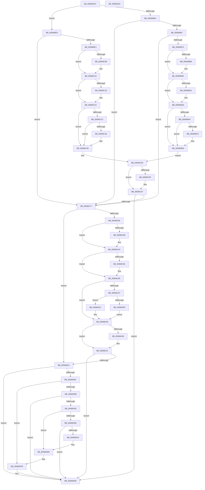

# IommupHvAttachPasidDevice

- RVA: `0x00566AEC`–`0x00566E34` (길이 `840` bytes)
- VA: `0x0000000140566AEC`
- 실행 섹션: `.text`
- PDB 이름 있음: `예`; PDB Function 태그: `아니요`
- unwind 정보 RVA: `0x000C4E4C`
- 디코드: `214`개 명령, `840/840` bytes 표시
- 미해석 바이트: `0` (있으면 어셈블리에 `.byte`로 보존)

> 이 문서는 커널 이미지의 기계어와 PDB 기호를 분석해 생성했습니다. 4번과 5번은 함수 원형과 자료형을 바이너리 사용 방식에서 추정한 C 해석이며 원본 소스 복구 결과는 아닙니다.

## 1. Dependencies

- 직접 호출 지점: **24**; 고유 호출 대상: **7**
- 직접 호출자로 확인된 함수: **1**
- RIP 상대 이미지 참조: **19**

### Outgoing calls
- `0x00566B42` → [Feature_Test57481295__private_IsEnabledDeviceUsageNoInline](../4F/Feature_Test57481295__private_IsEnabledDeviceUsageNoInline_function_004F7B90.md) (function, `0x004F7B90`)
- `0x00566B7D` → [KeAbPreAcquire](../21/KeAbPreAcquire_function_00210230.md) (function, `0x00210230`)
- `0x00566B97` → [ExfAcquirePushLockExclusiveEx](../20/ExfAcquirePushLockExclusiveEx_function_0020FC90.md) (function, `0x0020FC90`)
- `0x00566BBE` → [guard_dispatch_icall](../6B/guard_dispatch_icall_function_006BAAD0.md) (function, `0x006BAAD0`)
- `0x00566BFA` → [KeAbPreAcquire](../21/KeAbPreAcquire_function_00210230.md) (function, `0x00210230`)
- `0x00566C14` → [ExfAcquirePushLockExclusiveEx](../20/ExfAcquirePushLockExclusiveEx_function_0020FC90.md) (function, `0x0020FC90`)
- `0x00566C3B` → [guard_dispatch_icall](../6B/guard_dispatch_icall_function_006BAAD0.md) (function, `0x006BAAD0`)
- `0x00566C62` → [ExfTryToWakePushLock](../26/ExfTryToWakePushLock_function_00265DD0.md) (function, `0x00265DD0`)
- `0x00566C6A` → [KeAbPostRelease](../2E/KeAbPostRelease_function_002E1600.md) (function, `0x002E1600`)
- `0x00566C8D` → [KeAbPreAcquire](../21/KeAbPreAcquire_function_00210230.md) (function, `0x00210230`)
- `0x00566CA7` → [ExfAcquirePushLockExclusiveEx](../20/ExfAcquirePushLockExclusiveEx_function_0020FC90.md) (function, `0x0020FC90`)
- `0x00566CCC` → [guard_dispatch_icall](../6B/guard_dispatch_icall_function_006BAAD0.md) (function, `0x006BAAD0`)
- `0x00566D04` → [guard_dispatch_icall](../6B/guard_dispatch_icall_function_006BAAD0.md) (function, `0x006BAAD0`)
- `0x00566D1A` → [guard_dispatch_icall](../6B/guard_dispatch_icall_function_006BAAD0.md) (function, `0x006BAAD0`)
- `0x00566D3C` → [ExfTryToWakePushLock](../26/ExfTryToWakePushLock_function_00265DD0.md) (function, `0x00265DD0`)
- `0x00566D44` → [KeAbPostRelease](../2E/KeAbPostRelease_function_002E1600.md) (function, `0x002E1600`)
- `0x00566D60` → [guard_dispatch_icall](../6B/guard_dispatch_icall_function_006BAAD0.md) (function, `0x006BAAD0`)
- `0x00566D7E` → [guard_dispatch_icall](../6B/guard_dispatch_icall_function_006BAAD0.md) (function, `0x006BAAD0`)
- `0x00566DB1` → [guard_dispatch_icall](../6B/guard_dispatch_icall_function_006BAAD0.md) (function, `0x006BAAD0`)
- `0x00566DC9` → [guard_dispatch_icall](../6B/guard_dispatch_icall_function_006BAAD0.md) (function, `0x006BAAD0`)
- `0x00566DE6` → [guard_dispatch_icall](../6B/guard_dispatch_icall_function_006BAAD0.md) (function, `0x006BAAD0`)
- `0x00566DF6` → [guard_dispatch_icall](../6B/guard_dispatch_icall_function_006BAAD0.md) (function, `0x006BAAD0`)
- `0x00566E06` → [guard_dispatch_icall](../6B/guard_dispatch_icall_function_006BAAD0.md) (function, `0x006BAAD0`)
- `0x00566E14` → [_security_check_cookie](../6A/_security_check_cookie_function_006AC640.md) (function, `0x006AC640`)

### Direct callers
- [IommupDeviceEnableSvm](../../page/70/IommupDeviceEnableSvm_function_00708CC4.md) at `0x00708E2D`

### Static image references
- `0x00566B07` → RVA `0x00E0A740` (`.data`; read)
- `0x00566B2D` → RVA `0x00F8FAEC` (`.data`; read)
- `0x00566B4B` → RVA `0x00F8FAE0` (`.data`; read)
- `0x00566B67` → RVA `0x00F8FAD2` (`.data`; read)
- `0x00566BAF` → RVA `0x00FC1D68` (`.data`; read)
- `0x00566BB8` → RVA `0x00F8FAF0` (`.data`; read)
- `0x00566BC9` → RVA `0x00F8FAD2` (`.data`; write)
- `0x00566BD3` → RVA `0x00F8FAE0` (`.data`; read/write)
- `0x00566C77` → RVA `0x00F8FAD3` (`.data`; read)
- `0x00566CC5` → RVA `0x00FC1E08` (`.data`; read)
- `0x00566CE4` → RVA `0x00FC1E90` (`.data`; read)
- `0x00566D0F` → RVA `0x00FC1E20` (`.data`; read)
- `0x00566D21` → RVA `0x00F8FAD3` (`.data`; write)
- `0x00566D51` → RVA `0x00FC1EB8` (`.data`; read)
- `0x00566D6F` → RVA `0x00FC1E10` (`.data`; read)
- `0x00566D9E` → RVA `0x00FC1DC8` (`.data`; read)
- `0x00566DBC` → RVA `0x00FC1D80` (`.data`; read)
- `0x00566DEB` → RVA `0x00FC1E18` (`.data`; read)
- `0x00566DFB` → RVA `0x00FC1EC0` (`.data`; read)

## 2. Other-region calls and transfers

- 다른 실행 섹션으로 향하는 call: **0**
- 별도 외부 분기/꼬리 이동을 확인하지 못했습니다.

## 3. Assembly (complete function range)

```asm
00566AEC  48 89 5C 24 10                  mov qword ptr [rsp + 0x10], rbx
00566AF1  48 89 74 24 18                  mov qword ptr [rsp + 0x18], rsi
00566AF6  48 89 7C 24 20                  mov qword ptr [rsp + 0x20], rdi
00566AFB  55                              push rbp
00566AFC  41 54                           push r12
00566AFE  41 56                           push r14
00566B00  48 8B EC                        mov rbp, rsp
00566B03  48 83 EC 70                     sub rsp, 0x70
00566B07  48 8B 05 32 3C 8A 00            mov rax, qword ptr [rip + 0x8a3c32]
00566B0E  48 33 C4                        xor rax, rsp
00566B11  48 89 45 F0                     mov qword ptr [rbp - 0x10], rax
00566B15  33 C0                           xor eax, eax
00566B17  0F 57 C0                        xorps xmm0, xmm0
00566B1A  33 FF                           xor edi, edi
00566B1C  48 89 45 E0                     mov qword ptr [rbp - 0x20], rax
00566B20  48 21 45 B0                     and qword ptr [rbp - 0x50], rax
00566B24  48 8B F1                        mov rsi, rcx
00566B27  89 45 E8                        mov dword ptr [rbp - 0x18], eax
00566B2A  89 45 D8                        mov dword ptr [rbp - 0x28], eax
00566B2D  8B 05 B9 8F A2 00               mov eax, dword ptr [rip + 0xa28fb9]
00566B33  89 45 B0                        mov dword ptr [rbp - 0x50], eax
00566B36  0F 11 45 B8                     movups xmmword ptr [rbp - 0x48], xmm0
00566B3A  C6 45 B4 01                     mov byte ptr [rbp - 0x4c], 1
00566B3E  0F 11 45 C8                     movups xmmword ptr [rbp - 0x38], xmm0
00566B42  E8 49 10 F9 FF                  call 0x1404f7b90
00566B47  48 83 CB FF                     or rbx, 0xffffffffffffffff
00566B4B  4C 8D 25 8E 8F A2 00            lea r12, [rip + 0xa28f8e]
00566B52  85 C0                           test eax, eax
00566B54  0F 84 8A 00 00 00               je 0x140566be4
00566B5A  40 38 BE 11 01 00 00            cmp byte ptr [rsi + 0x111], dil
00566B61  0F 84 10 01 00 00               je 0x140566c77
00566B67  8A 05 65 8F A2 00               mov al, byte ptr [rip + 0xa28f65]
00566B6D  84 C0                           test al, al
00566B6F  0F 85 02 01 00 00               jne 0x140566c77
00566B75  45 33 C0                        xor r8d, r8d
00566B78  33 D2                           xor edx, edx
00566B7A  49 8B CC                        mov rcx, r12
00566B7D  E8 AE 96 CA FF                  call 0x140210230
00566B82  F0 49 0F BA 2C 24 00            lock bts qword ptr [r12], 0
00566B89  4C 8B F0                        mov r14, rax
00566B8C  73 0E                           jae 0x140566b9c
00566B8E  4D 8B C4                        mov r8, r12
00566B91  48 8B D0                        mov rdx, rax
00566B94  49 8B CC                        mov rcx, r12
00566B97  E8 F4 90 CA FF                  call 0x14020fc90
00566B9C  4D 85 F6                        test r14, r14
00566B9F  74 05                           je 0x140566ba6
00566BA1  41 C6 46 0A 01                  mov byte ptr [r14 + 0xa], 1
00566BA6  40 38 3D 25 8F A2 00            cmp byte ptr [rip + 0xa28f25], dil
00566BAD  75 21                           jne 0x140566bd0
00566BAF  48 8B 05 B2 B1 A5 00            mov rax, qword ptr [rip + 0xa5b1b2]
00566BB6  33 C9                           xor ecx, ecx
00566BB8  8B 15 32 8F A2 00               mov edx, dword ptr [rip + 0xa28f32]
00566BBE  E8 0D 3F 15 00                  call 0x1406baad0
00566BC3  8B F8                           mov edi, eax
00566BC5  85 C0                           test eax, eax
00566BC7  78 07                           js 0x140566bd0
00566BC9  C6 05 02 8F A2 00 01            mov byte ptr [rip + 0xa28f02], 1
00566BD0  48 8B CB                        mov rcx, rbx
00566BD3  F0 48 0F C1 0D 04 8F A2 00      lock xadd qword ptr [rip + 0xa28f04], rcx
00566BDC  80 E1 06                        and cl, 6
00566BDF  80 F9 02                        cmp cl, 2
00566BE2  EB 79                           jmp 0x140566c5d
00566BE4  8A 05 E8 8E A2 00               mov al, byte ptr [rip + 0xa28ee8]
00566BEA  84 C0                           test al, al
00566BEC  0F 85 85 00 00 00               jne 0x140566c77
00566BF2  45 33 C0                        xor r8d, r8d
00566BF5  33 D2                           xor edx, edx
00566BF7  49 8B CC                        mov rcx, r12
00566BFA  E8 31 96 CA FF                  call 0x140210230
00566BFF  F0 49 0F BA 2C 24 00            lock bts qword ptr [r12], 0
00566C06  4C 8B F0                        mov r14, rax
00566C09  73 0E                           jae 0x140566c19
00566C0B  4D 8B C4                        mov r8, r12
00566C0E  48 8B D0                        mov rdx, rax
00566C11  49 8B CC                        mov rcx, r12
00566C14  E8 77 90 CA FF                  call 0x14020fc90
00566C19  4D 85 F6                        test r14, r14
00566C1C  74 05                           je 0x140566c23
00566C1E  41 C6 46 0A 01                  mov byte ptr [r14 + 0xa], 1
00566C23  40 38 3D A8 8E A2 00            cmp byte ptr [rip + 0xa28ea8], dil
00566C2A  75 21                           jne 0x140566c4d
00566C2C  48 8B 05 35 B1 A5 00            mov rax, qword ptr [rip + 0xa5b135]
00566C33  33 C9                           xor ecx, ecx
00566C35  8B 15 B5 8E A2 00               mov edx, dword ptr [rip + 0xa28eb5]
00566C3B  E8 90 3E 15 00                  call 0x1406baad0
00566C40  8B F8                           mov edi, eax
00566C42  85 C0                           test eax, eax
00566C44  78 07                           js 0x140566c4d
00566C46  C6 05 85 8E A2 00 01            mov byte ptr [rip + 0xa28e85], 1
00566C4D  48 8B C3                        mov rax, rbx
00566C50  F0 48 0F C1 05 87 8E A2 00      lock xadd qword ptr [rip + 0xa28e87], rax
00566C59  24 06                           and al, 6
00566C5B  3C 02                           cmp al, 2
00566C5D  75 08                           jne 0x140566c67
00566C5F  49 8B CC                        mov rcx, r12
00566C62  E8 69 F1 CF FF                  call 0x140265dd0
00566C67  49 8B CC                        mov rcx, r12
00566C6A  E8 91 A9 D7 FF                  call 0x1402e1600
00566C6F  85 FF                           test edi, edi
00566C71  0F 88 94 01 00 00               js 0x140566e0b
00566C77  8A 05 56 8E A2 00               mov al, byte ptr [rip + 0xa28e56]
00566C7D  84 C0                           test al, al
00566C7F  0F 85 CC 00 00 00               jne 0x140566d51
00566C85  45 33 C0                        xor r8d, r8d
00566C88  33 D2                           xor edx, edx
00566C8A  49 8B CC                        mov rcx, r12
00566C8D  E8 9E 95 CA FF                  call 0x140210230
00566C92  F0 49 0F BA 2C 24 00            lock bts qword ptr [r12], 0
00566C99  48 8B F8                        mov rdi, rax
00566C9C  73 0E                           jae 0x140566cac
00566C9E  4D 8B C4                        mov r8, r12
00566CA1  48 8B D0                        mov rdx, rax
00566CA4  49 8B CC                        mov rcx, r12
00566CA7  E8 E4 8F CA FF                  call 0x14020fc90
00566CAC  48 85 FF                        test rdi, rdi
00566CAF  74 04                           je 0x140566cb5
00566CB1  C6 47 0A 01                     mov byte ptr [rdi + 0xa], 1
00566CB5  48 8B 45 B0                     mov rax, qword ptr [rbp - 0x50]
00566CB9  48 8D 4D E0                     lea rcx, [rbp - 0x20]
00566CBD  83 65 E8 00                     and dword ptr [rbp - 0x18], 0
00566CC1  48 89 45 E0                     mov qword ptr [rbp - 0x20], rax
00566CC5  48 8B 05 3C B1 A5 00            mov rax, qword ptr [rip + 0xa5b13c]
00566CCC  E8 FF 3D 15 00                  call 0x1406baad0
00566CD1  8B F8                           mov edi, eax
00566CD3  85 C0                           test eax, eax
00566CD5  78 51                           js 0x140566d28
00566CD7  33 C0                           xor eax, eax
00566CD9  48 8D 55 B8                     lea rdx, [rbp - 0x48]
00566CDD  0F 57 C0                        xorps xmm0, xmm0
00566CE0  48 89 45 D8                     mov qword ptr [rbp - 0x28], rax
00566CE4  48 8B 05 A5 B1 A5 00            mov rax, qword ptr [rip + 0xa5b1a5]
00566CEB  48 8D 4D B0                     lea rcx, [rbp - 0x50]
00566CEF  0F 11 45 B8                     movups xmmword ptr [rbp - 0x48], xmm0
00566CF3  C7 45 B8 01 00 00 00            mov dword ptr [rbp - 0x48], 1
00566CFA  0F 11 45 C8                     movups xmmword ptr [rbp - 0x38], xmm0
00566CFE  66 C7 45 C8 01 01               mov word ptr [rbp - 0x38], 0x101
00566D04  E8 C7 3D 15 00                  call 0x1406baad0
00566D09  8B F8                           mov edi, eax
00566D0B  85 C0                           test eax, eax
00566D0D  79 12                           jns 0x140566d21
00566D0F  48 8B 05 0A B1 A5 00            mov rax, qword ptr [rip + 0xa5b10a]
00566D16  48 8D 4D B0                     lea rcx, [rbp - 0x50]
00566D1A  E8 B1 3D 15 00                  call 0x1406baad0
00566D1F  EB 07                           jmp 0x140566d28
00566D21  C6 05 AB 8D A2 00 01            mov byte ptr [rip + 0xa28dab], 1
00566D28  F0 48 0F C1 1D AF 8D A2 00      lock xadd qword ptr [rip + 0xa28daf], rbx
00566D31  80 E3 06                        and bl, 6
00566D34  80 FB 02                        cmp bl, 2
00566D37  75 08                           jne 0x140566d41
00566D39  49 8B CC                        mov rcx, r12
00566D3C  E8 8F F0 CF FF                  call 0x140265dd0
00566D41  49 8B CC                        mov rcx, r12
00566D44  E8 B7 A8 D7 FF                  call 0x1402e1600
00566D49  85 FF                           test edi, edi
00566D4B  0F 88 BA 00 00 00               js 0x140566e0b
00566D51  48 8B 05 60 B1 A5 00            mov rax, qword ptr [rip + 0xa5b160]
00566D58  48 8D 55 B0                     lea rdx, [rbp - 0x50]
00566D5C  48 8B 4E 20                     mov rcx, qword ptr [rsi + 0x20]
00566D60  E8 6B 3D 15 00                  call 0x1406baad0
00566D65  8B F8                           mov edi, eax
00566D67  85 C0                           test eax, eax
00566D69  0F 88 9C 00 00 00               js 0x140566e0b
00566D6F  48 8B 05 9A B0 A5 00            mov rax, qword ptr [rip + 0xa5b09a]
00566D76  48 8D 55 B0                     lea rdx, [rbp - 0x50]
00566D7A  48 8B 4E 20                     mov rcx, qword ptr [rsi + 0x20]
00566D7E  E8 4D 3D 15 00                  call 0x1406baad0
00566D83  8B F8                           mov edi, eax
00566D85  85 C0                           test eax, eax
00566D87  78 72                           js 0x140566dfb
00566D89  80 BE 11 01 00 00 00            cmp byte ptr [rsi + 0x111], 0
00566D90  74 79                           je 0x140566e0b
00566D92  44 8B 86 80 01 00 00            mov r8d, dword ptr [rsi + 0x180]
00566D99  BA 2A 00 00 00                  mov edx, 0x2a
00566D9E  48 8B 05 23 B0 A5 00            mov rax, qword ptr [rip + 0xa5b023]
00566DA5  48 8B 4E 20                     mov rcx, qword ptr [rsi + 0x20]
00566DA9  41 C1 E8 03                     shr r8d, 3
00566DAD  41 83 E0 1F                     and r8d, 0x1f
00566DB1  E8 1A 3D 15 00                  call 0x1406baad0
00566DB6  8B F8                           mov edi, eax
00566DB8  85 C0                           test eax, eax
00566DBA  78 2F                           js 0x140566deb
00566DBC  48 8B 05 BD AF A5 00            mov rax, qword ptr [rip + 0xa5afbd]
00566DC3  33 D2                           xor edx, edx
00566DC5  48 8B 4E 20                     mov rcx, qword ptr [rsi + 0x20]
00566DC9  E8 02 3D 15 00                  call 0x1406baad0
00566DCE  8B F8                           mov edi, eax
00566DD0  85 C0                           test eax, eax
00566DD2  79 37                           jns 0x140566e0b
00566DD4  48 8B 05 ED AF A5 00            mov rax, qword ptr [rip + 0xa5afed]
00566DDB  45 33 C0                        xor r8d, r8d
00566DDE  48 8B 4E 20                     mov rcx, qword ptr [rsi + 0x20]
00566DE2  41 8D 50 21                     lea edx, [r8 + 0x21]
00566DE6  E8 E5 3C 15 00                  call 0x1406baad0
00566DEB  48 8B 05 26 B0 A5 00            mov rax, qword ptr [rip + 0xa5b026]
00566DF2  48 8B 4E 20                     mov rcx, qword ptr [rsi + 0x20]
00566DF6  E8 D5 3C 15 00                  call 0x1406baad0
00566DFB  48 8B 05 BE B0 A5 00            mov rax, qword ptr [rip + 0xa5b0be]
00566E02  48 8B 4E 20                     mov rcx, qword ptr [rsi + 0x20]
00566E06  E8 C5 3C 15 00                  call 0x1406baad0
00566E0B  8B C7                           mov eax, edi
00566E0D  48 8B 4D F0                     mov rcx, qword ptr [rbp - 0x10]
00566E11  48 33 CC                        xor rcx, rsp
00566E14  E8 27 58 14 00                  call 0x1406ac640
00566E19  4C 8D 5C 24 70                  lea r11, [rsp + 0x70]
00566E1E  49 8B 5B 28                     mov rbx, qword ptr [r11 + 0x28]
00566E22  49 8B 73 30                     mov rsi, qword ptr [r11 + 0x30]
00566E26  49 8B 7B 38                     mov rdi, qword ptr [r11 + 0x38]
00566E2A  49 8B E3                        mov rsp, r11
00566E2D  41 5E                           pop r14
00566E2F  41 5C                           pop r12
00566E31  5D                              pop rbp
00566E32  C3                              ret
00566E33  CC                              int3
```

## 4. C-style interpretation (structured pseudocode)

```c
__int64 __fastcall IommupHvAttachPasidDevice(__int64 a1, int a2, int a3)
{
    __int64 result;
    __int64 v_rbx;
    __int64 v_rdi;
    __int64 v_rsp;
    unsigned __int64 v_stack_m18;
    unsigned __int64 v_stack_m28;
    unsigned int v_stack_m30;
    unsigned __int64 v_stack_m38;
    unsigned int v_stack_m40;
    unsigned __int64 v_stack_m50;
    unsigned __int64 v_stack_m60;
    unsigned __int8 v_stack_m64;
    unsigned __int64 v_stack_m68;
    unsigned __int64 v_stack_p10;
    unsigned __int64 v_stack_p18;
    unsigned __int64 v_stack_p20;

    v_stack_p10 = v_rbx;
    v_stack_p18 = v_rsi;
    v_stack_p20 = v_rdi;
    v_rsp = (v_rsp) - (112);
    result = (*(unsigned __int64 *)(v_rip + 9059378)) ^ (v_rsp);
    v_stack_m28 = result;
    result = 0;
    v_rdi = 0;
    v_stack_m38 = 0;
    v_stack_m30 = 0;
    v_stack_m40 = 0;
    v_stack_m68 = (unsigned int)((unsigned int)(*(unsigned int *)(v_rip + 10653625)));
    v_stack_m60 = v_xmm0;
    v_stack_m64 = 1;
    v_stack_m50 = v_xmm0;
    result = Feature_Test57481295__private_IsEnabledDeviceUsageNoInline(a1, a2, a3, a4);
    v_rbx = (v_rbx) | (-1);
    if ((unsigned int)(result) == 0) goto loc_00566BE4;
    if ((*(unsigned __int8 *)(a1 + 273)) == 0) goto loc_00566C77;
    if ((unsigned __int8)(*(unsigned __int8 *)(v_rip + 10653541)) != 0) goto loc_00566C77;
    a3 = 0;
    a2 = 0;
    result = KeAbPreAcquire(v_rip + 10653582, a2, a3, a4);
    if (!(condition_is_above_or_equal)) {
        a3 = v_rip + 10653582;
        a2 = result;
        a1 = v_rip + 10653582;
        result = ExfAcquirePushLockExclusiveEx(a1, a2, a3, a4);
    }
    if (result != 0) {
        *(unsigned __int8 *)(result + 10) = 1;
    }
    if ((*(unsigned __int8 *)(v_rip + 10653477)) != 0) goto loc_00566BD0;
    a1 = 0;
    result = guard_dispatch_icall(a1, (unsigned int)(*(unsigned int *)(v_rip + 10653490)), a3, a4);
    if (!(sign_flag)) {
        *(unsigned __int8 *)(v_rip + 10653442) = 1;
    }
    a1 = (unsigned __int8)((v_rbx) & (6));
    goto loc_00566C5D;
loc_00566BE4:
    if ((unsigned __int8)(*(unsigned __int8 *)(v_rip + 10653416)) != 0) goto loc_00566C77;
    a3 = 0;
    a2 = 0;
    result = KeAbPreAcquire(v_rip + 10653582, a2, a3, a4);
    if (!(condition_is_above_or_equal)) {
        a3 = v_rip + 10653582;
        a2 = result;
        a1 = v_rip + 10653582;
        result = ExfAcquirePushLockExclusiveEx(a1, a2, a3, a4);
    }
    if (result != 0) {
        *(unsigned __int8 *)(result + 10) = 1;
    }
    if ((*(unsigned __int8 *)(v_rip + 10653352)) != ((unsigned __int8)((unsigned int)((unsigned int)(result))))) goto loc_00566C4D;
    a1 = 0;
    result = guard_dispatch_icall(a1, (unsigned int)(*(unsigned int *)(v_rip + 10653365)), a3, a4);
    if (!(sign_flag)) {
        *(unsigned __int8 *)(v_rip + 10653317) = 1;
    }
    result = (unsigned __int8)((v_rbx) & (6));
loc_00566C5D:
    if (((unsigned __int8)(result)) == 2) {
        a1 = v_rip + 10653582;
        result = ExfTryToWakePushLock(a1, (unsigned int)(*(unsigned int *)(v_rip + 10653365)), a3, a4);
    }
    result = KeAbPostRelease(v_rip + 10653582, (unsigned int)(*(unsigned int *)(v_rip + 10653365)), a3, a4);
    if (sign_flag) goto loc_00566E0B;
loc_00566C77:
    if ((unsigned __int8)(*(unsigned __int8 *)(v_rip + 10653270)) != 0) goto loc_00566D51;
    a3 = 0;
    a2 = 0;
    result = KeAbPreAcquire(v_rip + 10653582, a2, a3, a4);
    if (!(condition_is_above_or_equal)) {
        a3 = v_rip + 10653582;
        a2 = result;
        a1 = v_rip + 10653582;
        result = ExfAcquirePushLockExclusiveEx(a1, a2, a3, a4);
    }
    if (result != 0) {
        *(unsigned __int8 *)(result + 10) = 1;
    }
    v_stack_m38 = v_stack_m68;
    result = guard_dispatch_icall(v_stack_m38, a2, a3, a4);
    if (sign_flag) goto loc_00566D28;
    result = 0;
    v_stack_m40 = 0;
    v_stack_m60 = v_xmm0;
    v_stack_m60 = 1;
    v_stack_m50 = v_xmm0;
    v_stack_m50 = 257;
    result = guard_dispatch_icall(v_stack_m68, v_stack_m60, a3, a4);
    if (!sign_flag) goto loc_00566D21;
    result = guard_dispatch_icall(v_stack_m68, v_stack_m60, a3, a4);
    goto loc_00566D28;
loc_00566D21:
    *(unsigned __int8 *)(v_rip + 10653099) = 1;
loc_00566D28:
    v_rbx = (unsigned __int8)((v_rbx) & (6));
    if (((unsigned __int8)(v_rbx)) == 2) {
        a1 = v_rip + 10653582;
        result = ExfTryToWakePushLock(a1, v_stack_m60, a3, a4);
    }
    result = KeAbPostRelease(v_rip + 10653582, v_stack_m60, a3, a4);
    if (sign_flag) goto loc_00566E0B;
loc_00566D51:
    result = guard_dispatch_icall(*(unsigned __int64 *)(a1 + 32), v_stack_m68, a3, a4);
    if (sign_flag) goto loc_00566E0B;
    result = guard_dispatch_icall(*(unsigned __int64 *)(a1 + 32), v_stack_m68, a3, a4);
    if (sign_flag) goto loc_00566DFB;
    if ((*(unsigned __int8 *)(a1 + 273)) == 0) goto loc_00566E0B;
    a3 = (unsigned int)(((unsigned int)(*(unsigned int *)(a1 + 384))) >> (3));
    a3 = (unsigned int)((a3) & (31));
    result = guard_dispatch_icall(*(unsigned __int64 *)(a1 + 32), 42, a3, a4);
    if (sign_flag) goto loc_00566DEB;
    a2 = 0;
    result = guard_dispatch_icall(*(unsigned __int64 *)(a1 + 32), a2, a3, a4);
    if (!sign_flag) goto loc_00566E0B;
    a3 = 0;
    result = guard_dispatch_icall(*(unsigned __int64 *)(a1 + 32), a3 + 33, a3, a4);
loc_00566DEB:
    result = guard_dispatch_icall(*(unsigned __int64 *)(a1 + 32), a3 + 33, a3, a4);
loc_00566DFB:
    result = guard_dispatch_icall(*(unsigned __int64 *)(a1 + 32), a3 + 33, a3, a4);
loc_00566E0B:
    a1 = (v_stack_m28) ^ (v_rsp);
    result = _security_check_cookie(a1, a3 + 33, a3, a4);
    return result;
}
```

## 5. (Beta) C Style

```c
int64_t IommupHvAttachPasidDevice(void *Arg1, int32_t Arg2, int32_t Arg3)
{
    uint8_t *arg1 = (uint8_t *)Arg1;

    int64_t result;
    int64_t local_rbx;
    int64_t local_rdi;
    int64_t local_rsp;
    uint64_t v_stack_m18;
    uint64_t v_stack_m28;
    uint32_t v_stack_m30;
    uint64_t v_stack_m38;
    uint32_t v_stack_m40;
    uint64_t v_stack_m50;
    uint64_t v_stack_m60;
    uint8_t v_stack_m64;
    uint64_t v_stack_m68;
    uint64_t v_stack_p10;
    uint64_t v_stack_p18;
    uint64_t v_stack_p20;

    v_stack_p10 = local_rbx;
    v_stack_p18 = local_rsi;
    v_stack_p20 = local_rdi;
    local_rsp = (local_rsp) - (112);
    result = (*(uint64_t *)(v_rip + 0x8A3C32)) ^ (local_rsp);
    v_stack_m28 = result;
    result = 0;
    local_rdi = 0;
    v_stack_m38 = 0;
    v_stack_m30 = 0;
    v_stack_m40 = 0;
    v_stack_m68 = (uint32_t)((uint32_t)(*(uint32_t *)(v_rip + 0xA28FB9)));
    v_stack_m60 = v_xmm0;
    v_stack_m64 = 1;
    v_stack_m50 = v_xmm0;
    result = Feature_Test57481295__private_IsEnabledDeviceUsageNoInline(Arg1, Arg2, Arg3, a4);
    local_rbx = (local_rbx) | (-1);
    if ((uint32_t)(result) == 0) goto loc_00566BE4;
    if ((*(uint8_t *)(arg1 + 0x111)) == 0) goto loc_00566C77;
    if ((uint8_t)(*(uint8_t *)(v_rip + 0xA28F65)) != 0) goto loc_00566C77;
    Arg3 = 0;
    Arg2 = 0;
    result = KeAbPreAcquire(v_rip + 10653582, Arg2, Arg3, a4);
    if (!(condition_is_above_or_equal)) {
        Arg3 = v_rip + 10653582;
        Arg2 = result;
        Arg1 = v_rip + 10653582;
        result = ExfAcquirePushLockExclusiveEx(Arg1, Arg2, Arg3, a4);
    }
    if (result != 0) {
        *(uint8_t *)(result + 0xA) = 1;
    }
    if ((*(uint8_t *)(v_rip + 0xA28F25)) != 0) goto loc_00566BD0;
    Arg1 = 0;
    result = guard_dispatch_icall(Arg1, (uint32_t)(*(uint32_t *)(v_rip + 0xA28F32)), Arg3, a4);
    if (!(sign_flag)) {
        *(uint8_t *)(v_rip + 0xA28F02) = 1;
    }
    Arg1 = (uint8_t)((local_rbx) & (6));
    goto loc_00566C5D;
loc_00566BE4:
    if ((uint8_t)(*(uint8_t *)(v_rip + 0xA28EE8)) != 0) goto loc_00566C77;
    Arg3 = 0;
    Arg2 = 0;
    result = KeAbPreAcquire(v_rip + 10653582, Arg2, Arg3, a4);
    if (!(condition_is_above_or_equal)) {
        Arg3 = v_rip + 10653582;
        Arg2 = result;
        Arg1 = v_rip + 10653582;
        result = ExfAcquirePushLockExclusiveEx(Arg1, Arg2, Arg3, a4);
    }
    if (result != 0) {
        *(uint8_t *)(result + 0xA) = 1;
    }
    if ((*(uint8_t *)(v_rip + 0xA28EA8)) != ((uint8_t)((uint32_t)((uint32_t)(result))))) goto loc_00566C4D;
    Arg1 = 0;
    result = guard_dispatch_icall(Arg1, (uint32_t)(*(uint32_t *)(v_rip + 0xA28EB5)), Arg3, a4);
    if (!(sign_flag)) {
        *(uint8_t *)(v_rip + 0xA28E85) = 1;
    }
    result = (uint8_t)((local_rbx) & (6));
loc_00566C5D:
    if (((uint8_t)(result)) == 2) {
        Arg1 = v_rip + 10653582;
        result = ExfTryToWakePushLock(Arg1, (uint32_t)(*(uint32_t *)(v_rip + 0xA28EB5)), Arg3, a4);
    }
    result = KeAbPostRelease(v_rip + 10653582, (uint32_t)(*(uint32_t *)(v_rip + 0xA28EB5)), Arg3, a4);
    if (sign_flag) goto loc_00566E0B;
loc_00566C77:
    if ((uint8_t)(*(uint8_t *)(v_rip + 0xA28E56)) != 0) goto loc_00566D51;
    Arg3 = 0;
    Arg2 = 0;
    result = KeAbPreAcquire(v_rip + 10653582, Arg2, Arg3, a4);
    if (!(condition_is_above_or_equal)) {
        Arg3 = v_rip + 10653582;
        Arg2 = result;
        Arg1 = v_rip + 10653582;
        result = ExfAcquirePushLockExclusiveEx(Arg1, Arg2, Arg3, a4);
    }
    if (result != 0) {
        *(uint8_t *)(result + 0xA) = 1;
    }
    v_stack_m38 = v_stack_m68;
    result = guard_dispatch_icall(v_stack_m38, Arg2, Arg3, a4);
    if (sign_flag) goto loc_00566D28;
    result = 0;
    v_stack_m40 = 0;
    v_stack_m60 = v_xmm0;
    v_stack_m60 = 1;
    v_stack_m50 = v_xmm0;
    v_stack_m50 = 257;
    result = guard_dispatch_icall(v_stack_m68, v_stack_m60, Arg3, a4);
    if (!sign_flag) goto loc_00566D21;
    result = guard_dispatch_icall(v_stack_m68, v_stack_m60, Arg3, a4);
    goto loc_00566D28;
loc_00566D21:
    *(uint8_t *)(v_rip + 0xA28DAB) = 1;
loc_00566D28:
    local_rbx = (uint8_t)((local_rbx) & (6));
    if (((uint8_t)(local_rbx)) == 2) {
        Arg1 = v_rip + 10653582;
        result = ExfTryToWakePushLock(Arg1, v_stack_m60, Arg3, a4);
    }
    result = KeAbPostRelease(v_rip + 10653582, v_stack_m60, Arg3, a4);
    if (sign_flag) goto loc_00566E0B;
loc_00566D51:
    result = guard_dispatch_icall(*(uint64_t *)(arg1 + 0x20), v_stack_m68, Arg3, a4);
    if (sign_flag) goto loc_00566E0B;
    result = guard_dispatch_icall(*(uint64_t *)(arg1 + 0x20), v_stack_m68, Arg3, a4);
    if (sign_flag) goto loc_00566DFB;
    if ((*(uint8_t *)(arg1 + 0x111)) == 0) goto loc_00566E0B;
    Arg3 = (uint32_t)(((uint32_t)(*(uint32_t *)(arg1 + 0x180))) >> (3));
    Arg3 = (uint32_t)((Arg3) & (31));
    result = guard_dispatch_icall(*(uint64_t *)(arg1 + 0x20), 42, Arg3, a4);
    if (sign_flag) goto loc_00566DEB;
    Arg2 = 0;
    result = guard_dispatch_icall(*(uint64_t *)(arg1 + 0x20), Arg2, Arg3, a4);
    if (!sign_flag) goto loc_00566E0B;
    Arg3 = 0;
    result = guard_dispatch_icall(*(uint64_t *)(arg1 + 0x20), Arg3 + 33, Arg3, a4);
loc_00566DEB:
    result = guard_dispatch_icall(*(uint64_t *)(arg1 + 0x20), Arg3 + 33, Arg3, a4);
loc_00566DFB:
    result = guard_dispatch_icall(*(uint64_t *)(arg1 + 0x20), Arg3 + 33, Arg3, a4);
loc_00566E0B:
    Arg1 = (v_stack_m28) ^ (local_rsp);
    result = _security_check_cookie(Arg1, Arg3 + 33, Arg3, a4);
    return result;
}
```

### 관측된 메모리 오프셋

구조체 형식이 확인되지 않은 접근은 인자 기준의 오프셋으로만 기록했습니다.

| 기준 인자 | 오프셋 표현 | 폭 (bit) | 접근 |
|---|---:|---:|---|
| `Arg1` | `+ 0x20` | `64` | `R` |
| `Arg1` | `+ 0x111` | `8` | `R` |
| `Arg1` | `+ 0x180` | `32` | `R` |

## 6. Execution-region graph

[열기: 2D/3D 그래프와 함수 탐색 컨트롤 패널](../../../control-panel.html?section=text&rva=0x00566AEC&view=graph)

- 2D 그래프는 위에서 아래로 흐르고, 3D 그래프는 빈 공간을 드래그해 회전합니다. Shift+드래그는 이동, 휠은 확대·축소, 함수 노드 선택은 대상 보고서 이동입니다.

### Static fallback


