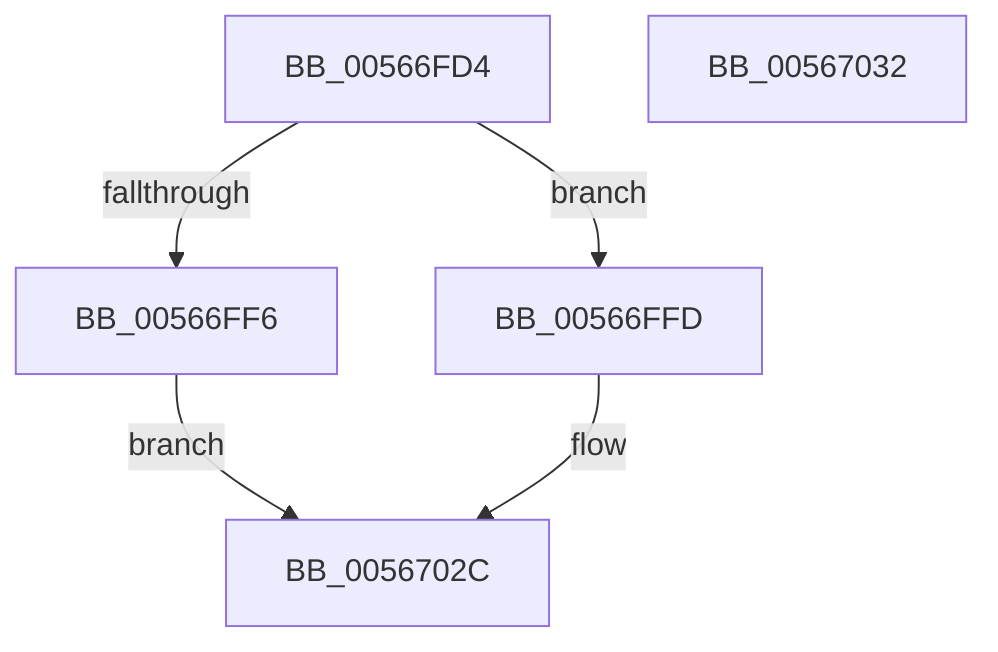

# IommupHvConfigureDeviceDomain

- RVA: `0x00566FD4`–`0x00567033` (길이 `95` bytes)
- VA: `0x0000000140566FD4`
- 실행 섹션: `.text`
- PDB 이름 있음: `예`; PDB Function 태그: `아니요`
- unwind 정보 RVA: `0x0006EFC0`
- 디코드: `29`개 명령, `95/95` bytes 표시
- 미해석 바이트: `0` (있으면 어셈블리에 `.byte`로 보존)

> 이 문서는 커널 이미지의 기계어와 PDB 기호를 분석해 생성했습니다. 4번과 5번은 함수 원형과 자료형을 바이너리 사용 방식에서 추정한 C 해석이며 원본 소스 복구 결과는 아닙니다.

## 1. Dependencies

- 직접 호출 지점: **1**; 고유 호출 대상: **1**
- 직접 호출자로 확인된 함수: **1**
- RIP 상대 이미지 참조: **1**

### Outgoing calls
- `0x00567027` → [guard_dispatch_icall](../6B/guard_dispatch_icall_function_006BAAD0.md) (function, `0x006BAAD0`)

### Direct callers
- [IommuDomainConfigure](../../page/70/IommuDomainConfigure_function_0070D320.md) at `0x0070D353`

### Static image references
- `0x00567012` → RVA `0x00FC1E90` (`.data`; read)

## 2. Other-region calls and transfers

- 다른 실행 섹션으로 향하는 call: **0**
- 별도 외부 분기/꼬리 이동을 확인하지 못했습니다.

## 3. Assembly (complete function range)

```asm
00566FD4  40 55                           push rbp
00566FD6  48 8B EC                        mov rbp, rsp
00566FD9  48 83 EC 50                     sub rsp, 0x50
00566FDD  48 83 65 D0 00                  and qword ptr [rbp - 0x30], 0
00566FE2  33 C0                           xor eax, eax
00566FE4  89 45 F8                        mov dword ptr [rbp - 8], eax
00566FE7  0F 57 C0                        xorps xmm0, xmm0
00566FEA  0F 11 45 D8                     movups xmmword ptr [rbp - 0x28], xmm0
00566FEE  0F 11 45 E8                     movups xmmword ptr [rbp - 0x18], xmm0
00566FF2  84 D2                           test dl, dl
00566FF4  75 07                           jne 0x140566ffd
00566FF6  B8 BB 00 00 C0                  mov eax, 0xc00000bb
00566FFB  EB 2F                           jmp 0x14056702c
00566FFD  49 8B 41 08                     mov rax, qword ptr [r9 + 8]
00567001  48 89 45 E0                     mov qword ptr [rbp - 0x20], rax
00567005  41 8A 41 10                     mov al, byte ptr [r9 + 0x10]
00567009  88 45 E8                        mov byte ptr [rbp - 0x18], al
0056700C  41 8B 01                        mov eax, dword ptr [r9]
0056700F  89 45 D8                        mov dword ptr [rbp - 0x28], eax
00567012  48 8B 05 77 AE A5 00            mov rax, qword ptr [rip + 0xa5ae77]
00567019  89 4D D0                        mov dword ptr [rbp - 0x30], ecx
0056701C  48 8D 4D D0                     lea rcx, [rbp - 0x30]
00567020  88 55 D4                        mov byte ptr [rbp - 0x2c], dl
00567023  48 8D 55 D8                     lea rdx, [rbp - 0x28]
00567027  E8 A4 3A 15 00                  call 0x1406baad0
0056702C  48 83 C4 50                     add rsp, 0x50
00567030  5D                              pop rbp
00567031  C3                              ret
00567032  CC                              int3
```

## 4. C-style interpretation (structured pseudocode)

```c
__int64 __fastcall IommupHvConfigureDeviceDomain(int a1, unsigned __int8 a2, __int64 a3, __int64 a4)
{
    __int64 result;
    __int64 v_rsp;
    unsigned int v_stack_m10;
    unsigned __int64 v_stack_m20;
    unsigned __int64 v_stack_m28;
    unsigned __int64 v_stack_m30;
    unsigned __int8 v_stack_m34;
    unsigned __int64 v_stack_m38;

    v_rsp = (v_rsp) - (80);
    result = 0;
    v_stack_m10 = 0;
    v_stack_m30 = v_xmm0;
    v_stack_m20 = v_xmm0;
    if (a2 != 0) goto loc_00566FFD;
    goto loc_0056702C;
loc_00566FFD:
    v_stack_m28 = *(unsigned __int64 *)(a4 + 8);
    v_stack_m20 = (unsigned __int8)(*(unsigned __int8 *)(a4 + 16));
    v_stack_m30 = (unsigned int)((unsigned int)(*(unsigned int *)(a4)));
    v_stack_m38 = a1;
    v_stack_m34 = a2;
    result = guard_dispatch_icall(v_stack_m38, v_stack_m30, a3, a4);
loc_0056702C:
    v_rsp = (v_rsp) + (80);
    return result;
}
```

## 5. (Beta) C Style

```c
int64_t IommupHvConfigureDeviceDomain(int32_t Arg1, uint8_t Arg2, int64_t Arg3, void *Arg4)
{
    uint8_t *arg4 = (uint8_t *)Arg4;

    int64_t result;
    int64_t local_rsp;
    uint32_t v_stack_m10;
    uint64_t v_stack_m20;
    uint64_t v_stack_m28;
    uint64_t v_stack_m30;
    uint8_t v_stack_m34;
    uint64_t v_stack_m38;

    local_rsp = (local_rsp) - (80);
    result = 0;
    v_stack_m10 = 0;
    v_stack_m30 = v_xmm0;
    v_stack_m20 = v_xmm0;
    if (Arg2 != 0) goto loc_00566FFD;
    goto loc_0056702C;
loc_00566FFD:
    v_stack_m28 = *(uint64_t *)(arg4 + 0x8);
    v_stack_m20 = (uint8_t)(*(uint8_t *)(arg4 + 0x10));
    v_stack_m30 = (uint32_t)((uint32_t)(*(uint32_t *)(arg4)));
    v_stack_m38 = Arg1;
    v_stack_m34 = Arg2;
    result = guard_dispatch_icall(v_stack_m38, v_stack_m30, Arg3, Arg4);
loc_0056702C:
    local_rsp = (local_rsp) + (80);
    return result;
}
```

### 관측된 메모리 오프셋

구조체 형식이 확인되지 않은 접근은 인자 기준의 오프셋으로만 기록했습니다.

| 기준 인자 | 오프셋 표현 | 폭 (bit) | 접근 |
|---|---:|---:|---|
| `Arg4` | `+ 0x0` | `32` | `R` |
| `Arg4` | `+ 0x8` | `64` | `R` |
| `Arg4` | `+ 0x10` | `8` | `R` |

## 6. Execution-region graph

[열기: 2D/3D 그래프와 함수 탐색 컨트롤 패널](../../../control-panel.html?section=text&rva=0x00566FD4&view=graph)

- 2D 그래프는 위에서 아래로 흐르고, 3D 그래프는 빈 공간을 드래그해 회전합니다. Shift+드래그는 이동, 휠은 확대·축소, 함수 노드 선택은 대상 보고서 이동입니다.

### Static fallback


