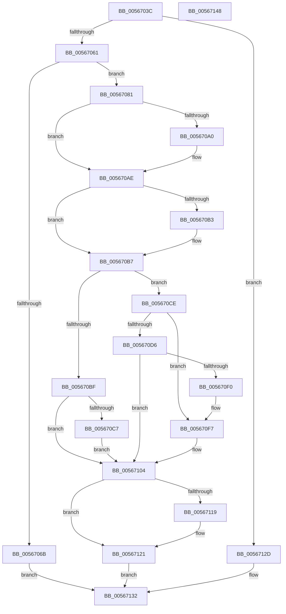

# IommupHvCreateSvmPasidSpace

- RVA: `0x0056703C`–`0x00567149` (길이 `269` bytes)
- VA: `0x000000014056703C`
- 실행 섹션: `.text`
- PDB 이름 있음: `예`; PDB Function 태그: `아니요`
- unwind 정보 RVA: `0x0006F978`
- 디코드: `70`개 명령, `269/269` bytes 표시
- 미해석 바이트: `0` (있으면 어셈블리에 `.byte`로 보존)

> 이 문서는 커널 이미지의 기계어와 PDB 기호를 분석해 생성했습니다. 4번과 5번은 함수 원형과 자료형을 바이너리 사용 방식에서 추정한 C 해석이며 원본 소스 복구 결과는 아닙니다.

## 1. Dependencies

- 직접 호출 지점: **5**; 고유 호출 대상: **5**
- 직접 호출자로 확인된 함수: **1**
- RIP 상대 이미지 참조: **11**

### Outgoing calls
- `0x00567090` → [KeAbPreAcquire](../21/KeAbPreAcquire_function_00210230.md) (function, `0x00210230`)
- `0x005670A9` → [ExfAcquirePushLockExclusiveEx](../20/ExfAcquirePushLockExclusiveEx_function_0020FC90.md) (function, `0x0020FC90`)
- `0x005670E5` → [guard_dispatch_icall](../6B/guard_dispatch_icall_function_006BAAD0.md) (function, `0x006BAAD0`)
- `0x0056711C` → [ExfTryToWakePushLock](../26/ExfTryToWakePushLock_function_00265DD0.md) (function, `0x00265DD0`)
- `0x00567124` → [KeAbPostRelease](../2E/KeAbPostRelease_function_002E1600.md) (function, `0x002E1600`)

### Direct callers
- [IommupGetSystemContext](IommupGetSystemContext_function_00566310.md) at `0x005663D6`

### Static image references
- `0x00567055` → RVA `0x00F8FAD4` (`.data`; read)
- `0x00567061` → RVA `0x00F8FADC` (`.data`; read)
- `0x0056706B` → RVA `0x00F8FAE8` (`.data`; read)
- `0x00567081` → RVA `0x00F8FAE0` (`.data`; read)
- `0x005670CE` → RVA `0x00F8FAD2` (`.data`; read)
- `0x005670D6` → RVA `0x00FC1D68` (`.data`; read)
- `0x005670DF` → RVA `0x00F8FAF0` (`.data`; read)
- `0x005670F0` → RVA `0x00F8FAD2` (`.data`; write)
- `0x005670F7` → RVA `0x00F8FAE8` (`.data`; write)
- `0x005670FD` → RVA `0x00F8FADC` (`.data`; write)
- `0x00567108` → RVA `0x00F8FAE0` (`.data`; read/write)

## 2. Other-region calls and transfers

- 다른 실행 섹션으로 향하는 call: **0**
- 별도 외부 분기/꼬리 이동을 확인하지 못했습니다.

## 3. Assembly (complete function range)

```asm
0056703C  48 89 5C 24 08                  mov qword ptr [rsp + 8], rbx
00567041  48 89 74 24 10                  mov qword ptr [rsp + 0x10], rsi
00567046  48 89 7C 24 18                  mov qword ptr [rsp + 0x18], rdi
0056704B  41 56                           push r14
0056704D  48 83 EC 20                     sub rsp, 0x20
00567051  33 DB                           xor ebx, ebx
00567053  8B F9                           mov edi, ecx
00567055  38 1D 79 8A A2 00               cmp byte ptr [rip + 0xa28a79], bl
0056705B  0F 84 CC 00 00 00               je 0x14056712d
00567061  8A 05 75 8A A2 00               mov al, byte ptr [rip + 0xa28a75]
00567067  84 C0                           test al, al
00567069  74 16                           je 0x140567081
0056706B  8B 05 77 8A A2 00               mov eax, dword ptr [rip + 0xa28a77]
00567071  2B C1                           sub eax, ecx
00567073  F7 D8                           neg eax
00567075  1B C0                           sbb eax, eax
00567077  25 BB 00 00 C0                  and eax, 0xc00000bb
0056707C  E9 B1 00 00 00                  jmp 0x140567132
00567081  4C 8D 35 58 8A A2 00            lea r14, [rip + 0xa28a58]
00567088  45 33 C0                        xor r8d, r8d
0056708B  49 8B CE                        mov rcx, r14
0056708E  33 D2                           xor edx, edx
00567090  E8 9B 91 CA FF                  call 0x140210230
00567095  F0 49 0F BA 2E 00               lock bts qword ptr [r14], 0
0056709B  48 8B F0                        mov rsi, rax
0056709E  73 0E                           jae 0x1405670ae
005670A0  4D 8B C6                        mov r8, r14
005670A3  48 8B D0                        mov rdx, rax
005670A6  49 8B CE                        mov rcx, r14
005670A9  E8 E2 8B CA FF                  call 0x14020fc90
005670AE  48 85 F6                        test rsi, rsi
005670B1  74 04                           je 0x1405670b7
005670B3  C6 46 0A 01                     mov byte ptr [rsi + 0xa], 1
005670B7  38 1D 1F 8A A2 00               cmp byte ptr [rip + 0xa28a1f], bl
005670BD  74 0F                           je 0x1405670ce
005670BF  39 3D 23 8A A2 00               cmp dword ptr [rip + 0xa28a23], edi
005670C5  74 3D                           je 0x140567104
005670C7  BB BB 00 00 C0                  mov ebx, 0xc00000bb
005670CC  EB 36                           jmp 0x140567104
005670CE  38 1D FE 89 A2 00               cmp byte ptr [rip + 0xa289fe], bl
005670D4  75 21                           jne 0x1405670f7
005670D6  48 8B 05 8B AC A5 00            mov rax, qword ptr [rip + 0xa5ac8b]
005670DD  33 C9                           xor ecx, ecx
005670DF  8B 15 0B 8A A2 00               mov edx, dword ptr [rip + 0xa28a0b]
005670E5  E8 E6 39 15 00                  call 0x1406baad0
005670EA  8B D8                           mov ebx, eax
005670EC  85 C0                           test eax, eax
005670EE  78 14                           js 0x140567104
005670F0  C6 05 DB 89 A2 00 01            mov byte ptr [rip + 0xa289db], 1
005670F7  89 3D EB 89 A2 00               mov dword ptr [rip + 0xa289eb], edi
005670FD  C6 05 D8 89 A2 00 01            mov byte ptr [rip + 0xa289d8], 1
00567104  48 83 CA FF                     or rdx, 0xffffffffffffffff
00567108  F0 48 0F C1 15 CF 89 A2 00      lock xadd qword ptr [rip + 0xa289cf], rdx
00567111  80 E2 06                        and dl, 6
00567114  80 FA 02                        cmp dl, 2
00567117  75 08                           jne 0x140567121
00567119  49 8B CE                        mov rcx, r14
0056711C  E8 AF EC CF FF                  call 0x140265dd0
00567121  49 8B CE                        mov rcx, r14
00567124  E8 D7 A4 D7 FF                  call 0x1402e1600
00567129  8B C3                           mov eax, ebx
0056712B  EB 05                           jmp 0x140567132
0056712D  B8 BB 00 00 C0                  mov eax, 0xc00000bb
00567132  48 8B 5C 24 30                  mov rbx, qword ptr [rsp + 0x30]
00567137  48 8B 74 24 38                  mov rsi, qword ptr [rsp + 0x38]
0056713C  48 8B 7C 24 40                  mov rdi, qword ptr [rsp + 0x40]
00567141  48 83 C4 20                     add rsp, 0x20
00567145  41 5E                           pop r14
00567147  C3                              ret
00567148  CC                              int3
```

## 4. C-style interpretation (structured pseudocode)

```c
__int64 __fastcall IommupHvCreateSvmPasidSpace(int a1, int a2, int a3)
{
    __int64 result;
    __int64 v_rbx;
    __int64 v_rsp;
    unsigned __int64 v_stack_p10;
    unsigned __int64 v_stack_p18;
    unsigned __int64 v_stack_p8;

    v_stack_p8 = v_rbx;
    v_stack_p10 = v_rsi;
    v_stack_p18 = v_rdi;
    v_rsp = (v_rsp) - (32);
    v_rbx = 0;
    if ((*(unsigned __int8 *)(v_rip + 10652281)) == 0) goto loc_0056712D;
    if ((unsigned __int8)(*(unsigned __int8 *)(v_rip + 10652277)) == 0) goto loc_00567081;
    result = (unsigned int)(((unsigned int)(*(unsigned int *)(v_rip + 10652279))) - (a1));
    result = (unsigned int)(-(result));
    result = (unsigned int)((result) & (0xC00000BBULL));
    goto loc_00567132;
loc_00567081:
    a3 = 0;
    a2 = 0;
    result = KeAbPreAcquire(v_rip + 10652248, a2, a3, a4);
    if (!(condition_is_above_or_equal)) {
        a3 = v_rip + 10652248;
        a2 = result;
        a1 = v_rip + 10652248;
        result = ExfAcquirePushLockExclusiveEx(a1, a2, a3, a4);
    }
    if (result != 0) {
        *(unsigned __int8 *)(result + 10) = 1;
    }
    if ((*(unsigned __int8 *)(v_rip + 10652191)) == 0) goto loc_005670CE;
    if ((*(unsigned int *)(v_rip + 10652195)) == ((unsigned int)((unsigned int)(a1)))) goto loc_00567104;
    goto loc_00567104;
loc_005670CE:
    if ((*(unsigned __int8 *)(v_rip + 10652158)) != ((unsigned __int8)((unsigned int)(0xC00000BBULL)))) goto loc_005670F7;
    a1 = 0;
    result = guard_dispatch_icall(a1, (unsigned int)(*(unsigned int *)(v_rip + 10652171)), a3, a4);
    if (sign_flag) goto loc_00567104;
    *(unsigned __int8 *)(v_rip + 10652123) = 1;
loc_005670F7:
    *(unsigned int *)(v_rip + 10652139) = (unsigned int)((unsigned int)(a1));
    *(unsigned __int8 *)(v_rip + 10652120) = 1;
loc_00567104:
    a2 = ((unsigned int)(*(unsigned int *)(v_rip + 10652171))) | (-1);
    a2 = (unsigned __int8)((a2) & (6));
    if (((unsigned __int8)(a2)) == 2) {
        a1 = v_rip + 10652248;
        result = ExfTryToWakePushLock(a1, a2, a3, a4);
    }
    result = KeAbPostRelease(v_rip + 10652248, a2, a3, a4);
    goto loc_00567132;
loc_0056712D:
loc_00567132:
    v_rsp = (v_rsp) + (32);
    return (unsigned int)(0xC00000BBULL);
}
```

## 5. (Beta) C Style

```c
int64_t IommupHvCreateSvmPasidSpace(int32_t Arg1, int32_t Arg2, int32_t Arg3)
{
    int64_t result;
    int64_t local_rbx;
    int64_t local_rsp;
    uint64_t v_stack_p10;
    uint64_t v_stack_p18;
    uint64_t v_stack_p8;

    v_stack_p8 = local_rbx;
    v_stack_p10 = local_rsi;
    v_stack_p18 = local_rdi;
    local_rsp = (local_rsp) - (32);
    local_rbx = 0;
    if ((*(uint8_t *)(v_rip + 0xA28A79)) == 0) goto loc_0056712D;
    if ((uint8_t)(*(uint8_t *)(v_rip + 0xA28A75)) == 0) goto loc_00567081;
    result = (uint32_t)(((uint32_t)(*(uint32_t *)(v_rip + 0xA28A77))) - (Arg1));
    result = (uint32_t)(-(result));
    result = (uint32_t)((result) & (0xC00000BBULL));
    goto loc_00567132;
loc_00567081:
    Arg3 = 0;
    Arg2 = 0;
    result = KeAbPreAcquire(v_rip + 10652248, Arg2, Arg3, a4);
    if (!(condition_is_above_or_equal)) {
        Arg3 = v_rip + 10652248;
        Arg2 = result;
        Arg1 = v_rip + 10652248;
        result = ExfAcquirePushLockExclusiveEx(Arg1, Arg2, Arg3, a4);
    }
    if (result != 0) {
        *(uint8_t *)(result + 0xA) = 1;
    }
    if ((*(uint8_t *)(v_rip + 0xA28A1F)) == 0) goto loc_005670CE;
    if ((*(uint32_t *)(v_rip + 0xA28A23)) == ((uint32_t)((uint32_t)(Arg1)))) goto loc_00567104;
    goto loc_00567104;
loc_005670CE:
    if ((*(uint8_t *)(v_rip + 0xA289FE)) != ((uint8_t)((uint32_t)(0xC00000BBULL)))) goto loc_005670F7;
    Arg1 = 0;
    result = guard_dispatch_icall(Arg1, (uint32_t)(*(uint32_t *)(v_rip + 0xA28A0B)), Arg3, a4);
    if (sign_flag) goto loc_00567104;
    *(uint8_t *)(v_rip + 0xA289DB) = 1;
loc_005670F7:
    *(uint32_t *)(v_rip + 0xA289EB) = (uint32_t)((uint32_t)(Arg1));
    *(uint8_t *)(v_rip + 0xA289D8) = 1;
loc_00567104:
    Arg2 = ((uint32_t)(*(uint32_t *)(v_rip + 0xA28A0B))) | (-1);
    Arg2 = (uint8_t)((Arg2) & (6));
    if (((uint8_t)(Arg2)) == 2) {
        Arg1 = v_rip + 10652248;
        result = ExfTryToWakePushLock(Arg1, Arg2, Arg3, a4);
    }
    result = KeAbPostRelease(v_rip + 10652248, Arg2, Arg3, a4);
    goto loc_00567132;
loc_0056712D:
loc_00567132:
    local_rsp = (local_rsp) + (32);
    return (uint32_t)(0xC00000BBULL);
}
```

## 6. Execution-region graph

[열기: 2D/3D 그래프와 함수 탐색 컨트롤 패널](../../../control-panel.html?section=text&rva=0x0056703C&view=graph)

- 2D 그래프는 위에서 아래로 흐르고, 3D 그래프는 빈 공간을 드래그해 회전합니다. Shift+드래그는 이동, 휠은 확대·축소, 함수 노드 선택은 대상 보고서 이동입니다.

### Static fallback


