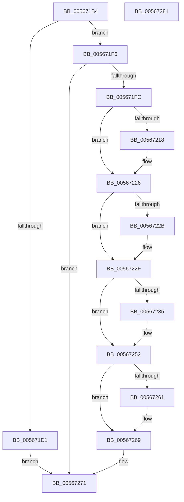

# IommupHvDetachPasidDeviceDomain

- RVA: `0x005671B4`–`0x00567282` (길이 `206` bytes)
- VA: `0x00000001405671B4`
- 실행 섹션: `.text`
- PDB 이름 있음: `예`; PDB Function 태그: `아니요`
- unwind 정보 RVA: `0x000A9ACC`
- 디코드: `57`개 명령, `206/206` bytes 표시
- 미해석 바이트: `0` (있으면 어셈블리에 `.byte`로 보존)

> 이 문서는 커널 이미지의 기계어와 PDB 기호를 분석해 생성했습니다. 4번과 5번은 함수 원형과 자료형을 바이너리 사용 방식에서 추정한 C 해석이며 원본 소스 복구 결과는 아닙니다.

## 1. Dependencies

- 직접 호출 지점: **6**; 고유 호출 대상: **5**
- 직접 호출자로 확인된 함수: **2**
- RIP 상대 이미지 참조: **3**

### Outgoing calls
- `0x005671EF` → [guard_dispatch_icall](../6B/guard_dispatch_icall_function_006BAAD0.md) (function, `0x006BAAD0`)
- `0x00567208` → [KeAbPreAcquire](../21/KeAbPreAcquire_function_00210230.md) (function, `0x00210230`)
- `0x00567221` → [ExfAcquirePushLockExclusiveEx](../20/ExfAcquirePushLockExclusiveEx_function_0020FC90.md) (function, `0x0020FC90`)
- `0x0056724D` → [guard_dispatch_icall](../6B/guard_dispatch_icall_function_006BAAD0.md) (function, `0x006BAAD0`)
- `0x00567264` → [ExfTryToWakePushLock](../26/ExfTryToWakePushLock_function_00265DD0.md) (function, `0x00265DD0`)
- `0x0056726C` → [KeAbPostRelease](../2E/KeAbPostRelease_function_002E1600.md) (function, `0x002E1600`)

### Direct callers
- [IommupDomainAttachPasidDevice](../54/IommupDomainAttachPasidDevice_function_0054F984.md) at `0x0054FCF5`
- [IommupDomainAttachPasidDevice](../54/IommupDomainAttachPasidDevice_function_0054F984.md) at `0x0054FD02`
- [IommupDomainDetachPasidDevice](../54/IommupDomainDetachPasidDevice_function_0054FD50.md) at `0x0054FDDF`
- [IommupDomainDetachPasidDevice](../54/IommupDomainDetachPasidDevice_function_0054FD50.md) at `0x0054FEB3`

### Static image references
- `0x005671D1` → RVA `0x00F8FAEC` (`.data`; read)
- `0x005671E3` → RVA `0x00FC1E10` (`.data`; read)
- `0x00567241` → RVA `0x00FC1E20` (`.data`; read)

## 2. Other-region calls and transfers

- 다른 실행 섹션으로 향하는 call: **0**
- 별도 외부 분기/꼬리 이동을 확인하지 못했습니다.

## 3. Assembly (complete function range)

```asm
005671B4  4C 8B DC                        mov r11, rsp
005671B7  49 89 5B 10                     mov qword ptr [r11 + 0x10], rbx
005671BB  49 89 73 18                     mov qword ptr [r11 + 0x18], rsi
005671BF  57                              push rdi
005671C0  48 83 EC 20                     sub rsp, 0x20
005671C4  49 83 63 08 00                  and qword ptr [r11 + 8], 0
005671C9  48 8B 79 18                     mov rdi, qword ptr [rcx + 0x18]
005671CD  85 D2                           test edx, edx
005671CF  75 25                           jne 0x1405671f6
005671D1  8B 05 15 89 A2 00               mov eax, dword ptr [rip + 0xa28915]
005671D7  49 8D 53 08                     lea rdx, [r11 + 8]
005671DB  48 8B 49 20                     mov rcx, qword ptr [rcx + 0x20]
005671DF  89 44 24 30                     mov dword ptr [rsp + 0x30], eax
005671E3  48 8B 05 26 AC A5 00            mov rax, qword ptr [rip + 0xa5ac26]
005671EA  C6 44 24 34 01                  mov byte ptr [rsp + 0x34], 1
005671EF  E8 DC 38 15 00                  call 0x1406baad0
005671F4  EB 7B                           jmp 0x140567271
005671F6  83 7F 08 01                     cmp dword ptr [rdi + 8], 1
005671FA  74 75                           je 0x140567271
005671FC  48 8D 5F 68                     lea rbx, [rdi + 0x68]
00567200  45 33 C0                        xor r8d, r8d
00567203  48 8B CB                        mov rcx, rbx
00567206  33 D2                           xor edx, edx
00567208  E8 23 90 CA FF                  call 0x140210230
0056720D  F0 48 0F BA 2B 00               lock bts qword ptr [rbx], 0
00567213  48 8B F0                        mov rsi, rax
00567216  73 0E                           jae 0x140567226
00567218  4C 8B C3                        mov r8, rbx
0056721B  48 8B D0                        mov rdx, rax
0056721E  48 8B CB                        mov rcx, rbx
00567221  E8 6A 8A CA FF                  call 0x14020fc90
00567226  48 85 F6                        test rsi, rsi
00567229  74 04                           je 0x14056722f
0056722B  C6 46 0A 01                     mov byte ptr [rsi + 0xa], 1
0056722F  83 47 5C FF                     add dword ptr [rdi + 0x5c], -1
00567233  75 1D                           jne 0x140567252
00567235  8B 47 30                        mov eax, dword ptr [rdi + 0x30]
00567238  48 8D 4C 24 30                  lea rcx, [rsp + 0x30]
0056723D  89 44 24 30                     mov dword ptr [rsp + 0x30], eax
00567241  48 8B 05 D8 AB A5 00            mov rax, qword ptr [rip + 0xa5abd8]
00567248  C6 44 24 34 01                  mov byte ptr [rsp + 0x34], 1
0056724D  E8 7E 38 15 00                  call 0x1406baad0
00567252  48 83 C8 FF                     or rax, 0xffffffffffffffff
00567256  F0 48 0F C1 03                  lock xadd qword ptr [rbx], rax
0056725B  24 06                           and al, 6
0056725D  3C 02                           cmp al, 2
0056725F  75 08                           jne 0x140567269
00567261  48 8B CB                        mov rcx, rbx
00567264  E8 67 EB CF FF                  call 0x140265dd0
00567269  48 8B CB                        mov rcx, rbx
0056726C  E8 8F A3 D7 FF                  call 0x1402e1600
00567271  48 8B 5C 24 38                  mov rbx, qword ptr [rsp + 0x38]
00567276  48 8B 74 24 40                  mov rsi, qword ptr [rsp + 0x40]
0056727B  48 83 C4 20                     add rsp, 0x20
0056727F  5F                              pop rdi
00567280  C3                              ret
00567281  CC                              int3
```

## 4. C-style interpretation (structured pseudocode)

```c
__int64 __fastcall IommupHvDetachPasidDeviceDomain(__int64 a1, int a2, int a3)
{
    __int64 result;
    __int64 v_rsp;
    unsigned __int64 v_stack_p10;
    unsigned __int64 v_stack_p18;
    unsigned int v_stack_p8;
    unsigned __int8 v_stack_pC;

    *(unsigned __int64 *)(v_rsp + 16) = v_rbx;
    *(unsigned __int64 *)(v_rsp + 24) = v_rsi;
    v_rsp = (v_rsp) - (32);
    if (a2 != 0) goto loc_005671F6;
    v_stack_p8 = (unsigned int)((unsigned int)(*(unsigned int *)(v_rip + 10651925)));
    v_stack_pC = 1;
    result = guard_dispatch_icall(*(unsigned __int64 *)(a1 + 32), v_rsp + 8, a3, a4);
    goto loc_00567271;
loc_005671F6:
    if ((*(unsigned int *)(*(unsigned __int64 *)(a1 + 24) + 8)) == 1) goto loc_00567271;
    a3 = 0;
    a2 = 0;
    result = KeAbPreAcquire(*(unsigned __int64 *)(a1 + 24) + 104, a2, a3, a4);
    if (!(condition_is_above_or_equal)) {
        a3 = *(unsigned __int64 *)(a1 + 24) + 104;
        a2 = result;
        a1 = *(unsigned __int64 *)(a1 + 24) + 104;
        result = ExfAcquirePushLockExclusiveEx(a1, a2, a3, a4);
    }
    if (result != 0) {
        *(unsigned __int8 *)(result + 10) = 1;
    }
    if (result == 0) {
        result = *(unsigned int *)(*(unsigned __int64 *)(a1 + 24) + 48);
        a1 = v_stack_p8;
        v_stack_p8 = (unsigned int)(result);
        result = *(unsigned __int64 *)(v_rip + 10857432);
        v_stack_pC = 1;
        result = guard_dispatch_icall(a1, a2, a3, a4);
    }
    result = (result) | (-1);
    result = (unsigned __int8)((result) & (6));
    if (((unsigned __int8)(result)) == 2) {
        a1 = *(unsigned __int64 *)(a1 + 24) + 104;
        result = ExfTryToWakePushLock(a1, a2, a3, a4);
    }
    result = KeAbPostRelease(*(unsigned __int64 *)(a1 + 24) + 104, a2, a3, a4);
loc_00567271:
    v_rsp = (v_rsp) + (32);
    return result;
}
```

## 5. (Beta) C Style

```c
int64_t IommupHvDetachPasidDeviceDomain(void *Arg1, int32_t Arg2, int32_t Arg3)
{
    uint8_t *arg1 = (uint8_t *)Arg1;

    int64_t result;
    int64_t local_rsp;
    uint64_t v_stack_p10;
    uint64_t v_stack_p18;
    uint32_t v_stack_p8;
    uint8_t v_stack_pC;

    *(uint64_t *)(local_rsp + 0x10) = local_rbx;
    *(uint64_t *)(local_rsp + 0x18) = local_rsi;
    local_rsp = (local_rsp) - (32);
    if (Arg2 != 0) goto loc_005671F6;
    v_stack_p8 = (uint32_t)((uint32_t)(*(uint32_t *)(v_rip + 0xA28915)));
    v_stack_pC = 1;
    result = guard_dispatch_icall(*(uint64_t *)(arg1 + 0x20), local_rsp + 8, Arg3, a4);
    goto loc_00567271;
loc_005671F6:
    if ((*(uint32_t *)(*(uint64_t *)(arg1 + 0x18) + 0x8)) == 1) goto loc_00567271;
    Arg3 = 0;
    Arg2 = 0;
    result = KeAbPreAcquire(*(uint64_t *)(arg1 + 0x18) + 104, Arg2, Arg3, a4);
    if (!(condition_is_above_or_equal)) {
        Arg3 = *(uint64_t *)(arg1 + 0x18) + 104;
        Arg2 = result;
        Arg1 = *(uint64_t *)(arg1 + 0x18) + 104;
        result = ExfAcquirePushLockExclusiveEx(Arg1, Arg2, Arg3, a4);
    }
    if (result != 0) {
        *(uint8_t *)(result + 0xA) = 1;
    }
    if (result == 0) {
        result = *(uint32_t *)(*(uint64_t *)(arg1 + 0x18) + 0x30);
        Arg1 = v_stack_p8;
        v_stack_p8 = (uint32_t)(result);
        result = *(uint64_t *)(v_rip + 0xA5ABD8);
        v_stack_pC = 1;
        result = guard_dispatch_icall(Arg1, Arg2, Arg3, a4);
    }
    result = (result) | (-1);
    result = (uint8_t)((result) & (6));
    if (((uint8_t)(result)) == 2) {
        Arg1 = *(uint64_t *)(arg1 + 0x18) + 104;
        result = ExfTryToWakePushLock(Arg1, Arg2, Arg3, a4);
    }
    result = KeAbPostRelease(*(uint64_t *)(arg1 + 0x18) + 104, Arg2, Arg3, a4);
loc_00567271:
    local_rsp = (local_rsp) + (32);
    return result;
}
```

### 관측된 메모리 오프셋

구조체 형식이 확인되지 않은 접근은 인자 기준의 오프셋으로만 기록했습니다.

| 기준 인자 | 오프셋 표현 | 폭 (bit) | 접근 |
|---|---:|---:|---|
| `Arg1` | `+ 0x18` | `64` | `R` |
| `Arg1` | `+ 0x20` | `64` | `R` |

## 6. Execution-region graph

[열기: 2D/3D 그래프와 함수 탐색 컨트롤 패널](../../../control-panel.html?section=text&rva=0x005671B4&view=graph)

- 2D 그래프는 위에서 아래로 흐르고, 3D 그래프는 빈 공간을 드래그해 회전합니다. Shift+드래그는 이동, 휠은 확대·축소, 함수 노드 선택은 대상 보고서 이동입니다.

### Static fallback


