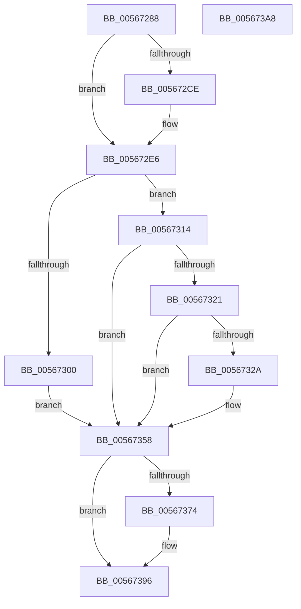

# IommupHvDismissPageFault

- RVA: `0x00567288`–`0x005673A9` (길이 `289` bytes)
- VA: `0x0000000140567288`
- 실행 섹션: `.text`
- PDB 이름 있음: `예`; PDB Function 태그: `아니요`
- unwind 정보 RVA: `0x0006F9F8`
- 디코드: `67`개 명령, `289/289` bytes 표시
- 미해석 바이트: `0` (있으면 어셈블리에 `.byte`로 보존)

> 이 문서는 커널 이미지의 기계어와 PDB 기호를 분석해 생성했습니다. 4번과 5번은 함수 원형과 자료형을 바이너리 사용 방식에서 추정한 C 해석이며 원본 소스 복구 결과는 아닙니다.

## 1. Dependencies

- 직접 호출 지점: **3**; 고유 호출 대상: **3**
- 직접 호출자로 확인된 함수: **1**
- RIP 상대 이미지 참조: **3**

### Outgoing calls
- `0x0056736B` → [guard_dispatch_icall](../6B/guard_dispatch_icall_function_006BAAD0.md) (function, `0x006BAAD0`)
- `0x00567390` → [KeBugCheckEx](../4F/KeBugCheckEx_function_004FD660.md) (function, `0x004FD660`)
- `0x0056739E` → [_security_check_cookie](../6A/_security_check_cookie_function_006AC640.md) (function, `0x006AC640`)

### Direct callers
- [IommuProcessPageRequestQueue](IommuProcessPageRequestQueue_function_00565BA0.md) at `0x00565F7B`

### Static image references
- `0x0056728C` → RVA `0x00E0A740` (`.data`; read)
- `0x00567321` → RVA `0x00F8FAD1` (`.data`; read)
- `0x00567358` → RVA `0x00FC1DA0` (`.data`; read)

## 2. Other-region calls and transfers

- 다른 실행 섹션으로 향하는 call: **0**
- 별도 외부 분기/꼬리 이동을 확인하지 못했습니다.

## 3. Assembly (complete function range)

```asm
00567288  48 83 EC 68                     sub rsp, 0x68
0056728C  48 8B 05 AD 34 8A 00            mov rax, qword ptr [rip + 0x8a34ad]
00567293  48 33 C4                        xor rax, rsp
00567296  48 89 44 24 50                  mov qword ptr [rsp + 0x50], rax
0056729B  48 83 64 24 40 00               and qword ptr [rsp + 0x40], 0
005672A1  33 C0                           xor eax, eax
005672A3  48 83 64 24 48 00               and qword ptr [rsp + 0x48], 0
005672A9  48 25 00 FE FF FF               and rax, 0xfffffffffffffe00
005672AF  4C 8B 94 24 90 00 00 00         mov r10, qword ptr [rsp + 0x90]
005672B7  48 89 54 24 30                  mov qword ptr [rsp + 0x30], rdx
005672BC  41 0F B7 D0                     movzx edx, r8w
005672C0  81 E2 FF 01 00 00               and edx, 0x1ff
005672C6  48 0B D0                        or rdx, rax
005672C9  83 F9 FF                        cmp ecx, -1
005672CC  74 18                           je 0x1405672e6
005672CE  8B C9                           mov ecx, ecx
005672D0  48 C1 E1 0B                     shl rcx, 0xb
005672D4  48 33 D1                        xor rdx, rcx
005672D7  48 81 E2 FF 07 00 80            and rdx, 0xffffffff800007ff
005672DE  48 33 D1                        xor rdx, rcx
005672E1  48 0F BA EA 0A                  bts rdx, 0xa
005672E6  48 B9 00 00 00 00 00 00 00 80   movabs rcx, 0x8000000000000000
005672F0  48 8B C2                        mov rax, rdx
005672F3  48 0B D1                        or rdx, rcx
005672F6  48 89 54 24 38                  mov qword ptr [rsp + 0x38], rdx
005672FB  45 85 C9                        test r9d, r9d
005672FE  79 14                           jns 0x140567314
00567300  48 B9 00 00 00 00 00 00 00 A0   movabs rcx, 0xa000000000000000
0056730A  48 0B C1                        or rax, rcx
0056730D  48 89 44 24 38                  mov qword ptr [rsp + 0x38], rax
00567312  EB 44                           jmp 0x140567358
00567314  48 8B 8C 24 98 00 00 00         mov rcx, qword ptr [rsp + 0x98]
0056731C  48 85 C9                        test rcx, rcx
0056731F  74 37                           je 0x140567358
00567321  80 3D A9 87 A2 00 00            cmp byte ptr [rip + 0xa287a9], 0
00567328  75 2E                           jne 0x140567358
0056732A  49 81 E2 00 F0 FF FF            and r10, 0xfffffffffffff000
00567331  48 BA 00 00 00 00 00 00 00 C0   movabs rdx, 0xc000000000000000
0056733B  48 0B C2                        or rax, rdx
0056733E  83 E1 0F                        and ecx, 0xf
00567341  48 89 44 24 38                  mov qword ptr [rsp + 0x38], rax
00567346  33 C0                           xor eax, eax
00567348  25 F0 0F 00 00                  and eax, 0xff0
0056734D  4C 0B D0                        or r10, rax
00567350  4C 0B D1                        or r10, rcx
00567353  4C 89 54 24 40                  mov qword ptr [rsp + 0x40], r10
00567358  48 8B 05 41 AA A5 00            mov rax, qword ptr [rip + 0xa5aa41]
0056735F  48 8D 54 24 30                  lea rdx, [rsp + 0x30]
00567364  45 33 C0                        xor r8d, r8d
00567367  41 8D 48 01                     lea ecx, [r8 + 1]
0056736B  E8 60 37 15 00                  call 0x1406baad0
00567370  85 C0                           test eax, eax
00567372  79 22                           jns 0x140567396
00567374  4C 8B 4C 24 38                  mov r9, qword ptr [rsp + 0x38]
00567379  BA 02 31 00 00                  mov edx, 0x3102
0056737E  4C 63 C0                        movsxd r8, eax
00567381  B9 59 01 00 00                  mov ecx, 0x159
00567386  48 8B 44 24 40                  mov rax, qword ptr [rsp + 0x40]
0056738B  48 89 44 24 20                  mov qword ptr [rsp + 0x20], rax
00567390  E8 CB 62 F9 FF                  call 0x1404fd660
00567395  CC                              int3
00567396  48 8B 4C 24 50                  mov rcx, qword ptr [rsp + 0x50]
0056739B  48 33 CC                        xor rcx, rsp
0056739E  E8 9D 52 14 00                  call 0x1406ac640
005673A3  48 83 C4 68                     add rsp, 0x68
005673A7  C3                              ret
005673A8  CC                              int3
```

## 4. C-style interpretation (structured pseudocode)

```c
__int64 __fastcall IommupHvDismissPageFault(int a1, __int64 a2, int a3, int a4, __int64 a5, __int64 a6)
{
    __int64 result;
    __int64 v_r10;
    __int64 v_rsp;
    unsigned __int64 v_stack_m18;
    unsigned __int64 v_stack_m20;
    unsigned __int64 v_stack_m28;
    unsigned __int64 v_stack_m30;
    unsigned __int64 v_stack_m38;
    unsigned __int64 v_stack_m48;

    v_rsp = (v_rsp) - (104);
    result = (*(unsigned __int64 *)(v_rip + 9057453)) ^ (v_rsp);
    v_stack_m18 = result;
    result = 0;
    result = (result) & (-512);
    v_stack_m38 = a2;
    a2 = (unsigned int)(((unsigned __int16)(a3)) & (511));
    a2 = (a2) | (result);
    if (a1 != -1) {
        a1 = a1;
        a1 = (a1) << (11);
        a2 = (a2) ^ (a1);
        a2 = (a2) & (0xFFFFFFFF800007FFULL);
        a2 = (a2) ^ (a1);
    }
    a2 = (a2) | (a1);
    v_stack_m30 = a2;
    if (!sign_flag) goto loc_00567314;
    result = (a2) | (a1);
    v_stack_m30 = result;
    goto loc_00567358;
loc_00567314:
    if (a6 == 0) goto loc_00567358;
    v_r10 = a5;
    if ((*(unsigned __int8 *)(v_rip + 10651561)) == 0) {
        v_r10 = (a5) & (0xFFFFFFFFFFFFF000ULL);
        result = (result) | (a2);
        a1 = (unsigned int)((a6) & (15));
        v_stack_m30 = result;
        result = 0;
        result = (unsigned int)((result) & (0xFF0ULL));
        v_r10 = (v_r10) | (result);
        v_r10 = (v_r10) | (a1);
        v_stack_m28 = v_r10;
    }
    a3 = 0;
    result = guard_dispatch_icall(a3 + 1, v_stack_m38, a3, a4);
    if (sign_flag) {
        a4 = v_stack_m30;
        a2 = 0x3102ULL;
        a3 = (int)((unsigned int)(result));
        a1 = 345;
        result = v_stack_m28;
        v_stack_m48 = result;
        result = KeBugCheckEx(a1, a2, a3, a4);
    }
    a1 = (v_stack_m18) ^ (v_rsp);
    result = _security_check_cookie(a1, a2, a3, a4);
    v_rsp = (v_rsp) + (104);
    return result;
}
```

## 5. (Beta) C Style

```c
int64_t IommupHvDismissPageFault(int32_t Arg1, int64_t Arg2, int32_t Arg3, int32_t Arg4, int64_t Arg5, int64_t Arg6)
{
    int64_t result;
    int64_t local_r10;
    int64_t local_rsp;
    uint64_t v_stack_m18;
    uint64_t v_stack_m20;
    uint64_t v_stack_m28;
    uint64_t v_stack_m30;
    uint64_t v_stack_m38;
    uint64_t v_stack_m48;

    local_rsp = (local_rsp) - (104);
    result = (*(uint64_t *)(v_rip + 0x8A34AD)) ^ (local_rsp);
    v_stack_m18 = result;
    result = 0;
    result = (result) & (-512);
    v_stack_m38 = Arg2;
    Arg2 = (uint32_t)(((uint16_t)(Arg3)) & (511));
    Arg2 = (Arg2) | (result);
    if (Arg1 != -1) {
        Arg1 = Arg1;
        Arg1 = (Arg1) << (11);
        Arg2 = (Arg2) ^ (Arg1);
        Arg2 = (Arg2) & (0xFFFFFFFF800007FFULL);
        Arg2 = (Arg2) ^ (Arg1);
    }
    Arg2 = (Arg2) | (Arg1);
    v_stack_m30 = Arg2;
    if (!sign_flag) goto loc_00567314;
    result = (Arg2) | (Arg1);
    v_stack_m30 = result;
    goto loc_00567358;
loc_00567314:
    if (Arg6 == 0) goto loc_00567358;
    local_r10 = Arg5;
    if ((*(uint8_t *)(v_rip + 0xA287A9)) == 0) {
        local_r10 = (Arg5) & (0xFFFFFFFFFFFFF000ULL);
        result = (result) | (Arg2);
        Arg1 = (uint32_t)((Arg6) & (15));
        v_stack_m30 = result;
        result = 0;
        result = (uint32_t)((result) & (0xFF0ULL));
        local_r10 = (local_r10) | (result);
        local_r10 = (local_r10) | (Arg1);
        v_stack_m28 = local_r10;
    }
    Arg3 = 0;
    result = guard_dispatch_icall(Arg3 + 1, v_stack_m38, Arg3, Arg4);
    if (sign_flag) {
        Arg4 = v_stack_m30;
        Arg2 = 0x3102ULL;
        Arg3 = (int32_t)((uint32_t)(result));
        Arg1 = 345;
        result = v_stack_m28;
        v_stack_m48 = result;
        result = KeBugCheckEx(Arg1, Arg2, Arg3, Arg4);
    }
    Arg1 = (v_stack_m18) ^ (local_rsp);
    result = _security_check_cookie(Arg1, Arg2, Arg3, Arg4);
    local_rsp = (local_rsp) + (104);
    return result;
}
```

## 6. Execution-region graph

[열기: 2D/3D 그래프와 함수 탐색 컨트롤 패널](../../../control-panel.html?section=text&rva=0x00567288&view=graph)

- 2D 그래프는 위에서 아래로 흐르고, 3D 그래프는 빈 공간을 드래그해 회전합니다. Shift+드래그는 이동, 휠은 확대·축소, 함수 노드 선택은 대상 보고서 이동입니다.

### Static fallback


