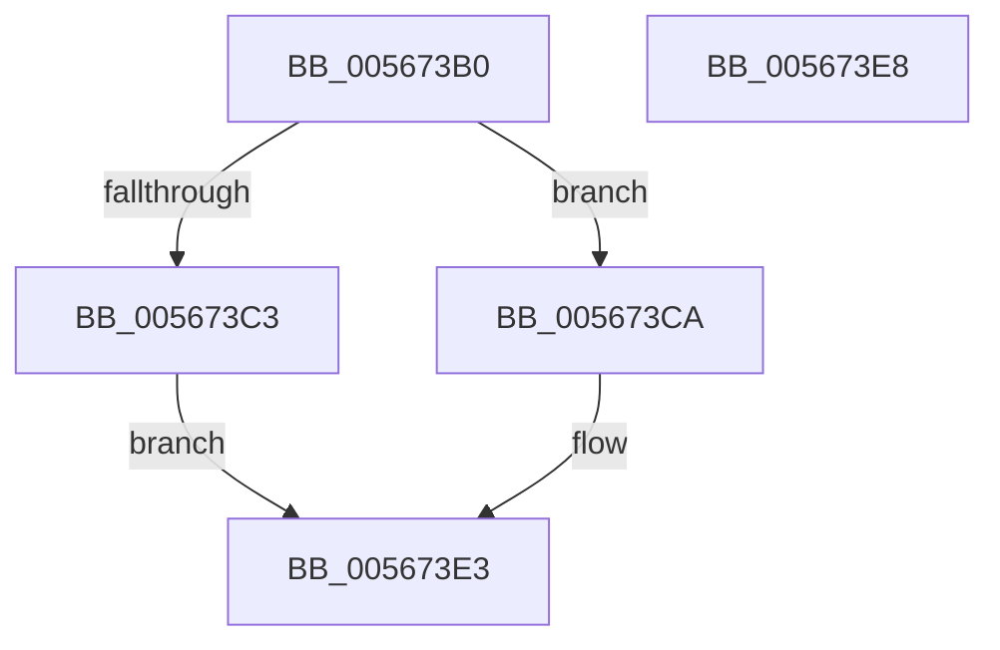

# IommupHvFlushDeviceDomainVaList

- RVA: `0x005673B0`–`0x005673E9` (길이 `57` bytes)
- VA: `0x00000001405673B0`
- 실행 섹션: `.text`
- PDB 이름 있음: `예`; PDB Function 태그: `아니요`
- unwind 정보 RVA: `0x00085914`
- 디코드: `15`개 명령, `57/57` bytes 표시
- 미해석 바이트: `0` (있으면 어셈블리에 `.byte`로 보존)

> 이 문서는 커널 이미지의 기계어와 PDB 기호를 분석해 생성했습니다. 4번과 5번은 함수 원형과 자료형을 바이너리 사용 방식에서 추정한 C 해석이며 원본 소스 복구 결과는 아닙니다.

## 1. Dependencies

- 직접 호출 지점: **1**; 고유 호출 대상: **1**
- 직접 호출자로 확인된 함수: **1**
- RIP 상대 이미지 참조: **1**

### Outgoing calls
- `0x005673DE` → [guard_dispatch_icall](../6B/guard_dispatch_icall_function_006BAAD0.md) (function, `0x006BAAD0`)

### Direct callers
- [IommuFlushDomainVaList](../../page/70/IommuFlushDomainVaList_function_0070D410.md) at `0x0070D430`

### Static image references
- `0x005673CA` → RVA `0x00FC1EA0` (`.data`; read)

## 2. Other-region calls and transfers

- 다른 실행 섹션으로 향하는 call: **0**
- 별도 외부 분기/꼬리 이동을 확인하지 못했습니다.

## 3. Assembly (complete function range)

```asm
005673B0  4C 89 4C 24 20                  mov qword ptr [rsp + 0x20], r9
005673B5  48 83 EC 28                     sub rsp, 0x28
005673B9  48 83 64 24 48 00               and qword ptr [rsp + 0x48], 0
005673BF  84 D2                           test dl, dl
005673C1  75 07                           jne 0x1405673ca
005673C3  B8 BB 00 00 C0                  mov eax, 0xc00000bb
005673C8  EB 19                           jmp 0x1405673e3
005673CA  48 8B 05 CF AA A5 00            mov rax, qword ptr [rip + 0xa5aacf]
005673D1  89 4C 24 48                     mov dword ptr [rsp + 0x48], ecx
005673D5  48 8D 4C 24 48                  lea rcx, [rsp + 0x48]
005673DA  88 54 24 4C                     mov byte ptr [rsp + 0x4c], dl
005673DE  E8 ED 36 15 00                  call 0x1406baad0
005673E3  48 83 C4 28                     add rsp, 0x28
005673E7  C3                              ret
005673E8  CC                              int3
```

## 4. C-style interpretation (structured pseudocode)

```c
__int64 __fastcall IommupHvFlushDeviceDomainVaList(int a1, unsigned __int8 a2, __int64 a3, __int64 a4)
{
    __int64 result;
    __int64 v_rsp;
    unsigned __int64 v_stack_p20;
    unsigned __int8 v_stack_p24;

    v_stack_p20 = a4;
    v_rsp = (v_rsp) - (40);
    if (a2 != 0) goto loc_005673CA;
    goto loc_005673E3;
loc_005673CA:
    v_stack_p20 = a1;
    v_stack_p24 = a2;
    result = guard_dispatch_icall(v_stack_p20, a2, a3, a4);
loc_005673E3:
    v_rsp = (v_rsp) + (40);
    return result;
}
```

## 5. (Beta) C Style

```c
int64_t IommupHvFlushDeviceDomainVaList(int32_t Arg1, uint8_t Arg2, int64_t Arg3, int64_t Arg4)
{
    int64_t result;
    int64_t local_rsp;
    uint64_t v_stack_p20;
    uint8_t v_stack_p24;

    v_stack_p20 = Arg4;
    local_rsp = (local_rsp) - (40);
    if (Arg2 != 0) goto loc_005673CA;
    goto loc_005673E3;
loc_005673CA:
    v_stack_p20 = Arg1;
    v_stack_p24 = Arg2;
    result = guard_dispatch_icall(v_stack_p20, Arg2, Arg3, Arg4);
loc_005673E3:
    local_rsp = (local_rsp) + (40);
    return result;
}
```

## 6. Execution-region graph

[열기: 2D/3D 그래프와 함수 탐색 컨트롤 패널](../../../control-panel.html?section=text&rva=0x005673B0&view=graph)

- 2D 그래프는 위에서 아래로 흐르고, 3D 그래프는 빈 공간을 드래그해 회전합니다. Shift+드래그는 이동, 휠은 확대·축소, 함수 노드 선택은 대상 보고서 이동입니다.

### Static fallback


