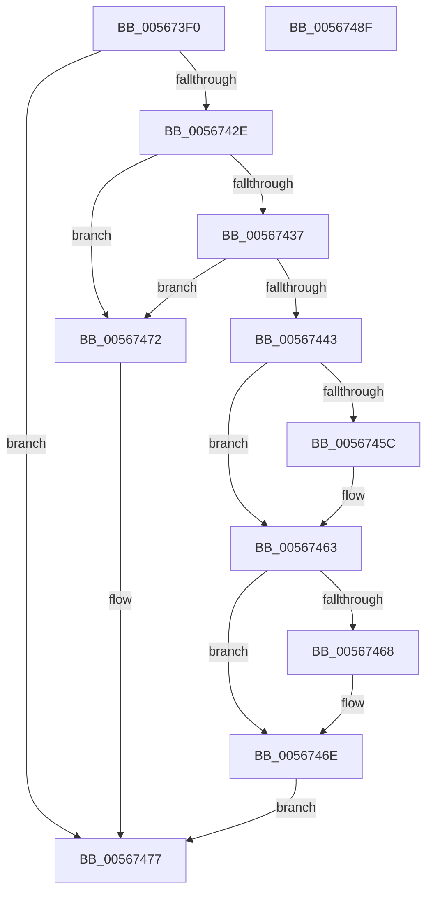

# IommupHvGetDeviceSvmCapabilities

- RVA: `0x005673F0`–`0x00567490` (길이 `160` bytes)
- VA: `0x00000001405673F0`
- 실행 섹션: `.text`
- PDB 이름 있음: `예`; PDB Function 태그: `아니요`
- unwind 정보 RVA: `0x000C4E0C`
- 디코드: `46`개 명령, `160/160` bytes 표시
- 미해석 바이트: `0` (있으면 어셈블리에 `.byte`로 보존)

> 이 문서는 커널 이미지의 기계어와 PDB 기호를 분석해 생성했습니다. 4번과 5번은 함수 원형과 자료형을 바이너리 사용 방식에서 추정한 C 해석이며 원본 소스 복구 결과는 아닙니다.

## 1. Dependencies

- 직접 호출 지점: **2**; 고유 호출 대상: **2**
- 직접 호출자로 확인된 함수: **1**
- RIP 상대 이미지 참조: **4**

### Outgoing calls
- `0x00567423` → [guard_dispatch_icall](../6B/guard_dispatch_icall_function_006BAAD0.md) (function, `0x006BAAD0`)
- `0x0056747F` → [_security_check_cookie](../6A/_security_check_cookie_function_006AC640.md) (function, `0x006AC640`)

### Direct callers
- [IommupMapDeviceInternal](IommupMapDeviceInternal_function_00566478.md) at `0x0056653A`

### Static image references
- `0x005673FA` → RVA `0x00E0A740` (`.data`; read)
- `0x00567409` → RVA `0x00FC1D60` (`.data`; read)
- `0x00567437` → RVA `0x00F8FAF0` (`.data`; read)
- `0x0056744B` → RVA `0x00F8FAC8` (`.data`; read)

## 2. Other-region calls and transfers

- 다른 실행 섹션으로 향하는 call: **0**
- 별도 외부 분기/꼬리 이동을 확인하지 못했습니다.

## 3. Assembly (complete function range)

```asm
005673F0  48 89 5C 24 20                  mov qword ptr [rsp + 0x20], rbx
005673F5  57                              push rdi
005673F6  48 83 EC 40                     sub rsp, 0x40
005673FA  48 8B 05 3F 33 8A 00            mov rax, qword ptr [rip + 0x8a333f]
00567401  48 33 C4                        xor rax, rsp
00567404  48 89 44 24 30                  mov qword ptr [rsp + 0x30], rax
00567409  48 8B 05 50 A9 A5 00            mov rax, qword ptr [rip + 0xa5a950]
00567410  48 8B FA                        mov rdi, rdx
00567413  0F 57 C0                        xorps xmm0, xmm0
00567416  48 8D 54 24 20                  lea rdx, [rsp + 0x20]
0056741B  0F 11 44 24 20                  movups xmmword ptr [rsp + 0x20], xmm0
00567420  49 8B D8                        mov rbx, r8
00567423  E8 A8 36 15 00                  call 0x1406baad0
00567428  33 C9                           xor ecx, ecx
0056742A  85 C0                           test eax, eax
0056742C  78 49                           js 0x140567477
0056742E  8B 54 24 20                     mov edx, dword ptr [rsp + 0x20]
00567432  F6 C2 01                        test dl, 1
00567435  74 3B                           je 0x140567472
00567437  8B 05 B3 86 A2 00               mov eax, dword ptr [rip + 0xa286b3]
0056743D  39 44 24 24                     cmp dword ptr [rsp + 0x24], eax
00567441  72 2F                           jb 0x140567472
00567443  8B 44 24 28                     mov eax, dword ptr [rsp + 0x28]
00567447  48 C1 E0 06                     shl rax, 6
0056744B  48 03 05 76 86 A2 00            add rax, qword ptr [rip + 0xa28676]
00567452  48 89 07                        mov qword ptr [rdi], rax
00567455  89 0B                           mov dword ptr [rbx], ecx
00567457  F6 C2 02                        test dl, 2
0056745A  74 07                           je 0x140567463
0056745C  B9 00 00 02 00                  mov ecx, 0x20000
00567461  89 0B                           mov dword ptr [rbx], ecx
00567463  F6 C2 04                        test dl, 4
00567466  74 06                           je 0x14056746e
00567468  0F BA E9 10                     bts ecx, 0x10
0056746C  89 0B                           mov dword ptr [rbx], ecx
0056746E  33 C0                           xor eax, eax
00567470  EB 05                           jmp 0x140567477
00567472  B8 BB 00 00 C0                  mov eax, 0xc00000bb
00567477  48 8B 4C 24 30                  mov rcx, qword ptr [rsp + 0x30]
0056747C  48 33 CC                        xor rcx, rsp
0056747F  E8 BC 51 14 00                  call 0x1406ac640
00567484  48 8B 5C 24 68                  mov rbx, qword ptr [rsp + 0x68]
00567489  48 83 C4 40                     add rsp, 0x40
0056748D  5F                              pop rdi
0056748E  C3                              ret
0056748F  CC                              int3
```

## 4. C-style interpretation (structured pseudocode)

```c
__int64 __fastcall IommupHvGetDeviceSvmCapabilities(int a1, __int64 a2, __int64 a3)
{
    __int64 result;
    __int64 v_rsp;
    unsigned __int64 v_stack_m18;
    unsigned int v_stack_m20;
    unsigned int v_stack_m24;
    unsigned __int64 v_stack_m28;
    unsigned __int64 v_stack_p20;

    v_stack_p20 = v_rbx;
    v_rsp = (v_rsp) - (64);
    result = (*(unsigned __int64 *)(v_rip + 9057087)) ^ (v_rsp);
    v_stack_m18 = result;
    v_stack_m28 = v_xmm0;
    result = guard_dispatch_icall(a1, v_stack_m28, a3, a4);
    a1 = 0;
    if (sign_flag) goto loc_00567477;
    if ((((unsigned __int8)((unsigned int)(v_stack_m28))) & (1)) == 0) goto loc_00567472;
    if (v_stack_m24 < ((unsigned int)((unsigned int)(*(unsigned int *)(v_rip + 10651315))))) goto loc_00567472;
    result = ((unsigned int)(v_stack_m20)) << (6);
    result = (result) + (*(unsigned __int64 *)(v_rip + 10651254));
    *(unsigned __int64 *)(a2) = result;
    *(unsigned int *)(a3) = 0;
    if ((((unsigned __int8)((unsigned int)(v_stack_m28))) & (2)) != 0) {
        a1 = 0x20000ULL;
        *(unsigned int *)(a3) = a1;
    }
    if ((((unsigned __int8)((unsigned int)(v_stack_m28))) & (4)) != 0) {
        *(unsigned int *)(a3) = a1;
    }
    result = 0;
    goto loc_00567477;
loc_00567472:
loc_00567477:
    a1 = (v_stack_m18) ^ (v_rsp);
    result = _security_check_cookie(a1, (unsigned int)(v_stack_m28), a3, a4);
    v_rsp = (v_rsp) + (64);
    return result;
}
```

## 5. (Beta) C Style

```c
int64_t IommupHvGetDeviceSvmCapabilities(int32_t Arg1, void *Arg2, void *Arg3)
{
    uint8_t *arg2 = (uint8_t *)Arg2;
    uint8_t *arg3 = (uint8_t *)Arg3;

    int64_t result;
    int64_t local_rsp;
    uint64_t v_stack_m18;
    uint32_t v_stack_m20;
    uint32_t v_stack_m24;
    uint64_t v_stack_m28;
    uint64_t v_stack_p20;

    v_stack_p20 = local_rbx;
    local_rsp = (local_rsp) - (64);
    result = (*(uint64_t *)(v_rip + 0x8A333F)) ^ (local_rsp);
    v_stack_m18 = result;
    v_stack_m28 = v_xmm0;
    result = guard_dispatch_icall(Arg1, v_stack_m28, Arg3, a4);
    Arg1 = 0;
    if (sign_flag) goto loc_00567477;
    if ((((uint8_t)((uint32_t)(v_stack_m28))) & (1)) == 0) goto loc_00567472;
    if (v_stack_m24 < ((uint32_t)((uint32_t)(*(uint32_t *)(v_rip + 0xA286B3))))) goto loc_00567472;
    result = ((uint32_t)(v_stack_m20)) << (6);
    result = (result) + (*(uint64_t *)(v_rip + 0xA28676));
    *(uint64_t *)(arg2) = result;
    *(uint32_t *)(arg3) = 0;
    if ((((uint8_t)((uint32_t)(v_stack_m28))) & (2)) != 0) {
        Arg1 = 0x20000ULL;
        *(uint32_t *)(arg3) = Arg1;
    }
    if ((((uint8_t)((uint32_t)(v_stack_m28))) & (4)) != 0) {
        *(uint32_t *)(arg3) = Arg1;
    }
    result = 0;
    goto loc_00567477;
loc_00567472:
loc_00567477:
    Arg1 = (v_stack_m18) ^ (local_rsp);
    result = _security_check_cookie(Arg1, (uint32_t)(v_stack_m28), Arg3, a4);
    local_rsp = (local_rsp) + (64);
    return result;
}
```

### 관측된 메모리 오프셋

구조체 형식이 확인되지 않은 접근은 인자 기준의 오프셋으로만 기록했습니다.

| 기준 인자 | 오프셋 표현 | 폭 (bit) | 접근 |
|---|---:|---:|---|
| `Arg2` | `+ 0x0` | `64` | `W` |
| `Arg3` | `+ 0x0` | `32` | `W` |

## 6. Execution-region graph

[열기: 2D/3D 그래프와 함수 탐색 컨트롤 패널](../../../control-panel.html?section=text&rva=0x005673F0&view=graph)

- 2D 그래프는 위에서 아래로 흐르고, 3D 그래프는 빈 공간을 드래그해 회전합니다. Shift+드래그는 이동, 휠은 확대·축소, 함수 노드 선택은 대상 보고서 이동입니다.

### Static fallback


