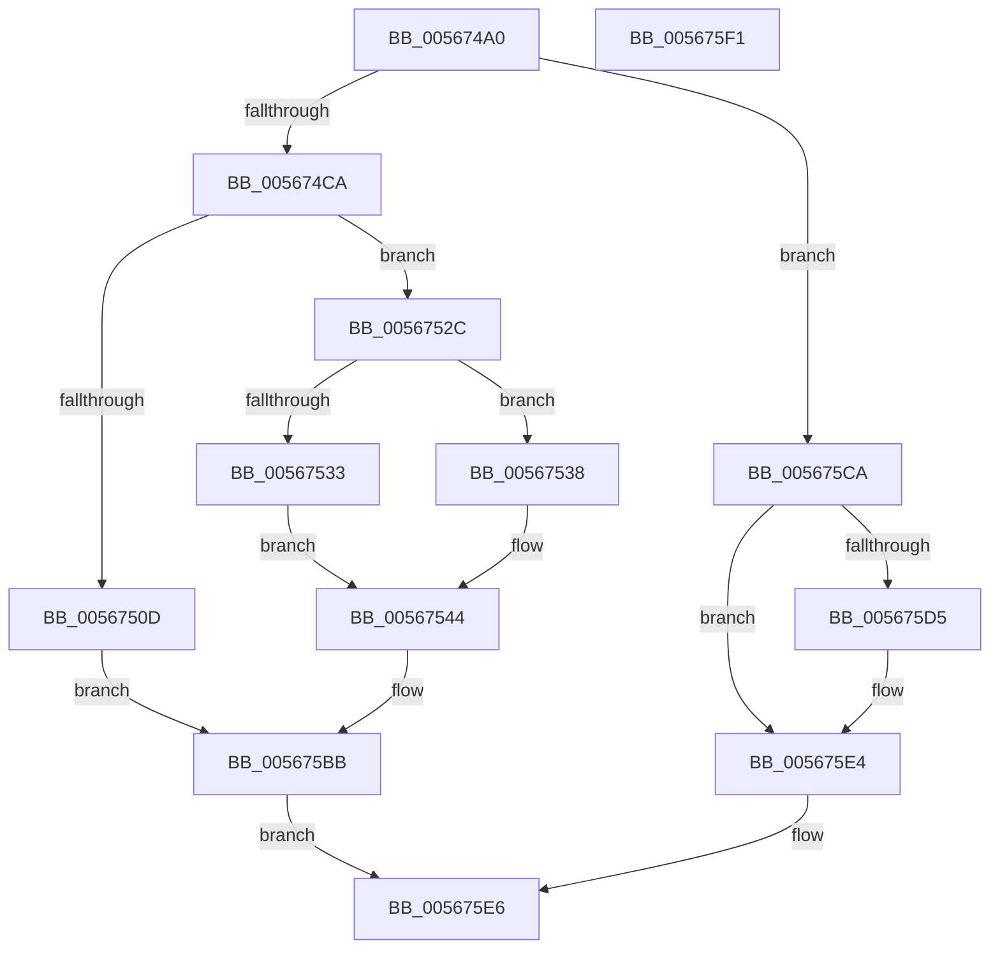

# IommupHvGetPageFault

- RVA: `0x005674A0`–`0x005675F2` (길이 `338` bytes)
- VA: `0x00000001405674A0`
- 실행 섹션: `.text`
- PDB 이름 있음: `예`; PDB Function 태그: `아니요`
- unwind 정보 RVA: `0x00065960`
- 디코드: `91`개 명령, `338/338` bytes 표시
- 미해석 바이트: `0` (있으면 어셈블리에 `.byte`로 보존)

> 이 문서는 커널 이미지의 기계어와 PDB 기호를 분석해 생성했습니다. 4번과 5번은 함수 원형과 자료형을 바이너리 사용 방식에서 추정한 C 해석이며 원본 소스 복구 결과는 아닙니다.

## 1. Dependencies

- 직접 호출 지점: **1**; 고유 호출 대상: **1**
- 직접 호출자로 확인된 함수: **0**
- RIP 상대 이미지 참조: **1**

### Outgoing calls
- `0x005675DF` → [guard_dispatch_icall](../6B/guard_dispatch_icall_function_006BAAD0.md) (function, `0x006BAAD0`)

### Direct callers
- 이 함수 시작 RVA로 연결되는 직접 call은 확인되지 않았습니다. 간접 호출은 완전히 역산할 수 없습니다.

### Static image references
- `0x005675D5` → RVA `0x00FC1DB8` (`.data`; read)

## 2. Other-region calls and transfers

- 다른 실행 섹션으로 향하는 call: **0**
- 별도 외부 분기/꼬리 이동을 확인하지 못했습니다.

## 3. Assembly (complete function range)

```asm
005674A0  48 89 5C 24 08                  mov qword ptr [rsp + 8], rbx
005674A5  57                              push rdi
005674A6  48 83 EC 40                     sub rsp, 0x40
005674AA  48 8B 41 08                     mov rax, qword ptr [rcx + 8]
005674AE  49 8B D9                        mov rbx, r9
005674B1  48 8B FA                        mov rdi, rdx
005674B4  4C 8B D9                        mov r11, rcx
005674B7  48 8B 00                        mov rax, qword ptr [rax]
005674BA  4C 8B D0                        mov r10, rax
005674BD  49 C1 EA 20                     shr r10, 0x20
005674C1  41 3B C2                        cmp eax, r10d
005674C4  0F 84 00 01 00 00               je 0x1405675ca
005674CA  48 8B 51 10                     mov rdx, qword ptr [rcx + 0x10]
005674CE  33 C9                           xor ecx, ecx
005674D0  44 8B C8                        mov r9d, eax
005674D3  49 C1 E1 05                     shl r9, 5
005674D7  FF C0                           inc eax
005674D9  3D 80 00 00 00                  cmp eax, 0x80
005674DE  41 0F 10 0C 11                  movups xmm1, xmmword ptr [r9 + rdx]
005674E3  0F 45 C8                        cmovne ecx, eax
005674E6  49 8B 43 08                     mov rax, qword ptr [r11 + 8]
005674EA  41 0F 10 44 11 10               movups xmm0, xmmword ptr [r9 + rdx + 0x10]
005674F0  0F 11 4C 24 20                  movups xmmword ptr [rsp + 0x20], xmm1
005674F5  66 0F 73 D9 08                  psrldq xmm1, 8
005674FA  66 49 0F 7E CA                  movq r10, xmm1
005674FF  49 0F BA E2 3F                  bt r10, 0x3f
00567504  0F 11 44 24 30                  movups xmmword ptr [rsp + 0x30], xmm0
00567509  89 08                           mov dword ptr [rax], ecx
0056750B  73 1F                           jae 0x14056752c
0056750D  83 0F FF                        or dword ptr [rdi], 0xffffffff
00567510  48 8B 44 24 70                  mov rax, qword ptr [rsp + 0x70]
00567515  49 83 20 00                     and qword ptr [r8], 0
00567519  66 81 0B FF FF                  or word ptr [rbx], 0xffff
0056751E  48 83 20 00                     and qword ptr [rax], 0
00567522  B8 20 00 00 00                  mov eax, 0x20
00567527  E9 8F 00 00 00                  jmp 0x1405675bb
0056752C  49 0F BA E2 0A                  bt r10, 0xa
00567531  72 05                           jb 0x140567538
00567533  83 C8 FF                        or eax, 0xffffffff
00567536  EB 0C                           jmp 0x140567544
00567538  49 8B C2                        mov rax, r10
0056753B  48 C1 E8 0B                     shr rax, 0xb
0056753F  25 FF FF 0F 00                  and eax, 0xfffff
00567544  89 07                           mov dword ptr [rdi], eax
00567546  B9 FF 01 00 00                  mov ecx, 0x1ff
0056754B  4C 8B 4C 24 30                  mov r9, qword ptr [rsp + 0x30]
00567550  48 8B 44 24 20                  mov rax, qword ptr [rsp + 0x20]
00567555  49 89 00                        mov qword ptr [r8], rax
00567558  41 0F B7 C2                     movzx eax, r10w
0056755C  66 23 C1                        and ax, cx
0056755F  49 8B C9                        mov rcx, r9
00567562  48 81 E1 00 F0 FF FF            and rcx, 0xfffffffffffff000
00567569  66 89 03                        mov word ptr [rbx], ax
0056756C  48 8B 44 24 70                  mov rax, qword ptr [rsp + 0x70]
00567571  48 89 08                        mov qword ptr [rax], rcx
00567574  49 8B C9                        mov rcx, r9
00567577  83 E1 01                        and ecx, 1
0056757A  8B D1                           mov edx, ecx
0056757C  48 83 CA 02                     or rdx, 2
00567580  41 F6 C1 02                     test r9b, 2
00567584  48 0F 44 D1                     cmove rdx, rcx
00567588  4C 8B C2                        mov r8, rdx
0056758B  49 83 C8 04                     or r8, 4
0056758F  41 F6 C1 04                     test r9b, 4
00567593  4C 0F 44 C2                     cmove r8, rdx
00567597  49 8B C8                        mov rcx, r8
0056759A  48 83 C9 08                     or rcx, 8
0056759E  41 F6 C1 08                     test r9b, 8
005675A2  49 0F 44 C8                     cmove rcx, r8
005675A6  41 81 E2 00 02 00 00            and r10d, 0x200
005675AD  48 8B C1                        mov rax, rcx
005675B0  48 83 C8 10                     or rax, 0x10
005675B4  4D 85 D2                        test r10, r10
005675B7  48 0F 44 C1                     cmove rax, rcx
005675BB  48 8B 4C 24 78                  mov rcx, qword ptr [rsp + 0x78]
005675C0  48 89 01                        mov qword ptr [rcx], rax
005675C3  B8 01 00 00 00                  mov eax, 1
005675C8  EB 1C                           jmp 0x1405675e6
005675CA  48 8B 41 08                     mov rax, qword ptr [rcx + 8]
005675CE  8A 48 09                        mov cl, byte ptr [rax + 9]
005675D1  84 C9                           test cl, cl
005675D3  74 0F                           je 0x1405675e4
005675D5  48 8B 05 DC A7 A5 00            mov rax, qword ptr [rip + 0xa5a7dc]
005675DC  41 8B 0B                        mov ecx, dword ptr [r11]
005675DF  E8 EC 34 15 00                  call 0x1406baad0
005675E4  33 C0                           xor eax, eax
005675E6  48 8B 5C 24 50                  mov rbx, qword ptr [rsp + 0x50]
005675EB  48 83 C4 40                     add rsp, 0x40
005675EF  5F                              pop rdi
005675F0  C3                              ret
005675F1  CC                              int3
```

## 4. C-style interpretation (structured pseudocode)

```c
__int64 __fastcall IommupHvGetPageFault(__int64 a1, __int64 a2, __int64 a3, __int64 a4, __int64 a5, __int64 a6)
{
    __int64 result;
    __int64 v_r10;
    __int64 v_rsp;
    unsigned __int64 v_stack_m18;
    unsigned __int64 v_stack_m28;
    unsigned __int64 v_stack_p8;

    v_stack_p8 = v_rbx;
    v_rsp = (v_rsp) - (64);
    v_r10 = (*(unsigned __int64 *)(*(unsigned __int64 *)(a1 + 8))) >> (32);
    if (((unsigned int)(*(unsigned __int64 *)(*(unsigned __int64 *)(a1 + 8)))) == ((unsigned int)(v_r10))) goto loc_005675CA;
    a1 = 0;
    a4 = ((unsigned int)((unsigned int)(*(unsigned __int64 *)(*(unsigned __int64 *)(a1 + 8))))) << (5);
    result = (unsigned int)((*(unsigned __int64 *)(*(unsigned __int64 *)(a1 + 8))) + 1);
    if (((unsigned int)(result)) != 128) { a1 = (unsigned int)(result); }
    v_stack_m28 = v_xmm1;
    v_stack_m18 = v_xmm0;
    *(unsigned int *)(*(unsigned __int64 *)(a1 + 8)) = (unsigned int)(a1);
    if (((unsigned int)(result)) >= 128) goto loc_0056752C;
    goto loc_005675BB;
loc_0056752C:
    if (((unsigned int)(result)) < 128) goto loc_00567538;
    result = (unsigned int)((32) | (0xFFFFFFFFULL));
    goto loc_00567544;
loc_00567538:
    result = (v_r10) >> (11);
    result = (unsigned int)((result) & (0xFFFFFULL));
loc_00567544:
    *(unsigned int *)(a2) = (unsigned int)(result);
    *(unsigned __int64 *)(a3) = v_stack_m28;
    result = (unsigned __int16)(((unsigned __int16)(v_r10)) & (511));
    a1 = (v_stack_m18) & (0xFFFFFFFFFFFFF000ULL);
    *(unsigned __int16 *)(a4) = (unsigned __int16)(result);
    *(unsigned __int64 *)(a5) = a1;
    a1 = (unsigned int)((v_stack_m18) & (1));
    a2 = ((unsigned int)((unsigned int)(a1))) | (2);
    if ((((unsigned __int8)(v_stack_m18)) & (2)) == 0) { a2 = a1; }
    a3 = (a2) | (4);
    if ((((unsigned __int8)(v_stack_m18)) & (4)) == 0) { a3 = a2; }
    a1 = (a3) | (8);
    if ((((unsigned __int8)(v_stack_m18)) & (8)) == 0) { a1 = a3; }
    v_r10 = (unsigned int)((v_r10) & (512));
    result = (a1) | (16);
    if (v_r10 == 0) { result = a1; }
loc_005675BB:
    *(unsigned __int64 *)(a6) = result;
    goto loc_005675E6;
loc_005675CA:
    result = *(unsigned __int64 *)(a6 + 8);
    if ((unsigned __int8)(*(unsigned __int8 *)(*(unsigned __int64 *)(a6 + 8) + 9)) != 0) {
        result = *(unsigned __int64 *)(v_rip + 10856412);
        a1 = *(unsigned int *)(a1);
        result = guard_dispatch_icall(a1, a2, a3, v_stack_m18);
    }
    result = 0;
loc_005675E6:
    v_rsp = (v_rsp) + (64);
    return result;
}
```

## 5. (Beta) C Style

```c
int64_t IommupHvGetPageFault(void *Arg1, void *Arg2, void *Arg3, void *Arg4, void *Arg5, void *Arg6)
{
    uint8_t *arg1 = (uint8_t *)Arg1;
    uint8_t *arg2 = (uint8_t *)Arg2;
    uint8_t *arg3 = (uint8_t *)Arg3;
    uint8_t *arg4 = (uint8_t *)Arg4;
    uint8_t *arg5 = (uint8_t *)Arg5;
    uint8_t *arg6 = (uint8_t *)Arg6;

    int64_t result;
    int64_t local_r10;
    int64_t local_rsp;
    uint64_t v_stack_m18;
    uint64_t v_stack_m28;
    uint64_t v_stack_p8;

    v_stack_p8 = local_rbx;
    local_rsp = (local_rsp) - (64);
    local_r10 = (*(uint64_t *)(*(uint64_t *)(arg1 + 0x8))) >> (32);
    if (((uint32_t)(*(uint64_t *)(*(uint64_t *)(arg1 + 0x8)))) == ((uint32_t)(local_r10))) goto loc_005675CA;
    Arg1 = 0;
    Arg4 = ((uint32_t)((uint32_t)(*(uint64_t *)(*(uint64_t *)(arg1 + 0x8))))) << (5);
    result = (uint32_t)((*(uint64_t *)(*(uint64_t *)(arg1 + 0x8))) + 1);
    if (((uint32_t)(result)) != 128) { Arg1 = (uint32_t)(result); }
    v_stack_m28 = v_xmm1;
    v_stack_m18 = v_xmm0;
    *(uint32_t *)(*(uint64_t *)(arg1 + 0x8)) = (uint32_t)(Arg1);
    if (((uint32_t)(result)) >= 128) goto loc_0056752C;
    goto loc_005675BB;
loc_0056752C:
    if (((uint32_t)(result)) < 128) goto loc_00567538;
    result = (uint32_t)((32) | (0xFFFFFFFFULL));
    goto loc_00567544;
loc_00567538:
    result = (local_r10) >> (11);
    result = (uint32_t)((result) & (0xFFFFFULL));
loc_00567544:
    *(uint32_t *)(arg2) = (uint32_t)(result);
    *(uint64_t *)(arg3) = v_stack_m28;
    result = (uint16_t)(((uint16_t)(local_r10)) & (511));
    Arg1 = (v_stack_m18) & (0xFFFFFFFFFFFFF000ULL);
    *(uint16_t *)(arg4) = (uint16_t)(result);
    *(void **)(arg5) = Arg1;
    Arg1 = (uint32_t)((v_stack_m18) & (1));
    Arg2 = ((uint32_t)((uint32_t)(Arg1))) | (2);
    if ((((uint8_t)(v_stack_m18)) & (2)) == 0) { Arg2 = Arg1; }
    Arg3 = (Arg2) | (4);
    if ((((uint8_t)(v_stack_m18)) & (4)) == 0) { Arg3 = Arg2; }
    Arg1 = (Arg3) | (8);
    if ((((uint8_t)(v_stack_m18)) & (8)) == 0) { Arg1 = Arg3; }
    local_r10 = (uint32_t)((local_r10) & (512));
    result = (Arg1) | (16);
    if (local_r10 == 0) { result = Arg1; }
loc_005675BB:
    *(uint64_t *)(arg6) = result;
    goto loc_005675E6;
loc_005675CA:
    result = *(uint64_t *)(arg6 + 0x8);
    if ((uint8_t)(*(uint8_t *)(*(uint64_t *)(arg6 + 0x8) + 0x9)) != 0) {
        result = *(uint64_t *)(v_rip + 0xA5A7DC);
        Arg1 = *(uint32_t *)(arg1);
        result = guard_dispatch_icall(Arg1, Arg2, Arg3, v_stack_m18);
    }
    result = 0;
loc_005675E6:
    local_rsp = (local_rsp) + (64);
    return result;
}
```

### 관측된 메모리 오프셋

구조체 형식이 확인되지 않은 접근은 인자 기준의 오프셋으로만 기록했습니다.

| 기준 인자 | 오프셋 표현 | 폭 (bit) | 접근 |
|---|---:|---:|---|
| `Arg1` | `+ 0x0` | `32` | `R` |
| `Arg1` | `+ 0x8` | `64` | `R` |
| `Arg1` | `+ 0x10` | `64` | `R` |
| `Arg2` | `+ 0x0` | `32` | `R/W` |
| `Arg2` | `+ 0x0` | `32` | `W` |
| `Arg3` | `+ 0x0` | `64` | `R/W` |
| `Arg3` | `+ 0x0` | `64` | `W` |
| `Arg4` | `+ 0x0` | `16` | `R/W` |
| `Arg4` | `+ 0x0` | `16` | `W` |
| `Arg5` | `+ 0x0` | `64` | `R/W` |
| `Arg5` | `+ 0x0` | `64` | `W` |
| `Arg6` | `+ 0x0` | `64` | `W` |

## 6. Execution-region graph

[열기: 2D/3D 그래프와 함수 탐색 컨트롤 패널](../../../control-panel.html?section=text&rva=0x005674A0&view=graph)

- 2D 그래프는 위에서 아래로 흐르고, 3D 그래프는 빈 공간을 드래그해 회전합니다. Shift+드래그는 이동, 휠은 확대·축소, 함수 노드 선택은 대상 보고서 이동입니다.

### Static fallback


