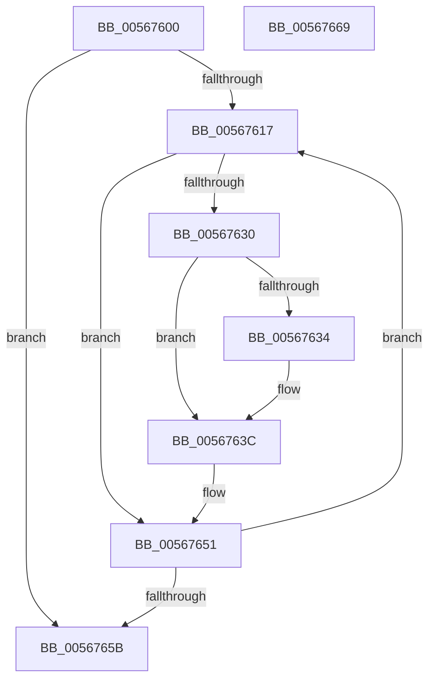

# IommupHvInterruptRoutine

- RVA: `0x00567600`–`0x0056766A` (길이 `106` bytes)
- VA: `0x0000000140567600`
- 실행 섹션: `.text`
- PDB 이름 있음: `예`; PDB Function 태그: `아니요`
- unwind 정보 RVA: `0x0005CAAC`
- 디코드: `32`개 명령, `106/106` bytes 표시
- 미해석 바이트: `0` (있으면 어셈블리에 `.byte`로 보존)

> 이 문서는 커널 이미지의 기계어와 PDB 기호를 분석해 생성했습니다. 4번과 5번은 함수 원형과 자료형을 바이너리 사용 방식에서 추정한 C 해석이며 원본 소스 복구 결과는 아닙니다.

## 1. Dependencies

- 직접 호출 지점: **1**; 고유 호출 대상: **1**
- 직접 호출자로 확인된 함수: **0**
- RIP 상대 이미지 참조: **3**

### Outgoing calls
- `0x0056764C` → [guard_dispatch_icall](../6B/guard_dispatch_icall_function_006BAAD0.md) (function, `0x006BAAD0`)

### Direct callers
- 이 함수 시작 RVA로 연결되는 직접 call은 확인되지 않았습니다. 간접 호출은 완전히 역산할 수 없습니다.

### Static image references
- `0x0056760F` → RVA `0x00F8FAD8` (`.data`; read)
- `0x0056761D` → RVA `0x00F8FAC8` (`.data`; read)
- `0x0056763C` → RVA `0x00E06D28` (`.data`; read)

## 2. Other-region calls and transfers

- 다른 실행 섹션으로 향하는 call: **0**
- 별도 외부 분기/꼬리 이동을 확인하지 못했습니다.

## 3. Assembly (complete function range)

```asm
00567600  48 89 5C 24 08                  mov qword ptr [rsp + 8], rbx
00567605  57                              push rdi
00567606  48 83 EC 20                     sub rsp, 0x20
0056760A  40 32 FF                        xor dil, dil
0056760D  33 DB                           xor ebx, ebx
0056760F  39 1D C3 84 A2 00               cmp dword ptr [rip + 0xa284c3], ebx
00567615  76 44                           jbe 0x14056765b
00567617  8B CB                           mov ecx, ebx
00567619  48 C1 E1 06                     shl rcx, 6
0056761D  48 03 0D A4 84 A2 00            add rcx, qword ptr [rip + 0xa284a4]
00567624  48 8B 41 08                     mov rax, qword ptr [rcx + 8]
00567628  8B 50 08                        mov edx, dword ptr [rax + 8]
0056762B  66 85 D2                        test dx, dx
0056762E  74 21                           je 0x140567651
00567630  84 D2                           test dl, dl
00567632  74 08                           je 0x14056763c
00567634  48 8B 41 08                     mov rax, qword ptr [rcx + 8]
00567638  C6 40 08 00                     mov byte ptr [rax + 8], 0
0056763C  48 8B 0D E5 F6 89 00            mov rcx, qword ptr [rip + 0x89f6e5]
00567643  40 B7 01                        mov dil, 1
00567646  48 8B 41 60                     mov rax, qword ptr [rcx + 0x60]
0056764A  8B CB                           mov ecx, ebx
0056764C  E8 7F 34 15 00                  call 0x1406baad0
00567651  FF C3                           inc ebx
00567653  3B 1D 7F 84 A2 00               cmp ebx, dword ptr [rip + 0xa2847f]
00567659  72 BC                           jb 0x140567617
0056765B  48 8B 5C 24 30                  mov rbx, qword ptr [rsp + 0x30]
00567660  40 8A C7                        mov al, dil
00567663  48 83 C4 20                     add rsp, 0x20
00567667  5F                              pop rdi
00567668  C3                              ret
00567669  CC                              int3
```

## 4. C-style interpretation (structured pseudocode)

```c
__int64 __fastcall IommupHvInterruptRoutine(void)
{
    __int64 result;
    __int64 v_rbx;
    __int64 v_rdi;
    __int64 v_rsp;
    unsigned __int64 v_stack_p8;

    v_stack_p8 = v_rbx;
    v_rsp = (v_rsp) - (32);
    v_rdi = 0;
    v_rbx = 0;
    if ((*(unsigned int *)(v_rip + 10650819)) <= 0) goto loc_0056765B;
loc_00567617:
    a1 = (0) << (6);
    a1 = (a1) + (*(unsigned __int64 *)(v_rip + 10650788));
    if ((unsigned __int16)((unsigned int)(*(unsigned int *)(*(unsigned __int64 *)(a1 + 8) + 8))) == 0) goto loc_00567651;
    result = *(unsigned __int64 *)(a1 + 8);
    if ((unsigned __int8)((unsigned int)(*(unsigned int *)(*(unsigned __int64 *)(a1 + 8) + 8))) != 0) {
        result = *(unsigned __int64 *)(a1 + 8);
        *(unsigned __int8 *)(result + 8) = 0;
    }
    result = guard_dispatch_icall(0, (unsigned int)(*(unsigned int *)(*(unsigned __int64 *)(a1 + 8) + 8)), a3, a4);
loc_00567651:
    v_rbx = (unsigned int)((v_rbx) + 1);
    if (((unsigned int)(v_rbx)) < (*(unsigned int *)(v_rip + 10650751))) goto loc_00567617;
loc_0056765B:
    v_rsp = (v_rsp) + (32);
    return 1;
}
```

## 5. (Beta) C Style

```c
void IommupHvInterruptRoutine(void)
{
    int64_t result;
    int64_t local_rbx;
    int64_t local_rdi;
    int64_t local_rsp;
    uint64_t v_stack_p8;

    v_stack_p8 = local_rbx;
    local_rsp = (local_rsp) - (32);
    local_rdi = 0;
    local_rbx = 0;
    if ((*(uint32_t *)(v_rip + 0xA284C3)) <= 0) goto loc_0056765B;
loc_00567617:
    a1 = (0) << (6);
    a1 = (a1) + (*(uint64_t *)(v_rip + 0xA284A4));
    if ((uint16_t)((uint32_t)(*(uint32_t *)(*(uint64_t *)(a1 + 0x8) + 0x8))) == 0) goto loc_00567651;
    result = *(uint64_t *)(a1 + 0x8);
    if ((uint8_t)((uint32_t)(*(uint32_t *)(*(uint64_t *)(a1 + 0x8) + 0x8))) != 0) {
        result = *(uint64_t *)(a1 + 0x8);
        *(uint8_t *)(result + 0x8) = 0;
    }
    result = guard_dispatch_icall(0, (uint32_t)(*(uint32_t *)(*(uint64_t *)(a1 + 0x8) + 0x8)), a3, a4);
loc_00567651:
    local_rbx = (uint32_t)((local_rbx) + 1);
    if (((uint32_t)(local_rbx)) < (*(uint32_t *)(v_rip + 0xA2847F))) goto loc_00567617;
loc_0056765B:
    local_rsp = (local_rsp) + (32);
    return 1;
}
```

## 6. Execution-region graph

[열기: 2D/3D 그래프와 함수 탐색 컨트롤 패널](../../../control-panel.html?section=text&rva=0x00567600&view=graph)

- 2D 그래프는 위에서 아래로 흐르고, 3D 그래프는 빈 공간을 드래그해 회전합니다. Shift+드래그는 이동, 휠은 확대·축소, 함수 노드 선택은 대상 보고서 이동입니다.

### Static fallback


