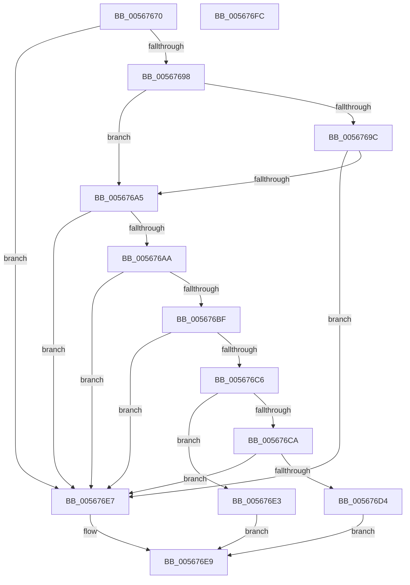

# IommupHvIsStage1DmarCompatible

- RVA: `0x00567670`–`0x005676FD` (길이 `141` bytes)
- VA: `0x0000000140567670`
- 실행 섹션: `.text`
- PDB 이름 있음: `예`; PDB Function 태그: `아니요`
- unwind 정보 RVA: `0x000AB2E4`
- 디코드: `41`개 명령, `141/141` bytes 표시
- 미해석 바이트: `0` (있으면 어셈블리에 `.byte`로 보존)

> 이 문서는 커널 이미지의 기계어와 PDB 기호를 분석해 생성했습니다. 4번과 5번은 함수 원형과 자료형을 바이너리 사용 방식에서 추정한 C 해석이며 원본 소스 복구 결과는 아닙니다.

## 1. Dependencies

- 직접 호출 지점: **2**; 고유 호출 대상: **2**
- 직접 호출자로 확인된 함수: **2**
- RIP 상대 이미지 참조: **5**

### Outgoing calls
- `0x005676B6` → [guard_dispatch_icall](../6B/guard_dispatch_icall_function_006BAAD0.md) (function, `0x006BAAD0`)
- `0x005676F1` → [_security_check_cookie](../6A/_security_check_cookie_function_006AC640.md) (function, `0x006AC640`)

### Direct callers
- [HalpDmaGetDefaultRemappingDomainPolicy](../53/HalpDmaGetDefaultRemappingDomainPolicy_function_0053E240.md) at `0x0053E281`
- [IommupDeviceEnablePasidTaggedDma](../../page/70/IommupDeviceEnablePasidTaggedDma_function_00708B74.md) at `0x00708C59`

### Static image references
- `0x00567676` → RVA `0x00E0A740` (`.data`; read)
- `0x00567685` → RVA `0x00FC1711` (`.data`; read)
- `0x0056769C` → RVA `0x00F8FAD0` (`.data`; read)
- `0x005676AA` → RVA `0x00FC1D60` (`.data`; read)
- `0x005676D4` → RVA `0x00F8FAF0` (`.data`; read)

## 2. Other-region calls and transfers

- 다른 실행 섹션으로 향하는 call: **0**
- 별도 외부 분기/꼬리 이동을 확인하지 못했습니다.

## 3. Assembly (complete function range)

```asm
00567670  40 53                           push rbx
00567672  48 83 EC 40                     sub rsp, 0x40
00567676  48 8B 05 C3 30 8A 00            mov rax, qword ptr [rip + 0x8a30c3]
0056767D  48 33 C4                        xor rax, rsp
00567680  48 89 44 24 30                  mov qword ptr [rsp + 0x30], rax
00567685  80 3D 85 A0 A5 00 00            cmp byte ptr [rip + 0xa5a085], 0
0056768C  0F 57 C0                        xorps xmm0, xmm0
0056768F  0F 11 44 24 20                  movups xmmword ptr [rsp + 0x20], xmm0
00567694  8A DA                           mov bl, dl
00567696  74 4F                           je 0x1405676e7
00567698  84 D2                           test dl, dl
0056769A  74 09                           je 0x1405676a5
0056769C  80 3D 2D 84 A2 00 00            cmp byte ptr [rip + 0xa2842d], 0
005676A3  74 42                           je 0x1405676e7
005676A5  83 39 01                        cmp dword ptr [rcx], 1
005676A8  75 3D                           jne 0x1405676e7
005676AA  48 8B 05 AF A6 A5 00            mov rax, qword ptr [rip + 0xa5a6af]
005676B1  48 8D 54 24 20                  lea rdx, [rsp + 0x20]
005676B6  E8 15 34 15 00                  call 0x1406baad0
005676BB  85 C0                           test eax, eax
005676BD  78 28                           js 0x1405676e7
005676BF  F6 44 24 20 20                  test byte ptr [rsp + 0x20], 0x20
005676C4  74 21                           je 0x1405676e7
005676C6  84 DB                           test bl, bl
005676C8  74 19                           je 0x1405676e3
005676CA  F7 44 24 20 00 02 00 00         test dword ptr [rsp + 0x20], 0x200
005676D2  74 13                           je 0x1405676e7
005676D4  8B 05 16 84 A2 00               mov eax, dword ptr [rip + 0xa28416]
005676DA  39 44 24 24                     cmp dword ptr [rsp + 0x24], eax
005676DE  0F 93 C0                        setae al
005676E1  EB 06                           jmp 0x1405676e9
005676E3  B0 01                           mov al, 1
005676E5  EB 02                           jmp 0x1405676e9
005676E7  32 C0                           xor al, al
005676E9  48 8B 4C 24 30                  mov rcx, qword ptr [rsp + 0x30]
005676EE  48 33 CC                        xor rcx, rsp
005676F1  E8 4A 4F 14 00                  call 0x1406ac640
005676F6  48 83 C4 40                     add rsp, 0x40
005676FA  5B                              pop rbx
005676FB  C3                              ret
005676FC  CC                              int3
```

## 4. C-style interpretation (structured pseudocode)

```c
__int64 __fastcall IommupHvIsStage1DmarCompatible(__int64 a1, unsigned __int8 a2)
{
    __int64 result;
    __int64 v_rsp;
    unsigned __int64 v_stack_m18;
    unsigned int v_stack_m24;
    unsigned __int64 v_stack_m28;

    v_rsp = (v_rsp) - (64);
    result = (*(unsigned __int64 *)(v_rip + 9056451)) ^ (v_rsp);
    v_stack_m18 = result;
    v_stack_m28 = v_xmm0;
    if ((*(unsigned __int8 *)(v_rip + 10854533)) == 0) goto loc_005676E7;
    if (a2 == 0) goto loc_005676A5;
    if ((*(unsigned __int8 *)(v_rip + 10650669)) == 0) goto loc_005676E7;
loc_005676A5:
    if ((*(unsigned int *)(a1)) != 1) goto loc_005676E7;
    result = guard_dispatch_icall(a1, v_stack_m28, a3, a4);
    if (sign_flag) goto loc_005676E7;
    if (((v_stack_m28) & (32)) == 0) goto loc_005676E7;
    if (a2 == 0) goto loc_005676E3;
    if (((v_stack_m28) & (512)) == 0) goto loc_005676E7;
    result = (v_stack_m24 >= ((unsigned int)((unsigned int)(*(unsigned int *)(v_rip + 10650646))))) ? 1 : 0;
    goto loc_005676E9;
loc_005676E3:
    goto loc_005676E9;
loc_005676E7:
    result = 0;
loc_005676E9:
    a1 = (v_stack_m18) ^ (v_rsp);
    result = _security_check_cookie(a1, v_stack_m28, a3, a4);
    v_rsp = (v_rsp) + (64);
    return result;
}
```

## 5. (Beta) C Style

```c
int64_t IommupHvIsStage1DmarCompatible(void *Arg1, uint8_t Arg2)
{
    uint8_t *arg1 = (uint8_t *)Arg1;

    int64_t result;
    int64_t local_rsp;
    uint64_t v_stack_m18;
    uint32_t v_stack_m24;
    uint64_t v_stack_m28;

    local_rsp = (local_rsp) - (64);
    result = (*(uint64_t *)(v_rip + 0x8A30C3)) ^ (local_rsp);
    v_stack_m18 = result;
    v_stack_m28 = v_xmm0;
    if ((*(uint8_t *)(v_rip + 0xA5A085)) == 0) goto loc_005676E7;
    if (Arg2 == 0) goto loc_005676A5;
    if ((*(uint8_t *)(v_rip + 0xA2842D)) == 0) goto loc_005676E7;
loc_005676A5:
    if ((*(uint32_t *)(arg1)) != 1) goto loc_005676E7;
    result = guard_dispatch_icall(Arg1, v_stack_m28, a3, a4);
    if (sign_flag) goto loc_005676E7;
    if (((v_stack_m28) & (32)) == 0) goto loc_005676E7;
    if (Arg2 == 0) goto loc_005676E3;
    if (((v_stack_m28) & (512)) == 0) goto loc_005676E7;
    result = (v_stack_m24 >= ((uint32_t)((uint32_t)(*(uint32_t *)(v_rip + 0xA28416))))) ? 1 : 0;
    goto loc_005676E9;
loc_005676E3:
    goto loc_005676E9;
loc_005676E7:
    result = 0;
loc_005676E9:
    Arg1 = (v_stack_m18) ^ (local_rsp);
    result = _security_check_cookie(Arg1, v_stack_m28, a3, a4);
    local_rsp = (local_rsp) + (64);
    return result;
}
```

### 관측된 메모리 오프셋

구조체 형식이 확인되지 않은 접근은 인자 기준의 오프셋으로만 기록했습니다.

| 기준 인자 | 오프셋 표현 | 폭 (bit) | 접근 |
|---|---:|---:|---|
| `Arg1` | `+ 0x0` | `32` | `R` |

## 6. Execution-region graph

[열기: 2D/3D 그래프와 함수 탐색 컨트롤 패널](../../../control-panel.html?section=text&rva=0x00567670&view=graph)

- 2D 그래프는 위에서 아래로 흐르고, 3D 그래프는 빈 공간을 드래그해 회전합니다. Shift+드래그는 이동, 휠은 확대·축소, 함수 노드 선택은 대상 보고서 이동입니다.

### Static fallback


