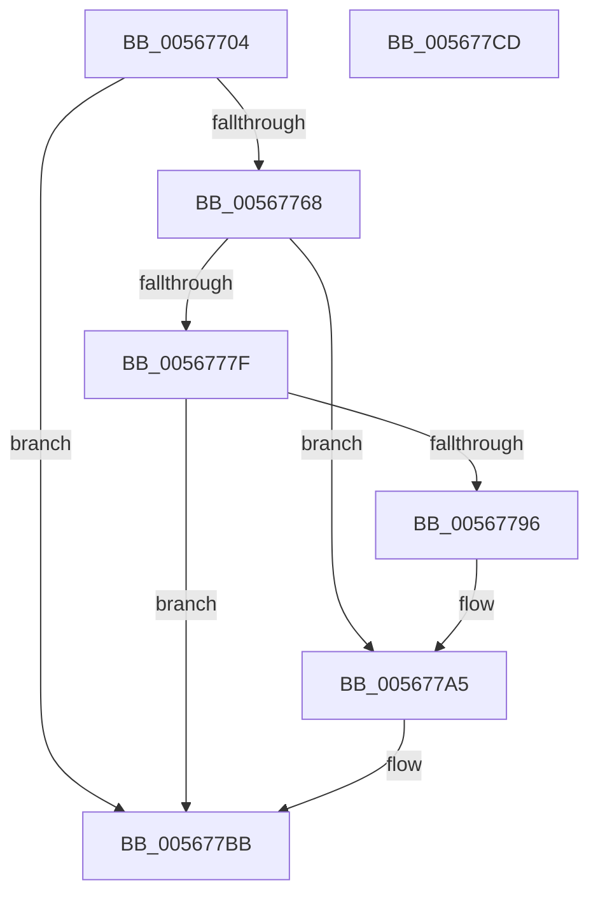

# IommupHvMapDevice

- RVA: `0x00567704`–`0x005677CE` (길이 `202` bytes)
- VA: `0x0000000140567704`
- 실행 섹션: `.text`
- PDB 이름 있음: `예`; PDB Function 태그: `아니요`
- unwind 정보 RVA: `0x00060BC4`
- 디코드: `56`개 명령, `202/202` bytes 표시
- 미해석 바이트: `0` (있으면 어셈블리에 `.byte`로 보존)

> 이 문서는 커널 이미지의 기계어와 PDB 기호를 분석해 생성했습니다. 4번과 5번은 함수 원형과 자료형을 바이너리 사용 방식에서 추정한 C 해석이며 원본 소스 복구 결과는 아닙니다.

## 1. Dependencies

- 직접 호출 지점: **5**; 고유 호출 대상: **1**
- 직접 호출자로 확인된 함수: **1**
- RIP 상대 이미지 참조: **4**

### Outgoing calls
- `0x0056775D` → [guard_dispatch_icall](../6B/guard_dispatch_icall_function_006BAAD0.md) (function, `0x006BAAD0`)
- `0x00567774` → [guard_dispatch_icall](../6B/guard_dispatch_icall_function_006BAAD0.md) (function, `0x006BAAD0`)
- `0x0056778B` → [guard_dispatch_icall](../6B/guard_dispatch_icall_function_006BAAD0.md) (function, `0x006BAAD0`)
- `0x005677A0` → [guard_dispatch_icall](../6B/guard_dispatch_icall_function_006BAAD0.md) (function, `0x006BAAD0`)
- `0x005677B6` → [guard_dispatch_icall](../6B/guard_dispatch_icall_function_006BAAD0.md) (function, `0x006BAAD0`)

### Direct callers
- [IommupMapDeviceInternal](IommupMapDeviceInternal_function_00566478.md) at `0x00566554`

### Static image references
- `0x00567747` → RVA `0x00FC1DC8` (`.data`; read)
- `0x00567768` → RVA `0x00FC1D80` (`.data`; read)
- `0x0056777F` → RVA `0x00FC1DD0` (`.data`; read)
- `0x00567796` → RVA `0x00FC1D88` (`.data`; read)

## 2. Other-region calls and transfers

- 다른 실행 섹션으로 향하는 call: **0**
- 별도 외부 분기/꼬리 이동을 확인하지 못했습니다.

## 3. Assembly (complete function range)

```asm
00567704  48 89 5C 24 08                  mov qword ptr [rsp + 8], rbx
00567709  48 89 74 24 10                  mov qword ptr [rsp + 0x10], rsi
0056770E  57                              push rdi
0056770F  48 83 EC 20                     sub rsp, 0x20
00567713  41 8B 11                        mov edx, dword ptr [r9]
00567716  49 8B F0                        mov rsi, r8
00567719  8B C2                           mov eax, edx
0056771B  44 8B C2                        mov r8d, edx
0056771E  41 D1 E8                        shr r8d, 1
00567721  25 00 00 02 00                  and eax, 0x20000
00567726  41 81 E0 00 F8 00 00            and r8d, 0xf800
0056772D  48 8B F9                        mov rdi, rcx
00567730  44 0B C0                        or r8d, eax
00567733  8B C2                           mov eax, edx
00567735  41 C1 E8 03                     shr r8d, 3
00567739  25 F8 00 00 00                  and eax, 0xf8
0056773E  44 0B C0                        or r8d, eax
00567741  81 E2 00 08 00 00               and edx, 0x800
00567747  48 8B 05 7A A6 A5 00            mov rax, qword ptr [rip + 0xa5a67a]
0056774E  41 C1 E8 02                     shr r8d, 2
00567752  44 0B C2                        or r8d, edx
00567755  BA 0E 00 00 00                  mov edx, 0xe
0056775A  41 D1 E8                        shr r8d, 1
0056775D  E8 6E 33 15 00                  call 0x1406baad0
00567762  8B D8                           mov ebx, eax
00567764  85 C0                           test eax, eax
00567766  78 53                           js 0x1405677bb
00567768  48 8B 05 11 A6 A5 00            mov rax, qword ptr [rip + 0xa5a611]
0056776F  33 D2                           xor edx, edx
00567771  48 8B CF                        mov rcx, rdi
00567774  E8 57 33 15 00                  call 0x1406baad0
00567779  8B D8                           mov ebx, eax
0056777B  85 C0                           test eax, eax
0056777D  78 26                           js 0x1405677a5
0056777F  48 8B 05 4A A6 A5 00            mov rax, qword ptr [rip + 0xa5a64a]
00567786  48 8B CF                        mov rcx, rdi
00567789  8B 16                           mov edx, dword ptr [rsi]
0056778B  E8 40 33 15 00                  call 0x1406baad0
00567790  8B D8                           mov ebx, eax
00567792  85 C0                           test eax, eax
00567794  79 25                           jns 0x1405677bb
00567796  48 8B 05 EB A5 A5 00            mov rax, qword ptr [rip + 0xa5a5eb]
0056779D  48 8B CF                        mov rcx, rdi
005677A0  E8 2B 33 15 00                  call 0x1406baad0
005677A5  48 8B 05 1C A6 A5 00            mov rax, qword ptr [rip + 0xa5a61c]
005677AC  45 33 C0                        xor r8d, r8d
005677AF  48 8B CF                        mov rcx, rdi
005677B2  41 8D 50 05                     lea edx, [r8 + 5]
005677B6  E8 15 33 15 00                  call 0x1406baad0
005677BB  48 8B 74 24 38                  mov rsi, qword ptr [rsp + 0x38]
005677C0  8B C3                           mov eax, ebx
005677C2  48 8B 5C 24 30                  mov rbx, qword ptr [rsp + 0x30]
005677C7  48 83 C4 20                     add rsp, 0x20
005677CB  5F                              pop rdi
005677CC  C3                              ret
005677CD  CC                              int3
```

## 4. C-style interpretation (structured pseudocode)

```c
__int64 __fastcall IommupHvMapDevice(__int64 a1, __int64 a2, __int64 a3, __int64 a4)
{
    __int64 result;
    __int64 v_rsp;
    unsigned __int64 v_stack_p10;
    unsigned __int64 v_stack_p8;

    v_stack_p8 = v_rbx;
    v_stack_p10 = v_rsi;
    v_rsp = (v_rsp) - (32);
    a3 = (unsigned int)(((unsigned int)((unsigned int)((unsigned int)(*(unsigned int *)(a4))))) >> (1));
    result = (unsigned int)(((unsigned int)((unsigned int)((unsigned int)(*(unsigned int *)(a4))))) & (0x20000ULL));
    a3 = (unsigned int)((a3) & (0xF800ULL));
    a3 = (unsigned int)((a3) | ((unsigned int)(result)));
    a3 = (unsigned int)((a3) >> (3));
    result = (unsigned int)(((unsigned int)((unsigned int)((unsigned int)(*(unsigned int *)(a4))))) & (248));
    a3 = (unsigned int)((a3) | ((unsigned int)(result)));
    a2 = (unsigned int)(((unsigned int)(*(unsigned int *)(a4))) & (0x800ULL));
    a3 = (unsigned int)((a3) >> (2));
    a3 = (unsigned int)((a3) | ((unsigned int)(a2)));
    a3 = (unsigned int)((a3) >> (1));
    result = guard_dispatch_icall(a1, 14, a3, a4);
    if (sign_flag) goto loc_005677BB;
    a2 = 0;
    result = guard_dispatch_icall(a1, a2, a3, a4);
    if (sign_flag) goto loc_005677A5;
    result = guard_dispatch_icall(a1, (unsigned int)(*(unsigned int *)(a3)), a3, a4);
    if (!sign_flag) goto loc_005677BB;
    result = guard_dispatch_icall(a1, (unsigned int)(*(unsigned int *)(a3)), a3, a4);
loc_005677A5:
    a3 = 0;
    result = guard_dispatch_icall(a1, a3 + 5, a3, a4);
loc_005677BB:
    v_rsp = (v_rsp) + (32);
    return (unsigned int)((unsigned int)((unsigned int)((unsigned int)(result))));
}
```

## 5. (Beta) C Style

```c
int64_t IommupHvMapDevice(int64_t Arg1, int64_t Arg2, void *Arg3, void *Arg4)
{
    uint8_t *arg3 = (uint8_t *)Arg3;
    uint8_t *arg4 = (uint8_t *)Arg4;

    int64_t result;
    int64_t local_rsp;
    uint64_t v_stack_p10;
    uint64_t v_stack_p8;

    v_stack_p8 = local_rbx;
    v_stack_p10 = local_rsi;
    local_rsp = (local_rsp) - (32);
    Arg3 = (uint32_t)(((uint32_t)((uint32_t)((uint32_t)(*(uint32_t *)(arg4))))) >> (1));
    result = (uint32_t)(((uint32_t)((uint32_t)((uint32_t)(*(uint32_t *)(arg4))))) & (0x20000ULL));
    Arg3 = (uint32_t)((Arg3) & (0xF800ULL));
    Arg3 = (uint32_t)((Arg3) | ((uint32_t)(result)));
    Arg3 = (uint32_t)((Arg3) >> (3));
    result = (uint32_t)(((uint32_t)((uint32_t)((uint32_t)(*(uint32_t *)(arg4))))) & (248));
    Arg3 = (uint32_t)((Arg3) | ((uint32_t)(result)));
    Arg2 = (uint32_t)(((uint32_t)(*(uint32_t *)(arg4))) & (0x800ULL));
    Arg3 = (uint32_t)((Arg3) >> (2));
    Arg3 = (uint32_t)((Arg3) | ((uint32_t)(Arg2)));
    Arg3 = (uint32_t)((Arg3) >> (1));
    result = guard_dispatch_icall(Arg1, 14, Arg3, Arg4);
    if (sign_flag) goto loc_005677BB;
    Arg2 = 0;
    result = guard_dispatch_icall(Arg1, Arg2, Arg3, Arg4);
    if (sign_flag) goto loc_005677A5;
    result = guard_dispatch_icall(Arg1, (uint32_t)(*(uint32_t *)(arg3)), Arg3, Arg4);
    if (!sign_flag) goto loc_005677BB;
    result = guard_dispatch_icall(Arg1, (uint32_t)(*(uint32_t *)(arg3)), Arg3, Arg4);
loc_005677A5:
    Arg3 = 0;
    result = guard_dispatch_icall(Arg1, Arg3 + 5, Arg3, Arg4);
loc_005677BB:
    local_rsp = (local_rsp) + (32);
    return (uint32_t)((uint32_t)((uint32_t)((uint32_t)(result))));
}
```

### 관측된 메모리 오프셋

구조체 형식이 확인되지 않은 접근은 인자 기준의 오프셋으로만 기록했습니다.

| 기준 인자 | 오프셋 표현 | 폭 (bit) | 접근 |
|---|---:|---:|---|
| `Arg3` | `+ 0x0` | `32` | `R` |
| `Arg4` | `+ 0x0` | `32` | `R` |

## 6. Execution-region graph

[열기: 2D/3D 그래프와 함수 탐색 컨트롤 패널](../../../control-panel.html?section=text&rva=0x00567704&view=graph)

- 2D 그래프는 위에서 아래로 흐르고, 3D 그래프는 빈 공간을 드래그해 회전합니다. Shift+드래그는 이동, 휠은 확대·축소, 함수 노드 선택은 대상 보고서 이동입니다.

### Static fallback


