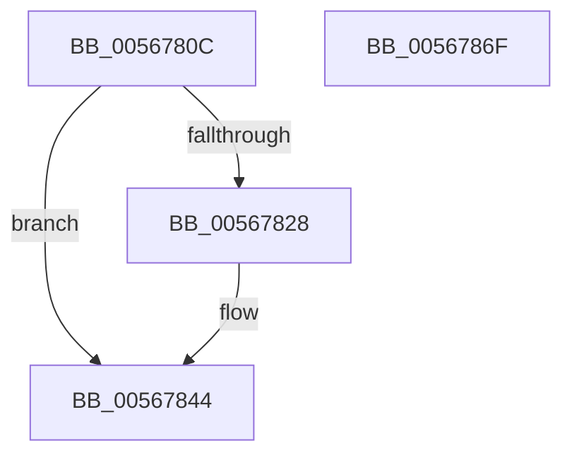

# IommupHvUnmapDevice

- RVA: `0x0056780C`–`0x00567870` (길이 `100` bytes)
- VA: `0x000000014056780C`
- 실행 섹션: `.text`
- PDB 이름 있음: `예`; PDB Function 태그: `아니요`
- unwind 정보 RVA: `0x00064C80`
- 디코드: `26`개 명령, `100/100` bytes 표시
- 미해석 바이트: `0` (있으면 어셈블리에 `.byte`로 보존)

> 이 문서는 커널 이미지의 기계어와 PDB 기호를 분석해 생성했습니다. 4번과 5번은 함수 원형과 자료형을 바이너리 사용 방식에서 추정한 C 해석이며 원본 소스 복구 결과는 아닙니다.

## 1. Dependencies

- 직접 호출 지점: **4**; 고유 호출 대상: **2**
- 직접 호출자로 확인된 함수: **2**
- RIP 상대 이미지 참조: **3**

### Outgoing calls
- `0x0056781C` → [guard_dispatch_icall](../6B/guard_dispatch_icall_function_006BAAD0.md) (function, `0x006BAAD0`)
- `0x0056783E` → [KeBugCheckEx](../4F/KeBugCheckEx_function_004FD660.md) (function, `0x004FD660`)
- `0x0056784E` → [guard_dispatch_icall](../6B/guard_dispatch_icall_function_006BAAD0.md) (function, `0x006BAAD0`)
- `0x00567864` → [guard_dispatch_icall](../6B/guard_dispatch_icall_function_006BAAD0.md) (function, `0x006BAAD0`)

### Direct callers
- [IommupMapDeviceInternal](IommupMapDeviceInternal_function_00566478.md) at `0x00566680`
- [IommupUnmapDeviceInternal](IommupUnmapDeviceInternal_function_005667D8.md) at `0x00566847`

### Static image references
- `0x00567812` → RVA `0x00FC1DD8` (`.data`; read)
- `0x00567844` → RVA `0x00FC1D88` (`.data`; read)
- `0x00567853` → RVA `0x00FC1DC8` (`.data`; read)

## 2. Other-region calls and transfers

- 다른 실행 섹션으로 향하는 call: **0**
- 별도 외부 분기/꼬리 이동을 확인하지 못했습니다.

## 3. Assembly (complete function range)

```asm
0056780C  40 53                           push rbx
0056780E  48 83 EC 30                     sub rsp, 0x30
00567812  48 8B 05 BF A5 A5 00            mov rax, qword ptr [rip + 0xa5a5bf]
00567819  48 8B D9                        mov rbx, rcx
0056781C  E8 AF 32 15 00                  call 0x1406baad0
00567821  3D 59 00 35 00                  cmp eax, 0x350059
00567826  75 1C                           jne 0x140567844
00567828  48 83 64 24 20 00               and qword ptr [rsp + 0x20], 0
0056782E  45 33 C9                        xor r9d, r9d
00567831  4C 8B C3                        mov r8, rbx
00567834  BA 00 30 00 00                  mov edx, 0x3000
00567839  B9 59 01 00 00                  mov ecx, 0x159
0056783E  E8 1D 5E F9 FF                  call 0x1404fd660
00567843  CC                              int3
00567844  48 8B 05 3D A5 A5 00            mov rax, qword ptr [rip + 0xa5a53d]
0056784B  48 8B CB                        mov rcx, rbx
0056784E  E8 7D 32 15 00                  call 0x1406baad0
00567853  48 8B 05 6E A5 A5 00            mov rax, qword ptr [rip + 0xa5a56e]
0056785A  45 33 C0                        xor r8d, r8d
0056785D  48 8B CB                        mov rcx, rbx
00567860  41 8D 50 05                     lea edx, [r8 + 5]
00567864  E8 67 32 15 00                  call 0x1406baad0
00567869  48 83 C4 30                     add rsp, 0x30
0056786D  5B                              pop rbx
0056786E  C3                              ret
0056786F  CC                              int3
```

## 4. C-style interpretation (structured pseudocode)

```c
__int64 __fastcall IommupHvUnmapDevice(__int64 a1, __int64 a2, __int64 a3, int a4)
{
    __int64 result;
    __int64 v_rsp;
    unsigned __int64 v_stack_m18;

    v_rsp = (v_rsp) - (48);
    result = guard_dispatch_icall(a1, a2, a3, a4);
    if (((unsigned int)(result)) == 0x350059ULL) {
        a4 = 0;
        a3 = a1;
        a2 = 0x3000ULL;
        a1 = 345;
        result = KeBugCheckEx(a1, a2, a3, a4);
    }
    result = guard_dispatch_icall(a1, a2, a3, a4);
    a3 = 0;
    result = guard_dispatch_icall(a1, a3 + 5, a3, a4);
    v_rsp = (v_rsp) + (48);
    return result;
}
```

## 5. (Beta) C Style

```c
int64_t IommupHvUnmapDevice(int64_t Arg1, int64_t Arg2, int64_t Arg3, int32_t Arg4)
{
    int64_t result;
    int64_t local_rsp;
    uint64_t v_stack_m18;

    local_rsp = (local_rsp) - (48);
    result = guard_dispatch_icall(Arg1, Arg2, Arg3, Arg4);
    if (((uint32_t)(result)) == 0x350059ULL) {
        Arg4 = 0;
        Arg3 = Arg1;
        Arg2 = 0x3000ULL;
        Arg1 = 345;
        result = KeBugCheckEx(Arg1, Arg2, Arg3, Arg4);
    }
    result = guard_dispatch_icall(Arg1, Arg2, Arg3, Arg4);
    Arg3 = 0;
    result = guard_dispatch_icall(Arg1, Arg3 + 5, Arg3, Arg4);
    local_rsp = (local_rsp) + (48);
    return result;
}
```

## 6. Execution-region graph

[열기: 2D/3D 그래프와 함수 탐색 컨트롤 패널](../../../control-panel.html?section=text&rva=0x0056780C&view=graph)

- 2D 그래프는 위에서 아래로 흐르고, 3D 그래프는 빈 공간을 드래그해 회전합니다. Shift+드래그는 이동, 휠은 확대·축소, 함수 노드 선택은 대상 보고서 이동입니다.

### Static fallback


