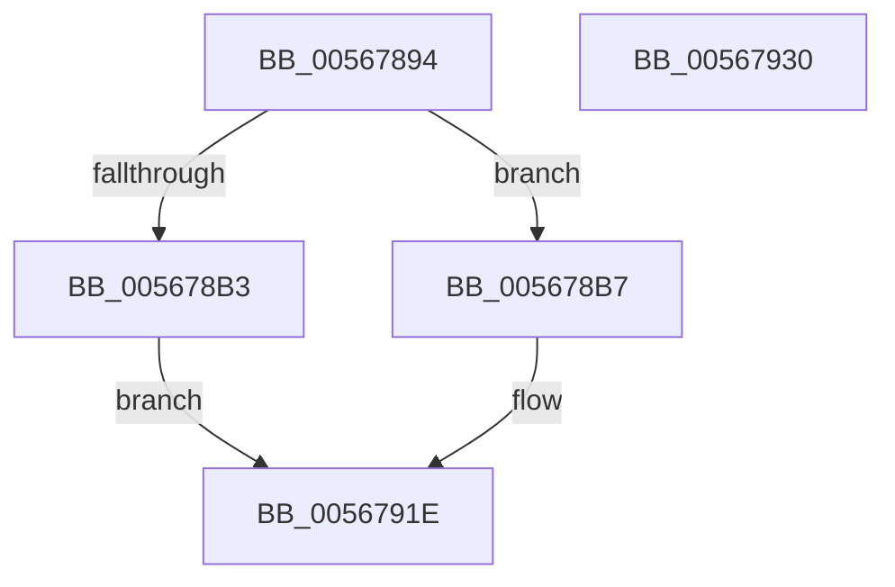

# IommupHvValidatePageRequestGpa

- RVA: `0x00567894`–`0x00567931` (길이 `157` bytes)
- VA: `0x0000000140567894`
- 실행 섹션: `.text`
- PDB 이름 있음: `예`; PDB Function 태그: `아니요`
- unwind 정보 RVA: `0x00060904`
- 디코드: `36`개 명령, `157/157` bytes 표시
- 미해석 바이트: `0` (있으면 어셈블리에 `.byte`로 보존)

> 이 문서는 커널 이미지의 기계어와 PDB 기호를 분석해 생성했습니다. 4번과 5번은 함수 원형과 자료형을 바이너리 사용 방식에서 추정한 C 해석이며 원본 소스 복구 결과는 아닙니다.

## 1. Dependencies

- 직접 호출 지점: **2**; 고유 호출 대상: **2**
- 직접 호출자로 확인된 함수: **1**
- RIP 상대 이미지 참조: **3**

### Outgoing calls
- `0x00567919` → [guard_dispatch_icall](../6B/guard_dispatch_icall_function_006BAAD0.md) (function, `0x006BAAD0`)
- `0x00567926` → [_security_check_cookie](../6A/_security_check_cookie_function_006AC640.md) (function, `0x006AC640`)

### Direct callers
- [IommuProcessPageRequestQueue](IommuProcessPageRequestQueue_function_00565BA0.md) at `0x00565EE3`

### Static image references
- `0x00567898` → RVA `0x00E0A740` (`.data`; read)
- `0x005678AA` → RVA `0x00F8FAD1` (`.data`; read)
- `0x00567906` → RVA `0x00FC1DA0` (`.data`; read)

## 2. Other-region calls and transfers

- 다른 실행 섹션으로 향하는 call: **0**
- 별도 외부 분기/꼬리 이동을 확인하지 못했습니다.

## 3. Assembly (complete function range)

```asm
00567894  48 83 EC 58                     sub rsp, 0x58
00567898  48 8B 05 A1 2E 8A 00            mov rax, qword ptr [rip + 0x8a2ea1]
0056789F  48 33 C4                        xor rax, rsp
005678A2  48 89 44 24 40                  mov qword ptr [rsp + 0x40], rax
005678A7  45 33 D2                        xor r10d, r10d
005678AA  44 38 15 20 82 A2 00            cmp byte ptr [rip + 0xa28220], r10b
005678B1  74 04                           je 0x1405678b7
005678B3  33 C0                           xor eax, eax
005678B5  EB 67                           jmp 0x14056791e
005678B7  81 E1 FF FF 0F 00               and ecx, 0xfffff
005678BD  4C 89 54 24 38                  mov qword ptr [rsp + 0x38], r10
005678C2  49 81 E0 00 F0 FF FF            and r8, 0xfffffffffffff000
005678C9  48 C1 E1 0B                     shl rcx, 0xb
005678CD  49 8B C2                        mov rax, r10
005678D0  48 89 54 24 20                  mov qword ptr [rsp + 0x20], rdx
005678D5  48 25 FF 07 00 80               and rax, 0xffffffff800007ff
005678DB  48 8D 54 24 20                  lea rdx, [rsp + 0x20]
005678E0  48 0B C8                        or rcx, rax
005678E3  41 81 E2 F0 0F 00 00            and r10d, 0xff0
005678EA  4D 0B C2                        or r8, r10
005678ED  41 83 E1 0F                     and r9d, 0xf
005678F1  4D 0B C1                        or r8, r9
005678F4  48 B8 00 04 00 00 00 00 00 40   movabs rax, 0x4000000000000400
005678FE  48 0B C8                        or rcx, rax
00567901  4C 89 44 24 30                  mov qword ptr [rsp + 0x30], r8
00567906  48 8B 05 93 A4 A5 00            mov rax, qword ptr [rip + 0xa5a493]
0056790D  45 33 C0                        xor r8d, r8d
00567910  48 89 4C 24 28                  mov qword ptr [rsp + 0x28], rcx
00567915  41 8D 48 01                     lea ecx, [r8 + 1]
00567919  E8 B2 31 15 00                  call 0x1406baad0
0056791E  48 8B 4C 24 40                  mov rcx, qword ptr [rsp + 0x40]
00567923  48 33 CC                        xor rcx, rsp
00567926  E8 15 4D 14 00                  call 0x1406ac640
0056792B  48 83 C4 58                     add rsp, 0x58
0056792F  C3                              ret
00567930  CC                              int3
```

## 4. C-style interpretation (structured pseudocode)

```c
__int64 __fastcall IommupHvValidatePageRequestGpa(int a1, __int64 a2, __int64 a3, int a4)
{
    __int64 result;
    __int64 v_r10;
    __int64 v_rsp;
    unsigned __int64 v_stack_m18;
    unsigned __int64 v_stack_m20;
    unsigned __int64 v_stack_m28;
    unsigned __int64 v_stack_m30;
    unsigned __int64 v_stack_m38;

    v_rsp = (v_rsp) - (88);
    result = (*(unsigned __int64 *)(v_rip + 9055905)) ^ (v_rsp);
    v_stack_m18 = result;
    v_r10 = 0;
    if ((*(unsigned __int8 *)(v_rip + 10650144)) == 0) goto loc_005678B7;
    result = 0;
    goto loc_0056791E;
loc_005678B7:
    a1 = (unsigned int)((a1) & (0xFFFFFULL));
    v_stack_m20 = 0;
    a3 = (a3) & (0xFFFFFFFFFFFFF000ULL);
    a1 = (a1) << (11);
    v_stack_m38 = a2;
    result = (0) & (0xFFFFFFFF800007FFULL);
    a1 = (a1) | (result);
    v_r10 = (unsigned int)((v_r10) & (0xFF0ULL));
    a3 = (a3) | (v_r10);
    a4 = (unsigned int)((a4) & (15));
    a3 = (a3) | (a4);
    a1 = (a1) | (result);
    v_stack_m28 = a3;
    a3 = 0;
    v_stack_m30 = a1;
    result = guard_dispatch_icall(a3 + 1, v_stack_m38, a3, a4);
loc_0056791E:
    a1 = (v_stack_m18) ^ (v_rsp);
    result = _security_check_cookie(a1, v_stack_m38, a3, a4);
    v_rsp = (v_rsp) + (88);
    return result;
}
```

## 5. (Beta) C Style

```c
int64_t IommupHvValidatePageRequestGpa(int32_t Arg1, int64_t Arg2, int64_t Arg3, int32_t Arg4)
{
    int64_t result;
    int64_t local_r10;
    int64_t local_rsp;
    uint64_t v_stack_m18;
    uint64_t v_stack_m20;
    uint64_t v_stack_m28;
    uint64_t v_stack_m30;
    uint64_t v_stack_m38;

    local_rsp = (local_rsp) - (88);
    result = (*(uint64_t *)(v_rip + 0x8A2EA1)) ^ (local_rsp);
    v_stack_m18 = result;
    local_r10 = 0;
    if ((*(uint8_t *)(v_rip + 0xA28220)) == 0) goto loc_005678B7;
    result = 0;
    goto loc_0056791E;
loc_005678B7:
    Arg1 = (uint32_t)((Arg1) & (0xFFFFFULL));
    v_stack_m20 = 0;
    Arg3 = (Arg3) & (0xFFFFFFFFFFFFF000ULL);
    Arg1 = (Arg1) << (11);
    v_stack_m38 = Arg2;
    result = (0) & (0xFFFFFFFF800007FFULL);
    Arg1 = (Arg1) | (result);
    local_r10 = (uint32_t)((local_r10) & (0xFF0ULL));
    Arg3 = (Arg3) | (local_r10);
    Arg4 = (uint32_t)((Arg4) & (15));
    Arg3 = (Arg3) | (Arg4);
    Arg1 = (Arg1) | (result);
    v_stack_m28 = Arg3;
    Arg3 = 0;
    v_stack_m30 = Arg1;
    result = guard_dispatch_icall(Arg3 + 1, v_stack_m38, Arg3, Arg4);
loc_0056791E:
    Arg1 = (v_stack_m18) ^ (local_rsp);
    result = _security_check_cookie(Arg1, v_stack_m38, Arg3, Arg4);
    local_rsp = (local_rsp) + (88);
    return result;
}
```

## 6. Execution-region graph

[열기: 2D/3D 그래프와 함수 탐색 컨트롤 패널](../../../control-panel.html?section=text&rva=0x00567894&view=graph)

- 2D 그래프는 위에서 아래로 흐르고, 3D 그래프는 빈 공간을 드래그해 회전합니다. Shift+드래그는 이동, 휠은 확대·축소, 함수 노드 선택은 대상 보고서 이동입니다.

### Static fallback


