# IommupMapDeviceInternal

- RVA: `0x00566478`–`0x005667D0` (길이 `856` bytes)
- VA: `0x0000000140566478`
- 실행 섹션: `.text`
- PDB 이름 있음: `예`; PDB Function 태그: `아니요`
- unwind 정보 RVA: `0x000C4D48`
- 디코드: `236`개 명령, `856/856` bytes 표시
- 미해석 바이트: `0` (있으면 어셈블리에 `.byte`로 보존)

> 이 문서는 커널 이미지의 기계어와 PDB 기호를 분석해 생성했습니다. 4번과 5번은 함수 원형과 자료형을 바이너리 사용 방식에서 추정한 C 해석이며 원본 소스 복구 결과는 아닙니다.

## 1. Dependencies

- 직접 호출 지점: **20**; 고유 호출 대상: **13**
- 직접 호출자로 확인된 함수: **2**
- RIP 상대 이미지 참조: **2**

### Outgoing calls
- `0x005664D1` → [Feature_Test57481295__private_IsEnabledDeviceUsageNoInline](../4F/Feature_Test57481295__private_IsEnabledDeviceUsageNoInline_function_004F7B90.md) (function, `0x004F7B90`)
- `0x005664F0` → [guard_dispatch_icall](../6B/guard_dispatch_icall_function_006BAAD0.md) (function, `0x006BAAD0`)
- `0x0056653A` → [IommupHvGetDeviceSvmCapabilities](IommupHvGetDeviceSvmCapabilities_function_005673F0.md) (function, `0x005673F0`)
- `0x00566554` → [IommupHvMapDevice](IommupHvMapDevice_function_00567704.md) (function, `0x00567704`)
- `0x0056656C` → [HalpMmAllocCtxAlloc](../3E/HalpMmAllocCtxAlloc_function_003E10B8.md) (function, `0x003E10B8`)
- `0x005665BC` → [memset](../6C/memset_function_006C6C40.md) (function, `0x006C6C40`)
- `0x0056660E` → [HalpMmAllocCtxAlloc](../3E/HalpMmAllocCtxAlloc_function_003E10B8.md) (function, `0x003E10B8`)
- `0x00566623` → [memset](../6C/memset_function_006C6C40.md) (function, `0x006C6C40`)
- `0x00566630` → [HalpMmAllocCtxAlloc](../3E/HalpMmAllocCtxAlloc_function_003E10B8.md) (function, `0x003E10B8`)
- `0x0056664F` → [Feature_Test57481295__private_IsEnabledDeviceUsageNoInline](../4F/Feature_Test57481295__private_IsEnabledDeviceUsageNoInline_function_004F7B90.md) (function, `0x004F7B90`)
- `0x00566669` → [guard_dispatch_icall](../6B/guard_dispatch_icall_function_006BAAD0.md) (function, `0x006BAAD0`)
- `0x00566680` → [IommupHvUnmapDevice](IommupHvUnmapDevice_function_0056780C.md) (function, `0x0056780C`)
- `0x005666AF` → [ExWaitForRundownProtectionRelease](../2A/ExWaitForRundownProtectionRelease_function_002A4CB0.md) (function, `0x002A4CB0`)
- `0x005666C0` → [HalpMmAllocCtxFree](../3E/HalpMmAllocCtxFree_function_003E1904.md) (function, `0x003E1904`)
- `0x005666F1` → [KiRaiseIrqlProcessIrqlFlags](../4F/KiRaiseIrqlProcessIrqlFlags_function_004F56FC.md) (function, `0x004F56FC`)
- `0x005666FF` → [KeAcquireSpinLockAtDpcLevel](../20/KeAcquireSpinLockAtDpcLevel_function_00208430.md) (function, `0x00208430`)
- `0x00566787` → [KxReleaseSpinLock](../20/KxReleaseSpinLock_function_00206670.md) (function, `0x00206670`)
- `0x0056679A` → [KiLowerIrqlProcessIrqlFlags](../4F/KiLowerIrqlProcessIrqlFlags_function_004F5698.md) (function, `0x004F5698`)
- `0x005667AE` → [HalpMmAllocCtxFree](../3E/HalpMmAllocCtxFree_function_003E1904.md) (function, `0x003E1904`)
- `0x005667BF` → [HalpMmAllocCtxFree](../3E/HalpMmAllocCtxFree_function_003E1904.md) (function, `0x003E1904`)

### Direct callers
- [IommuMapDevice](IommuMapDevice_function_00565AB0.md) at `0x00565B4E`
- [IommupDeviceEnableSvm](../../page/70/IommupDeviceEnableSvm_function_00708CC4.md) at `0x00708E0B`

### Static image references
- `0x0056649C` → RVA `0x00FC1710` (`.data`; read)
- `0x005666E6` → RVA `0x00FC6D20` (`ALMOSTRO`; read)

## 2. Other-region calls and transfers

- 다른 실행 섹션으로 향하는 call: **0**
- 별도 외부 분기/꼬리 이동을 확인하지 못했습니다.

## 3. Assembly (complete function range)

```asm
00566478  48 8B C4                        mov rax, rsp
0056647B  48 89 58 10                     mov qword ptr [rax + 0x10], rbx
0056647F  4C 89 40 18                     mov qword ptr [rax + 0x18], r8
00566483  48 89 48 08                     mov qword ptr [rax + 8], rcx
00566487  55                              push rbp
00566488  56                              push rsi
00566489  57                              push rdi
0056648A  41 54                           push r12
0056648C  41 55                           push r13
0056648E  41 56                           push r14
00566490  41 57                           push r15
00566492  48 83 EC 30                     sub rsp, 0x30
00566496  45 33 F6                        xor r14d, r14d
00566499  49 8B F0                        mov rsi, r8
0056649C  44 38 35 6D B2 A5 00            cmp byte ptr [rip + 0xa5b26d], r14b
005664A3  48 8B DA                        mov rbx, rdx
005664A6  44 89 70 20                     mov dword ptr [rax + 0x20], r14d
005664AA  41 8B EE                        mov ebp, r14d
005664AD  4C 89 70 B8                     mov qword ptr [rax - 0x48], r14
005664B1  45 8B FE                        mov r15d, r14d
005664B4  41 8D 7E 01                     lea edi, [r14 + 1]
005664B8  75 6C                           jne 0x140566526
005664BA  48 8B 72 20                     mov rsi, qword ptr [rdx + 0x20]
005664BE  4C 8B 62 30                     mov r12, qword ptr [rdx + 0x30]
005664C2  48 89 70 B8                     mov qword ptr [rax - 0x48], rsi
005664C6  44 8B AE D8 01 00 00            mov r13d, dword ptr [rsi + 0x1d8]
005664CD  44 89 68 20                     mov dword ptr [rax + 0x20], r13d
005664D1  E8 BA 16 F9 FF                  call 0x1404f7b90
005664D6  85 C0                           test eax, eax
005664D8  75 1D                           jne 0x1405664f7
005664DA  48 8B 86 80 01 00 00            mov rax, qword ptr [rsi + 0x180]
005664E1  48 85 C0                        test rax, rax
005664E4  74 1D                           je 0x140566503
005664E6  49 8B D4                        mov rdx, r12
005664E9  48 8B 4E 10                     mov rcx, qword ptr [rsi + 0x10]
005664ED  44 8A C7                        mov r8b, dil
005664F0  E8 DB 45 15 00                  call 0x1406baad0
005664F5  EB 6A                           jmp 0x140566561
005664F7  48 8B 86 D8 00 00 00            mov rax, qword ptr [rsi + 0xd8]
005664FE  48 85 C0                        test rax, rax
00566501  75 1D                           jne 0x140566520
00566503  BF BB 00 00 C0                  mov edi, 0xc00000bb
00566508  48 8B 5C 24 78                  mov rbx, qword ptr [rsp + 0x78]
0056650D  8B C7                           mov eax, edi
0056650F  48 83 C4 30                     add rsp, 0x30
00566513  41 5F                           pop r15
00566515  41 5E                           pop r14
00566517  41 5D                           pop r13
00566519  41 5C                           pop r12
0056651B  5F                              pop rdi
0056651C  5E                              pop rsi
0056651D  5D                              pop rbp
0056651E  C3                              ret
0056651F  CC                              int3
00566520  48 8B 53 28                     mov rdx, qword ptr [rbx + 0x28]
00566524  EB C3                           jmp 0x1405664e9
00566526  4C 8B 62 20                     mov r12, qword ptr [rdx + 0x20]
0056652A  4C 8D 84 24 88 00 00 00         lea r8, [rsp + 0x88]
00566532  48 8B 0B                        mov rcx, qword ptr [rbx]
00566535  48 8D 54 24 20                  lea rdx, [rsp + 0x20]
0056653A  E8 B1 0E 00 00                  call 0x1405673f0
0056653F  8B F8                           mov edi, eax
00566541  85 C0                           test eax, eax
00566543  78 C3                           js 0x140566508
00566545  48 8B 4B 20                     mov rcx, qword ptr [rbx + 0x20]
00566549  4C 8B CE                        mov r9, rsi
0056654C  48 8B 74 24 20                  mov rsi, qword ptr [rsp + 0x20]
00566551  4C 8B C6                        mov r8, rsi
00566554  E8 AB 11 00 00                  call 0x140567704
00566559  44 8B AC 24 88 00 00 00         mov r13d, dword ptr [rsp + 0x88]
00566561  8B F8                           mov edi, eax
00566563  85 C0                           test eax, eax
00566565  78 A1                           js 0x140566508
00566567  BA 58 10 00 00                  mov edx, 0x1058
0056656C  E8 47 AB E7 FF                  call 0x1403e10b8
00566571  4C 8B F0                        mov r14, rax
00566574  48 85 C0                        test rax, rax
00566577  0F 84 C4 00 00 00               je 0x140566641
0056657D  40 8A 2D 8C B1 A5 00            mov bpl, byte ptr [rip + 0xa5b18c]
00566584  40 84 ED                        test bpl, bpl
00566587  75 24                           jne 0x1405665ad
00566589  8B 4B 38                        mov ecx, dword ptr [rbx + 0x38]
0056658C  85 C9                           test ecx, ecx
0056658E  75 17                           jne 0x1405665a7
00566590  48 8B 84 24 80 00 00 00         mov rax, qword ptr [rsp + 0x80]
00566598  8B 00                           mov eax, dword ptr [rax]
0056659A  C1 E8 0C                        shr eax, 0xc
0056659D  83 E0 1F                        and eax, 0x1f
005665A0  4C 21 7B 40                     and qword ptr [rbx + 0x40], r15
005665A4  89 43 3C                        mov dword ptr [rbx + 0x3c], eax
005665A7  8D 41 01                        lea eax, [rcx + 1]
005665AA  89 43 38                        mov dword ptr [rbx + 0x38], eax
005665AD  33 D2                           xor edx, edx
005665AF  4C 89 73 60                     mov qword ptr [rbx + 0x60], r14
005665B3  41 B8 58 10 00 00               mov r8d, 0x1058
005665B9  49 8B CE                        mov rcx, r14
005665BC  E8 7F 06 16 00                  call 0x1406c6c40
005665C1  48 8B 84 24 80 00 00 00         mov rax, qword ptr [rsp + 0x80]
005665C9  49 89 5E 48                     mov qword ptr [r14 + 0x48], rbx
005665CD  49 89 76 18                     mov qword ptr [r14 + 0x18], rsi
005665D1  4D 89 66 28                     mov qword ptr [r14 + 0x28], r12
005665D5  45 89 6E 20                     mov dword ptr [r14 + 0x20], r13d
005665D9  8B 00                           mov eax, dword ptr [rax]
005665DB  4D 21 7E 10                     and qword ptr [r14 + 0x10], r15
005665DF  41 89 46 30                     mov dword ptr [r14 + 0x30], eax
005665E3  49 8D 46 38                     lea rax, [r14 + 0x38]
005665E7  48 89 40 08                     mov qword ptr [rax + 8], rax
005665EB  48 89 00                        mov qword ptr [rax], rax
005665EE  48 8D 86 90 01 00 00            lea rax, [rsi + 0x190]
005665F5  40 84 ED                        test bpl, bpl
005665F8  74 04                           je 0x1405665fe
005665FA  48 8D 46 18                     lea rax, [rsi + 0x18]
005665FE  8B 40 10                        mov eax, dword ptr [rax + 0x10]
00566601  41 BD 40 00 00 00               mov r13d, 0x40
00566607  41 8B D5                        mov edx, r13d
0056660A  41 89 46 50                     mov dword ptr [r14 + 0x50], eax
0056660E  E8 A5 AA E7 FF                  call 0x1403e10b8
00566613  48 8B E8                        mov rbp, rax
00566616  48 85 C0                        test rax, rax
00566619  74 26                           je 0x140566641
0056661B  45 8B C5                        mov r8d, r13d
0056661E  33 D2                           xor edx, edx
00566620  48 8B C8                        mov rcx, rax
00566623  E8 18 06 16 00                  call 0x1406c6c40
00566628  41 8D 55 E8                     lea edx, [r13 - 0x18]
0056662C  4C 89 75 28                     mov qword ptr [rbp + 0x28], r14
00566630  E8 83 AA E7 FF                  call 0x1403e10b8
00566635  4C 8B F8                        mov r15, rax
00566638  48 85 C0                        test rax, rax
0056663B  0F 85 89 00 00 00               jne 0x1405666ca
00566641  80 3D C8 B0 A5 00 00            cmp byte ptr [rip + 0xa5b0c8], 0
00566648  BF 9A 00 00 C0                  mov edi, 0xc000009a
0056664D  75 2E                           jne 0x14056667d
0056664F  E8 3C 15 F9 FF                  call 0x1404f7b90
00566654  48 8B 4E 10                     mov rcx, qword ptr [rsi + 0x10]
00566658  45 33 C0                        xor r8d, r8d
0056665B  85 C0                           test eax, eax
0056665D  75 11                           jne 0x140566670
0056665F  48 8B 86 80 01 00 00            mov rax, qword ptr [rsi + 0x180]
00566666  49 8B D4                        mov rdx, r12
00566669  E8 62 44 15 00                  call 0x1406baad0
0056666E  EB 15                           jmp 0x140566685
00566670  48 8B 86 D8 00 00 00            mov rax, qword ptr [rsi + 0xd8]
00566677  48 8B 53 28                     mov rdx, qword ptr [rbx + 0x28]
0056667B  EB EC                           jmp 0x140566669
0056667D  49 8B CC                        mov rcx, r12
00566680  E8 87 11 00 00                  call 0x14056780c
00566685  4D 85 F6                        test r14, r14
00566688  0F 84 25 01 00 00               je 0x1405667b3
0056668E  48 83 63 60 00                  and qword ptr [rbx + 0x60], 0
00566693  49 83 66 48 00                  and qword ptr [r14 + 0x48], 0
00566698  80 3D 71 B0 A5 00 00            cmp byte ptr [rip + 0xa5b071], 0
0056669F  75 1C                           jne 0x1405666bd
005666A1  83 43 38 FF                     add dword ptr [rbx + 0x38], -1
005666A5  75 16                           jne 0x1405666bd
005666A7  83 63 3C 00                     and dword ptr [rbx + 0x3c], 0
005666AB  48 8D 4B 40                     lea rcx, [rbx + 0x40]
005666AF  E8 FC E5 D3 FF                  call 0x1402a4cb0
005666B4  B8 01 00 00 00                  mov eax, 1
005666B9  48 87 43 40                     xchg qword ptr [rbx + 0x40], rax
005666BD  49 8B D6                        mov rdx, r14
005666C0  E8 3F B2 E7 FF                  call 0x1403e1904
005666C5  E9 DC 00 00 00                  jmp 0x1405667a6
005666CA  48 89 70 10                     mov qword ptr [rax + 0x10], rsi
005666CE  48 83 C0 18                     add rax, 0x18
005666D2  48 89 40 08                     mov qword ptr [rax + 8], rax
005666D6  48 89 00                        mov qword ptr [rax], rax
005666D9  44 0F 20 C3                     mov rbx, cr8
005666DD  BA 0F 00 00 00                  mov edx, 0xf
005666E2  44 0F 22 C2                     mov cr8, rdx
005666E6  83 3D 33 06 A6 00 00            cmp dword ptr [rip + 0xa60633], 0
005666ED  74 07                           je 0x1405666f6
005666EF  8A CB                           mov cl, bl
005666F1  E8 06 F0 F8 FF                  call 0x1404f56fc
005666F6  4C 8B 6C 24 70                  mov r13, qword ptr [rsp + 0x70]
005666FB  49 8D 4D 18                     lea rcx, [r13 + 0x18]
005666FF  E8 2C 1D CA FF                  call 0x140208430
00566704  49 8D 45 30                     lea rax, [r13 + 0x30]
00566708  48 8B 08                        mov rcx, qword ptr [rax]
0056670B  48 39 41 08                     cmp qword ptr [rcx + 8], rax
0056670F  0F 85 B4 00 00 00               jne 0x1405667c9
00566715  49 89 46 08                     mov qword ptr [r14 + 8], rax
00566719  49 89 0E                        mov qword ptr [r14], rcx
0056671C  4C 89 71 08                     mov qword ptr [rcx + 8], r14
00566720  4C 89 30                        mov qword ptr [rax], r14
00566723  49 8D 45 20                     lea rax, [r13 + 0x20]
00566727  48 8B 08                        mov rcx, qword ptr [rax]
0056672A  48 3B C8                        cmp rcx, rax
0056672D  74 19                           je 0x140566748
0056672F  48 8B 51 10                     mov rdx, qword ptr [rcx + 0x10]
00566733  4C 8B C1                        mov r8, rcx
00566736  48 3B D6                        cmp rdx, rsi
00566739  74 2A                           je 0x140566765
0056673B  48 8B 09                        mov rcx, qword ptr [rcx]
0056673E  48 3B C8                        cmp rcx, rax
00566741  75 EC                           jne 0x14056672f
00566743  48 3B D6                        cmp rdx, rsi
00566746  74 1D                           je 0x140566765
00566748  48 8B 08                        mov rcx, qword ptr [rax]
0056674B  48 39 41 08                     cmp qword ptr [rcx + 8], rax
0056674F  75 78                           jne 0x1405667c9
00566751  49 89 0F                        mov qword ptr [r15], rcx
00566754  4D 8B C7                        mov r8, r15
00566757  49 89 47 08                     mov qword ptr [r15 + 8], rax
0056675B  4C 89 79 08                     mov qword ptr [rcx + 8], r15
0056675F  4C 89 38                        mov qword ptr [rax], r15
00566762  45 33 FF                        xor r15d, r15d
00566765  49 8D 40 18                     lea rax, [r8 + 0x18]
00566769  48 8B 10                        mov rdx, qword ptr [rax]
0056676C  48 39 42 08                     cmp qword ptr [rdx + 8], rax
00566770  75 57                           jne 0x1405667c9
00566772  48 89 55 00                     mov qword ptr [rbp], rdx
00566776  49 8D 4D 18                     lea rcx, [r13 + 0x18]
0056677A  48 89 45 08                     mov qword ptr [rbp + 8], rax
0056677E  48 89 6A 08                     mov qword ptr [rdx + 8], rbp
00566782  48 89 28                        mov qword ptr [rax], rbp
00566785  33 ED                           xor ebp, ebp
00566787  E8 E4 FE C9 FF                  call 0x140206670
0056678C  39 2D 8E 05 A6 00               cmp dword ptr [rip + 0xa6058e], ebp
00566792  74 0B                           je 0x14056679f
00566794  44 0F 20 C1                     mov rcx, cr8
00566798  8A D3                           mov dl, bl
0056679A  E8 F9 EE F8 FF                  call 0x1404f5698
0056679F  0F B6 C3                        movzx eax, bl
005667A2  44 0F 22 C0                     mov cr8, rax
005667A6  4D 85 FF                        test r15, r15
005667A9  74 08                           je 0x1405667b3
005667AB  49 8B D7                        mov rdx, r15
005667AE  E8 51 B1 E7 FF                  call 0x1403e1904
005667B3  48 85 ED                        test rbp, rbp
005667B6  0F 84 4C FD FF FF               je 0x140566508
005667BC  48 8B D5                        mov rdx, rbp
005667BF  E8 40 B1 E7 FF                  call 0x1403e1904
005667C4  E9 3F FD FF FF                  jmp 0x140566508
005667C9  B9 03 00 00 00                  mov ecx, 3
005667CE  CD 29                           int 0x29
```

## 4. C-style interpretation (structured pseudocode)

```c
__int64 __fastcall IommupMapDeviceInternal(__int64 a1, __int64 a2, __int64 a3)
{
    __int64 result;
    __int64 v_r14;
    __int64 v_r15;
    __int64 v_rbp;
    __int64 v_rsp;
    unsigned __int64 v_stack_p10;
    unsigned __int64 v_stack_p20;
    unsigned __int64 v_stack_p70;
    unsigned __int64 v_stack_p80;
    unsigned __int64 v_stack_p88;

    *(unsigned __int64 *)(v_rsp + 16) = v_rbx;
    *(unsigned __int64 *)(v_rsp + 24) = a3;
    *(unsigned __int64 *)(v_rsp + 8) = a1;
    v_rsp = (v_rsp) - (48);
    v_r14 = 0;
    *(unsigned int *)(v_rsp + 32) = 0;
    *(unsigned __int64 *)(v_rsp - 72) = 0;
    if ((*(unsigned __int8 *)(v_rip + 10859117)) != 0) goto loc_00566526;
    *(unsigned __int64 *)(v_rsp - 72) = *(unsigned __int64 *)(a2 + 32);
    *(unsigned int *)(v_rsp + 32) = (unsigned int)((unsigned int)(*(unsigned int *)(*(unsigned __int64 *)(a2 + 32) + 472)));
    result = Feature_Test57481295__private_IsEnabledDeviceUsageNoInline(a1, a2, a3, a4);
    if ((unsigned int)(result) != 0) goto loc_005664F7;
    if (*(unsigned __int64 *)(*(unsigned __int64 *)(a2 + 32) + 384) == 0) goto loc_00566503;
loc_005664E9:
    result = guard_dispatch_icall(*(unsigned __int64 *)(*(unsigned __int64 *)(a2 + 32) + 16), *(unsigned __int64 *)(a2 + 48), (unsigned __int8)(v_r14 + 1), a4);
    goto loc_00566561;
loc_005664F7:
    if (*(unsigned __int64 *)(*(unsigned __int64 *)(a2 + 32) + 216) != 0) goto loc_00566520;
loc_00566503:
loc_00566508:
    v_rsp = (v_rsp) + (48);
    return (unsigned int)((unsigned int)((unsigned int)(0xC00000BBULL)));
loc_00566520:
    goto loc_005664E9;
loc_00566526:
    result = IommupHvGetDeviceSvmCapabilities(*(unsigned __int64 *)(v_stack_p10), v_stack_p20, v_stack_p88, a4);
    if (sign_flag) goto loc_00566508;
    result = IommupHvMapDevice(*(unsigned __int64 *)(v_stack_p10 + 32), v_stack_p20, v_stack_p20, *(unsigned __int64 *)(a2 + 32));
loc_00566561:
    if (sign_flag) goto loc_00566508;
    result = HalpMmAllocCtxAlloc(*(unsigned __int64 *)(v_stack_p10 + 32), (unsigned int)(0x1058ULL), v_stack_p20, *(unsigned __int64 *)(a2 + 32));
    if (result == 0) goto loc_00566641;
    if ((unsigned __int8)(*(unsigned __int8 *)(v_rip + 10858892)) != 0) goto loc_005665AD;
    if ((unsigned int)((unsigned int)(*(unsigned int *)(v_stack_p10 + 56))) == 0) {
        result = v_stack_p80;
        result = *(unsigned int *)(result);
        result = (unsigned int)((result) >> (12));
        result = (unsigned int)((result) & (31));
        *(unsigned int *)(v_stack_p10 + 60) = (unsigned int)(result);
    }
    *(unsigned int *)(v_stack_p10 + 56) = (unsigned int)((unsigned int)(*(unsigned int *)(v_stack_p10 + 56)) + 1);
loc_005665AD:
    a2 = 0;
    *(unsigned __int64 *)(v_stack_p10 + 96) = result;
    result = memset(result, a2, (unsigned int)(0x1058ULL), *(unsigned __int64 *)(a2 + 32));
    *(unsigned __int64 *)(result + 72) = v_stack_p10;
    *(unsigned __int64 *)(result + 24) = v_stack_p20;
    *(unsigned __int64 *)(result + 40) = *(unsigned __int64 *)(*(unsigned __int64 *)(v_stack_p10 + 40) + 32);
    *(unsigned int *)(result + 32) = (unsigned int)((unsigned int)(v_stack_p88));
    *(unsigned int *)(result + 48) = (unsigned int)((unsigned int)(*(unsigned int *)(v_stack_p80)));
    *(unsigned __int64 *)(result + 56 + 8) = result + 56;
    *(unsigned __int64 *)(result + 56) = result + 56;
    result = v_stack_p20 + 400;
    if ((unsigned __int8)(*(unsigned __int8 *)(v_rip + 10858892)) != 0) {
        result = v_stack_p20 + 24;
    }
    *(unsigned int *)(result + 80) = (unsigned int)((unsigned int)(*(unsigned int *)(result + 16)));
    result = HalpMmAllocCtxAlloc(result, 64, (unsigned int)(0x1058ULL), *(unsigned __int64 *)(a2 + 32));
    if (result == 0) goto loc_00566641;
    a2 = 0;
    result = memset(result, a2, 64, *(unsigned __int64 *)(a2 + 32));
    *(unsigned __int64 *)(result + 40) = result;
    result = HalpMmAllocCtxAlloc(result, 64 - 24, 64, *(unsigned __int64 *)(a2 + 32));
    if (result != 0) goto loc_005666CA;
loc_00566641:
    if ((*(unsigned __int8 *)(v_rip + 10858696)) != 0) goto loc_0056667D;
    result = Feature_Test57481295__private_IsEnabledDeviceUsageNoInline(result, 64 - 24, 64, *(unsigned __int64 *)(a2 + 32));
    a3 = 0;
    if ((unsigned int)(result) != 0) goto loc_00566670;
loc_00566669:
    result = guard_dispatch_icall(*(unsigned __int64 *)(v_stack_p20 + 16), *(unsigned __int64 *)(*(unsigned __int64 *)(v_stack_p10 + 40) + 32), a3, *(unsigned __int64 *)(a2 + 32));
    goto loc_00566685;
loc_00566670:
    goto loc_00566669;
loc_0056667D:
    result = IommupHvUnmapDevice(*(unsigned __int64 *)(*(unsigned __int64 *)(v_stack_p10 + 40) + 32), *(unsigned __int64 *)(v_stack_p10 + 40), a3, *(unsigned __int64 *)(a2 + 32));
loc_00566685:
    if (result == 0) goto loc_005667B3;
    if ((*(unsigned __int8 *)(v_rip + 10858609)) != 0) goto loc_005666BD;
    if ((*(unsigned __int8 *)(v_rip + 10858609)) == 0) {
        a1 = v_stack_p10 + 64;
        result = ExWaitForRundownProtectionRelease(a1, *(unsigned __int64 *)(v_stack_p10 + 40), a3, *(unsigned __int64 *)(a2 + 32));
        result = 1;
    }
    result = HalpMmAllocCtxFree(a1, result, a3, *(unsigned __int64 *)(a2 + 32));
    goto loc_005667A6;
loc_005666CA:
    *(unsigned __int64 *)(result + 16) = v_stack_p20;
    result = (result) + (24);
    *(unsigned __int64 *)(result + 8) = result;
    *(unsigned __int64 *)(result) = result;
    if ((*(unsigned int *)(v_rip + 10880563)) != 0) {
        a1 = (unsigned __int8)(v_cr8);
        result = KiRaiseIrqlProcessIrqlFlags(a1, 15, a3, *(unsigned __int64 *)(a2 + 32));
    }
    result = KeAcquireSpinLockAtDpcLevel(v_stack_p70 + 24, 15, a3, *(unsigned __int64 *)(a2 + 32));
    if ((*(unsigned __int64 *)(*(unsigned __int64 *)(v_stack_p70 + 48) + 8)) != (v_stack_p70 + 48)) goto loc_005667C9;
    *(unsigned __int64 *)(result + 8) = v_stack_p70 + 48;
    *(unsigned __int64 *)(result) = *(unsigned __int64 *)(v_stack_p70 + 48);
    *(unsigned __int64 *)(*(unsigned __int64 *)(v_stack_p70 + 48) + 8) = result;
    *(unsigned __int64 *)(v_stack_p70 + 48) = result;
    if ((*(unsigned __int64 *)(v_stack_p70 + 32)) == (v_stack_p70 + 32)) goto loc_00566748;
loc_0056672F:
    if ((*(unsigned __int64 *)(*(unsigned __int64 *)(v_stack_p70 + 32) + 16)) == v_stack_p20) goto loc_00566765;
    if ((*(unsigned __int64 *)(*(unsigned __int64 *)(v_stack_p70 + 32))) != (v_stack_p70 + 32)) goto loc_0056672F;
    if ((*(unsigned __int64 *)(*(unsigned __int64 *)(v_stack_p70 + 32) + 16)) == v_stack_p20) goto loc_00566765;
loc_00566748:
    if ((*(unsigned __int64 *)(*(unsigned __int64 *)(v_stack_p70 + 32) + 8)) != (v_stack_p70 + 32)) goto loc_005667C9;
    *(unsigned __int64 *)(result) = *(unsigned __int64 *)(v_stack_p70 + 32);
    *(unsigned __int64 *)(result + 8) = v_stack_p70 + 32;
    *(unsigned __int64 *)(*(unsigned __int64 *)(v_stack_p70 + 32) + 8) = result;
    *(unsigned __int64 *)(v_stack_p70 + 32) = result;
    v_r15 = 0;
loc_00566765:
    if ((*(unsigned __int64 *)(*(unsigned __int64 *)(result + 24) + 8)) != (result + 24)) goto loc_005667C9;
    *(unsigned __int64 *)(result) = *(unsigned __int64 *)(result + 24);
    *(unsigned __int64 *)(result + 8) = result + 24;
    *(unsigned __int64 *)(*(unsigned __int64 *)(result + 24) + 8) = result;
    *(unsigned __int64 *)(result + 24) = result;
    v_rbp = 0;
    result = KxReleaseSpinLock(v_stack_p70 + 24, *(unsigned __int64 *)(result + 24), result, *(unsigned __int64 *)(a2 + 32));
    if ((*(unsigned int *)(v_rip + 10880398)) != 0) {
        a1 = 15;
        a2 = (unsigned __int8)(v_cr8);
        result = KiLowerIrqlProcessIrqlFlags(a1, a2, result, *(unsigned __int64 *)(a2 + 32));
    }
loc_005667A6:
    result = (unsigned __int8)(v_cr8);
    if (0 != 0) {
        a2 = 0;
        result = HalpMmAllocCtxFree(a1, a2, result, *(unsigned __int64 *)(a2 + 32));
    }
    if (0 == 0) goto loc_00566508;
    result = HalpMmAllocCtxFree(a1, 0, result, *(unsigned __int64 *)(a2 + 32));
    goto loc_00566508;
loc_005667C9:
    return result;
}
```

## 5. (Beta) C Style

```c
int64_t IommupMapDeviceInternal(int64_t Arg1, void *Arg2, int64_t Arg3)
{
    uint8_t *arg2 = (uint8_t *)Arg2;

    int64_t result;
    int64_t local_r14;
    int64_t local_r15;
    int64_t local_rbp;
    int64_t local_rsp;
    uint64_t v_stack_p10;
    uint64_t v_stack_p20;
    uint64_t v_stack_p70;
    uint64_t v_stack_p80;
    uint64_t v_stack_p88;

    *(uint64_t *)(local_rsp + 0x10) = local_rbx;
    *(uint64_t *)(local_rsp + 0x18) = Arg3;
    *(uint64_t *)(local_rsp + 0x8) = Arg1;
    local_rsp = (local_rsp) - (48);
    local_r14 = 0;
    *(uint32_t *)(local_rsp + 0x20) = 0;
    *(uint64_t *)(local_rsp - 0x48) = 0;
    if ((*(uint8_t *)(v_rip + 0xA5B26D)) != 0) goto loc_00566526;
    *(uint64_t *)(local_rsp - 0x48) = *(uint64_t *)(arg2 + 0x20);
    *(uint32_t *)(local_rsp + 0x20) = (uint32_t)((uint32_t)(*(uint32_t *)(*(uint64_t *)(arg2 + 0x20) + 0x1D8)));
    result = Feature_Test57481295__private_IsEnabledDeviceUsageNoInline(Arg1, Arg2, Arg3, a4);
    if ((uint32_t)(result) != 0) goto loc_005664F7;
    if (*(uint64_t *)(*(uint64_t *)(arg2 + 0x20) + 0x180) == 0) goto loc_00566503;
loc_005664E9:
    result = guard_dispatch_icall(*(uint64_t *)(*(uint64_t *)(arg2 + 0x20) + 0x10), *(uint64_t *)(arg2 + 0x30), (uint8_t)(local_r14 + 1), a4);
    goto loc_00566561;
loc_005664F7:
    if (*(uint64_t *)(*(uint64_t *)(arg2 + 0x20) + 0xD8) != 0) goto loc_00566520;
loc_00566503:
loc_00566508:
    local_rsp = (local_rsp) + (48);
    return (uint32_t)((uint32_t)((uint32_t)(0xC00000BBULL)));
loc_00566520:
    goto loc_005664E9;
loc_00566526:
    result = IommupHvGetDeviceSvmCapabilities(*(uint64_t *)(v_stack_p10), v_stack_p20, v_stack_p88, a4);
    if (sign_flag) goto loc_00566508;
    result = IommupHvMapDevice(*(uint64_t *)(v_stack_p10 + 0x20), v_stack_p20, v_stack_p20, *(uint64_t *)(arg2 + 0x20));
loc_00566561:
    if (sign_flag) goto loc_00566508;
    result = HalpMmAllocCtxAlloc(*(uint64_t *)(v_stack_p10 + 0x20), (uint32_t)(0x1058ULL), v_stack_p20, *(uint64_t *)(arg2 + 0x20));
    if (result == 0) goto loc_00566641;
    if ((uint8_t)(*(uint8_t *)(v_rip + 0xA5B18C)) != 0) goto loc_005665AD;
    if ((uint32_t)((uint32_t)(*(uint32_t *)(v_stack_p10 + 0x38))) == 0) {
        result = v_stack_p80;
        result = *(uint32_t *)(result);
        result = (uint32_t)((result) >> (12));
        result = (uint32_t)((result) & (31));
        *(uint32_t *)(v_stack_p10 + 0x3C) = (uint32_t)(result);
    }
    *(uint32_t *)(v_stack_p10 + 0x38) = (uint32_t)((uint32_t)(*(uint32_t *)(v_stack_p10 + 0x38)) + 1);
loc_005665AD:
    Arg2 = 0;
    *(uint64_t *)(v_stack_p10 + 0x60) = result;
    result = memset(result, Arg2, (uint32_t)(0x1058ULL), *(uint64_t *)(arg2 + 0x20));
    *(uint64_t *)(result + 0x48) = v_stack_p10;
    *(uint64_t *)(result + 0x18) = v_stack_p20;
    *(uint64_t *)(result + 0x28) = *(uint64_t *)(*(uint64_t *)(v_stack_p10 + 0x28) + 0x20);
    *(uint32_t *)(result + 0x20) = (uint32_t)((uint32_t)(v_stack_p88));
    *(uint32_t *)(result + 0x30) = (uint32_t)((uint32_t)(*(uint32_t *)(v_stack_p80)));
    *(uint64_t *)(result + 0x38 + 0x8) = result + 56;
    *(uint64_t *)(result + 0x38) = result + 56;
    result = v_stack_p20 + 400;
    if ((uint8_t)(*(uint8_t *)(v_rip + 0xA5B18C)) != 0) {
        result = v_stack_p20 + 24;
    }
    *(uint32_t *)(result + 0x50) = (uint32_t)((uint32_t)(*(uint32_t *)(result + 0x10)));
    result = HalpMmAllocCtxAlloc(result, 64, (uint32_t)(0x1058ULL), *(uint64_t *)(arg2 + 0x20));
    if (result == 0) goto loc_00566641;
    Arg2 = 0;
    result = memset(result, Arg2, 64, *(uint64_t *)(arg2 + 0x20));
    *(uint64_t *)(result + 0x28) = result;
    result = HalpMmAllocCtxAlloc(result, 64 - 24, 64, *(uint64_t *)(arg2 + 0x20));
    if (result != 0) goto loc_005666CA;
loc_00566641:
    if ((*(uint8_t *)(v_rip + 0xA5B0C8)) != 0) goto loc_0056667D;
    result = Feature_Test57481295__private_IsEnabledDeviceUsageNoInline(result, 64 - 24, 64, *(uint64_t *)(arg2 + 0x20));
    Arg3 = 0;
    if ((uint32_t)(result) != 0) goto loc_00566670;
loc_00566669:
    result = guard_dispatch_icall(*(uint64_t *)(v_stack_p20 + 0x10), *(uint64_t *)(*(uint64_t *)(v_stack_p10 + 0x28) + 0x20), Arg3, *(uint64_t *)(arg2 + 0x20));
    goto loc_00566685;
loc_00566670:
    goto loc_00566669;
loc_0056667D:
    result = IommupHvUnmapDevice(*(uint64_t *)(*(uint64_t *)(v_stack_p10 + 0x28) + 0x20), *(uint64_t *)(v_stack_p10 + 0x28), Arg3, *(uint64_t *)(arg2 + 0x20));
loc_00566685:
    if (result == 0) goto loc_005667B3;
    if ((*(uint8_t *)(v_rip + 0xA5B071)) != 0) goto loc_005666BD;
    if ((*(uint8_t *)(v_rip + 0xA5B071)) == 0) {
        Arg1 = v_stack_p10 + 64;
        result = ExWaitForRundownProtectionRelease(Arg1, *(uint64_t *)(v_stack_p10 + 0x28), Arg3, *(uint64_t *)(arg2 + 0x20));
        result = 1;
    }
    result = HalpMmAllocCtxFree(Arg1, result, Arg3, *(uint64_t *)(arg2 + 0x20));
    goto loc_005667A6;
loc_005666CA:
    *(uint64_t *)(result + 0x10) = v_stack_p20;
    result = (result) + (24);
    *(uint64_t *)(result + 0x8) = result;
    *(uint64_t *)(result) = result;
    if ((*(uint32_t *)(v_rip + 0xA60633)) != 0) {
        Arg1 = (uint8_t)(v_cr8);
        result = KiRaiseIrqlProcessIrqlFlags(Arg1, 15, Arg3, *(uint64_t *)(arg2 + 0x20));
    }
    result = KeAcquireSpinLockAtDpcLevel(v_stack_p70 + 24, 15, Arg3, *(uint64_t *)(arg2 + 0x20));
    if ((*(uint64_t *)(*(uint64_t *)(v_stack_p70 + 0x30) + 0x8)) != (v_stack_p70 + 48)) goto loc_005667C9;
    *(uint64_t *)(result + 0x8) = v_stack_p70 + 48;
    *(uint64_t *)(result) = *(uint64_t *)(v_stack_p70 + 0x30);
    *(uint64_t *)(*(uint64_t *)(v_stack_p70 + 0x30) + 0x8) = result;
    *(uint64_t *)(v_stack_p70 + 0x30) = result;
    if ((*(uint64_t *)(v_stack_p70 + 0x20)) == (v_stack_p70 + 32)) goto loc_00566748;
loc_0056672F:
    if ((*(uint64_t *)(*(uint64_t *)(v_stack_p70 + 0x20) + 0x10)) == v_stack_p20) goto loc_00566765;
    if ((*(uint64_t *)(*(uint64_t *)(v_stack_p70 + 0x20))) != (v_stack_p70 + 32)) goto loc_0056672F;
    if ((*(uint64_t *)(*(uint64_t *)(v_stack_p70 + 0x20) + 0x10)) == v_stack_p20) goto loc_00566765;
loc_00566748:
    if ((*(uint64_t *)(*(uint64_t *)(v_stack_p70 + 0x20) + 0x8)) != (v_stack_p70 + 32)) goto loc_005667C9;
    *(uint64_t *)(result) = *(uint64_t *)(v_stack_p70 + 0x20);
    *(uint64_t *)(result + 0x8) = v_stack_p70 + 32;
    *(uint64_t *)(*(uint64_t *)(v_stack_p70 + 0x20) + 0x8) = result;
    *(uint64_t *)(v_stack_p70 + 0x20) = result;
    local_r15 = 0;
loc_00566765:
    if ((*(uint64_t *)(*(uint64_t *)(result + 0x18) + 0x8)) != (result + 24)) goto loc_005667C9;
    *(uint64_t *)(result) = *(uint64_t *)(result + 0x18);
    *(uint64_t *)(result + 0x8) = result + 24;
    *(uint64_t *)(*(uint64_t *)(result + 0x18) + 0x8) = result;
    *(uint64_t *)(result + 0x18) = result;
    local_rbp = 0;
    result = KxReleaseSpinLock(v_stack_p70 + 24, *(uint64_t *)(result + 0x18), result, *(uint64_t *)(arg2 + 0x20));
    if ((*(uint32_t *)(v_rip + 0xA6058E)) != 0) {
        Arg1 = 15;
        Arg2 = (uint8_t)(v_cr8);
        result = KiLowerIrqlProcessIrqlFlags(Arg1, Arg2, result, *(uint64_t *)(arg2 + 0x20));
    }
loc_005667A6:
    result = (uint8_t)(v_cr8);
    if (0 != 0) {
        Arg2 = 0;
        result = HalpMmAllocCtxFree(Arg1, Arg2, result, *(uint64_t *)(arg2 + 0x20));
    }
    if (0 == 0) goto loc_00566508;
    result = HalpMmAllocCtxFree(Arg1, 0, result, *(uint64_t *)(arg2 + 0x20));
    goto loc_00566508;
loc_005667C9:
    return result;
}
```

### 관측된 메모리 오프셋

구조체 형식이 확인되지 않은 접근은 인자 기준의 오프셋으로만 기록했습니다.

| 기준 인자 | 오프셋 표현 | 폭 (bit) | 접근 |
|---|---:|---:|---|
| `Arg2` | `+ 0x0` | `64` | `R` |
| `Arg2` | `+ 0x20` | `64` | `R` |
| `Arg2` | `+ 0x28` | `64` | `R` |
| `Arg2` | `+ 0x30` | `64` | `R` |
| `Arg2` | `+ 0x38` | `32` | `R` |
| `Arg2` | `+ 0x38` | `32` | `R/W` |
| `Arg2` | `+ 0x38` | `32` | `W` |
| `Arg2` | `+ 0x3C` | `32` | `R/W` |
| `Arg2` | `+ 0x3C` | `32` | `W` |
| `Arg2` | `+ 0x40` | `64` | `R` |
| `Arg2` | `+ 0x40` | `64` | `R/W` |
| `Arg2` | `+ 0x60` | `64` | `R/W` |
| `Arg2` | `+ 0x60` | `64` | `W` |

## 6. Execution-region graph

[열기: 2D/3D 그래프와 함수 탐색 컨트롤 패널](../../../control-panel.html?section=text&rva=0x00566478&view=graph)

- 2D 그래프는 위에서 아래로 흐르고, 3D 그래프는 빈 공간을 드래그해 회전합니다. Shift+드래그는 이동, 휠은 확대·축소, 함수 노드 선택은 대상 보고서 이동입니다.

### Static fallback

```mermaid
flowchart TD
  bb_00566478[BB_00566478]
  bb_005664BA[BB_005664BA]
  bb_005664DA[BB_005664DA]
  bb_005664E6[BB_005664E6]
  bb_005664E9[BB_005664E9]
  bb_005664F7[BB_005664F7]
  bb_00566503[BB_00566503]
  bb_00566508[BB_00566508]
  bb_0056651F[BB_0056651F]
  bb_00566520[BB_00566520]
  bb_00566526[BB_00566526]
  bb_00566545[BB_00566545]
  bb_00566561[BB_00566561]
  bb_00566567[BB_00566567]
  bb_0056657D[BB_0056657D]
  bb_00566589[BB_00566589]
  bb_00566590[BB_00566590]
  bb_005665A7[BB_005665A7]
  bb_005665AD[BB_005665AD]
  bb_005665FA[BB_005665FA]
  bb_005665FE[BB_005665FE]
  bb_0056661B[BB_0056661B]
  bb_00566641[BB_00566641]
  bb_0056664F[BB_0056664F]
  bb_0056665F[BB_0056665F]
  bb_00566669[BB_00566669]
  bb_00566670[BB_00566670]
  bb_0056667D[BB_0056667D]
  bb_00566685[BB_00566685]
  bb_0056668E[BB_0056668E]
  bb_005666A1[BB_005666A1]
  bb_005666A7[BB_005666A7]
  bb_005666BD[BB_005666BD]
  bb_005666CA[BB_005666CA]
  bb_005666EF[BB_005666EF]
  bb_005666F6[BB_005666F6]
  bb_00566715[BB_00566715]
  bb_0056672F[BB_0056672F]
  bb_0056673B[BB_0056673B]
  bb_00566743[BB_00566743]
  bb_00566748[BB_00566748]
  bb_00566751[BB_00566751]
  bb_00566765[BB_00566765]
  bb_00566772[BB_00566772]
  bb_00566794[BB_00566794]
  bb_0056679F[BB_0056679F]
  bb_005667A6[BB_005667A6]
  bb_005667AB[BB_005667AB]
  bb_005667B3[BB_005667B3]
  bb_005667BC[BB_005667BC]
  bb_005667C9[BB_005667C9]
  bb_00566478 -->|branch| bb_00566526
  bb_00566478 -->|fallthrough| bb_005664BA
  bb_005664BA -->|branch| bb_005664F7
  bb_005664BA -->|fallthrough| bb_005664DA
  bb_005664DA -->|branch| bb_00566503
  bb_005664DA -->|fallthrough| bb_005664E6
  bb_005664E6 -->|flow| bb_005664E9
  bb_005664E9 -->|branch| bb_00566561
  bb_005664F7 -->|branch| bb_00566520
  bb_005664F7 -->|fallthrough| bb_00566503
  bb_00566503 -->|flow| bb_00566508
  bb_0056651F -->|flow| bb_00566520
  bb_00566520 -->|branch| bb_005664E9
  bb_00566526 -->|branch| bb_00566508
  bb_00566526 -->|fallthrough| bb_00566545
  bb_00566545 -->|flow| bb_00566561
  bb_00566561 -->|branch| bb_00566508
  bb_00566561 -->|fallthrough| bb_00566567
  bb_00566567 -->|branch| bb_00566641
  bb_00566567 -->|fallthrough| bb_0056657D
  bb_0056657D -->|branch| bb_005665AD
  bb_0056657D -->|fallthrough| bb_00566589
  bb_00566589 -->|branch| bb_005665A7
  bb_00566589 -->|fallthrough| bb_00566590
  bb_00566590 -->|flow| bb_005665A7
  bb_005665A7 -->|flow| bb_005665AD
  bb_005665AD -->|branch| bb_005665FE
  bb_005665AD -->|fallthrough| bb_005665FA
  bb_005665FA -->|flow| bb_005665FE
  bb_005665FE -->|branch| bb_00566641
  bb_005665FE -->|fallthrough| bb_0056661B
  bb_0056661B -->|branch| bb_005666CA
  bb_0056661B -->|fallthrough| bb_00566641
  bb_00566641 -->|branch| bb_0056667D
  bb_00566641 -->|fallthrough| bb_0056664F
  bb_0056664F -->|branch| bb_00566670
  bb_0056664F -->|fallthrough| bb_0056665F
  bb_0056665F -->|flow| bb_00566669
  bb_00566669 -->|branch| bb_00566685
  bb_00566670 -->|branch| bb_00566669
  bb_0056667D -->|flow| bb_00566685
  bb_00566685 -->|branch| bb_005667B3
  bb_00566685 -->|fallthrough| bb_0056668E
  bb_0056668E -->|branch| bb_005666BD
  bb_0056668E -->|fallthrough| bb_005666A1
  bb_005666A1 -->|branch| bb_005666BD
  bb_005666A1 -->|fallthrough| bb_005666A7
  bb_005666A7 -->|flow| bb_005666BD
  bb_005666BD -->|branch| bb_005667A6
  bb_005666CA -->|branch| bb_005666F6
  bb_005666CA -->|fallthrough| bb_005666EF
  bb_005666EF -->|flow| bb_005666F6
  bb_005666F6 -->|branch| bb_005667C9
  bb_005666F6 -->|fallthrough| bb_00566715
  bb_00566715 -->|branch| bb_00566748
  bb_00566715 -->|fallthrough| bb_0056672F
  bb_0056672F -->|branch| bb_00566765
  bb_0056672F -->|fallthrough| bb_0056673B
  bb_0056673B -->|branch| bb_0056672F
  bb_0056673B -->|fallthrough| bb_00566743
  bb_00566743 -->|branch| bb_00566765
  bb_00566743 -->|fallthrough| bb_00566748
  bb_00566748 -->|branch| bb_005667C9
  bb_00566748 -->|fallthrough| bb_00566751
  bb_00566751 -->|flow| bb_00566765
  bb_00566765 -->|branch| bb_005667C9
  bb_00566765 -->|fallthrough| bb_00566772
  bb_00566772 -->|branch| bb_0056679F
  bb_00566772 -->|fallthrough| bb_00566794
  bb_00566794 -->|flow| bb_0056679F
  bb_0056679F -->|flow| bb_005667A6
  bb_005667A6 -->|branch| bb_005667B3
  bb_005667A6 -->|fallthrough| bb_005667AB
  bb_005667AB -->|flow| bb_005667B3
  bb_005667B3 -->|branch| bb_00566508
  bb_005667B3 -->|fallthrough| bb_005667BC
  bb_005667BC -->|branch| bb_00566508
```


