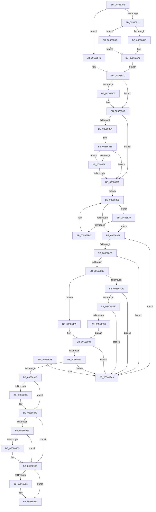

# IommupUnmapDeviceInternal

- RVA: `0x005667D8`–`0x005669B0` (길이 `472` bytes)
- VA: `0x00000001405667D8`
- 실행 섹션: `.text`
- PDB 이름 있음: `예`; PDB Function 태그: `아니요`
- unwind 정보 RVA: `0x0008CDD0`
- 디코드: `132`개 명령, `472/472` bytes 표시
- 미해석 바이트: `0` (있으면 어셈블리에 `.byte`로 보존)

> 이 문서는 커널 이미지의 기계어와 PDB 기호를 분석해 생성했습니다. 4번과 5번은 함수 원형과 자료형을 바이너리 사용 방식에서 추정한 C 해석이며 원본 소스 복구 결과는 아닙니다.

## 1. Dependencies

- 직접 호출 지점: **11**; 고유 호출 대상: **9**
- 직접 호출자로 확인된 함수: **3**
- RIP 상대 이미지 참조: **2**

### Outgoing calls
- `0x00566811` → [Feature_Test57481295__private_IsEnabledDeviceUsageNoInline](../4F/Feature_Test57481295__private_IsEnabledDeviceUsageNoInline_function_004F7B90.md) (function, `0x004F7B90`)
- `0x0056682C` → [guard_dispatch_icall](../6B/guard_dispatch_icall_function_006BAAD0.md) (function, `0x006BAAD0`)
- `0x00566847` → [IommupHvUnmapDevice](IommupHvUnmapDevice_function_0056780C.md) (function, `0x0056780C`)
- `0x00566865` → [KiRaiseIrqlProcessIrqlFlags](../4F/KiRaiseIrqlProcessIrqlFlags_function_004F56FC.md) (function, `0x004F56FC`)
- `0x00566871` → [KeAcquireSpinLockAtDpcLevel](../20/KeAcquireSpinLockAtDpcLevel_function_00208430.md) (function, `0x00208430`)
- `0x00566928` → [KxReleaseSpinLock](../20/KxReleaseSpinLock_function_00206670.md) (function, `0x00206670`)
- `0x0056693C` → [KiLowerIrqlProcessIrqlFlags](../4F/KiLowerIrqlProcessIrqlFlags_function_004F5698.md) (function, `0x004F5698`)
- `0x00566963` → [ExWaitForRundownProtectionRelease](../2A/ExWaitForRundownProtectionRelease_function_002A4CB0.md) (function, `0x002A4CB0`)
- `0x0056696F` → [HalpMmAllocCtxFree](../3E/HalpMmAllocCtxFree_function_003E1904.md) (function, `0x003E1904`)
- `0x00566977` → [HalpMmAllocCtxFree](../3E/HalpMmAllocCtxFree_function_003E1904.md) (function, `0x003E1904`)
- `0x00566984` → [HalpMmAllocCtxFree](../3E/HalpMmAllocCtxFree_function_003E1904.md) (function, `0x003E1904`)

### Direct callers
- [IommuUnmapDevice](IommuUnmapDevice_function_00566200.md) at `0x00566210`
- [IommupDeviceDisableSvm](../../page/70/IommupDeviceDisableSvm_function_00708A28.md) at `0x00708AB1`
- [IommupDeviceEnableSvm](../../page/70/IommupDeviceEnableSvm_function_00708CC4.md) at `0x00708E92`

### Static image references
- `0x005667F4` → RVA `0x00FC1710` (`.data`; read)
- `0x00566859` → RVA `0x00FC6D20` (`ALMOSTRO`; read)

## 2. Other-region calls and transfers

- 다른 실행 섹션으로 향하는 call: **0**
- 별도 외부 분기/꼬리 이동을 확인하지 못했습니다.

## 3. Assembly (complete function range)

```asm
005667D8  48 89 5C 24 08                  mov qword ptr [rsp + 8], rbx
005667DD  48 89 6C 24 10                  mov qword ptr [rsp + 0x10], rbp
005667E2  48 89 74 24 18                  mov qword ptr [rsp + 0x18], rsi
005667E7  57                              push rdi
005667E8  41 54                           push r12
005667EA  41 55                           push r13
005667EC  41 56                           push r14
005667EE  41 57                           push r15
005667F0  48 83 EC 20                     sub rsp, 0x20
005667F4  80 3D 15 AF A5 00 00            cmp byte ptr [rip + 0xa5af15], 0
005667FB  48 8B DA                        mov rbx, rdx
005667FE  48 8B 72 60                     mov rsi, qword ptr [rdx + 0x60]
00566802  48 8B E9                        mov rbp, rcx
00566805  41 BD 01 00 00 00               mov r13d, 1
0056680B  48 8B 7E 18                     mov rdi, qword ptr [rsi + 0x18]
0056680F  75 32                           jne 0x140566843
00566811  E8 7A 13 F9 FF                  call 0x1404f7b90
00566816  48 8B 4F 10                     mov rcx, qword ptr [rdi + 0x10]
0056681A  85 C0                           test eax, eax
0056681C  75 15                           jne 0x140566833
0056681E  48 8B 87 80 01 00 00            mov rax, qword ptr [rdi + 0x180]
00566825  45 8A C5                        mov r8b, r13b
00566828  48 8B 56 28                     mov rdx, qword ptr [rsi + 0x28]
0056682C  E8 9F 42 15 00                  call 0x1406baad0
00566831  EB 19                           jmp 0x14056684c
00566833  48 8B 87 D8 00 00 00            mov rax, qword ptr [rdi + 0xd8]
0056683A  45 33 C0                        xor r8d, r8d
0056683D  48 8B 53 28                     mov rdx, qword ptr [rbx + 0x28]
00566841  EB E9                           jmp 0x14056682c
00566843  48 8B 4E 28                     mov rcx, qword ptr [rsi + 0x28]
00566847  E8 C0 0F 00 00                  call 0x14056780c
0056684C  45 0F 20 C7                     mov r15, cr8
00566850  BA 0F 00 00 00                  mov edx, 0xf
00566855  44 0F 22 C2                     mov cr8, rdx
00566859  83 3D C0 04 A6 00 00            cmp dword ptr [rip + 0xa604c0], 0
00566860  74 08                           je 0x14056686a
00566862  41 8A CF                        mov cl, r15b
00566865  E8 92 EE F8 FF                  call 0x1404f56fc
0056686A  4C 8D 65 18                     lea r12, [rbp + 0x18]
0056686E  49 8B CC                        mov rcx, r12
00566871  E8 BA 1B CA FF                  call 0x140208430
00566876  48 8D 4D 20                     lea rcx, [rbp + 0x20]
0056687A  33 FF                           xor edi, edi
0056687C  48 8B 01                        mov rax, qword ptr [rcx]
0056687F  48 3B C1                        cmp rax, rcx
00566882  74 15                           je 0x140566899
00566884  48 8B 56 18                     mov rdx, qword ptr [rsi + 0x18]
00566888  48 8B F8                        mov rdi, rax
0056688B  48 39 50 10                     cmp qword ptr [rax + 0x10], rdx
0056688F  74 08                           je 0x140566899
00566891  48 8B 00                        mov rax, qword ptr [rax]
00566894  48 3B C1                        cmp rax, rcx
00566897  75 EF                           jne 0x140566888
00566899  33 ED                           xor ebp, ebp
0056689B  48 8D 4F 18                     lea rcx, [rdi + 0x18]
0056689F  48 8B 01                        mov rax, qword ptr [rcx]
005668A2  44 8B F5                        mov r14d, ebp
005668A5  EB 0C                           jmp 0x1405668b3
005668A7  4C 8B F0                        mov r14, rax
005668AA  48 39 70 28                     cmp qword ptr [rax + 0x28], rsi
005668AE  74 08                           je 0x1405668b8
005668B0  48 8B 00                        mov rax, qword ptr [rax]
005668B3  48 3B C1                        cmp rax, rcx
005668B6  75 EF                           jne 0x1405668a7
005668B8  49 8B 16                        mov rdx, qword ptr [r14]
005668BB  4C 39 72 08                     cmp qword ptr [rdx + 8], r14
005668BF  0F 85 E4 00 00 00               jne 0x1405669a9
005668C5  49 8B 46 08                     mov rax, qword ptr [r14 + 8]
005668C9  4C 39 30                        cmp qword ptr [rax], r14
005668CC  0F 85 D7 00 00 00               jne 0x1405669a9
005668D2  48 89 10                        mov qword ptr [rax], rdx
005668D5  48 89 42 08                     mov qword ptr [rdx + 8], rax
005668D9  48 39 09                        cmp qword ptr [rcx], rcx
005668DC  75 23                           jne 0x140566901
005668DE  48 8B 0F                        mov rcx, qword ptr [rdi]
005668E1  48 39 79 08                     cmp qword ptr [rcx + 8], rdi
005668E5  0F 85 BE 00 00 00               jne 0x1405669a9
005668EB  48 8B 47 08                     mov rax, qword ptr [rdi + 8]
005668EF  48 39 38                        cmp qword ptr [rax], rdi
005668F2  0F 85 B1 00 00 00               jne 0x1405669a9
005668F8  48 89 08                        mov qword ptr [rax], rcx
005668FB  48 89 41 08                     mov qword ptr [rcx + 8], rax
005668FF  EB 03                           jmp 0x140566904
00566901  48 8B FD                        mov rdi, rbp
00566904  48 8B 16                        mov rdx, qword ptr [rsi]
00566907  48 39 72 08                     cmp qword ptr [rdx + 8], rsi
0056690B  0F 85 98 00 00 00               jne 0x1405669a9
00566911  48 8B 46 08                     mov rax, qword ptr [rsi + 8]
00566915  48 39 30                        cmp qword ptr [rax], rsi
00566918  0F 85 8B 00 00 00               jne 0x1405669a9
0056691E  48 89 10                        mov qword ptr [rax], rdx
00566921  49 8B CC                        mov rcx, r12
00566924  48 89 42 08                     mov qword ptr [rdx + 8], rax
00566928  E8 43 FD C9 FF                  call 0x140206670
0056692D  39 2D ED 03 A6 00               cmp dword ptr [rip + 0xa603ed], ebp
00566933  74 0C                           je 0x140566941
00566935  44 0F 20 C1                     mov rcx, cr8
00566939  41 8A D7                        mov dl, r15b
0056693C  E8 57 ED F8 FF                  call 0x1404f5698
00566941  41 0F B6 C7                     movzx eax, r15b
00566945  44 0F 22 C0                     mov cr8, rax
00566949  40 38 2D C0 AD A5 00            cmp byte ptr [rip + 0xa5adc0], bpl
00566950  48 89 6B 60                     mov qword ptr [rbx + 0x60], rbp
00566954  75 16                           jne 0x14056696c
00566956  83 43 38 FF                     add dword ptr [rbx + 0x38], -1
0056695A  75 10                           jne 0x14056696c
0056695C  48 8D 4B 40                     lea rcx, [rbx + 0x40]
00566960  89 6B 3C                        mov dword ptr [rbx + 0x3c], ebp
00566963  E8 48 E3 D3 FF                  call 0x1402a4cb0
00566968  4C 87 6B 40                     xchg qword ptr [rbx + 0x40], r13
0056696C  48 8B D6                        mov rdx, rsi
0056696F  E8 90 AF E7 FF                  call 0x1403e1904
00566974  49 8B D6                        mov rdx, r14
00566977  E8 88 AF E7 FF                  call 0x1403e1904
0056697C  48 85 FF                        test rdi, rdi
0056697F  74 08                           je 0x140566989
00566981  48 8B D7                        mov rdx, rdi
00566984  E8 7B AF E7 FF                  call 0x1403e1904
00566989  48 8B 5C 24 50                  mov rbx, qword ptr [rsp + 0x50]
0056698E  33 C0                           xor eax, eax
00566990  48 8B 6C 24 58                  mov rbp, qword ptr [rsp + 0x58]
00566995  48 8B 74 24 60                  mov rsi, qword ptr [rsp + 0x60]
0056699A  48 83 C4 20                     add rsp, 0x20
0056699E  41 5F                           pop r15
005669A0  41 5E                           pop r14
005669A2  41 5D                           pop r13
005669A4  41 5C                           pop r12
005669A6  5F                              pop rdi
005669A7  C3                              ret
005669A8  CC                              int3
005669A9  B9 03 00 00 00                  mov ecx, 3
005669AE  CD 29                           int 0x29
```

## 4. C-style interpretation (structured pseudocode)

```c
__int64 __fastcall IommupUnmapDeviceInternal(__int64 a1, __int64 a2)
{
    __int64 result;
    __int64 v_rbp;
    __int64 v_rdi;
    __int64 v_rsp;
    unsigned __int64 v_stack_p10;
    unsigned __int64 v_stack_p18;
    unsigned __int64 v_stack_p8;

    v_stack_p8 = v_rbx;
    v_stack_p10 = v_rbp;
    v_stack_p18 = v_rsi;
    v_rsp = (v_rsp) - (32);
    if ((*(unsigned __int8 *)(v_rip + 10858261)) != 0) goto loc_00566843;
    result = Feature_Test57481295__private_IsEnabledDeviceUsageNoInline(a1, a2, a3, a4);
    if ((unsigned int)(result) != 0) goto loc_00566833;
loc_0056682C:
    result = guard_dispatch_icall(*(unsigned __int64 *)(*(unsigned __int64 *)(*(unsigned __int64 *)(a2 + 96) + 24) + 16), *(unsigned __int64 *)(*(unsigned __int64 *)(a2 + 96) + 40), 1, a4);
    goto loc_0056684C;
loc_00566833:
    a3 = 0;
    goto loc_0056682C;
loc_00566843:
    result = IommupHvUnmapDevice(*(unsigned __int64 *)(*(unsigned __int64 *)(a2 + 96) + 40), *(unsigned __int64 *)(a2 + 40), a3, a4);
loc_0056684C:
    if ((*(unsigned int *)(v_rip + 10880192)) != 0) {
        a1 = (unsigned __int8)(v_cr8);
        result = KiRaiseIrqlProcessIrqlFlags(a1, 15, a3, a4);
    }
    result = KeAcquireSpinLockAtDpcLevel(a1 + 24, 15, a3, a4);
    v_rdi = 0;
    if ((*(unsigned __int64 *)(a1 + 32)) == (a1 + 32)) goto loc_00566899;
loc_00566888:
    if ((*(unsigned __int64 *)(*(unsigned __int64 *)(a1 + 32) + 16)) == (*(unsigned __int64 *)(*(unsigned __int64 *)(a2 + 96) + 24))) goto loc_00566899;
    if ((*(unsigned __int64 *)(*(unsigned __int64 *)(a1 + 32))) != (a1 + 32)) goto loc_00566888;
loc_00566899:
    v_rbp = 0;
    goto loc_005668B3;
loc_005668A7:
    if ((*(unsigned __int64 *)(*(unsigned __int64 *)(*(unsigned __int64 *)(a1 + 32) + 24) + 40)) == (*(unsigned __int64 *)(a2 + 96))) goto loc_005668B8;
loc_005668B3:
    if ((*(unsigned __int64 *)(*(unsigned __int64 *)(*(unsigned __int64 *)(a1 + 32) + 24))) != (*(unsigned __int64 *)(a1 + 32) + 24)) goto loc_005668A7;
loc_005668B8:
    if ((*(unsigned __int64 *)(*(unsigned __int64 *)(*(unsigned __int64 *)(*(unsigned __int64 *)(a1 + 32) + 24)) + 8)) != (*(unsigned __int64 *)(*(unsigned __int64 *)(a1 + 32) + 24))) goto loc_005669A9;
    if ((*(unsigned __int64 *)(*(unsigned __int64 *)(*(unsigned __int64 *)(*(unsigned __int64 *)(a1 + 32) + 24) + 8))) != (*(unsigned __int64 *)(*(unsigned __int64 *)(a1 + 32) + 24))) goto loc_005669A9;
    *(unsigned __int64 *)(*(unsigned __int64 *)(*(unsigned __int64 *)(*(unsigned __int64 *)(a1 + 32) + 24) + 8)) = *(unsigned __int64 *)(*(unsigned __int64 *)(*(unsigned __int64 *)(a1 + 32) + 24));
    *(unsigned __int64 *)(*(unsigned __int64 *)(*(unsigned __int64 *)(*(unsigned __int64 *)(a1 + 32) + 24)) + 8) = *(unsigned __int64 *)(*(unsigned __int64 *)(*(unsigned __int64 *)(a1 + 32) + 24) + 8);
    if ((*(unsigned __int64 *)(*(unsigned __int64 *)(a1 + 32) + 24)) != (*(unsigned __int64 *)(a1 + 32) + 24)) goto loc_00566901;
    if ((*(unsigned __int64 *)(*(unsigned __int64 *)(*(unsigned __int64 *)(a1 + 32)) + 8)) != (*(unsigned __int64 *)(a1 + 32))) goto loc_005669A9;
    if ((*(unsigned __int64 *)(*(unsigned __int64 *)(*(unsigned __int64 *)(a1 + 32) + 8))) != (*(unsigned __int64 *)(a1 + 32))) goto loc_005669A9;
    *(unsigned __int64 *)(*(unsigned __int64 *)(*(unsigned __int64 *)(a1 + 32) + 8)) = *(unsigned __int64 *)(*(unsigned __int64 *)(a1 + 32));
    *(unsigned __int64 *)(*(unsigned __int64 *)(*(unsigned __int64 *)(a1 + 32)) + 8) = *(unsigned __int64 *)(*(unsigned __int64 *)(a1 + 32) + 8);
    goto loc_00566904;
loc_00566901:
loc_00566904:
    if ((*(unsigned __int64 *)(*(unsigned __int64 *)(*(unsigned __int64 *)(a2 + 96)) + 8)) != (*(unsigned __int64 *)(a2 + 96))) goto loc_005669A9;
    if ((*(unsigned __int64 *)(*(unsigned __int64 *)(*(unsigned __int64 *)(a2 + 96) + 8))) != (*(unsigned __int64 *)(a2 + 96))) goto loc_005669A9;
    *(unsigned __int64 *)(*(unsigned __int64 *)(*(unsigned __int64 *)(a2 + 96) + 8)) = *(unsigned __int64 *)(*(unsigned __int64 *)(a2 + 96));
    *(unsigned __int64 *)(*(unsigned __int64 *)(*(unsigned __int64 *)(a2 + 96)) + 8) = *(unsigned __int64 *)(*(unsigned __int64 *)(a2 + 96) + 8);
    result = KxReleaseSpinLock(a1 + 24, *(unsigned __int64 *)(*(unsigned __int64 *)(a2 + 96)), a3, a4);
    if ((*(unsigned int *)(v_rip + 10879981)) != 0) {
        a1 = 15;
        a2 = (unsigned __int8)(v_cr8);
        result = KiLowerIrqlProcessIrqlFlags(a1, a2, a3, a4);
    }
    *(unsigned __int64 *)(a2 + 96) = 0;
    if ((*(unsigned __int8 *)(v_rip + 10857920)) != 0) goto loc_0056696C;
    result = (unsigned __int8)(v_cr8);
    if ((*(unsigned __int8 *)(v_rip + 10857920)) == 0) {
        a1 = a2 + 64;
        *(unsigned int *)(a2 + 60) = 0;
        result = ExWaitForRundownProtectionRelease(a1, a2, a3, a4);
    }
    result = HalpMmAllocCtxFree(a1, *(unsigned __int64 *)(a2 + 96), a3, a4);
    result = HalpMmAllocCtxFree(a1, *(unsigned __int64 *)(*(unsigned __int64 *)(a1 + 32) + 24), a3, a4);
    if (0 != 0) {
        a2 = 0;
        result = HalpMmAllocCtxFree(a1, a2, a3, a4);
    }
    result = 0;
    v_rsp = (v_rsp) + (32);
    return result;
loc_005669A9:
    return result;
}
```

## 5. (Beta) C Style

```c
int64_t IommupUnmapDeviceInternal(void *Arg1, void *Arg2)
{
    uint8_t *arg1 = (uint8_t *)Arg1;
    uint8_t *arg2 = (uint8_t *)Arg2;

    int64_t result;
    int64_t local_rbp;
    int64_t local_rdi;
    int64_t local_rsp;
    uint64_t v_stack_p10;
    uint64_t v_stack_p18;
    uint64_t v_stack_p8;

    v_stack_p8 = local_rbx;
    v_stack_p10 = local_rbp;
    v_stack_p18 = local_rsi;
    local_rsp = (local_rsp) - (32);
    if ((*(uint8_t *)(v_rip + 0xA5AF15)) != 0) goto loc_00566843;
    result = Feature_Test57481295__private_IsEnabledDeviceUsageNoInline(Arg1, Arg2, a3, a4);
    if ((uint32_t)(result) != 0) goto loc_00566833;
loc_0056682C:
    result = guard_dispatch_icall(*(uint64_t *)(*(uint64_t *)(*(uint64_t *)(arg2 + 0x60) + 0x18) + 0x10), *(uint64_t *)(*(uint64_t *)(arg2 + 0x60) + 0x28), 1, a4);
    goto loc_0056684C;
loc_00566833:
    a3 = 0;
    goto loc_0056682C;
loc_00566843:
    result = IommupHvUnmapDevice(*(uint64_t *)(*(uint64_t *)(arg2 + 0x60) + 0x28), *(uint64_t *)(arg2 + 0x28), a3, a4);
loc_0056684C:
    if ((*(uint32_t *)(v_rip + 0xA604C0)) != 0) {
        Arg1 = (uint8_t)(v_cr8);
        result = KiRaiseIrqlProcessIrqlFlags(Arg1, 15, a3, a4);
    }
    result = KeAcquireSpinLockAtDpcLevel(Arg1 + 24, 15, a3, a4);
    local_rdi = 0;
    if ((*(uint64_t *)(arg1 + 0x20)) == (Arg1 + 32)) goto loc_00566899;
loc_00566888:
    if ((*(uint64_t *)(*(uint64_t *)(arg1 + 0x20) + 0x10)) == (*(uint64_t *)(*(uint64_t *)(arg2 + 0x60) + 0x18))) goto loc_00566899;
    if ((*(uint64_t *)(*(uint64_t *)(arg1 + 0x20))) != (Arg1 + 32)) goto loc_00566888;
loc_00566899:
    local_rbp = 0;
    goto loc_005668B3;
loc_005668A7:
    if ((*(uint64_t *)(*(uint64_t *)(*(uint64_t *)(arg1 + 0x20) + 0x18) + 0x28)) == (*(uint64_t *)(arg2 + 0x60))) goto loc_005668B8;
loc_005668B3:
    if ((*(uint64_t *)(*(uint64_t *)(*(uint64_t *)(arg1 + 0x20) + 0x18))) != (*(uint64_t *)(arg1 + 0x20) + 24)) goto loc_005668A7;
loc_005668B8:
    if ((*(uint64_t *)(*(uint64_t *)(*(uint64_t *)(*(uint64_t *)(arg1 + 0x20) + 0x18)) + 0x8)) != (*(uint64_t *)(*(uint64_t *)(arg1 + 0x20) + 0x18))) goto loc_005669A9;
    if ((*(uint64_t *)(*(uint64_t *)(*(uint64_t *)(*(uint64_t *)(arg1 + 0x20) + 0x18) + 0x8))) != (*(uint64_t *)(*(uint64_t *)(arg1 + 0x20) + 0x18))) goto loc_005669A9;
    *(uint64_t *)(*(uint64_t *)(*(uint64_t *)(*(uint64_t *)(arg1 + 0x20) + 0x18) + 0x8)) = *(uint64_t *)(*(uint64_t *)(*(uint64_t *)(arg1 + 0x20) + 0x18));
    *(uint64_t *)(*(uint64_t *)(*(uint64_t *)(*(uint64_t *)(arg1 + 0x20) + 0x18)) + 0x8) = *(uint64_t *)(*(uint64_t *)(*(uint64_t *)(arg1 + 0x20) + 0x18) + 0x8);
    if ((*(uint64_t *)(*(uint64_t *)(arg1 + 0x20) + 0x18)) != (*(uint64_t *)(arg1 + 0x20) + 24)) goto loc_00566901;
    if ((*(uint64_t *)(*(uint64_t *)(*(uint64_t *)(arg1 + 0x20)) + 0x8)) != (*(uint64_t *)(arg1 + 0x20))) goto loc_005669A9;
    if ((*(uint64_t *)(*(uint64_t *)(*(uint64_t *)(arg1 + 0x20) + 0x8))) != (*(uint64_t *)(arg1 + 0x20))) goto loc_005669A9;
    *(uint64_t *)(*(uint64_t *)(*(uint64_t *)(arg1 + 0x20) + 0x8)) = *(uint64_t *)(*(uint64_t *)(arg1 + 0x20));
    *(uint64_t *)(*(uint64_t *)(*(uint64_t *)(arg1 + 0x20)) + 0x8) = *(uint64_t *)(*(uint64_t *)(arg1 + 0x20) + 0x8);
    goto loc_00566904;
loc_00566901:
loc_00566904:
    if ((*(uint64_t *)(*(uint64_t *)(*(uint64_t *)(arg2 + 0x60)) + 0x8)) != (*(uint64_t *)(arg2 + 0x60))) goto loc_005669A9;
    if ((*(uint64_t *)(*(uint64_t *)(*(uint64_t *)(arg2 + 0x60) + 0x8))) != (*(uint64_t *)(arg2 + 0x60))) goto loc_005669A9;
    *(uint64_t *)(*(uint64_t *)(*(uint64_t *)(arg2 + 0x60) + 0x8)) = *(uint64_t *)(*(uint64_t *)(arg2 + 0x60));
    *(uint64_t *)(*(uint64_t *)(*(uint64_t *)(arg2 + 0x60)) + 0x8) = *(uint64_t *)(*(uint64_t *)(arg2 + 0x60) + 0x8);
    result = KxReleaseSpinLock(Arg1 + 24, *(uint64_t *)(*(uint64_t *)(arg2 + 0x60)), a3, a4);
    if ((*(uint32_t *)(v_rip + 0xA603ED)) != 0) {
        Arg1 = 15;
        Arg2 = (uint8_t)(v_cr8);
        result = KiLowerIrqlProcessIrqlFlags(Arg1, Arg2, a3, a4);
    }
    *(uint64_t *)(arg2 + 0x60) = 0;
    if ((*(uint8_t *)(v_rip + 0xA5ADC0)) != 0) goto loc_0056696C;
    result = (uint8_t)(v_cr8);
    if ((*(uint8_t *)(v_rip + 0xA5ADC0)) == 0) {
        Arg1 = Arg2 + 64;
        *(uint32_t *)(arg2 + 0x3C) = 0;
        result = ExWaitForRundownProtectionRelease(Arg1, Arg2, a3, a4);
    }
    result = HalpMmAllocCtxFree(Arg1, *(uint64_t *)(arg2 + 0x60), a3, a4);
    result = HalpMmAllocCtxFree(Arg1, *(uint64_t *)(*(uint64_t *)(arg1 + 0x20) + 0x18), a3, a4);
    if (0 != 0) {
        Arg2 = 0;
        result = HalpMmAllocCtxFree(Arg1, Arg2, a3, a4);
    }
    result = 0;
    local_rsp = (local_rsp) + (32);
    return result;
loc_005669A9:
    return result;
}
```

### 관측된 메모리 오프셋

구조체 형식이 확인되지 않은 접근은 인자 기준의 오프셋으로만 기록했습니다.

| 기준 인자 | 오프셋 표현 | 폭 (bit) | 접근 |
|---|---:|---:|---|
| `Arg1` | `+ 0x0` | `64` | `R` |
| `Arg1` | `+ 0x18` | `64` | `R` |
| `Arg1` | `+ 0x20` | `64` | `R` |
| `Arg2` | `+ 0x28` | `64` | `R` |
| `Arg2` | `+ 0x38` | `32` | `R/W` |
| `Arg2` | `+ 0x3C` | `32` | `W` |
| `Arg2` | `+ 0x40` | `64` | `R` |
| `Arg2` | `+ 0x40` | `64` | `R/W` |
| `Arg2` | `+ 0x60` | `64` | `R` |
| `Arg2` | `+ 0x60` | `64` | `W` |

## 6. Execution-region graph

[열기: 2D/3D 그래프와 함수 탐색 컨트롤 패널](../../../control-panel.html?section=text&rva=0x005667D8&view=graph)

- 2D 그래프는 위에서 아래로 흐르고, 3D 그래프는 빈 공간을 드래그해 회전합니다. Shift+드래그는 이동, 휠은 확대·축소, 함수 노드 선택은 대상 보고서 이동입니다.

### Static fallback


