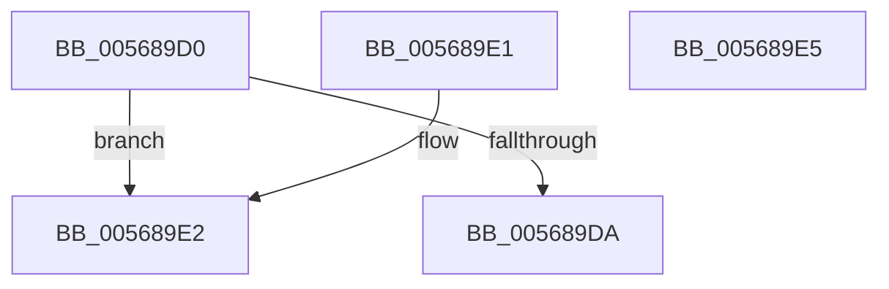

# IommupValidateMdl

- RVA: `0x005689D0`–`0x005689E6` (길이 `22` bytes)
- VA: `0x00000001405689D0`
- 실행 섹션: `.text`
- PDB 이름 있음: `예`; PDB Function 태그: `아니요`
- unwind 정보 RVA: `0x000DB714`
- 디코드: `10`개 명령, `22/22` bytes 표시
- 미해석 바이트: `0` (있으면 어셈블리에 `.byte`로 보존)

> 이 문서는 커널 이미지의 기계어와 PDB 기호를 분석해 생성했습니다. 4번과 5번은 함수 원형과 자료형을 바이너리 사용 방식에서 추정한 C 해석이며 원본 소스 복구 결과는 아닙니다.

## 1. Dependencies

- 직접 호출 지점: **0**; 고유 호출 대상: **0**
- 직접 호출자로 확인된 함수: **7**
- RIP 상대 이미지 참조: **0**

### Outgoing calls
- 직접 디코드된 call 명령이 없습니다.

### Direct callers
- [IommuUnmapIdentityRangeEx](../30/IommuUnmapIdentityRangeEx_function_00306F80.md) at `0x003070B7`
- [IommuMapLogicalRangeEx](../30/IommuMapLogicalRangeEx_function_003074B0.md) at `0x00307633`
- [IommuMapIdentityRangeEx](../30/IommuMapIdentityRangeEx_function_00307C10.md) at `0x00307D8B`
- [IommupProcessPhysicalAddress](../47/IommupProcessPhysicalAddress_function_0047FF5C.md) at `0x0047FFD2`
- [IommuMapIdentityRange](IommuMapIdentityRange_function_00568000.md) at `0x00568024`
- [IommuMapLogicalRange](IommuMapLogicalRange_function_00568070.md) at `0x0056808E`
- [IommuUnmapIdentityRange](IommuUnmapIdentityRange_function_00568660.md) at `0x00568684`

### Static image references
- 디코드된 RIP-relative 메모리 참조가 없습니다.

## 2. Other-region calls and transfers

- 다른 실행 섹션으로 향하는 call: **0**
- 별도 외부 분기/꼬리 이동을 확인하지 못했습니다.

## 3. Assembly (complete function range)

```asm
005689D0  BA FF 0F 00 00                  mov edx, 0xfff
005689D5  85 51 2C                        test dword ptr [rcx + 0x2c], edx
005689D8  75 08                           jne 0x1405689e2
005689DA  85 51 28                        test dword ptr [rcx + 0x28], edx
005689DD  0F 94 C0                        sete al
005689E0  C3                              ret
005689E1  CC                              int3
005689E2  32 C0                           xor al, al
005689E4  C3                              ret
005689E5  CC                              int3
```

## 4. C-style interpretation (structured pseudocode)

```c
__int64 __fastcall IommupValidateMdl(__int64 a1)
{
    __int64 result;

    if (((*(unsigned int *)(a1 + 44)) & ((unsigned int)((unsigned int)(0xFFFULL)))) != 0) goto loc_005689E2;
    result = (((*(unsigned int *)(a1 + 40)) & ((unsigned int)((unsigned int)(0xFFFULL)))) == 0) ? 1 : 0;
    return result;
loc_005689E2:
    result = 0;
    return result;
}
```

## 5. (Beta) C Style

```c
int64_t IommupValidateMdl(void *Arg1)
{
    uint8_t *arg1 = (uint8_t *)Arg1;

    int64_t result;

    if (((*(uint32_t *)(arg1 + 0x2C)) & ((uint32_t)((uint32_t)(0xFFFULL)))) != 0) goto loc_005689E2;
    result = (((*(uint32_t *)(arg1 + 0x28)) & ((uint32_t)((uint32_t)(0xFFFULL)))) == 0) ? 1 : 0;
    return result;
loc_005689E2:
    result = 0;
    return result;
}
```

### 관측된 메모리 오프셋

구조체 형식이 확인되지 않은 접근은 인자 기준의 오프셋으로만 기록했습니다.

| 기준 인자 | 오프셋 표현 | 폭 (bit) | 접근 |
|---|---:|---:|---|
| `Arg1` | `+ 0x28` | `32` | `R` |
| `Arg1` | `+ 0x2C` | `32` | `R` |

## 6. Execution-region graph

[열기: 2D/3D 그래프와 함수 탐색 컨트롤 패널](../../../control-panel.html?section=text&rva=0x005689D0&view=graph)

- 2D 그래프는 위에서 아래로 흐르고, 3D 그래프는 빈 공간을 드래그해 회전합니다. Shift+드래그는 이동, 휠은 확대·축소, 함수 노드 선택은 대상 보고서 이동입니다.

### Static fallback


