# IvtAllocateScalableModePasidTables

- RVA: `0x0056E8DC`–`0x0056EC50` (길이 `884` bytes)
- VA: `0x000000014056E8DC`
- 실행 섹션: `.text`
- PDB 이름 있음: `예`; PDB Function 태그: `아니요`
- unwind 정보 RVA: `0x00071578`
- 디코드: `230`개 명령, `884/884` bytes 표시
- 미해석 바이트: `0` (있으면 어셈블리에 `.byte`로 보존)

> 이 문서는 커널 이미지의 기계어와 PDB 기호를 분석해 생성했습니다. 4번과 5번은 함수 원형과 자료형을 바이너리 사용 방식에서 추정한 C 해석이며 원본 소스 복구 결과는 아닙니다.

## 1. Dependencies

- 직접 호출 지점: **10**; 고유 호출 대상: **10**
- 직접 호출자로 확인된 함수: **3**
- RIP 상대 이미지 참조: **1**

### Outgoing calls
- `0x0056E9C6` → [ExtEnvAllocateMemory](ExtEnvAllocateMemory_function_005610B0.md) (function, `0x005610B0`)
- `0x0056EA5A` → [ExtEnvAllocatePhysicalMemory](ExtEnvAllocatePhysicalMemory_function_00561124.md) (function, `0x00561124`)
- `0x0056EA73` → [memset](../6C/memset_function_006C6C40.md) (function, `0x006C6C40`)
- `0x0056EA89` → [IvtExtendScalableModePasidTables](IvtExtendScalableModePasidTables_function_0056F6C8.md) (function, `0x0056F6C8`)
- `0x0056EAAF` → [KiRaiseIrqlProcessIrqlFlags](../4F/KiRaiseIrqlProcessIrqlFlags_function_004F56FC.md) (function, `0x004F56FC`)
- `0x0056EAC0` → [KeAcquireInStackQueuedSpinLockAtDpcLevel](../27/KeAcquireInStackQueuedSpinLockAtDpcLevel_function_00275740.md) (function, `0x00275740`)
- `0x0056EBBD` → [memcpy](../6C/memcpy_function_006C6840.md) (function, `0x006C6840`)
- `0x0056EBD1` → [KeReleaseInStackQueuedSpinLockFromDpcLevel](../21/KeReleaseInStackQueuedSpinLockFromDpcLevel_function_002171B0.md) (function, `0x002171B0`)
- `0x0056EBED` → [KiLowerIrqlProcessIrqlFlags](../4F/KiLowerIrqlProcessIrqlFlags_function_004F5698.md) (function, `0x004F5698`)
- `0x0056EC09` → [IvtFreeScalableModePasidTables](IvtFreeScalableModePasidTables_function_0056F980.md) (function, `0x0056F980`)

### Direct callers
- [IvtAllocateTranslationStructures](IvtAllocateTranslationStructures_function_0056EC58.md) at `0x0056ECF9`
- [IvtGrowPasidTable](IvtGrowPasidTable_function_0056FDD0.md) at `0x0056FE8F`
- [IvtSetupScalableModeDefaultPasidTables](../../pagelk/B6/IvtSetupScalableModeDefaultPasidTables_function_00B62E78.md) at `0x00B62EC7`

### Static image references
- `0x0056EAA5` → RVA `0x00FC6D20` (`ALMOSTRO`; read)

## 2. Other-region calls and transfers

- 다른 실행 섹션으로 향하는 call: **0**
- 별도 외부 분기/꼬리 이동을 확인하지 못했습니다.

## 3. Assembly (complete function range)

```asm
0056E8DC  4C 8B DC                        mov r11, rsp
0056E8DF  49 89 5B 08                     mov qword ptr [r11 + 8], rbx
0056E8E3  45 89 43 18                     mov dword ptr [r11 + 0x18], r8d
0056E8E7  55                              push rbp
0056E8E8  56                              push rsi
0056E8E9  57                              push rdi
0056E8EA  41 54                           push r12
0056E8EC  41 55                           push r13
0056E8EE  41 56                           push r14
0056E8F0  41 57                           push r15
0056E8F2  48 83 EC 60                     sub rsp, 0x60
0056E8F6  4C 8B A4 24 E0 00 00 00         mov r12, qword ptr [rsp + 0xe0]
0056E8FE  33 C0                           xor eax, eax
0056E900  49 21 43 A0                     and qword ptr [r11 - 0x60], rax
0056E904  0F 57 C0                        xorps xmm0, xmm0
0056E907  45 8B F9                        mov r15d, r9d
0056E90A  48 8B EA                        mov rbp, rdx
0056E90D  4C 8B E9                        mov r13, rcx
0056E910  0F 11 44 24 40                  movups xmmword ptr [rsp + 0x40], xmm0
0056E915  49 89 43 B8                     mov qword ptr [r11 - 0x48], rax
0056E919  4D 85 E4                        test r12, r12
0056E91C  0F 84 E2 01 00 00               je 0x14056eb04
0056E922  48 85 D2                        test rdx, rdx
0056E925  74 0D                           je 0x14056e934
0056E927  48 8B 42 40                     mov rax, qword ptr [rdx + 0x40]
0056E92B  49 89 04 24                     mov qword ptr [r12], rax
0056E92F  E9 D9 01 00 00                  jmp 0x14056eb0d
0056E934  49 21 04 24                     and qword ptr [r12], rax
0056E938  83 8C 24 B8 00 00 00 FF         or dword ptr [rsp + 0xb8], 0xffffffff
0056E940  48 83 A4 24 A8 00 00 00 00      and qword ptr [rsp + 0xa8], 0
0056E949  33 C0                           xor eax, eax
0056E94B  48 89 44 24 30                  mov qword ptr [rsp + 0x30], rax
0056E950  33 DB                           xor ebx, ebx
0056E952  B8 00 00 10 00                  mov eax, 0x100000
0056E957  BE 01 00 00 C0                  mov esi, 0xc0000001
0056E95C  44 3B F8                        cmp r15d, eax
0056E95F  0F 83 BA 02 00 00               jae 0x14056ec1f
0056E965  8B 8C 24 C0 00 00 00            mov ecx, dword ptr [rsp + 0xc0]
0056E96C  3B C8                           cmp ecx, eax
0056E96E  0F 83 AB 02 00 00               jae 0x14056ec1f
0056E974  41 3B CF                        cmp ecx, r15d
0056E977  0F 82 A2 02 00 00               jb 0x14056ec1f
0056E97D  41 B8 C0 FF FF FF               mov r8d, 0xffffffc0
0056E983  41 8B C7                        mov eax, r15d
0056E986  41 23 C8                        and ecx, r8d
0056E989  41 23 C0                        and eax, r8d
0056E98C  41 B8 C0 FF 0F 00               mov r8d, 0xfffc0
0056E992  8D 51 40                        lea edx, [rcx + 0x40]
0056E995  89 94 24 E0 00 00 00            mov dword ptr [rsp + 0xe0], edx
0056E99C  41 3B C0                        cmp eax, r8d
0056E99F  0F 87 7A 02 00 00               ja 0x14056ec1f
0056E9A5  41 3B C8                        cmp ecx, r8d
0056E9A8  0F 87 71 02 00 00               ja 0x14056ec1f
0056E9AE  C1 EA 06                        shr edx, 6
0056E9B1  4C 8D 84 24 A8 00 00 00         lea r8, [rsp + 0xa8]
0056E9B9  81 E2 FF 3F 00 00               and edx, 0x3fff
0056E9BF  8D 14 D5 40 00 00 00            lea edx, [rdx*8 + 0x40]
0056E9C6  E8 E5 26 FF FF                  call 0x1405610b0
0056E9CB  8B F0                           mov esi, eax
0056E9CD  85 C0                           test eax, eax
0056E9CF  0F 88 4A 02 00 00               js 0x14056ec1f
0056E9D5  48 8B BC 24 A8 00 00 00         mov rdi, qword ptr [rsp + 0xa8]
0056E9DD  41 B8 00 10 00 00               mov r8d, 0x1000
0056E9E3  8B 84 24 B8 00 00 00            mov eax, dword ptr [rsp + 0xb8]
0056E9EA  48 89 7F 08                     mov qword ptr [rdi + 8], rdi
0056E9EE  4C 8D 77 10                     lea r14, [rdi + 0x10]
0056E9F2  48 89 3F                        mov qword ptr [rdi], rdi
0056E9F5  48 8D 4F 38                     lea rcx, [rdi + 0x38]
0056E9F9  4D 89 76 08                     mov qword ptr [r14 + 8], r14
0056E9FD  4D 89 36                        mov qword ptr [r14], r14
0056EA00  89 47 28                        mov dword ptr [rdi + 0x28], eax
0056EA03  21 5F 20                        and dword ptr [rdi + 0x20], ebx
0056EA06  8B 84 24 E0 00 00 00            mov eax, dword ptr [rsp + 0xe0]
0056EA0D  89 47 24                        mov dword ptr [rdi + 0x24], eax
0056EA10  8B 84 24 B0 00 00 00            mov eax, dword ptr [rsp + 0xb0]
0056EA17  89 47 2C                        mov dword ptr [rdi + 0x2c], eax
0056EA1A  8B 84 24 C8 00 00 00            mov eax, dword ptr [rsp + 0xc8]
0056EA21  89 47 30                        mov dword ptr [rdi + 0x30], eax
0056EA24  8B 47 24                        mov eax, dword ptr [rdi + 0x24]
0056EA27  45 8B 8D 10 01 00 00            mov r9d, dword ptr [r13 + 0x110]
0056EA2E  C1 E8 06                        shr eax, 6
0056EA31  25 FF 3F 00 00                  and eax, 0x3fff
0056EA36  48 89 4C 24 28                  mov qword ptr [rsp + 0x28], rcx
0056EA3B  48 8D 4C 24 38                  lea rcx, [rsp + 0x38]
0056EA40  48 89 4C 24 20                  mov qword ptr [rsp + 0x20], rcx
0056EA45  8D 04 C5 FF 0F 00 00            lea eax, [rax*8 + 0xfff]
0056EA4C  25 00 F0 FF FF                  and eax, 0xfffff000
0056EA51  8B D0                           mov edx, eax
0056EA53  89 84 24 B8 00 00 00            mov dword ptr [rsp + 0xb8], eax
0056EA5A  E8 C5 26 FF FF                  call 0x140561124
0056EA5F  8B F0                           mov esi, eax
0056EA61  85 C0                           test eax, eax
0056EA63  78 2B                           js 0x14056ea90
0056EA65  44 8B 84 24 B8 00 00 00         mov r8d, dword ptr [rsp + 0xb8]
0056EA6D  33 D2                           xor edx, edx
0056EA6F  48 8B 4F 38                     mov rcx, qword ptr [rdi + 0x38]
0056EA73  E8 C8 81 15 00                  call 0x1406c6c40
0056EA78  44 8B 8C 24 D0 00 00 00         mov r9d, dword ptr [rsp + 0xd0]
0056EA80  45 8B C7                        mov r8d, r15d
0056EA83  48 8B D7                        mov rdx, rdi
0056EA86  49 8B CD                        mov rcx, r13
0056EA89  E8 3A 0C 00 00                  call 0x14056f6c8
0056EA8E  8B F0                           mov esi, eax
0056EA90  44 0F 20 C0                     mov rax, cr8
0056EA94  48 89 84 24 A8 00 00 00         mov qword ptr [rsp + 0xa8], rax
0056EA9C  BA 0F 00 00 00                  mov edx, 0xf
0056EAA1  44 0F 22 C2                     mov cr8, rdx
0056EAA5  39 1D 75 82 A5 00               cmp dword ptr [rip + 0xa58275], ebx
0056EAAB  74 07                           je 0x14056eab4
0056EAAD  8A C8                           mov cl, al
0056EAAF  E8 48 6C F8 FF                  call 0x1404f56fc
0056EAB4  49 8D 8D D0 00 00 00            lea rcx, [r13 + 0xd0]
0056EABB  48 8D 54 24 40                  lea rdx, [rsp + 0x40]
0056EAC0  E8 7B 6C D0 FF                  call 0x140275740
0056EAC5  48 85 ED                        test rbp, rbp
0056EAC8  74 57                           je 0x14056eb21
0056EACA  48 8B 5D 40                     mov rbx, qword ptr [rbp + 0x40]
0056EACE  48 85 DB                        test rbx, rbx
0056EAD1  74 4C                           je 0x14056eb1f
0056EAD3  8B 84 24 B0 00 00 00            mov eax, dword ptr [rsp + 0xb0]
0056EADA  3B 43 2C                        cmp eax, dword ptr [rbx + 0x2c]
0056EADD  75 40                           jne 0x14056eb1f
0056EADF  8B 84 24 E0 00 00 00            mov eax, dword ptr [rsp + 0xe0]
0056EAE6  3B 43 24                        cmp eax, dword ptr [rbx + 0x24]
0056EAE9  77 06                           ja 0x14056eaf1
0056EAEB  44 3B 7B 20                     cmp r15d, dword ptr [rbx + 0x20]
0056EAEF  72 02                           jb 0x14056eaf3
0056EAF1  33 DB                           xor ebx, ebx
0056EAF3  48 85 DB                        test rbx, rbx
0056EAF6  74 29                           je 0x14056eb21
0056EAF8  48 89 7C 24 30                  mov qword ptr [rsp + 0x30], rdi
0056EAFD  33 F6                           xor esi, esi
0056EAFF  48 8B FB                        mov rdi, rbx
0056EB02  EB 71                           jmp 0x14056eb75
0056EB04  48 85 ED                        test rbp, rbp
0056EB07  0F 84 2B FE FF FF               je 0x14056e938
0056EB0D  48 8B 42 38                     mov rax, qword ptr [rdx + 0x38]
0056EB11  8B 00                           mov eax, dword ptr [rax]
0056EB13  89 84 24 B8 00 00 00            mov dword ptr [rsp + 0xb8], eax
0056EB1A  E9 21 FE FF FF                  jmp 0x14056e940
0056EB1F  33 DB                           xor ebx, ebx
0056EB21  85 F6                           test esi, esi
0056EB23  0F 88 A3 00 00 00               js 0x14056ebcc
0056EB29  48 85 ED                        test rbp, rbp
0056EB2C  74 20                           je 0x14056eb4e
0056EB2E  48 39 3F                        cmp qword ptr [rdi], rdi
0056EB31  75 1B                           jne 0x14056eb4e
0056EB33  49 8D 45 38                     lea rax, [r13 + 0x38]
0056EB37  48 8B 08                        mov rcx, qword ptr [rax]
0056EB3A  48 39 41 08                     cmp qword ptr [rcx + 8], rax
0056EB3E  75 20                           jne 0x14056eb60
0056EB40  48 89 0F                        mov qword ptr [rdi], rcx
0056EB43  48 89 47 08                     mov qword ptr [rdi + 8], rax
0056EB47  48 89 79 08                     mov qword ptr [rcx + 8], rdi
0056EB4B  48 89 38                        mov qword ptr [rax], rdi
0056EB4E  4D 39 36                        cmp qword ptr [r14], r14
0056EB51  75 22                           jne 0x14056eb75
0056EB53  49 8D 45 58                     lea rax, [r13 + 0x58]
0056EB57  48 8B 08                        mov rcx, qword ptr [rax]
0056EB5A  48 39 41 08                     cmp qword ptr [rcx + 8], rax
0056EB5E  74 07                           je 0x14056eb67
0056EB60  B9 03 00 00 00                  mov ecx, 3
0056EB65  CD 29                           int 0x29
0056EB67  49 89 0E                        mov qword ptr [r14], rcx
0056EB6A  49 89 46 08                     mov qword ptr [r14 + 8], rax
0056EB6E  4C 89 71 08                     mov qword ptr [rcx + 8], r14
0056EB72  4C 89 30                        mov qword ptr [rax], r14
0056EB75  8B 84 24 C8 00 00 00            mov eax, dword ptr [rsp + 0xc8]
0056EB7C  3B 47 30                        cmp eax, dword ptr [rdi + 0x30]
0056EB7F  74 07                           je 0x14056eb88
0056EB81  C7 47 30 01 00 00 00            mov dword ptr [rdi + 0x30], 1
0056EB88  48 85 DB                        test rbx, rbx
0056EB8B  74 3F                           je 0x14056ebcc
0056EB8D  48 3B FB                        cmp rdi, rbx
0056EB90  74 3A                           je 0x14056ebcc
0056EB92  8B 43 2C                        mov eax, dword ptr [rbx + 0x2c]
0056EB95  39 47 2C                        cmp dword ptr [rdi + 0x2c], eax
0056EB98  75 32                           jne 0x14056ebcc
0056EB9A  8B 43 20                        mov eax, dword ptr [rbx + 0x20]
0056EB9D  C1 E8 06                        shr eax, 6
0056EBA0  25 FF 3F 00 00                  and eax, 0x3fff
0056EBA5  76 25                           jbe 0x14056ebcc
0056EBA7  4C 8D 77 40                     lea r14, [rdi + 0x40]
0056EBAB  8B E8                           mov ebp, eax
0056EBAD  48 2B DF                        sub rbx, rdi
0056EBB0  4A 8B 14 33                     mov rdx, qword ptr [rbx + r14]
0056EBB4  41 B8 00 10 00 00               mov r8d, 0x1000
0056EBBA  49 8B 0E                        mov rcx, qword ptr [r14]
0056EBBD  E8 7E 7C 15 00                  call 0x1406c6840
0056EBC2  4D 8D 76 08                     lea r14, [r14 + 8]
0056EBC6  48 83 ED 01                     sub rbp, 1
0056EBCA  75 E4                           jne 0x14056ebb0
0056EBCC  48 8D 4C 24 40                  lea rcx, [rsp + 0x40]
0056EBD1  E8 DA 85 CA FF                  call 0x1402171b0
0056EBD6  83 3D 43 81 A5 00 00            cmp dword ptr [rip + 0xa58143], 0
0056EBDD  48 8B 9C 24 A8 00 00 00         mov rbx, qword ptr [rsp + 0xa8]
0056EBE5  74 0B                           je 0x14056ebf2
0056EBE7  44 0F 20 C1                     mov rcx, cr8
0056EBEB  8A D3                           mov dl, bl
0056EBED  E8 A6 6A F8 FF                  call 0x1404f5698
0056EBF2  0F B6 C3                        movzx eax, bl
0056EBF5  44 0F 22 C0                     mov cr8, rax
0056EBF9  48 8B 44 24 30                  mov rax, qword ptr [rsp + 0x30]
0056EBFE  48 85 C0                        test rax, rax
0056EC01  74 0B                           je 0x14056ec0e
0056EC03  48 8B D0                        mov rdx, rax
0056EC06  49 8B CD                        mov rcx, r13
0056EC09  E8 72 0D 00 00                  call 0x14056f980
0056EC0E  85 F6                           test esi, esi
0056EC10  78 0D                           js 0x14056ec1f
0056EC12  48 8B 84 24 D8 00 00 00         mov rax, qword ptr [rsp + 0xd8]
0056EC1A  48 89 38                        mov qword ptr [rax], rdi
0056EC1D  EB 16                           jmp 0x14056ec35
0056EC1F  48 8B 84 24 D8 00 00 00         mov rax, qword ptr [rsp + 0xd8]
0056EC27  48 83 20 00                     and qword ptr [rax], 0
0056EC2B  4D 85 E4                        test r12, r12
0056EC2E  74 05                           je 0x14056ec35
0056EC30  49 83 24 24 00                  and qword ptr [r12], 0
0056EC35  48 8B 9C 24 A0 00 00 00         mov rbx, qword ptr [rsp + 0xa0]
0056EC3D  8B C6                           mov eax, esi
0056EC3F  48 83 C4 60                     add rsp, 0x60
0056EC43  41 5F                           pop r15
0056EC45  41 5E                           pop r14
0056EC47  41 5D                           pop r13
0056EC49  41 5C                           pop r12
0056EC4B  5F                              pop rdi
0056EC4C  5E                              pop rsi
0056EC4D  5D                              pop rbp
0056EC4E  C3                              ret
0056EC4F  CC                              int3
```

## 4. C-style interpretation (structured pseudocode)

```c
__int64 __fastcall IvtAllocateScalableModePasidTables(__int64 a1, __int64 a2, int a3, int a4, unsigned int a5, unsigned int a6, unsigned int a7, __int64 a8, unsigned int a9)
{
    __int64 result;
    __int64 v_rbp;
    __int64 v_rbx;
    __int64 v_rsi;
    __int64 v_rsp;
    unsigned __int64 v_stack_m58;
    unsigned __int64 v_stack_m60;
    unsigned __int64 v_stack_m68;
    unsigned __int64 v_stack_m70;
    unsigned __int64 v_stack_m78;
    unsigned __int64 v_stack_p10;
    unsigned int v_stack_p18;
    unsigned int v_stack_p20;
    unsigned int v_stack_p48;
    unsigned __int64 v_stack_p8;

    *(unsigned __int64 *)(v_rsp + 8) = v_rbx;
    *(unsigned int *)(v_rsp + 24) = a3;
    v_rsp = (v_rsp) - (96);
    result = 0;
    v_stack_m58 = v_xmm0;
    *(unsigned __int64 *)(v_rsp - 72) = 0;
    if (a9 == 0) goto loc_0056EB04;
    if (a2 == 0) goto loc_0056E934;
    *(unsigned __int64 *)(a9) = *(unsigned __int64 *)(a2 + 64);
    goto loc_0056EB0D;
loc_0056E934:
loc_0056E938:
loc_0056E940:
    result = 0;
    v_stack_m68 = 0;
    v_rbx = 0;
    if (((unsigned int)((unsigned int)(a4))) >= ((unsigned int)((unsigned int)(0x100000ULL)))) goto loc_0056EC1F;
    if (((unsigned int)((unsigned int)(a5))) >= ((unsigned int)((unsigned int)(0x100000ULL)))) goto loc_0056EC1F;
    if (((unsigned int)((unsigned int)(a5))) < ((unsigned int)((unsigned int)(a4)))) goto loc_0056EC1F;
    a1 = (unsigned int)(((unsigned int)(a5)) & ((unsigned int)((unsigned int)(0xFFFFFFC0ULL))));
    result = (unsigned int)(((unsigned int)((unsigned int)((unsigned int)(a4)))) & ((unsigned int)((unsigned int)(0xFFFFFFC0ULL))));
    v_stack_p48 = (unsigned int)(a1 + 64);
    if (((unsigned int)(result)) > ((unsigned int)((unsigned int)(0xFFFC0ULL)))) goto loc_0056EC1F;
    if (((unsigned int)(a1)) > ((unsigned int)((unsigned int)(0xFFFC0ULL)))) goto loc_0056EC1F;
    a2 = (unsigned int)((a1 + 64) >> (6));
    a2 = (unsigned int)((a2) & (0x3FFFULL));
    result = ExtEnvAllocateMemory(a1, a2 * 8 + 64, v_stack_p10, a4);
    if (sign_flag) goto loc_0056EC1F;
    *(unsigned __int64 *)(v_stack_p10 + 8) = v_stack_p10;
    *(unsigned __int64 *)(v_stack_p10) = v_stack_p10;
    *(unsigned __int64 *)(v_stack_p10 + 16 + 8) = v_stack_p10 + 16;
    *(unsigned __int64 *)(v_stack_p10 + 16) = v_stack_p10 + 16;
    *(unsigned int *)(v_stack_p10 + 40) = (unsigned int)((unsigned int)(v_stack_p20));
    *(unsigned int *)(v_stack_p10 + 36) = (unsigned int)((unsigned int)(a9));
    *(unsigned int *)(v_stack_p10 + 44) = (unsigned int)((unsigned int)(v_stack_p18));
    *(unsigned int *)(v_stack_p10 + 48) = (unsigned int)((unsigned int)(a6));
    result = (unsigned int)(((unsigned int)(*(unsigned int *)(v_stack_p10 + 36))) >> (6));
    result = (unsigned int)((result) & (0x3FFFULL));
    v_stack_m70 = v_stack_p10 + 56;
    v_stack_m78 = v_stack_m60;
    result = (unsigned int)((result * 8 + 4095) & (0xFFFFF000ULL));
    v_stack_p20 = (unsigned int)(result);
    result = ExtEnvAllocatePhysicalMemory(v_stack_m60, (unsigned int)((unsigned int)(result)), (unsigned int)(0x1000ULL), (unsigned int)(*(unsigned int *)(a1 + 272)));
    v_rsi = (unsigned int)((unsigned int)(result));
    if (!(sign_flag)) {
        a3 = v_stack_p20;
        a2 = 0;
        a1 = *(unsigned __int64 *)(v_stack_p10 + 56);
        result = memset(a1, a2, a3, (unsigned int)(*(unsigned int *)(a1 + 272)));
        a4 = a7;
        a3 = (unsigned int)((unsigned int)(a4));
        a2 = v_stack_p10;
        a1 = a1;
        result = IvtExtendScalableModePasidTables(a1, a2, a3, a4);
        v_rsi = (unsigned int)(result);
    }
    v_stack_p10 = v_cr8;
    result = v_cr8;
    if ((*(unsigned int *)(v_rip + 10846837)) != 0) {
        a1 = (unsigned __int8)(v_cr8);
        result = KiRaiseIrqlProcessIrqlFlags(a1, 15, a3, a4);
    }
    result = KeAcquireInStackQueuedSpinLockAtDpcLevel(a1 + 208, v_stack_m58, a3, a4);
    if (a2 == 0) goto loc_0056EB21;
    if (*(unsigned __int64 *)(a2 + 64) == 0) goto loc_0056EB1F;
    if (((unsigned int)((unsigned int)(v_stack_p18))) != (*(unsigned int *)(*(unsigned __int64 *)(a2 + 64) + 44))) goto loc_0056EB1F;
    if (((unsigned int)((unsigned int)(a9))) > (*(unsigned int *)(*(unsigned __int64 *)(a2 + 64) + 36))) goto loc_0056EAF1;
    v_rbx = *(unsigned __int64 *)(a2 + 64);
    if (((unsigned int)((unsigned int)(a4))) >= (*(unsigned int *)(*(unsigned __int64 *)(a2 + 64) + 32))) {
        v_rbx = 0;
    }
    if (0 == 0) goto loc_0056EB21;
    v_stack_m68 = v_stack_p10;
    v_rsi = 0;
    goto loc_0056EB75;
loc_0056EB04:
    if (a2 == 0) goto loc_0056E938;
loc_0056EB0D:
    v_stack_p20 = (unsigned int)((unsigned int)(*(unsigned int *)(*(unsigned __int64 *)(v_stack_m58 + 56))));
    goto loc_0056E940;
loc_0056EB1F:
    v_rbx = 0;
loc_0056EB21:
    if (sign_flag) goto loc_0056EBCC;
    if (a2 == 0) goto loc_0056EB4E;
    if ((*(unsigned __int64 *)(0)) != 0) goto loc_0056EB4E;
    if ((*(unsigned __int64 *)(*(unsigned __int64 *)(a1 + 56) + 8)) != (a1 + 56)) goto loc_0056EB60;
    *(unsigned __int64 *)(0) = *(unsigned __int64 *)(a1 + 56);
    *(unsigned __int64 *)(0 + 8) = a1 + 56;
    *(unsigned __int64 *)(*(unsigned __int64 *)(a1 + 56) + 8) = 0;
    *(unsigned __int64 *)(a1 + 56) = 0;
loc_0056EB4E:
    if ((*(unsigned __int64 *)(v_stack_p10 + 16)) != (v_stack_p10 + 16)) goto loc_0056EB75;
    if ((*(unsigned __int64 *)(*(unsigned __int64 *)(a1 + 88) + 8)) != (a1 + 88)) {
        a1 = 3;
    }
    *(unsigned __int64 *)(v_stack_p10 + 16) = a1;
    *(unsigned __int64 *)(v_stack_p10 + 16 + 8) = a1 + 88;
    *(unsigned __int64 *)(a1 + 8) = v_stack_p10 + 16;
    *(unsigned __int64 *)(a1 + 88) = v_stack_p10 + 16;
loc_0056EB75:
    if (((unsigned int)((unsigned int)(a6))) != (*(unsigned int *)(0 + 48))) {
        *(unsigned int *)(0 + 48) = 1;
    }
    if (0 == 0) goto loc_0056EBCC;
    if (0 == 0) goto loc_0056EBCC;
    if ((*(unsigned int *)(0 + 44)) != ((unsigned int)((unsigned int)(*(unsigned int *)(v_rbx + 44))))) goto loc_0056EBCC;
    result = (unsigned int)(((unsigned int)(*(unsigned int *)(v_rbx + 32))) >> (6));
    result = (unsigned int)((result) & (0x3FFFULL));
    if (condition_is_below_or_equal) goto loc_0056EBCC;
    v_rbx = (v_rbx) - (0);
loc_0056EBB0:
    result = memcpy(*(unsigned __int64 *)(0 + 64), *(unsigned __int64 *)(v_rbx + 0 + 64 * 1), (unsigned int)(0x1000ULL), a4);
    v_rbp = ((unsigned int)((unsigned int)(result))) - (1);
    if (condition_is_not_equal) goto loc_0056EBB0;
loc_0056EBCC:
    result = KeReleaseInStackQueuedSpinLockFromDpcLevel(v_stack_m58, *(unsigned __int64 *)(v_rbx + 0 + 64 * 1), (unsigned int)(0x1000ULL), a4);
    if ((*(unsigned int *)(v_rip + 10846531)) != 0) {
        a1 = 15;
        a2 = (unsigned __int8)(v_stack_p10);
        result = KiLowerIrqlProcessIrqlFlags(a1, a2, (unsigned int)(0x1000ULL), a4);
    }
    result = v_stack_m68;
    if (v_stack_m68 != 0) {
        a2 = v_stack_m68;
        a1 = a1;
        result = IvtFreeScalableModePasidTables(a1, a2, (unsigned int)(0x1000ULL), a4);
    }
    if (sign_flag) goto loc_0056EC1F;
    *(unsigned __int64 *)(a8) = 0;
    goto loc_0056EC35;
loc_0056EC1F:
    if (a9 != 0) {
    }
    v_rsp = (v_rsp) + (96);
    return 0;
}
```

## 5. (Beta) C Style

```c
int64_t IvtAllocateScalableModePasidTables(void *Arg1, int64_t Arg2, int32_t Arg3, int32_t Arg4, uint32_t Arg5, uint32_t Arg6, uint32_t Arg7, void *Arg8, uint32_t Arg9)
{
    uint8_t *arg1 = (uint8_t *)Arg1;
    uint8_t *arg8 = (uint8_t *)Arg8;

    int64_t result;
    int64_t local_rbp;
    int64_t local_rbx;
    int64_t local_rsi;
    int64_t local_rsp;
    uint64_t v_stack_m58;
    uint64_t v_stack_m60;
    uint64_t v_stack_m68;
    uint64_t v_stack_m70;
    uint64_t v_stack_m78;
    uint64_t v_stack_p10;
    uint32_t v_stack_p18;
    uint32_t v_stack_p20;
    uint32_t v_stack_p48;
    uint64_t v_stack_p8;

    *(uint64_t *)(local_rsp + 0x8) = local_rbx;
    *(uint32_t *)(local_rsp + 0x18) = Arg3;
    local_rsp = (local_rsp) - (96);
    result = 0;
    v_stack_m58 = v_xmm0;
    *(uint64_t *)(local_rsp - 0x48) = 0;
    if (Arg9 == 0) goto loc_0056EB04;
    if (Arg2 == 0) goto loc_0056E934;
    *(uint64_t *)(Arg9) = *(uint64_t *)(Arg2 + 0x40);
    goto loc_0056EB0D;
loc_0056E934:
loc_0056E938:
loc_0056E940:
    result = 0;
    v_stack_m68 = 0;
    local_rbx = 0;
    if (((uint32_t)((uint32_t)(Arg4))) >= ((uint32_t)((uint32_t)(0x100000ULL)))) goto loc_0056EC1F;
    if (((uint32_t)((uint32_t)(Arg5))) >= ((uint32_t)((uint32_t)(0x100000ULL)))) goto loc_0056EC1F;
    if (((uint32_t)((uint32_t)(Arg5))) < ((uint32_t)((uint32_t)(Arg4)))) goto loc_0056EC1F;
    Arg1 = (uint32_t)(((uint32_t)(Arg5)) & ((uint32_t)((uint32_t)(0xFFFFFFC0ULL))));
    result = (uint32_t)(((uint32_t)((uint32_t)((uint32_t)(Arg4)))) & ((uint32_t)((uint32_t)(0xFFFFFFC0ULL))));
    v_stack_p48 = (uint32_t)(Arg1 + 64);
    if (((uint32_t)(result)) > ((uint32_t)((uint32_t)(0xFFFC0ULL)))) goto loc_0056EC1F;
    if (((uint32_t)(Arg1)) > ((uint32_t)((uint32_t)(0xFFFC0ULL)))) goto loc_0056EC1F;
    Arg2 = (uint32_t)((Arg1 + 64) >> (6));
    Arg2 = (uint32_t)((Arg2) & (0x3FFFULL));
    result = ExtEnvAllocateMemory(Arg1, Arg2 * 8 + 64, v_stack_p10, Arg4);
    if (sign_flag) goto loc_0056EC1F;
    *(uint64_t *)(v_stack_p10 + 0x8) = v_stack_p10;
    *(uint64_t *)(v_stack_p10) = v_stack_p10;
    *(uint64_t *)(v_stack_p10 + 0x10 + 0x8) = v_stack_p10 + 16;
    *(uint64_t *)(v_stack_p10 + 0x10) = v_stack_p10 + 16;
    *(uint32_t *)(v_stack_p10 + 0x28) = (uint32_t)((uint32_t)(v_stack_p20));
    *(uint32_t *)(v_stack_p10 + 0x24) = (uint32_t)((uint32_t)(Arg9));
    *(uint32_t *)(v_stack_p10 + 0x2C) = (uint32_t)((uint32_t)(v_stack_p18));
    *(uint32_t *)(v_stack_p10 + 0x30) = (uint32_t)((uint32_t)(Arg6));
    result = (uint32_t)(((uint32_t)(*(uint32_t *)(v_stack_p10 + 0x24))) >> (6));
    result = (uint32_t)((result) & (0x3FFFULL));
    v_stack_m70 = v_stack_p10 + 56;
    v_stack_m78 = v_stack_m60;
    result = (uint32_t)((result * 8 + 4095) & (0xFFFFF000ULL));
    v_stack_p20 = (uint32_t)(result);
    result = ExtEnvAllocatePhysicalMemory(v_stack_m60, (uint32_t)((uint32_t)(result)), (uint32_t)(0x1000ULL), (uint32_t)(*(uint32_t *)(arg1 + 0x110)));
    local_rsi = (uint32_t)((uint32_t)(result));
    if (!(sign_flag)) {
        Arg3 = v_stack_p20;
        Arg2 = 0;
        Arg1 = *(uint64_t *)(v_stack_p10 + 0x38);
        result = memset(Arg1, Arg2, Arg3, (uint32_t)(*(uint32_t *)(arg1 + 0x110)));
        Arg4 = Arg7;
        Arg3 = (uint32_t)((uint32_t)(Arg4));
        Arg2 = v_stack_p10;
        Arg1 = Arg1;
        result = IvtExtendScalableModePasidTables(Arg1, Arg2, Arg3, Arg4);
        local_rsi = (uint32_t)(result);
    }
    v_stack_p10 = v_cr8;
    result = v_cr8;
    if ((*(uint32_t *)(v_rip + 0xA58275)) != 0) {
        Arg1 = (uint8_t)(v_cr8);
        result = KiRaiseIrqlProcessIrqlFlags(Arg1, 15, Arg3, Arg4);
    }
    result = KeAcquireInStackQueuedSpinLockAtDpcLevel(Arg1 + 208, v_stack_m58, Arg3, Arg4);
    if (Arg2 == 0) goto loc_0056EB21;
    if (*(uint64_t *)(Arg2 + 0x40) == 0) goto loc_0056EB1F;
    if (((uint32_t)((uint32_t)(v_stack_p18))) != (*(uint32_t *)(*(uint64_t *)(Arg2 + 0x40) + 0x2C))) goto loc_0056EB1F;
    if (((uint32_t)((uint32_t)(Arg9))) > (*(uint32_t *)(*(uint64_t *)(Arg2 + 0x40) + 0x24))) goto loc_0056EAF1;
    local_rbx = *(uint64_t *)(Arg2 + 0x40);
    if (((uint32_t)((uint32_t)(Arg4))) >= (*(uint32_t *)(*(uint64_t *)(Arg2 + 0x40) + 0x20))) {
        local_rbx = 0;
    }
    if (0 == 0) goto loc_0056EB21;
    v_stack_m68 = v_stack_p10;
    local_rsi = 0;
    goto loc_0056EB75;
loc_0056EB04:
    if (Arg2 == 0) goto loc_0056E938;
loc_0056EB0D:
    v_stack_p20 = (uint32_t)((uint32_t)(*(uint32_t *)(*(uint64_t *)(v_stack_m58 + 0x38))));
    goto loc_0056E940;
loc_0056EB1F:
    local_rbx = 0;
loc_0056EB21:
    if (sign_flag) goto loc_0056EBCC;
    if (Arg2 == 0) goto loc_0056EB4E;
    if ((*(uint64_t *)(0)) != 0) goto loc_0056EB4E;
    if ((*(uint64_t *)(*(uint64_t *)(arg1 + 0x38) + 0x8)) != (Arg1 + 56)) goto loc_0056EB60;
    *(uint64_t *)(0) = *(uint64_t *)(arg1 + 0x38);
    *(void **)(0 + 0x8) = Arg1 + 56;
    *(uint64_t *)(*(uint64_t *)(arg1 + 0x38) + 0x8) = 0;
    *(uint64_t *)(arg1 + 0x38) = 0;
loc_0056EB4E:
    if ((*(uint64_t *)(v_stack_p10 + 0x10)) != (v_stack_p10 + 16)) goto loc_0056EB75;
    if ((*(uint64_t *)(*(uint64_t *)(arg1 + 0x58) + 0x8)) != (Arg1 + 88)) {
        Arg1 = 3;
    }
    *(void **)(v_stack_p10 + 0x10) = Arg1;
    *(void **)(v_stack_p10 + 0x10 + 0x8) = Arg1 + 88;
    *(uint64_t *)(arg1 + 0x8) = v_stack_p10 + 16;
    *(uint64_t *)(arg1 + 0x58) = v_stack_p10 + 16;
loc_0056EB75:
    if (((uint32_t)((uint32_t)(Arg6))) != (*(uint32_t *)(0 + 0x30))) {
        *(uint32_t *)(0 + 0x30) = 1;
    }
    if (0 == 0) goto loc_0056EBCC;
    if (0 == 0) goto loc_0056EBCC;
    if ((*(uint32_t *)(0 + 0x2C)) != ((uint32_t)((uint32_t)(*(uint32_t *)(local_rbx + 0x2C))))) goto loc_0056EBCC;
    result = (uint32_t)(((uint32_t)(*(uint32_t *)(local_rbx + 0x20))) >> (6));
    result = (uint32_t)((result) & (0x3FFFULL));
    if (condition_is_below_or_equal) goto loc_0056EBCC;
    local_rbx = (local_rbx) - (0);
loc_0056EBB0:
    result = memcpy(*(uint64_t *)(0 + 0x40), *(uint64_t *)(local_rbx + 0x0 + 0x40 * 1), (uint32_t)(0x1000ULL), Arg4);
    local_rbp = ((uint32_t)((uint32_t)(result))) - (1);
    if (condition_is_not_equal) goto loc_0056EBB0;
loc_0056EBCC:
    result = KeReleaseInStackQueuedSpinLockFromDpcLevel(v_stack_m58, *(uint64_t *)(local_rbx + 0x0 + 0x40 * 1), (uint32_t)(0x1000ULL), Arg4);
    if ((*(uint32_t *)(v_rip + 0xA58143)) != 0) {
        Arg1 = 15;
        Arg2 = (uint8_t)(v_stack_p10);
        result = KiLowerIrqlProcessIrqlFlags(Arg1, Arg2, (uint32_t)(0x1000ULL), Arg4);
    }
    result = v_stack_m68;
    if (v_stack_m68 != 0) {
        Arg2 = v_stack_m68;
        Arg1 = Arg1;
        result = IvtFreeScalableModePasidTables(Arg1, Arg2, (uint32_t)(0x1000ULL), Arg4);
    }
    if (sign_flag) goto loc_0056EC1F;
    *(uint64_t *)(arg8) = 0;
    goto loc_0056EC35;
loc_0056EC1F:
    if (Arg9 != 0) {
    }
    local_rsp = (local_rsp) + (96);
    return 0;
}
```

### 관측된 메모리 오프셋

구조체 형식이 확인되지 않은 접근은 인자 기준의 오프셋으로만 기록했습니다.

| 기준 인자 | 오프셋 표현 | 폭 (bit) | 접근 |
|---|---:|---:|---|
| `Arg1` | `+ 0x0` | `64` | `R` |
| `Arg1` | `+ 0x0` | `64` | `W` |
| `Arg1` | `+ 0x38` | `64` | `R` |
| `Arg1` | `+ 0x58` | `64` | `R` |
| `Arg1` | `+ 0xD0` | `64` | `R` |
| `Arg1` | `+ 0x110` | `32` | `R` |
| `Arg8` | `+ 0x0` | `64` | `R/W` |
| `Arg8` | `+ 0x0` | `64` | `W` |

## 6. Execution-region graph

[열기: 2D/3D 그래프와 함수 탐색 컨트롤 패널](../../../control-panel.html?section=text&rva=0x0056E8DC&view=graph)

- 2D 그래프는 위에서 아래로 흐르고, 3D 그래프는 빈 공간을 드래그해 회전합니다. Shift+드래그는 이동, 휠은 확대·축소, 함수 노드 선택은 대상 보고서 이동입니다.

### Static fallback

```mermaid
flowchart TD
  bb_0056E8DC[BB_0056E8DC]
  bb_0056E922[BB_0056E922]
  bb_0056E927[BB_0056E927]
  bb_0056E934[BB_0056E934]
  bb_0056E938[BB_0056E938]
  bb_0056E940[BB_0056E940]
  bb_0056E965[BB_0056E965]
  bb_0056E974[BB_0056E974]
  bb_0056E97D[BB_0056E97D]
  bb_0056E9A5[BB_0056E9A5]
  bb_0056E9AE[BB_0056E9AE]
  bb_0056E9D5[BB_0056E9D5]
  bb_0056EA65[BB_0056EA65]
  bb_0056EA90[BB_0056EA90]
  bb_0056EAAD[BB_0056EAAD]
  bb_0056EAB4[BB_0056EAB4]
  bb_0056EACA[BB_0056EACA]
  bb_0056EAD3[BB_0056EAD3]
  bb_0056EADF[BB_0056EADF]
  bb_0056EAEB[BB_0056EAEB]
  bb_0056EAF1[BB_0056EAF1]
  bb_0056EAF3[BB_0056EAF3]
  bb_0056EAF8[BB_0056EAF8]
  bb_0056EB04[BB_0056EB04]
  bb_0056EB0D[BB_0056EB0D]
  bb_0056EB1F[BB_0056EB1F]
  bb_0056EB21[BB_0056EB21]
  bb_0056EB29[BB_0056EB29]
  bb_0056EB2E[BB_0056EB2E]
  bb_0056EB33[BB_0056EB33]
  bb_0056EB40[BB_0056EB40]
  bb_0056EB4E[BB_0056EB4E]
  bb_0056EB53[BB_0056EB53]
  bb_0056EB60[BB_0056EB60]
  bb_0056EB67[BB_0056EB67]
  bb_0056EB75[BB_0056EB75]
  bb_0056EB81[BB_0056EB81]
  bb_0056EB88[BB_0056EB88]
  bb_0056EB8D[BB_0056EB8D]
  bb_0056EB92[BB_0056EB92]
  bb_0056EB9A[BB_0056EB9A]
  bb_0056EBA7[BB_0056EBA7]
  bb_0056EBB0[BB_0056EBB0]
  bb_0056EBCC[BB_0056EBCC]
  bb_0056EBE7[BB_0056EBE7]
  bb_0056EBF2[BB_0056EBF2]
  bb_0056EC03[BB_0056EC03]
  bb_0056EC0E[BB_0056EC0E]
  bb_0056EC12[BB_0056EC12]
  bb_0056EC1F[BB_0056EC1F]
  bb_0056EC30[BB_0056EC30]
  bb_0056EC35[BB_0056EC35]
  bb_0056EC4F[BB_0056EC4F]
  bb_0056E8DC -->|branch| bb_0056EB04
  bb_0056E8DC -->|fallthrough| bb_0056E922
  bb_0056E922 -->|branch| bb_0056E934
  bb_0056E922 -->|fallthrough| bb_0056E927
  bb_0056E927 -->|branch| bb_0056EB0D
  bb_0056E934 -->|flow| bb_0056E938
  bb_0056E938 -->|flow| bb_0056E940
  bb_0056E940 -->|branch| bb_0056EC1F
  bb_0056E940 -->|fallthrough| bb_0056E965
  bb_0056E965 -->|branch| bb_0056EC1F
  bb_0056E965 -->|fallthrough| bb_0056E974
  bb_0056E974 -->|branch| bb_0056EC1F
  bb_0056E974 -->|fallthrough| bb_0056E97D
  bb_0056E97D -->|branch| bb_0056EC1F
  bb_0056E97D -->|fallthrough| bb_0056E9A5
  bb_0056E9A5 -->|branch| bb_0056EC1F
  bb_0056E9A5 -->|fallthrough| bb_0056E9AE
  bb_0056E9AE -->|branch| bb_0056EC1F
  bb_0056E9AE -->|fallthrough| bb_0056E9D5
  bb_0056E9D5 -->|branch| bb_0056EA90
  bb_0056E9D5 -->|fallthrough| bb_0056EA65
  bb_0056EA65 -->|flow| bb_0056EA90
  bb_0056EA90 -->|branch| bb_0056EAB4
  bb_0056EA90 -->|fallthrough| bb_0056EAAD
  bb_0056EAAD -->|flow| bb_0056EAB4
  bb_0056EAB4 -->|branch| bb_0056EB21
  bb_0056EAB4 -->|fallthrough| bb_0056EACA
  bb_0056EACA -->|branch| bb_0056EB1F
  bb_0056EACA -->|fallthrough| bb_0056EAD3
  bb_0056EAD3 -->|branch| bb_0056EB1F
  bb_0056EAD3 -->|fallthrough| bb_0056EADF
  bb_0056EADF -->|branch| bb_0056EAF1
  bb_0056EADF -->|fallthrough| bb_0056EAEB
  bb_0056EAEB -->|branch| bb_0056EAF3
  bb_0056EAEB -->|fallthrough| bb_0056EAF1
  bb_0056EAF1 -->|flow| bb_0056EAF3
  bb_0056EAF3 -->|branch| bb_0056EB21
  bb_0056EAF3 -->|fallthrough| bb_0056EAF8
  bb_0056EAF8 -->|branch| bb_0056EB75
  bb_0056EB04 -->|branch| bb_0056E938
  bb_0056EB04 -->|fallthrough| bb_0056EB0D
  bb_0056EB0D -->|branch| bb_0056E940
  bb_0056EB1F -->|flow| bb_0056EB21
  bb_0056EB21 -->|branch| bb_0056EBCC
  bb_0056EB21 -->|fallthrough| bb_0056EB29
  bb_0056EB29 -->|branch| bb_0056EB4E
  bb_0056EB29 -->|fallthrough| bb_0056EB2E
  bb_0056EB2E -->|branch| bb_0056EB4E
  bb_0056EB2E -->|fallthrough| bb_0056EB33
  bb_0056EB33 -->|branch| bb_0056EB60
  bb_0056EB33 -->|fallthrough| bb_0056EB40
  bb_0056EB40 -->|flow| bb_0056EB4E
  bb_0056EB4E -->|branch| bb_0056EB75
  bb_0056EB4E -->|fallthrough| bb_0056EB53
  bb_0056EB53 -->|branch| bb_0056EB67
  bb_0056EB53 -->|fallthrough| bb_0056EB60
  bb_0056EB60 -->|flow| bb_0056EB67
  bb_0056EB67 -->|flow| bb_0056EB75
  bb_0056EB75 -->|branch| bb_0056EB88
  bb_0056EB75 -->|fallthrough| bb_0056EB81
  bb_0056EB81 -->|flow| bb_0056EB88
  bb_0056EB88 -->|branch| bb_0056EBCC
  bb_0056EB88 -->|fallthrough| bb_0056EB8D
  bb_0056EB8D -->|branch| bb_0056EBCC
  bb_0056EB8D -->|fallthrough| bb_0056EB92
  bb_0056EB92 -->|branch| bb_0056EBCC
  bb_0056EB92 -->|fallthrough| bb_0056EB9A
  bb_0056EB9A -->|branch| bb_0056EBCC
  bb_0056EB9A -->|fallthrough| bb_0056EBA7
  bb_0056EBA7 -->|flow| bb_0056EBB0
  bb_0056EBB0 -->|branch| bb_0056EBB0
  bb_0056EBB0 -->|fallthrough| bb_0056EBCC
  bb_0056EBCC -->|branch| bb_0056EBF2
  bb_0056EBCC -->|fallthrough| bb_0056EBE7
  bb_0056EBE7 -->|flow| bb_0056EBF2
  bb_0056EBF2 -->|branch| bb_0056EC0E
  bb_0056EBF2 -->|fallthrough| bb_0056EC03
  bb_0056EC03 -->|flow| bb_0056EC0E
  bb_0056EC0E -->|branch| bb_0056EC1F
  bb_0056EC0E -->|fallthrough| bb_0056EC12
  bb_0056EC12 -->|branch| bb_0056EC35
  bb_0056EC1F -->|branch| bb_0056EC35
  bb_0056EC1F -->|fallthrough| bb_0056EC30
  bb_0056EC30 -->|flow| bb_0056EC35
```


