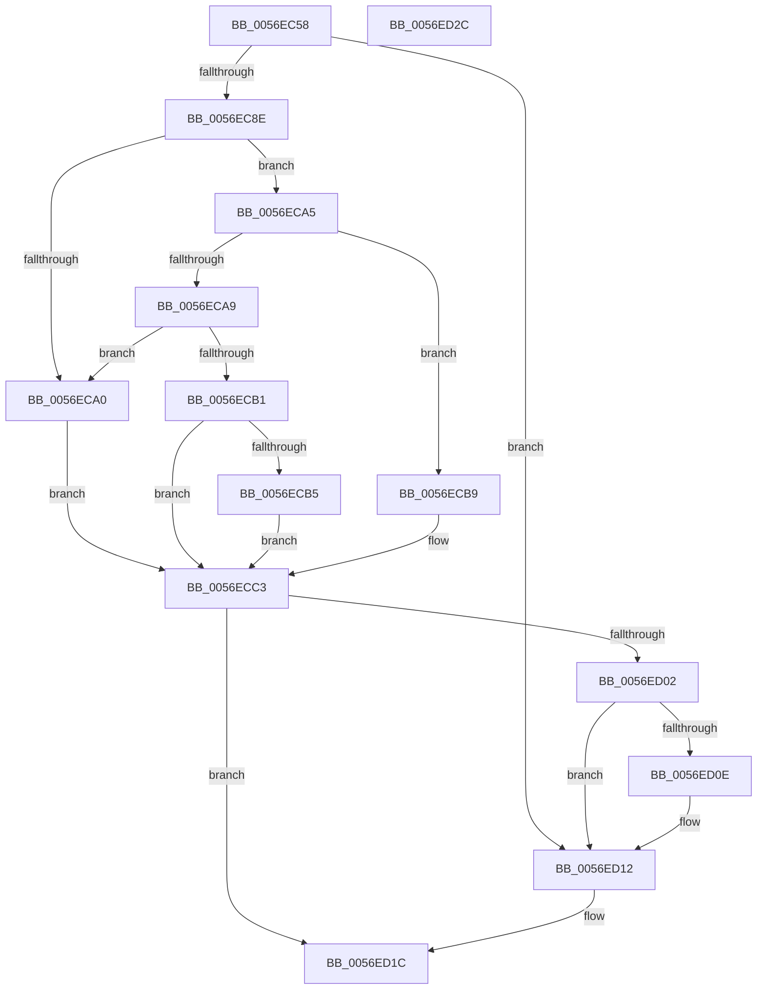

# IvtAllocateTranslationStructures

- RVA: `0x0056EC58`–`0x0056ED2D` (길이 `213` bytes)
- VA: `0x000000014056EC58`
- 실행 섹션: `.text`
- PDB 이름 있음: `예`; PDB Function 태그: `아니요`
- unwind 정보 RVA: `0x000C51B4`
- 디코드: `61`개 명령, `213/213` bytes 표시
- 미해석 바이트: `0` (있으면 어셈블리에 `.byte`로 보존)

> 이 문서는 커널 이미지의 기계어와 PDB 기호를 분석해 생성했습니다. 4번과 5번은 함수 원형과 자료형을 바이너리 사용 방식에서 추정한 C 해석이며 원본 소스 복구 결과는 아닙니다.

## 1. Dependencies

- 직접 호출 지점: **3**; 고유 호출 대상: **3**
- 직접 호출자로 확인된 함수: **4**
- RIP 상대 이미지 참조: **0**

### Outgoing calls
- `0x0056ECC3` → [IvtGetPasidGranularTranslationType](../4F/IvtGetPasidGranularTranslationType_function_004FC2FC.md) (function, `0x004FC2FC`)
- `0x0056ECF9` → [IvtAllocateScalableModePasidTables](IvtAllocateScalableModePasidTables_function_0056E8DC.md) (function, `0x0056E8DC`)
- `0x0056ED17` → [IvtAllocateContextTable](../4D/IvtAllocateContextTable_function_004DE0D4.md) (function, `0x004DE0D4`)

### Direct callers
- [IvtAttachDeviceDomainInternal](IvtAttachDeviceDomainInternal_function_0056ED90.md) at `0x0056EE2E`
- [IvtConfigureAts](IvtConfigureAts_function_0056F1F0.md) at `0x0056F295`
- [IvtProcessDeviceExceptions](../../pagelk/B6/IvtProcessDeviceExceptions_function_00B62C34.md) at `0x00B62D19`
- [HalpIvtpInitializeReservedDomain](../../pagelk/B6/HalpIvtpInitializeReservedDomain_function_00B63838.md) at `0x00B638B7`

### Static image references
- 디코드된 RIP-relative 메모리 참조가 없습니다.

## 2. Other-region calls and transfers

- 다른 실행 섹션으로 향하는 call: **0**
- 별도 외부 분기/꼬리 이동을 확인하지 못했습니다.

## 3. Assembly (complete function range)

```asm
0056EC58  4C 8B DC                        mov r11, rsp
0056EC5B  49 89 5B 18                     mov qword ptr [r11 + 0x18], rbx
0056EC5F  49 89 73 20                     mov qword ptr [r11 + 0x20], rsi
0056EC63  57                              push rdi
0056EC64  48 83 EC 50                     sub rsp, 0x50
0056EC68  48 8B 42 38                     mov rax, qword ptr [rdx + 0x38]
0056EC6C  4D 8B C8                        mov r9, r8
0056EC6F  49 83 63 08 00                  and qword ptr [r11 + 8], 0
0056EC74  48 8B FA                        mov rdi, rdx
0056EC77  49 83 63 10 00                  and qword ptr [r11 + 0x10], 0
0056EC7C  48 8B D9                        mov rbx, rcx
0056EC7F  80 B9 40 01 00 00 00            cmp byte ptr [rcx + 0x140], 0
0056EC86  8B 30                           mov esi, dword ptr [rax]
0056EC88  0F 84 84 00 00 00               je 0x14056ed12
0056EC8E  41 8B 40 04                     mov eax, dword ptr [r8 + 4]
0056EC92  32 D2                           xor dl, dl
0056EC94  41 8B 48 30                     mov ecx, dword ptr [r8 + 0x30]
0056EC98  45 32 C0                        xor r8b, r8b
0056EC9B  83 F8 01                        cmp eax, 1
0056EC9E  75 05                           jne 0x14056eca5
0056ECA0  41 B0 01                        mov r8b, 1
0056ECA3  EB 1E                           jmp 0x14056ecc3
0056ECA5  85 C0                           test eax, eax
0056ECA7  74 10                           je 0x14056ecb9
0056ECA9  41 8B 01                        mov eax, dword ptr [r9]
0056ECAC  83 F8 01                        cmp eax, 1
0056ECAF  74 EF                           je 0x14056eca0
0056ECB1  85 C0                           test eax, eax
0056ECB3  75 0E                           jne 0x14056ecc3
0056ECB5  B2 01                           mov dl, 1
0056ECB7  EB 0A                           jmp 0x14056ecc3
0056ECB9  38 93 3F 01 00 00               cmp byte ptr [rbx + 0x13f], dl
0056ECBF  41 0F 95 C0                     setne r8b
0056ECC3  E8 34 D6 F8 FF                  call 0x1404fc2fc
0056ECC8  48 8D 54 24 68                  lea rdx, [rsp + 0x68]
0056ECCD  44 8B C1                        mov r8d, ecx
0056ECD0  48 89 54 24 40                  mov qword ptr [rsp + 0x40], rdx
0056ECD5  45 33 C9                        xor r9d, r9d
0056ECD8  48 8D 54 24 60                  lea rdx, [rsp + 0x60]
0056ECDD  48 8B CB                        mov rcx, rbx
0056ECE0  48 89 54 24 38                  mov qword ptr [rsp + 0x38], rdx
0056ECE5  48 8B D7                        mov rdx, rdi
0056ECE8  89 44 24 30                     mov dword ptr [rsp + 0x30], eax
0056ECEC  C7 44 24 28 03 00 00 00         mov dword ptr [rsp + 0x28], 3
0056ECF4  83 64 24 20 00                  and dword ptr [rsp + 0x20], 0
0056ECF9  E8 DE FB FF FF                  call 0x14056e8dc
0056ECFE  85 C0                           test eax, eax
0056ED00  78 1A                           js 0x14056ed1c
0056ED02  48 8B 44 24 60                  mov rax, qword ptr [rsp + 0x60]
0056ED07  48 39 44 24 68                  cmp qword ptr [rsp + 0x68], rax
0056ED0C  74 04                           je 0x14056ed12
0056ED0E  48 89 47 48                     mov qword ptr [rdi + 0x48], rax
0056ED12  8B D6                           mov edx, esi
0056ED14  48 8B CB                        mov rcx, rbx
0056ED17  E8 B8 F3 F6 FF                  call 0x1404de0d4
0056ED1C  48 8B 5C 24 70                  mov rbx, qword ptr [rsp + 0x70]
0056ED21  48 8B 74 24 78                  mov rsi, qword ptr [rsp + 0x78]
0056ED26  48 83 C4 50                     add rsp, 0x50
0056ED2A  5F                              pop rdi
0056ED2B  C3                              ret
0056ED2C  CC                              int3
```

## 4. C-style interpretation (structured pseudocode)

```c
__int64 __fastcall IvtAllocateTranslationStructures(__int64 a1, __int64 a2, __int64 a3)
{
    __int64 result;
    __int64 v_rsp;
    unsigned __int64 v_stack_m18;
    unsigned __int64 v_stack_m20;
    unsigned int v_stack_m28;
    unsigned int v_stack_m30;
    unsigned int v_stack_m38;
    unsigned __int64 v_stack_p10;
    unsigned __int64 v_stack_p18;
    unsigned __int64 v_stack_p20;
    unsigned __int64 v_stack_p8;

    *(unsigned __int64 *)(v_rsp + 24) = v_rbx;
    *(unsigned __int64 *)(v_rsp + 32) = v_rsi;
    v_rsp = (v_rsp) - (80);
    if ((*(unsigned __int8 *)(a1 + 320)) == 0) goto loc_0056ED12;
    a2 = 0;
    a3 = 0;
    if (((unsigned int)((unsigned int)(*(unsigned int *)(a3 + 4)))) != 1) goto loc_0056ECA5;
loc_0056ECA0:
    goto loc_0056ECC3;
loc_0056ECA5:
    if ((unsigned int)((unsigned int)(*(unsigned int *)(a3 + 4))) == 0) goto loc_0056ECB9;
    if (((unsigned int)((unsigned int)(*(unsigned int *)(a3)))) == 1) goto loc_0056ECA0;
    if ((unsigned int)((unsigned int)(*(unsigned int *)(a3))) != 0) goto loc_0056ECC3;
    goto loc_0056ECC3;
loc_0056ECB9:
    a3 = ((*(unsigned __int8 *)(a1 + 319)) != 1) ? 1 : 0;
loc_0056ECC3:
    result = IvtGetPasidGranularTranslationType((unsigned int)(*(unsigned int *)(a3 + 48)), 1, a3, a3);
    v_stack_m18 = v_stack_p10;
    a4 = 0;
    v_stack_m20 = v_stack_p8;
    v_stack_m28 = (unsigned int)(result);
    v_stack_m30 = 3;
    result = IvtAllocateScalableModePasidTables(a1, 0, (unsigned int)((unsigned int)((unsigned int)(*(unsigned int *)(a3 + 48)))), a4);
    if (sign_flag) goto loc_0056ED1C;
    if (v_stack_p10 != v_stack_p8) {
        *(unsigned __int64 *)(a2 + 72) = v_stack_p8;
    }
    result = IvtAllocateContextTable(a1, (unsigned int)((unsigned int)((unsigned int)(*(unsigned int *)(*(unsigned __int64 *)(a2 + 56))))), (unsigned int)((unsigned int)((unsigned int)(*(unsigned int *)(a3 + 48)))), a4);
loc_0056ED1C:
    v_rsp = (v_rsp) + (80);
    return result;
}
```

## 5. (Beta) C Style

```c
int64_t IvtAllocateTranslationStructures(void *Arg1, void *Arg2, void *Arg3)
{
    uint8_t *arg1 = (uint8_t *)Arg1;
    uint8_t *arg2 = (uint8_t *)Arg2;
    uint8_t *arg3 = (uint8_t *)Arg3;

    int64_t result;
    int64_t local_rsp;
    uint64_t v_stack_m18;
    uint64_t v_stack_m20;
    uint32_t v_stack_m28;
    uint32_t v_stack_m30;
    uint32_t v_stack_m38;
    uint64_t v_stack_p10;
    uint64_t v_stack_p18;
    uint64_t v_stack_p20;
    uint64_t v_stack_p8;

    *(uint64_t *)(local_rsp + 0x18) = local_rbx;
    *(uint64_t *)(local_rsp + 0x20) = local_rsi;
    local_rsp = (local_rsp) - (80);
    if ((*(uint8_t *)(arg1 + 0x140)) == 0) goto loc_0056ED12;
    Arg2 = 0;
    Arg3 = 0;
    if (((uint32_t)((uint32_t)(*(uint32_t *)(arg3 + 0x4)))) != 1) goto loc_0056ECA5;
loc_0056ECA0:
    goto loc_0056ECC3;
loc_0056ECA5:
    if ((uint32_t)((uint32_t)(*(uint32_t *)(arg3 + 0x4))) == 0) goto loc_0056ECB9;
    if (((uint32_t)((uint32_t)(*(uint32_t *)(arg3)))) == 1) goto loc_0056ECA0;
    if ((uint32_t)((uint32_t)(*(uint32_t *)(arg3))) != 0) goto loc_0056ECC3;
    goto loc_0056ECC3;
loc_0056ECB9:
    Arg3 = ((*(uint8_t *)(arg1 + 0x13F)) != 1) ? 1 : 0;
loc_0056ECC3:
    result = IvtGetPasidGranularTranslationType((uint32_t)(*(uint32_t *)(arg3 + 0x30)), 1, Arg3, Arg3);
    v_stack_m18 = v_stack_p10;
    a4 = 0;
    v_stack_m20 = v_stack_p8;
    v_stack_m28 = (uint32_t)(result);
    v_stack_m30 = 3;
    result = IvtAllocateScalableModePasidTables(Arg1, 0, (uint32_t)((uint32_t)((uint32_t)(*(uint32_t *)(arg3 + 0x30)))), a4);
    if (sign_flag) goto loc_0056ED1C;
    if (v_stack_p10 != v_stack_p8) {
        *(uint64_t *)(arg2 + 0x48) = v_stack_p8;
    }
    result = IvtAllocateContextTable(Arg1, (uint32_t)((uint32_t)((uint32_t)(*(uint32_t *)(*(uint64_t *)(arg2 + 0x38))))), (uint32_t)((uint32_t)((uint32_t)(*(uint32_t *)(arg3 + 0x30)))), a4);
loc_0056ED1C:
    local_rsp = (local_rsp) + (80);
    return result;
}
```

### 관측된 메모리 오프셋

구조체 형식이 확인되지 않은 접근은 인자 기준의 오프셋으로만 기록했습니다.

| 기준 인자 | 오프셋 표현 | 폭 (bit) | 접근 |
|---|---:|---:|---|
| `Arg1` | `+ 0x13F` | `8` | `R` |
| `Arg1` | `+ 0x140` | `8` | `R` |
| `Arg2` | `+ 0x38` | `64` | `R` |
| `Arg2` | `+ 0x48` | `64` | `W` |
| `Arg3` | `+ 0x0` | `32` | `R` |
| `Arg3` | `+ 0x4` | `32` | `R` |
| `Arg3` | `+ 0x30` | `32` | `R` |

## 6. Execution-region graph

[열기: 2D/3D 그래프와 함수 탐색 컨트롤 패널](../../../control-panel.html?section=text&rva=0x0056EC58&view=graph)

- 2D 그래프는 위에서 아래로 흐르고, 3D 그래프는 빈 공간을 드래그해 회전합니다. Shift+드래그는 이동, 휠은 확대·축소, 함수 노드 선택은 대상 보고서 이동입니다.

### Static fallback


