# IvtAttachDeviceDomainInternal

- RVA: `0x0056ED90`–`0x0056F0A6` (길이 `790` bytes)
- VA: `0x000000014056ED90`
- 실행 섹션: `.text`
- PDB 이름 있음: `예`; PDB Function 태그: `아니요`
- unwind 정보 RVA: `0x000C5308`
- 디코드: `208`개 명령, `790/790` bytes 표시
- 미해석 바이트: `0` (있으면 어셈블리에 `.byte`로 보존)

> 이 문서는 커널 이미지의 기계어와 PDB 기호를 분석해 생성했습니다. 4번과 5번은 함수 원형과 자료형을 바이너리 사용 방식에서 추정한 C 해석이며 원본 소스 복구 결과는 아닙니다.

## 1. Dependencies

- 직접 호출 지점: **18**; 고유 호출 대상: **12**
- 직접 호출자로 확인된 함수: **2**
- RIP 상대 이미지 참조: **1**

### Outgoing calls
- `0x0056EDE2` → [memset](../6C/memset_function_006C6C40.md) (function, `0x006C6C40`)
- `0x0056EDFA` → [memset](../6C/memset_function_006C6C40.md) (function, `0x006C6C40`)
- `0x0056EE2E` → [IvtAllocateTranslationStructures](IvtAllocateTranslationStructures_function_0056EC58.md) (function, `0x0056EC58`)
- `0x0056EE55` → [KiRaiseIrqlProcessIrqlFlags](../4F/KiRaiseIrqlProcessIrqlFlags_function_004F56FC.md) (function, `0x004F56FC`)
- `0x0056EE66` → [KeAcquireInStackQueuedSpinLockAtDpcLevel](../27/KeAcquireInStackQueuedSpinLockAtDpcLevel_function_00275740.md) (function, `0x00275740`)
- `0x0056EE71` → [IvtGetDomainId](IvtGetDomainId_function_0056FAD8.md) (function, `0x0056FAD8`)
- `0x0056EECD` → [IvtUpdateTranslationStructures](../4F/IvtUpdateTranslationStructures_function_004F913C.md) (function, `0x004F913C`)
- `0x0056EEDE` → [KeReleaseInStackQueuedSpinLockFromDpcLevel](../21/KeReleaseInStackQueuedSpinLockFromDpcLevel_function_002171B0.md) (function, `0x002171B0`)
- `0x0056EEF2` → [KiLowerIrqlProcessIrqlFlags](../4F/KiLowerIrqlProcessIrqlFlags_function_004F5698.md) (function, `0x004F5698`)
- `0x0056EF33` → [HalpAcquireHighLevelLock](../2D/HalpAcquireHighLevelLock_function_002D2390.md) (function, `0x002D2390`)
- `0x0056EF6B` → [HalpReleaseHighLevelLock](../2D/HalpReleaseHighLevelLock_function_002D1C58.md) (function, `0x002D1C58`)
- `0x0056EF81` → [HalpAcquireHighLevelLock](../2D/HalpAcquireHighLevelLock_function_002D2390.md) (function, `0x002D2390`)
- `0x0056EFAF` → [HalpReleaseHighLevelLock](../2D/HalpReleaseHighLevelLock_function_002D1C58.md) (function, `0x002D1C58`)
- `0x0056EFE0` → [KiRaiseIrqlProcessIrqlFlags](../4F/KiRaiseIrqlProcessIrqlFlags_function_004F56FC.md) (function, `0x004F56FC`)
- `0x0056F01A` → [IvtFlushTbInternal](../2D/IvtFlushTbInternal_function_002D2548.md) (function, `0x002D2548`)
- `0x0056F04B` → [IvtFlushTbInternal](../2D/IvtFlushTbInternal_function_002D2548.md) (function, `0x002D2548`)
- `0x0056F05F` → [KiLowerIrqlProcessIrqlFlags](../4F/KiLowerIrqlProcessIrqlFlags_function_004F5698.md) (function, `0x004F5698`)
- `0x0056F076` → [IvtFreeScalableModePasidTables](IvtFreeScalableModePasidTables_function_0056F980.md) (function, `0x0056F980`)

### Direct callers
- [IvtAttachDeviceDomain](IvtAttachDeviceDomain_function_0056ED40.md) at `0x0056ED6A`
- [IvtDetachDeviceDomain](IvtDetachDeviceDomain_function_0056F3A0.md) at `0x0056F3C2`

### Static image references
- `0x0056EE48` → RVA `0x00FC6D20` (`ALMOSTRO`; read)

## 2. Other-region calls and transfers

- 다른 실행 섹션으로 향하는 call: **0**
- 별도 외부 분기/꼬리 이동을 확인하지 못했습니다.

## 3. Assembly (complete function range)

```asm
0056ED90  4C 8B DC                        mov r11, rsp
0056ED93  49 89 5B 08                     mov qword ptr [r11 + 8], rbx
0056ED97  49 89 6B 10                     mov qword ptr [r11 + 0x10], rbp
0056ED9B  49 89 73 18                     mov qword ptr [r11 + 0x18], rsi
0056ED9F  4D 89 4B 20                     mov qword ptr [r11 + 0x20], r9
0056EDA3  57                              push rdi
0056EDA4  41 54                           push r12
0056EDA6  41 55                           push r13
0056EDA8  41 56                           push r14
0056EDAA  41 57                           push r15
0056EDAC  48 81 EC 50 01 00 00            sub rsp, 0x150
0056EDB3  33 C0                           xor eax, eax
0056EDB5  4C 89 84 24 98 01 00 00         mov qword ptr [rsp + 0x198], r8
0056EDBD  49 8B F0                        mov rsi, r8
0056EDC0  48 89 44 24 60                  mov qword ptr [rsp + 0x60], rax
0056EDC5  48 8B FA                        mov rdi, rdx
0056EDC8  48 8B E9                        mov rbp, rcx
0056EDCB  0F 57 C0                        xorps xmm0, xmm0
0056EDCE  49 8D 8B 68 FF FF FF            lea rcx, [r11 - 0x98]
0056EDD5  8D 58 70                        lea ebx, [rax + 0x70]
0056EDD8  33 D2                           xor edx, edx
0056EDDA  44 8B C3                        mov r8d, ebx
0056EDDD  0F 11 44 24 50                  movups xmmword ptr [rsp + 0x50], xmm0
0056EDE2  E8 59 7E 15 00                  call 0x1406c6c40
0056EDE7  44 8B C3                        mov r8d, ebx
0056EDEA  48 8D 4C 24 70                  lea rcx, [rsp + 0x70]
0056EDEF  33 D2                           xor edx, edx
0056EDF1  45 32 FF                        xor r15b, r15b
0056EDF4  45 32 ED                        xor r13b, r13b
0056EDF7  45 33 E4                        xor r12d, r12d
0056EDFA  E8 41 7E 15 00                  call 0x1406c6c40
0056EDFF  8D 4B 91                        lea ecx, [rbx - 0x6f]
0056EE02  48 85 F6                        test rsi, rsi
0056EE05  75 1E                           jne 0x14056ee25
0056EE07  8B 85 34 01 00 00               mov eax, dword ptr [rbp + 0x134]
0056EE0D  83 F8 02                        cmp eax, 2
0056EE10  75 06                           jne 0x14056ee18
0056EE12  89 4C 24 74                     mov dword ptr [rsp + 0x74], ecx
0056EE16  EB 08                           jmp 0x14056ee20
0056EE18  3B C1                           cmp eax, ecx
0056EE1A  0F 85 01 01 00 00               jne 0x14056ef21
0056EE20  48 8D 74 24 70                  lea rsi, [rsp + 0x70]
0056EE25  4C 8B C6                        mov r8, rsi
0056EE28  48 8B D7                        mov rdx, rdi
0056EE2B  48 8B CD                        mov rcx, rbp
0056EE2E  E8 25 FE FF FF                  call 0x14056ec58
0056EE33  85 C0                           test eax, eax
0056EE35  0F 88 42 02 00 00               js 0x14056f07d
0056EE3B  44 0F 20 C3                     mov rbx, cr8
0056EE3F  B8 0F 00 00 00                  mov eax, 0xf
0056EE44  44 0F 22 C0                     mov cr8, rax
0056EE48  44 39 25 D1 7E A5 00            cmp dword ptr [rip + 0xa57ed1], r12d
0056EE4F  74 09                           je 0x14056ee5a
0056EE51  8A D0                           mov dl, al
0056EE53  8A CB                           mov cl, bl
0056EE55  E8 A2 68 F8 FF                  call 0x1404f56fc
0056EE5A  48 8D 8D D0 00 00 00            lea rcx, [rbp + 0xd0]
0056EE61  48 8D 54 24 50                  lea rdx, [rsp + 0x50]
0056EE66  E8 D5 68 D0 FF                  call 0x140275740
0056EE6B  48 8B D7                        mov rdx, rdi
0056EE6E  48 8B CD                        mov rcx, rbp
0056EE71  E8 62 0C 00 00                  call 0x14056fad8
0056EE76  33 C9                           xor ecx, ecx
0056EE78  4C 8B F0                        mov r14, rax
0056EE7B  48 39 8C 24 98 01 00 00         cmp qword ptr [rsp + 0x198], rcx
0056EE83  75 06                           jne 0x14056ee8b
0056EE85  48 3B 47 18                     cmp rax, qword ptr [rdi + 0x18]
0056EE89  75 4E                           jne 0x14056eed9
0056EE8B  48 8B 47 48                     mov rax, qword ptr [rdi + 0x48]
0056EE8F  41 BF 01 00 00 00               mov r15d, 1
0056EE95  4C 8B 67 40                     mov r12, qword ptr [rdi + 0x40]
0056EE99  48 85 C0                        test rax, rax
0056EE9C  74 14                           je 0x14056eeb2
0056EE9E  4D 85 E4                        test r12, r12
0056EEA1  74 0B                           je 0x14056eeae
0056EEA3  49 3B C4                        cmp rax, r12
0056EEA6  45 0F B6 ED                     movzx r13d, r13b
0056EEAA  45 0F 45 EF                     cmovne r13d, r15d
0056EEAE  48 89 47 40                     mov qword ptr [rdi + 0x40], rax
0056EEB2  4C 89 74 24 38                  mov qword ptr [rsp + 0x38], r14
0056EEB7  45 33 C9                        xor r9d, r9d
0056EEBA  89 4C 24 30                     mov dword ptr [rsp + 0x30], ecx
0056EEBE  48 8B D7                        mov rdx, rdi
0056EEC1  48 89 4F 48                     mov qword ptr [rdi + 0x48], rcx
0056EEC5  48 8B CD                        mov rcx, rbp
0056EEC8  48 89 74 24 28                  mov qword ptr [rsp + 0x28], rsi
0056EECD  E8 6A A2 F8 FF                  call 0x1404f913c
0056EED2  8B 46 30                        mov eax, dword ptr [rsi + 0x30]
0056EED5  48 89 47 18                     mov qword ptr [rdi + 0x18], rax
0056EED9  48 8D 4C 24 50                  lea rcx, [rsp + 0x50]
0056EEDE  E8 CD 82 CA FF                  call 0x1402171b0
0056EEE3  83 3D 36 7E A5 00 00            cmp dword ptr [rip + 0xa57e36], 0
0056EEEA  74 0B                           je 0x14056eef7
0056EEEC  44 0F 20 C1                     mov rcx, cr8
0056EEF0  8A D3                           mov dl, bl
0056EEF2  E8 A1 67 F8 FF                  call 0x1404f5698
0056EEF7  0F B6 C3                        movzx eax, bl
0056EEFA  44 0F 22 C0                     mov cr8, rax
0056EEFE  45 84 FF                        test r15b, r15b
0056EF01  0F 84 64 01 00 00               je 0x14056f06b
0056EF07  4C 8B BC 24 98 01 00 00         mov r15, qword ptr [rsp + 0x198]
0056EF0F  4D 85 FF                        test r15, r15
0056EF12  74 17                           je 0x14056ef2b
0056EF14  48 83 7F 10 00                  cmp qword ptr [rdi + 0x10], 0
0056EF19  75 10                           jne 0x14056ef2b
0056EF1B  48 8D 5F 28                     lea rbx, [rdi + 0x28]
0056EF1F  EB 5C                           jmp 0x14056ef7d
0056EF21  B8 01 00 00 C0                  mov eax, 0xc0000001
0056EF26  E9 52 01 00 00                  jmp 0x14056f07d
0056EF2B  48 8B 5F 10                     mov rbx, qword ptr [rdi + 0x10]
0056EF2F  48 8D 4B 58                     lea rcx, [rbx + 0x58]
0056EF33  E8 58 34 D6 FF                  call 0x1402d2390
0056EF38  88 43 60                        mov byte ptr [rbx + 0x60], al
0056EF3B  48 8D 5F 28                     lea rbx, [rdi + 0x28]
0056EF3F  48 8B 0B                        mov rcx, qword ptr [rbx]
0056EF42  48 39 59 08                     cmp qword ptr [rcx + 8], rbx
0056EF46  0F 85 53 01 00 00               jne 0x14056f09f
0056EF4C  48 8B 43 08                     mov rax, qword ptr [rbx + 8]
0056EF50  48 39 18                        cmp qword ptr [rax], rbx
0056EF53  0F 85 46 01 00 00               jne 0x14056f09f
0056EF59  48 89 08                        mov qword ptr [rax], rcx
0056EF5C  48 89 41 08                     mov qword ptr [rcx + 8], rax
0056EF60  48 8B 57 10                     mov rdx, qword ptr [rdi + 0x10]
0056EF64  48 8D 4A 58                     lea rcx, [rdx + 0x58]
0056EF68  8A 52 60                        mov dl, byte ptr [rdx + 0x60]
0056EF6B  E8 E8 2C D6 FF                  call 0x1402d1c58
0056EF70  48 8B 47 10                     mov rax, qword ptr [rdi + 0x10]
0056EF74  F0 FF 48 34                     lock dec dword ptr [rax + 0x34]
0056EF78  4D 85 FF                        test r15, r15
0056EF7B  74 40                           je 0x14056efbd
0056EF7D  48 8D 4E 58                     lea rcx, [rsi + 0x58]
0056EF81  E8 0A 34 D6 FF                  call 0x1402d2390
0056EF86  88 46 60                        mov byte ptr [rsi + 0x60], al
0056EF89  48 8D 46 38                     lea rax, [rsi + 0x38]
0056EF8D  48 8B 50 08                     mov rdx, qword ptr [rax + 8]
0056EF91  48 39 02                        cmp qword ptr [rdx], rax
0056EF94  0F 85 05 01 00 00               jne 0x14056f09f
0056EF9A  48 89 03                        mov qword ptr [rbx], rax
0056EF9D  48 8D 4E 58                     lea rcx, [rsi + 0x58]
0056EFA1  48 89 53 08                     mov qword ptr [rbx + 8], rdx
0056EFA5  48 89 1A                        mov qword ptr [rdx], rbx
0056EFA8  48 89 58 08                     mov qword ptr [rax + 8], rbx
0056EFAC  8A 56 60                        mov dl, byte ptr [rsi + 0x60]
0056EFAF  E8 A4 2C D6 FF                  call 0x1402d1c58
0056EFB4  B8 01 00 00 00                  mov eax, 1
0056EFB9  F0 01 46 34                     lock add dword ptr [rsi + 0x34], eax
0056EFBD  44 89 B4 24 10 01 00 00         mov dword ptr [rsp + 0x110], r14d
0056EFC5  44 0F 20 C3                     mov rbx, cr8
0056EFC9  BA 0F 00 00 00                  mov edx, 0xf
0056EFCE  44 0F 22 C2                     mov cr8, rdx
0056EFD2  45 33 FF                        xor r15d, r15d
0056EFD5  44 39 3D 44 7D A5 00            cmp dword ptr [rip + 0xa57d44], r15d
0056EFDC  74 07                           je 0x14056efe5
0056EFDE  8A CB                           mov cl, bl
0056EFE0  E8 17 67 F8 FF                  call 0x1404f56fc
0056EFE5  48 8B 07                        mov rax, qword ptr [rdi]
0056EFE8  49 81 FE 00 00 01 00            cmp r14, 0x10000
0056EFEF  74 33                           je 0x14056f024
0056EFF1  4C 89 7C 24 40                  mov qword ptr [rsp + 0x40], r15
0056EFF6  4C 8D 8C 24 E0 00 00 00         lea r9, [rsp + 0xe0]
0056EFFE  44 89 7C 24 38                  mov dword ptr [rsp + 0x38], r15d
0056F003  45 33 C0                        xor r8d, r8d
0056F006  4C 89 7C 24 30                  mov qword ptr [rsp + 0x30], r15
0056F00B  33 D2                           xor edx, edx
0056F00D  48 89 44 24 28                  mov qword ptr [rsp + 0x28], rax
0056F012  48 8B CD                        mov rcx, rbp
0056F015  C6 44 24 20 01                  mov byte ptr [rsp + 0x20], 1
0056F01A  E8 29 35 D6 FF                  call 0x1402d2548
0056F01F  48 8B 07                        mov rax, qword ptr [rdi]
0056F022  EB 03                           jmp 0x14056f027
0056F024  49 8B F7                        mov rsi, r15
0056F027  4C 89 7C 24 40                  mov qword ptr [rsp + 0x40], r15
0056F02C  4C 8B CE                        mov r9, rsi
0056F02F  44 89 7C 24 38                  mov dword ptr [rsp + 0x38], r15d
0056F034  45 33 C0                        xor r8d, r8d
0056F037  4C 89 7C 24 30                  mov qword ptr [rsp + 0x30], r15
0056F03C  33 D2                           xor edx, edx
0056F03E  48 89 44 24 28                  mov qword ptr [rsp + 0x28], rax
0056F043  48 8B CD                        mov rcx, rbp
0056F046  C6 44 24 20 01                  mov byte ptr [rsp + 0x20], 1
0056F04B  E8 F8 34 D6 FF                  call 0x1402d2548
0056F050  44 39 3D C9 7C A5 00            cmp dword ptr [rip + 0xa57cc9], r15d
0056F057  74 0B                           je 0x14056f064
0056F059  44 0F 20 C1                     mov rcx, cr8
0056F05D  8A D3                           mov dl, bl
0056F05F  E8 34 66 F8 FF                  call 0x1404f5698
0056F064  0F B6 C3                        movzx eax, bl
0056F067  44 0F 22 C0                     mov cr8, rax
0056F06B  45 84 ED                        test r13b, r13b
0056F06E  74 0B                           je 0x14056f07b
0056F070  49 8B D4                        mov rdx, r12
0056F073  48 8B CD                        mov rcx, rbp
0056F076  E8 05 09 00 00                  call 0x14056f980
0056F07B  33 C0                           xor eax, eax
0056F07D  4C 8D 9C 24 50 01 00 00         lea r11, [rsp + 0x150]
0056F085  49 8B 5B 30                     mov rbx, qword ptr [r11 + 0x30]
0056F089  49 8B 6B 38                     mov rbp, qword ptr [r11 + 0x38]
0056F08D  49 8B 73 40                     mov rsi, qword ptr [r11 + 0x40]
0056F091  49 8B E3                        mov rsp, r11
0056F094  41 5F                           pop r15
0056F096  41 5E                           pop r14
0056F098  41 5D                           pop r13
0056F09A  41 5C                           pop r12
0056F09C  5F                              pop rdi
0056F09D  C3                              ret
0056F09E  CC                              int3
0056F09F  B9 03 00 00 00                  mov ecx, 3
0056F0A4  CD 29                           int 0x29
```

## 4. C-style interpretation (structured pseudocode)

```c
__int64 __fastcall IvtAttachDeviceDomainInternal(__int64 a1, __int64 a2, __int64 a3, __int64 a4)
{
    __int64 result;
    __int64 v_r12;
    __int64 v_r13;
    __int64 v_r15;
    __int64 v_rsp;
    unsigned int v_stack_m104;
    unsigned __int64 v_stack_m108;
    unsigned __int64 v_stack_m118;
    unsigned __int64 v_stack_m128;
    unsigned __int64 v_stack_m138;
    unsigned __int64 v_stack_m140;
    unsigned int v_stack_m148;
    unsigned __int64 v_stack_m150;
    unsigned __int8 v_stack_m158;
    unsigned __int64 v_stack_m28;
    unsigned int v_stack_m68;
    unsigned __int64 v_stack_m98;
    unsigned __int64 v_stack_p20;

    *(unsigned __int64 *)(v_rsp + 8) = v_rbx;
    *(unsigned __int64 *)(v_rsp + 16) = v_rbp;
    *(unsigned __int64 *)(v_rsp + 24) = v_rsi;
    *(unsigned __int64 *)(v_rsp + 32) = a4;
    v_rsp = (v_rsp) - (336);
    result = 0;
    v_stack_p20 = a3;
    v_stack_m118 = 0;
    a2 = 0;
    v_stack_m128 = v_xmm0;
    result = memset(v_rsp - 152, a2, (unsigned int)((unsigned int)(result + 112)), a4);
    a2 = 0;
    v_r15 = 0;
    v_r13 = 0;
    v_r12 = 0;
    result = memset(v_stack_m108, a2, (unsigned int)((unsigned int)(result + 112)), a4);
    if (a3 != 0) goto loc_0056EE25;
    if (((unsigned int)((unsigned int)(*(unsigned int *)(a1 + 308)))) != 2) goto loc_0056EE18;
    v_stack_m104 = (unsigned int)(result + 112 - 111);
    goto loc_0056EE20;
loc_0056EE18:
    if (((unsigned int)((unsigned int)(*(unsigned int *)(a1 + 308)))) != ((unsigned int)(result + 112 - 111))) goto loc_0056EF21;
loc_0056EE20:
loc_0056EE25:
    result = IvtAllocateTranslationStructures(a1, 0, v_stack_m108, a4);
    if (sign_flag) goto loc_0056F07D;
    result = 15;
    if ((*(unsigned int *)(v_rip + 10845905)) != 0) {
        a2 = 15;
        a1 = (unsigned __int8)(v_cr8);
        result = KiRaiseIrqlProcessIrqlFlags(a1, a2, v_stack_m108, a4);
    }
    result = KeAcquireInStackQueuedSpinLockAtDpcLevel(a1 + 208, v_stack_m128, v_stack_m108, a4);
    result = IvtGetDomainId(a1, a2, v_stack_m108, a4);
    a1 = 0;
    if (v_stack_p20 != 0) goto loc_0056EE8B;
    if (result != (*(unsigned __int64 *)(a2 + 24))) goto loc_0056EED9;
loc_0056EE8B:
    if (*(unsigned __int64 *)(a2 + 72) == 0) goto loc_0056EEB2;
    if (*(unsigned __int64 *)(a2 + 64) != 0) {
        v_r13 = 0;
        if ((*(unsigned __int64 *)(a2 + 72)) != (*(unsigned __int64 *)(a2 + 64))) { v_r13 = 1; }
    }
    *(unsigned __int64 *)(a2 + 64) = *(unsigned __int64 *)(a2 + 72);
loc_0056EEB2:
    v_stack_m140 = result;
    a4 = 0;
    v_stack_m148 = 0;
    *(unsigned __int64 *)(a2 + 72) = 0;
    v_stack_m150 = v_stack_m108;
    result = IvtUpdateTranslationStructures(0, a2, v_stack_m108, a4);
    *(unsigned __int64 *)(a2 + 24) = (unsigned int)(*(unsigned int *)(v_stack_m108 + 48));
loc_0056EED9:
    result = KeReleaseInStackQueuedSpinLockFromDpcLevel(v_stack_m128, a2, v_stack_m108, a4);
    if ((*(unsigned int *)(v_rip + 10845750)) != 0) {
        a1 = 15;
        a2 = (unsigned __int8)(v_cr8);
        result = KiLowerIrqlProcessIrqlFlags(a1, a2, v_stack_m108, a4);
    }
    if (1 == 0) goto loc_0056F06B;
    if (v_stack_p20 == 0) goto loc_0056EF2B;
    if ((*(unsigned __int64 *)(a2 + 16)) != 0) goto loc_0056EF2B;
    goto loc_0056EF7D;
loc_0056EF21:
    goto loc_0056F07D;
loc_0056EF2B:
    result = HalpAcquireHighLevelLock(*(unsigned __int64 *)(a2 + 16) + 88, a2, v_stack_m108, a4);
    *(unsigned __int8 *)(*(unsigned __int64 *)(a2 + 16) + 96) = (unsigned __int8)(result);
    if ((*(unsigned __int64 *)(*(unsigned __int64 *)(a2 + 40) + 8)) != (a2 + 40)) goto loc_0056F09F;
    if ((*(unsigned __int64 *)(*(unsigned __int64 *)(a2 + 40 + 8))) != (a2 + 40)) goto loc_0056F09F;
    *(unsigned __int64 *)(*(unsigned __int64 *)(a2 + 40 + 8)) = *(unsigned __int64 *)(a2 + 40);
    *(unsigned __int64 *)(*(unsigned __int64 *)(a2 + 40) + 8) = *(unsigned __int64 *)(a2 + 40 + 8);
    result = HalpReleaseHighLevelLock(*(unsigned __int64 *)(a2 + 16) + 88, *(unsigned __int8 *)(*(unsigned __int64 *)(a2 + 16) + 96), v_stack_m108, a4);
    if (v_stack_p20 == 0) goto loc_0056EFBD;
loc_0056EF7D:
    result = HalpAcquireHighLevelLock(v_stack_m108 + 88, *(unsigned __int8 *)(*(unsigned __int64 *)(a2 + 16) + 96), v_stack_m108, a4);
    *(unsigned __int8 *)(v_stack_m108 + 96) = (unsigned __int8)(result);
    if ((*(unsigned __int64 *)(*(unsigned __int64 *)(v_stack_m108 + 56 + 8))) != (v_stack_m108 + 56)) goto loc_0056F09F;
    *(unsigned __int64 *)(a2 + 40) = v_stack_m108 + 56;
    *(unsigned __int64 *)(a2 + 40 + 8) = *(unsigned __int64 *)(v_stack_m108 + 56 + 8);
    *(unsigned __int64 *)(*(unsigned __int64 *)(v_stack_m108 + 56 + 8)) = a2 + 40;
    *(unsigned __int64 *)(v_stack_m108 + 56 + 8) = a2 + 40;
    result = HalpReleaseHighLevelLock(v_stack_m108 + 88, *(unsigned __int8 *)(v_stack_m108 + 96), v_stack_m108, a4);
loc_0056EFBD:
    v_stack_m68 = (unsigned int)(result);
    v_r15 = 0;
    result = 1;
    if ((*(unsigned int *)(v_rip + 10845508)) != 0) {
        a1 = (unsigned __int8)((unsigned __int8)(v_cr8));
        result = KiRaiseIrqlProcessIrqlFlags(a1, 15, v_stack_m108, a4);
    }
    if (result == 0x10000ULL) goto loc_0056F024;
    v_stack_m138 = 0;
    v_stack_m140 = 0;
    a3 = 0;
    v_stack_m148 = 0;
    a2 = 0;
    v_stack_m150 = *(unsigned __int64 *)(a2);
    v_stack_m158 = 1;
    result = IvtFlushTbInternal(a1, a2, a3, v_stack_m98);
    goto loc_0056F027;
loc_0056F024:
loc_0056F027:
    v_stack_m138 = 0;
    v_stack_m140 = 0;
    a3 = 0;
    v_stack_m148 = 0;
    a2 = 0;
    v_stack_m150 = *(unsigned __int64 *)(a2);
    v_stack_m158 = 1;
    result = IvtFlushTbInternal(a1, a2, a3, 0);
    if ((*(unsigned int *)(v_rip + 10845385)) != 0) {
        a1 = 15;
        a2 = (unsigned __int8)((unsigned __int8)(v_cr8));
        result = KiLowerIrqlProcessIrqlFlags(a1, a2, a3, 0);
    }
loc_0056F06B:
    result = (unsigned __int8)((unsigned __int8)(v_cr8));
    if ((unsigned __int8)(v_r13) != 0) {
        a2 = *(unsigned __int64 *)(a2 + 64);
        a1 = a1;
        result = IvtFreeScalableModePasidTables(a1, a2, a3, 0);
    }
    result = 0;
loc_0056F07D:
    return result;
loc_0056F09F:
    return result;
}
```

## 5. (Beta) C Style

```c
int64_t IvtAttachDeviceDomainInternal(void *Arg1, void *Arg2, int64_t Arg3, int64_t Arg4)
{
    uint8_t *arg1 = (uint8_t *)Arg1;
    uint8_t *arg2 = (uint8_t *)Arg2;

    int64_t result;
    int64_t local_r12;
    int64_t local_r13;
    int64_t local_r15;
    int64_t local_rsp;
    uint32_t v_stack_m104;
    uint64_t v_stack_m108;
    uint64_t v_stack_m118;
    uint64_t v_stack_m128;
    uint64_t v_stack_m138;
    uint64_t v_stack_m140;
    uint32_t v_stack_m148;
    uint64_t v_stack_m150;
    uint8_t v_stack_m158;
    uint64_t v_stack_m28;
    uint32_t v_stack_m68;
    uint64_t v_stack_m98;
    uint64_t v_stack_p20;

    *(uint64_t *)(local_rsp + 0x8) = local_rbx;
    *(uint64_t *)(local_rsp + 0x10) = local_rbp;
    *(uint64_t *)(local_rsp + 0x18) = local_rsi;
    *(uint64_t *)(local_rsp + 0x20) = Arg4;
    local_rsp = (local_rsp) - (336);
    result = 0;
    v_stack_p20 = Arg3;
    v_stack_m118 = 0;
    Arg2 = 0;
    v_stack_m128 = v_xmm0;
    result = memset(local_rsp - 152, Arg2, (uint32_t)((uint32_t)(result + 112)), Arg4);
    Arg2 = 0;
    local_r15 = 0;
    local_r13 = 0;
    local_r12 = 0;
    result = memset(v_stack_m108, Arg2, (uint32_t)((uint32_t)(result + 112)), Arg4);
    if (Arg3 != 0) goto loc_0056EE25;
    if (((uint32_t)((uint32_t)(*(uint32_t *)(arg1 + 0x134)))) != 2) goto loc_0056EE18;
    v_stack_m104 = (uint32_t)(result + 112 - 111);
    goto loc_0056EE20;
loc_0056EE18:
    if (((uint32_t)((uint32_t)(*(uint32_t *)(arg1 + 0x134)))) != ((uint32_t)(result + 112 - 111))) goto loc_0056EF21;
loc_0056EE20:
loc_0056EE25:
    result = IvtAllocateTranslationStructures(Arg1, 0, v_stack_m108, Arg4);
    if (sign_flag) goto loc_0056F07D;
    result = 15;
    if ((*(uint32_t *)(v_rip + 0xA57ED1)) != 0) {
        Arg2 = 15;
        Arg1 = (uint8_t)(v_cr8);
        result = KiRaiseIrqlProcessIrqlFlags(Arg1, Arg2, v_stack_m108, Arg4);
    }
    result = KeAcquireInStackQueuedSpinLockAtDpcLevel(Arg1 + 208, v_stack_m128, v_stack_m108, Arg4);
    result = IvtGetDomainId(Arg1, Arg2, v_stack_m108, Arg4);
    Arg1 = 0;
    if (v_stack_p20 != 0) goto loc_0056EE8B;
    if (result != (*(uint64_t *)(arg2 + 0x18))) goto loc_0056EED9;
loc_0056EE8B:
    if (*(uint64_t *)(arg2 + 0x48) == 0) goto loc_0056EEB2;
    if (*(uint64_t *)(arg2 + 0x40) != 0) {
        local_r13 = 0;
        if ((*(uint64_t *)(arg2 + 0x48)) != (*(uint64_t *)(arg2 + 0x40))) { local_r13 = 1; }
    }
    *(uint64_t *)(arg2 + 0x40) = *(uint64_t *)(arg2 + 0x48);
loc_0056EEB2:
    v_stack_m140 = result;
    Arg4 = 0;
    v_stack_m148 = 0;
    *(uint64_t *)(arg2 + 0x48) = 0;
    v_stack_m150 = v_stack_m108;
    result = IvtUpdateTranslationStructures(0, Arg2, v_stack_m108, Arg4);
    *(uint64_t *)(arg2 + 0x18) = (uint32_t)(*(uint32_t *)(v_stack_m108 + 0x30));
loc_0056EED9:
    result = KeReleaseInStackQueuedSpinLockFromDpcLevel(v_stack_m128, Arg2, v_stack_m108, Arg4);
    if ((*(uint32_t *)(v_rip + 0xA57E36)) != 0) {
        Arg1 = 15;
        Arg2 = (uint8_t)(v_cr8);
        result = KiLowerIrqlProcessIrqlFlags(Arg1, Arg2, v_stack_m108, Arg4);
    }
    if (1 == 0) goto loc_0056F06B;
    if (v_stack_p20 == 0) goto loc_0056EF2B;
    if ((*(uint64_t *)(arg2 + 0x10)) != 0) goto loc_0056EF2B;
    goto loc_0056EF7D;
loc_0056EF21:
    goto loc_0056F07D;
loc_0056EF2B:
    result = HalpAcquireHighLevelLock(*(uint64_t *)(arg2 + 0x10) + 88, Arg2, v_stack_m108, Arg4);
    *(uint8_t *)(*(uint64_t *)(arg2 + 0x10) + 0x60) = (uint8_t)(result);
    if ((*(uint64_t *)(*(uint64_t *)(arg2 + 0x28) + 0x8)) != (Arg2 + 40)) goto loc_0056F09F;
    if ((*(uint64_t *)(*(uint64_t *)(arg2 + 0x28 + 0x8))) != (Arg2 + 40)) goto loc_0056F09F;
    *(uint64_t *)(*(uint64_t *)(arg2 + 0x28 + 0x8)) = *(uint64_t *)(arg2 + 0x28);
    *(uint64_t *)(*(uint64_t *)(arg2 + 0x28) + 0x8) = *(uint64_t *)(arg2 + 0x28 + 0x8);
    result = HalpReleaseHighLevelLock(*(uint64_t *)(arg2 + 0x10) + 88, *(uint8_t *)(*(uint64_t *)(arg2 + 0x10) + 0x60), v_stack_m108, Arg4);
    if (v_stack_p20 == 0) goto loc_0056EFBD;
loc_0056EF7D:
    result = HalpAcquireHighLevelLock(v_stack_m108 + 88, *(uint8_t *)(*(uint64_t *)(arg2 + 0x10) + 0x60), v_stack_m108, Arg4);
    *(uint8_t *)(v_stack_m108 + 0x60) = (uint8_t)(result);
    if ((*(uint64_t *)(*(uint64_t *)(v_stack_m108 + 0x38 + 0x8))) != (v_stack_m108 + 56)) goto loc_0056F09F;
    *(uint64_t *)(arg2 + 0x28) = v_stack_m108 + 56;
    *(uint64_t *)(arg2 + 0x28 + 0x8) = *(uint64_t *)(v_stack_m108 + 0x38 + 0x8);
    *(void **)(*(uint64_t *)(v_stack_m108 + 0x38 + 0x8)) = Arg2 + 40;
    *(void **)(v_stack_m108 + 0x38 + 0x8) = Arg2 + 40;
    result = HalpReleaseHighLevelLock(v_stack_m108 + 88, *(uint8_t *)(v_stack_m108 + 0x60), v_stack_m108, Arg4);
loc_0056EFBD:
    v_stack_m68 = (uint32_t)(result);
    local_r15 = 0;
    result = 1;
    if ((*(uint32_t *)(v_rip + 0xA57D44)) != 0) {
        Arg1 = (uint8_t)((uint8_t)(v_cr8));
        result = KiRaiseIrqlProcessIrqlFlags(Arg1, 15, v_stack_m108, Arg4);
    }
    if (result == 0x10000ULL) goto loc_0056F024;
    v_stack_m138 = 0;
    v_stack_m140 = 0;
    Arg3 = 0;
    v_stack_m148 = 0;
    Arg2 = 0;
    v_stack_m150 = *(uint64_t *)(arg2);
    v_stack_m158 = 1;
    result = IvtFlushTbInternal(Arg1, Arg2, Arg3, v_stack_m98);
    goto loc_0056F027;
loc_0056F024:
loc_0056F027:
    v_stack_m138 = 0;
    v_stack_m140 = 0;
    Arg3 = 0;
    v_stack_m148 = 0;
    Arg2 = 0;
    v_stack_m150 = *(uint64_t *)(arg2);
    v_stack_m158 = 1;
    result = IvtFlushTbInternal(Arg1, Arg2, Arg3, 0);
    if ((*(uint32_t *)(v_rip + 0xA57CC9)) != 0) {
        Arg1 = 15;
        Arg2 = (uint8_t)((uint8_t)(v_cr8));
        result = KiLowerIrqlProcessIrqlFlags(Arg1, Arg2, Arg3, 0);
    }
loc_0056F06B:
    result = (uint8_t)((uint8_t)(v_cr8));
    if ((uint8_t)(local_r13) != 0) {
        Arg2 = *(uint64_t *)(arg2 + 0x40);
        Arg1 = Arg1;
        result = IvtFreeScalableModePasidTables(Arg1, Arg2, Arg3, 0);
    }
    result = 0;
loc_0056F07D:
    return result;
loc_0056F09F:
    return result;
}
```

### 관측된 메모리 오프셋

구조체 형식이 확인되지 않은 접근은 인자 기준의 오프셋으로만 기록했습니다.

| 기준 인자 | 오프셋 표현 | 폭 (bit) | 접근 |
|---|---:|---:|---|
| `Arg1` | `+ 0xD0` | `64` | `R` |
| `Arg1` | `+ 0x134` | `32` | `R` |
| `Arg2` | `+ 0x0` | `64` | `R` |
| `Arg2` | `+ 0x0` | `64` | `W` |
| `Arg2` | `+ 0x8` | `64` | `R` |
| `Arg2` | `+ 0x8` | `64` | `W` |
| `Arg2` | `+ 0x10` | `64` | `R` |
| `Arg2` | `+ 0x18` | `64` | `R` |
| `Arg2` | `+ 0x18` | `64` | `W` |
| `Arg2` | `+ 0x28` | `64` | `R` |
| `Arg2` | `+ 0x40` | `64` | `R` |
| `Arg2` | `+ 0x40` | `64` | `W` |
| `Arg2` | `+ 0x48` | `64` | `R` |
| `Arg2` | `+ 0x48` | `64` | `W` |

## 6. Execution-region graph

[열기: 2D/3D 그래프와 함수 탐색 컨트롤 패널](../../../control-panel.html?section=text&rva=0x0056ED90&view=graph)

- 2D 그래프는 위에서 아래로 흐르고, 3D 그래프는 빈 공간을 드래그해 회전합니다. Shift+드래그는 이동, 휠은 확대·축소, 함수 노드 선택은 대상 보고서 이동입니다.

### Static fallback

```mermaid
flowchart TD
  bb_0056ED90[BB_0056ED90]
  bb_0056EE07[BB_0056EE07]
  bb_0056EE12[BB_0056EE12]
  bb_0056EE18[BB_0056EE18]
  bb_0056EE20[BB_0056EE20]
  bb_0056EE25[BB_0056EE25]
  bb_0056EE3B[BB_0056EE3B]
  bb_0056EE51[BB_0056EE51]
  bb_0056EE5A[BB_0056EE5A]
  bb_0056EE85[BB_0056EE85]
  bb_0056EE8B[BB_0056EE8B]
  bb_0056EE9E[BB_0056EE9E]
  bb_0056EEA3[BB_0056EEA3]
  bb_0056EEAE[BB_0056EEAE]
  bb_0056EEB2[BB_0056EEB2]
  bb_0056EED9[BB_0056EED9]
  bb_0056EEEC[BB_0056EEEC]
  bb_0056EEF7[BB_0056EEF7]
  bb_0056EF07[BB_0056EF07]
  bb_0056EF14[BB_0056EF14]
  bb_0056EF1B[BB_0056EF1B]
  bb_0056EF21[BB_0056EF21]
  bb_0056EF2B[BB_0056EF2B]
  bb_0056EF4C[BB_0056EF4C]
  bb_0056EF59[BB_0056EF59]
  bb_0056EF7D[BB_0056EF7D]
  bb_0056EF9A[BB_0056EF9A]
  bb_0056EFBD[BB_0056EFBD]
  bb_0056EFDE[BB_0056EFDE]
  bb_0056EFE5[BB_0056EFE5]
  bb_0056EFF1[BB_0056EFF1]
  bb_0056F024[BB_0056F024]
  bb_0056F027[BB_0056F027]
  bb_0056F059[BB_0056F059]
  bb_0056F064[BB_0056F064]
  bb_0056F06B[BB_0056F06B]
  bb_0056F070[BB_0056F070]
  bb_0056F07B[BB_0056F07B]
  bb_0056F07D[BB_0056F07D]
  bb_0056F09E[BB_0056F09E]
  bb_0056F09F[BB_0056F09F]
  bb_0056ED90 -->|branch| bb_0056EE25
  bb_0056ED90 -->|fallthrough| bb_0056EE07
  bb_0056EE07 -->|branch| bb_0056EE18
  bb_0056EE07 -->|fallthrough| bb_0056EE12
  bb_0056EE12 -->|branch| bb_0056EE20
  bb_0056EE18 -->|branch| bb_0056EF21
  bb_0056EE18 -->|fallthrough| bb_0056EE20
  bb_0056EE20 -->|flow| bb_0056EE25
  bb_0056EE25 -->|branch| bb_0056F07D
  bb_0056EE25 -->|fallthrough| bb_0056EE3B
  bb_0056EE3B -->|branch| bb_0056EE5A
  bb_0056EE3B -->|fallthrough| bb_0056EE51
  bb_0056EE51 -->|flow| bb_0056EE5A
  bb_0056EE5A -->|branch| bb_0056EE8B
  bb_0056EE5A -->|fallthrough| bb_0056EE85
  bb_0056EE85 -->|branch| bb_0056EED9
  bb_0056EE85 -->|fallthrough| bb_0056EE8B
  bb_0056EE8B -->|branch| bb_0056EEB2
  bb_0056EE8B -->|fallthrough| bb_0056EE9E
  bb_0056EE9E -->|branch| bb_0056EEAE
  bb_0056EE9E -->|fallthrough| bb_0056EEA3
  bb_0056EEA3 -->|flow| bb_0056EEAE
  bb_0056EEAE -->|flow| bb_0056EEB2
  bb_0056EEB2 -->|flow| bb_0056EED9
  bb_0056EED9 -->|branch| bb_0056EEF7
  bb_0056EED9 -->|fallthrough| bb_0056EEEC
  bb_0056EEEC -->|flow| bb_0056EEF7
  bb_0056EEF7 -->|branch| bb_0056F06B
  bb_0056EEF7 -->|fallthrough| bb_0056EF07
  bb_0056EF07 -->|branch| bb_0056EF2B
  bb_0056EF07 -->|fallthrough| bb_0056EF14
  bb_0056EF14 -->|branch| bb_0056EF2B
  bb_0056EF14 -->|fallthrough| bb_0056EF1B
  bb_0056EF1B -->|branch| bb_0056EF7D
  bb_0056EF21 -->|branch| bb_0056F07D
  bb_0056EF2B -->|branch| bb_0056F09F
  bb_0056EF2B -->|fallthrough| bb_0056EF4C
  bb_0056EF4C -->|branch| bb_0056F09F
  bb_0056EF4C -->|fallthrough| bb_0056EF59
  bb_0056EF59 -->|branch| bb_0056EFBD
  bb_0056EF59 -->|fallthrough| bb_0056EF7D
  bb_0056EF7D -->|branch| bb_0056F09F
  bb_0056EF7D -->|fallthrough| bb_0056EF9A
  bb_0056EF9A -->|flow| bb_0056EFBD
  bb_0056EFBD -->|branch| bb_0056EFE5
  bb_0056EFBD -->|fallthrough| bb_0056EFDE
  bb_0056EFDE -->|flow| bb_0056EFE5
  bb_0056EFE5 -->|branch| bb_0056F024
  bb_0056EFE5 -->|fallthrough| bb_0056EFF1
  bb_0056EFF1 -->|branch| bb_0056F027
  bb_0056F024 -->|flow| bb_0056F027
  bb_0056F027 -->|branch| bb_0056F064
  bb_0056F027 -->|fallthrough| bb_0056F059
  bb_0056F059 -->|flow| bb_0056F064
  bb_0056F064 -->|flow| bb_0056F06B
  bb_0056F06B -->|branch| bb_0056F07B
  bb_0056F06B -->|fallthrough| bb_0056F070
  bb_0056F070 -->|flow| bb_0056F07B
  bb_0056F07B -->|flow| bb_0056F07D
  bb_0056F09E -->|flow| bb_0056F09F
```


