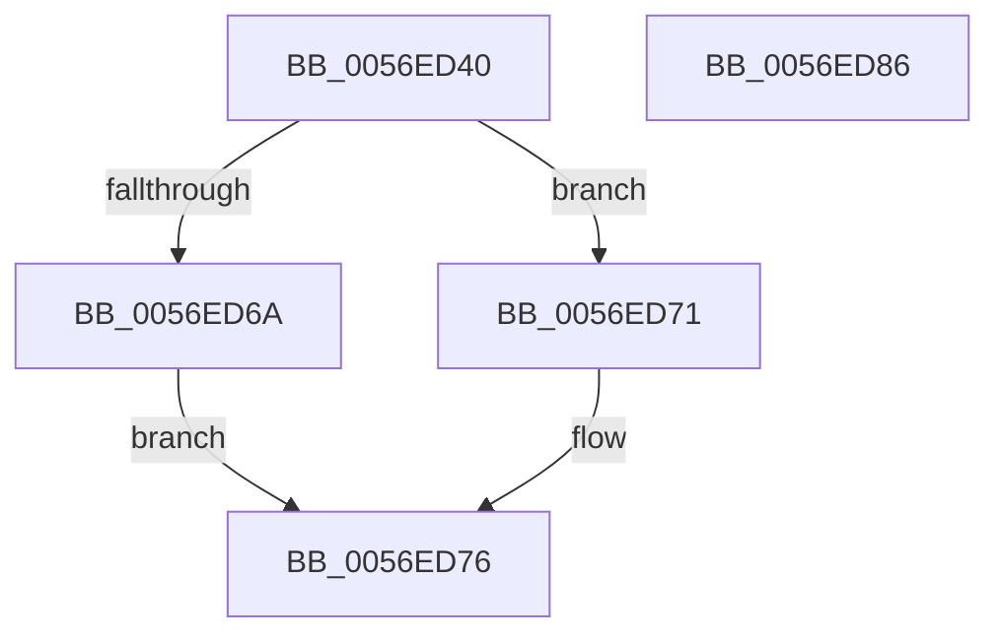

# IvtAttachDeviceDomain

- RVA: `0x0056ED40`–`0x0056ED87` (길이 `71` bytes)
- VA: `0x000000014056ED40`
- 실행 섹션: `.text`
- PDB 이름 있음: `예`; PDB Function 태그: `아니요`
- unwind 정보 RVA: `0x00060BC4`
- 디코드: `22`개 명령, `71/71` bytes 표시
- 미해석 바이트: `0` (있으면 어셈블리에 `.byte`로 보존)

> 이 문서는 커널 이미지의 기계어와 PDB 기호를 분석해 생성했습니다. 4번과 5번은 함수 원형과 자료형을 바이너리 사용 방식에서 추정한 C 해석이며 원본 소스 복구 결과는 아닙니다.

## 1. Dependencies

- 직접 호출 지점: **3**; 고유 호출 대상: **3**
- 직접 호출자로 확인된 함수: **0**
- RIP 상대 이미지 참조: **0**

### Outgoing calls
- `0x0056ED58` → [Feature_Test57481295__private_IsEnabledDeviceUsageNoInline](../4F/Feature_Test57481295__private_IsEnabledDeviceUsageNoInline_function_004F7B90.md) (function, `0x004F7B90`)
- `0x0056ED6A` → [IvtAttachDeviceDomainInternal](IvtAttachDeviceDomainInternal_function_0056ED90.md) (function, `0x0056ED90`)
- `0x0056ED71` → [IvtLegacyAttachDeviceDomainInternal](../57/IvtLegacyAttachDeviceDomainInternal_function_00570EDC.md) (function, `0x00570EDC`)

### Direct callers
- 이 함수 시작 RVA로 연결되는 직접 call은 확인되지 않았습니다. 간접 호출은 완전히 역산할 수 없습니다.

### Static image references
- 디코드된 RIP-relative 메모리 참조가 없습니다.

## 2. Other-region calls and transfers

- 다른 실행 섹션으로 향하는 call: **0**
- 별도 외부 분기/꼬리 이동을 확인하지 못했습니다.

## 3. Assembly (complete function range)

```asm
0056ED40  48 89 5C 24 08                  mov qword ptr [rsp + 8], rbx
0056ED45  48 89 74 24 10                  mov qword ptr [rsp + 0x10], rsi
0056ED4A  57                              push rdi
0056ED4B  48 83 EC 20                     sub rsp, 0x20
0056ED4F  49 8B D8                        mov rbx, r8
0056ED52  48 8B FA                        mov rdi, rdx
0056ED55  48 8B F1                        mov rsi, rcx
0056ED58  E8 33 8E F8 FF                  call 0x1404f7b90
0056ED5D  4C 8B C3                        mov r8, rbx
0056ED60  48 8B D7                        mov rdx, rdi
0056ED63  48 8B CE                        mov rcx, rsi
0056ED66  85 C0                           test eax, eax
0056ED68  74 07                           je 0x14056ed71
0056ED6A  E8 21 00 00 00                  call 0x14056ed90
0056ED6F  EB 05                           jmp 0x14056ed76
0056ED71  E8 66 21 00 00                  call 0x140570edc
0056ED76  48 8B 5C 24 30                  mov rbx, qword ptr [rsp + 0x30]
0056ED7B  48 8B 74 24 38                  mov rsi, qword ptr [rsp + 0x38]
0056ED80  48 83 C4 20                     add rsp, 0x20
0056ED84  5F                              pop rdi
0056ED85  C3                              ret
0056ED86  CC                              int3
```

## 4. C-style interpretation (structured pseudocode)

```c
__int64 __fastcall IvtAttachDeviceDomain(__int64 a1, __int64 a2, __int64 a3)
{
    __int64 result;
    __int64 v_rsp;
    unsigned __int64 v_stack_p10;
    unsigned __int64 v_stack_p8;

    v_stack_p8 = v_rbx;
    v_stack_p10 = v_rsi;
    v_rsp = (v_rsp) - (32);
    result = Feature_Test57481295__private_IsEnabledDeviceUsageNoInline(a1, a2, a3, a4);
    if ((unsigned int)(result) == 0) goto loc_0056ED71;
    result = IvtAttachDeviceDomainInternal(a1, a2, a3, a4);
    goto loc_0056ED76;
loc_0056ED71:
    result = IvtLegacyAttachDeviceDomainInternal(a1, a2, a3, a4);
loc_0056ED76:
    v_rsp = (v_rsp) + (32);
    return result;
}
```

## 5. (Beta) C Style

```c
int64_t IvtAttachDeviceDomain(int64_t Arg1, int64_t Arg2, int64_t Arg3)
{
    int64_t result;
    int64_t local_rsp;
    uint64_t v_stack_p10;
    uint64_t v_stack_p8;

    v_stack_p8 = local_rbx;
    v_stack_p10 = local_rsi;
    local_rsp = (local_rsp) - (32);
    result = Feature_Test57481295__private_IsEnabledDeviceUsageNoInline(Arg1, Arg2, Arg3, a4);
    if ((uint32_t)(result) == 0) goto loc_0056ED71;
    result = IvtAttachDeviceDomainInternal(Arg1, Arg2, Arg3, a4);
    goto loc_0056ED76;
loc_0056ED71:
    result = IvtLegacyAttachDeviceDomainInternal(Arg1, Arg2, Arg3, a4);
loc_0056ED76:
    local_rsp = (local_rsp) + (32);
    return result;
}
```

## 6. Execution-region graph

[열기: 2D/3D 그래프와 함수 탐색 컨트롤 패널](../../../control-panel.html?section=text&rva=0x0056ED40&view=graph)

- 2D 그래프는 위에서 아래로 흐르고, 3D 그래프는 빈 공간을 드래그해 회전합니다. Shift+드래그는 이동, 휠은 확대·축소, 함수 노드 선택은 대상 보고서 이동입니다.

### Static fallback


