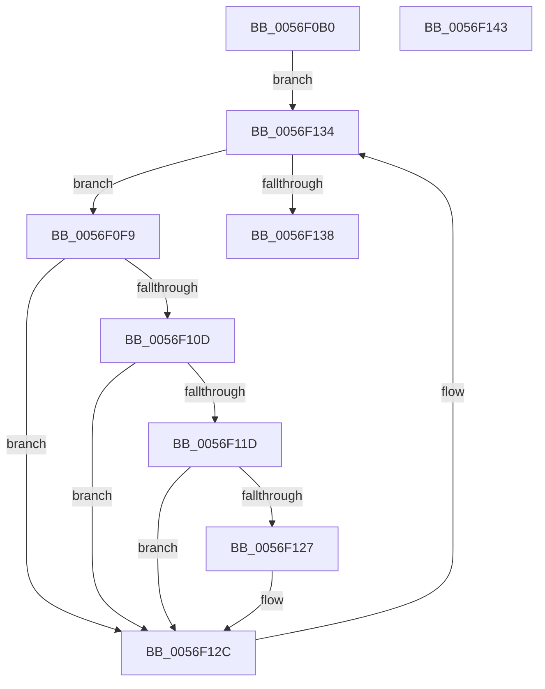

# IvtCancelPageRequests

- RVA: `0x0056F0B0`–`0x0056F144` (길이 `148` bytes)
- VA: `0x000000014056F0B0`
- 실행 섹션: `.text`
- PDB 이름 있음: `예`; PDB Function 태그: `아니요`
- unwind 정보 RVA: `0x000950EC`
- 디코드: `41`개 명령, `148/148` bytes 표시
- 미해석 바이트: `0` (있으면 어셈블리에 `.byte`로 보존)

> 이 문서는 커널 이미지의 기계어와 PDB 기호를 분석해 생성했습니다. 4번과 5번은 함수 원형과 자료형을 바이너리 사용 방식에서 추정한 C 해석이며 원본 소스 복구 결과는 아닙니다.

## 1. Dependencies

- 직접 호출 지점: **0**; 고유 호출 대상: **0**
- 직접 호출자로 확인된 함수: **0**
- RIP 상대 이미지 참조: **0**

### Outgoing calls
- 직접 디코드된 call 명령이 없습니다.

### Direct callers
- 이 함수 시작 RVA로 연결되는 직접 call은 확인되지 않았습니다. 간접 호출은 완전히 역산할 수 없습니다.

### Static image references
- 디코드된 RIP-relative 메모리 참조가 없습니다.

## 2. Other-region calls and transfers

- 다른 실행 섹션으로 향하는 call: **0**
- 별도 외부 분기/꼬리 이동을 확인하지 못했습니다.

## 3. Assembly (complete function range)

```asm
0056F0B0  48 89 5C 24 08                  mov qword ptr [rsp + 8], rbx
0056F0B5  48 89 7C 24 10                  mov qword ptr [rsp + 0x10], rdi
0056F0BA  4C 8B 91 A0 00 00 00            mov r10, qword ptr [rcx + 0xa0]
0056F0C1  4C 8B DA                        mov r11, rdx
0056F0C4  48 8B B9 90 00 00 00            mov rdi, qword ptr [rcx + 0x90]
0056F0CB  B8 FF 3F 00 00                  mov eax, 0x3fff
0056F0D0  48 8B 49 08                     mov rcx, qword ptr [rcx + 8]
0056F0D4  90                              nop
0056F0D5  49 C1 EA 05                     shr r10, 5
0056F0D9  41 8B D8                        mov ebx, r8d
0056F0DC  48 8B 91 C0 00 00 00            mov rdx, qword ptr [rcx + 0xc0]
0056F0E3  90                              nop
0056F0E4  48 8B 89 C8 00 00 00            mov rcx, qword ptr [rcx + 0xc8]
0056F0EB  48 C1 EA 05                     shr rdx, 5
0056F0EF  23 D0                           and edx, eax
0056F0F1  48 C1 E9 05                     shr rcx, 5
0056F0F5  23 C8                           and ecx, eax
0056F0F7  EB 3B                           jmp 0x14056f134
0056F0F9  44 8B C2                        mov r8d, edx
0056F0FC  49 C1 E0 05                     shl r8, 5
0056F100  4C 03 C7                        add r8, rdi
0056F103  4D 8B 08                        mov r9, qword ptr [r8]
0056F106  49 0F BA E1 08                  bt r9, 8
0056F10B  73 1F                           jae 0x14056f12c
0056F10D  49 C1 E9 20                     shr r9, 0x20
0056F111  41 81 E1 FF FF 0F 00            and r9d, 0xfffff
0056F118  4C 3B CB                        cmp r9, rbx
0056F11B  75 0F                           jne 0x14056f12c
0056F11D  41 0F B7 40 02                  movzx eax, word ptr [r8 + 2]
0056F122  49 3B C3                        cmp rax, r11
0056F125  75 05                           jne 0x14056f12c
0056F127  49 83 60 08 FC                  and qword ptr [r8 + 8], 0xfffffffffffffffc
0056F12C  8D 42 01                        lea eax, [rdx + 1]
0056F12F  33 D2                           xor edx, edx
0056F131  41 F7 F2                        div r10d
0056F134  3B D1                           cmp edx, ecx
0056F136  75 C1                           jne 0x14056f0f9
0056F138  48 8B 5C 24 08                  mov rbx, qword ptr [rsp + 8]
0056F13D  48 8B 7C 24 10                  mov rdi, qword ptr [rsp + 0x10]
0056F142  C3                              ret
0056F143  CC                              int3
```

## 4. C-style interpretation (structured pseudocode)

```c
__int64 __fastcall IvtCancelPageRequests(__int64 a1, __int64 a2, int a3)
{
    __int64 v_r10;
    unsigned __int64 v_stack_p10;
    unsigned __int64 v_stack_p8;

    v_stack_p8 = v_rbx;
    v_stack_p10 = v_rdi;
    v_r10 = (*(unsigned __int64 *)(a1 + 160)) >> (5);
    a2 = (*(unsigned __int64 *)(*(unsigned __int64 *)(a1 + 8) + 192)) >> (5);
    a2 = (unsigned int)((a2) & ((unsigned int)((unsigned int)(0x3FFFULL))));
    a1 = (*(unsigned __int64 *)(*(unsigned __int64 *)(a1 + 8) + 200)) >> (5);
    a1 = (unsigned int)((a1) & ((unsigned int)((unsigned int)(0x3FFFULL))));
    goto loc_0056F134;
loc_0056F0F9:
    a3 = ((unsigned int)((unsigned int)(a2))) << (5);
    a3 = (a3) + (*(unsigned __int64 *)(a1 + 144));
    if (condition_is_above_or_equal) goto loc_0056F12C;
    a4 = (*(unsigned __int64 *)(a3)) >> (32);
    a4 = (unsigned int)((a4) & (0xFFFFFULL));
    if (a4 != ((unsigned int)(a3))) goto loc_0056F12C;
    if ((*(unsigned __int16 *)(a3 + 2)) == a2) {
    }
    a2 = 0;
loc_0056F134:
    if (0 != ((unsigned int)(a1))) goto loc_0056F0F9;
    return a2 + 1;
}
```

## 5. (Beta) C Style

```c
int64_t IvtCancelPageRequests(void *Arg1, int64_t Arg2, int32_t Arg3)
{
    uint8_t *arg1 = (uint8_t *)Arg1;

    int64_t local_r10;
    uint64_t v_stack_p10;
    uint64_t v_stack_p8;

    v_stack_p8 = local_rbx;
    v_stack_p10 = local_rdi;
    local_r10 = (*(uint64_t *)(arg1 + 0xA0)) >> (5);
    Arg2 = (*(uint64_t *)(*(uint64_t *)(arg1 + 0x8) + 0xC0)) >> (5);
    Arg2 = (uint32_t)((Arg2) & ((uint32_t)((uint32_t)(0x3FFFULL))));
    Arg1 = (*(uint64_t *)(*(uint64_t *)(arg1 + 0x8) + 0xC8)) >> (5);
    Arg1 = (uint32_t)((Arg1) & ((uint32_t)((uint32_t)(0x3FFFULL))));
    goto loc_0056F134;
loc_0056F0F9:
    Arg3 = ((uint32_t)((uint32_t)(Arg2))) << (5);
    Arg3 = (Arg3) + (*(uint64_t *)(arg1 + 0x90));
    if (condition_is_above_or_equal) goto loc_0056F12C;
    a4 = (*(uint64_t *)(Arg3)) >> (32);
    a4 = (uint32_t)((a4) & (0xFFFFFULL));
    if (a4 != ((uint32_t)(Arg3))) goto loc_0056F12C;
    if ((*(uint16_t *)(Arg3 + 0x2)) == Arg2) {
    }
    Arg2 = 0;
loc_0056F134:
    if (0 != ((uint32_t)(Arg1))) goto loc_0056F0F9;
    return Arg2 + 1;
}
```

### 관측된 메모리 오프셋

구조체 형식이 확인되지 않은 접근은 인자 기준의 오프셋으로만 기록했습니다.

| 기준 인자 | 오프셋 표현 | 폭 (bit) | 접근 |
|---|---:|---:|---|
| `Arg1` | `+ 0x8` | `64` | `R` |
| `Arg1` | `+ 0x90` | `64` | `R` |
| `Arg1` | `+ 0xA0` | `64` | `R` |

## 6. Execution-region graph

[열기: 2D/3D 그래프와 함수 탐색 컨트롤 패널](../../../control-panel.html?section=text&rva=0x0056F0B0&view=graph)

- 2D 그래프는 위에서 아래로 흐르고, 3D 그래프는 빈 공간을 드래그해 회전합니다. Shift+드래그는 이동, 휠은 확대·축소, 함수 노드 선택은 대상 보고서 이동입니다.

### Static fallback


