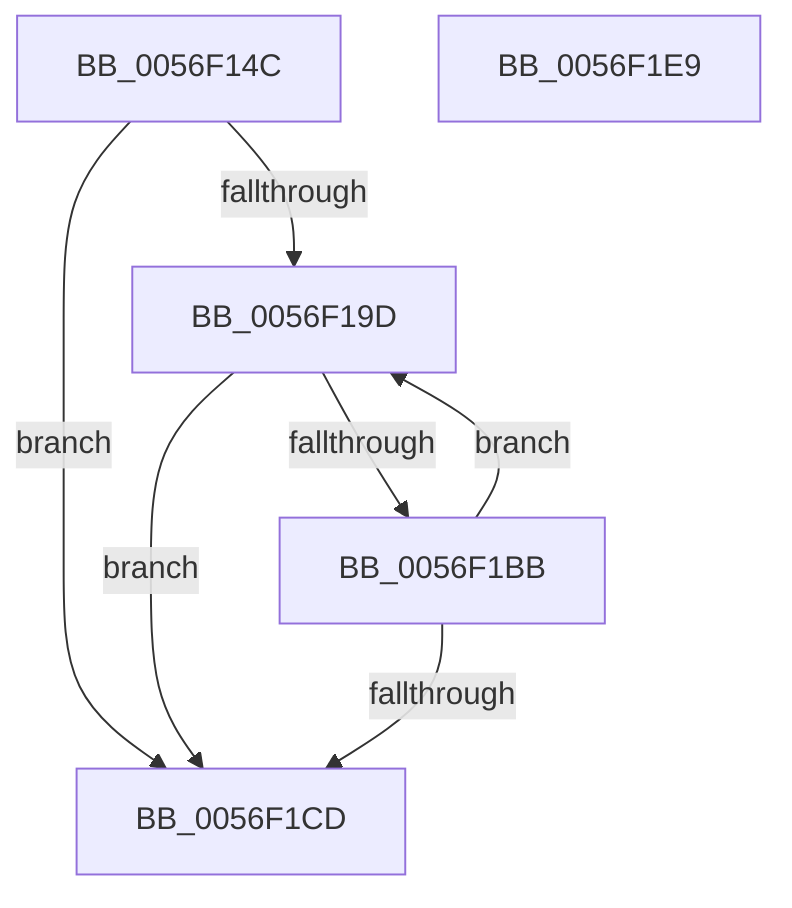

# IvtClearPendingFaults

- RVA: `0x0056F14C`–`0x0056F1EA` (길이 `158` bytes)
- VA: `0x000000014056F14C`
- 실행 섹션: `.text`
- PDB 이름 있음: `예`; PDB Function 태그: `아니요`
- unwind 정보 RVA: `0x000C523C`
- 디코드: `45`개 명령, `158/158` bytes 표시
- 미해석 바이트: `0` (있으면 어셈블리에 `.byte`로 보존)

> 이 문서는 커널 이미지의 기계어와 PDB 기호를 분석해 생성했습니다. 4번과 5번은 함수 원형과 자료형을 바이너리 사용 방식에서 추정한 C 해석이며 원본 소스 복구 결과는 아닙니다.

## 1. Dependencies

- 직접 호출 지점: **0**; 고유 호출 대상: **0**
- 직접 호출자로 확인된 함수: **1**
- RIP 상대 이미지 참조: **0**

### Outgoing calls
- 직접 디코드된 call 명령이 없습니다.

### Direct callers
- [IvtEnableInterrupt](../../pagelk/B6/IvtEnableInterrupt_function_00B61F70.md) at `0x00B61FA9`
- [IvtEnableInterrupt](../../pagelk/B6/IvtEnableInterrupt_function_00B61F70.md) at `0x00B61FC1`

### Static image references
- 디코드된 RIP-relative 메모리 참조가 없습니다.

## 2. Other-region calls and transfers

- 다른 실행 섹션으로 향하는 call: **0**
- 별도 외부 분기/꼬리 이동을 확인하지 못했습니다.

## 3. Assembly (complete function range)

```asm
0056F14C  48 89 5C 24 08                  mov qword ptr [rsp + 8], rbx
0056F151  57                              push rdi
0056F152  48 83 EC 10                     sub rsp, 0x10
0056F156  4C 8B 41 08                     mov r8, qword ptr [rcx + 8]
0056F15A  45 33 C9                        xor r9d, r9d
0056F15D  44 0F B6 99 DD 00 00 00         movzx r11d, byte ptr [rcx + 0xdd]
0056F165  0F 57 C0                        xorps xmm0, xmm0
0056F168  90                              nop
0056F169  48 8B D9                        mov rbx, rcx
0056F16C  0F 11 04 24                     movups xmmword ptr [rsp], xmm0
0056F170  45 8B 40 34                     mov r8d, dword ptr [r8 + 0x34]
0056F174  41 8B C0                        mov eax, r8d
0056F177  4C 8B 91 D8 00 00 00            mov r10, qword ptr [rcx + 0xd8]
0056F17E  49 C1 EA 18                     shr r10, 0x18
0056F182  41 81 E2 FF 03 00 00            and r10d, 0x3ff
0056F189  C1 E8 08                        shr eax, 8
0056F18C  49 C1 E2 04                     shl r10, 4
0056F190  4C 03 51 08                     add r10, qword ptr [rcx + 8]
0056F194  0F B6 F8                        movzx edi, al
0056F197  41 83 C3 01                     add r11d, 1
0056F19B  74 30                           je 0x14056f1cd
0056F19D  41 8D 04 39                     lea eax, [r9 + rdi]
0056F1A1  33 D2                           xor edx, edx
0056F1A3  41 F7 F3                        div r11d
0056F1A6  90                              nop
0056F1A7  8B CA                           mov ecx, edx
0056F1A9  48 03 C9                        add rcx, rcx
0056F1AC  49 8B 44 CA 08                  mov rax, qword ptr [r10 + rcx*8 + 8]
0056F1B1  48 89 44 24 08                  mov qword ptr [rsp + 8], rax
0056F1B6  48 85 C0                        test rax, rax
0056F1B9  79 12                           jns 0x14056f1cd
0056F1BB  49 89 44 CA 08                  mov qword ptr [r10 + rcx*8 + 8], rax
0056F1C0  F0 83 0C 24 00                  lock or dword ptr [rsp], 0
0056F1C5  41 FF C1                        inc r9d
0056F1C8  45 3B CB                        cmp r9d, r11d
0056F1CB  72 D0                           jb 0x14056f19d
0056F1CD  48 8B 43 08                     mov rax, qword ptr [rbx + 8]
0056F1D1  41 83 C8 01                     or r8d, 1
0056F1D5  44 89 40 34                     mov dword ptr [rax + 0x34], r8d
0056F1D9  F0 83 0C 24 00                  lock or dword ptr [rsp], 0
0056F1DE  48 8B 5C 24 20                  mov rbx, qword ptr [rsp + 0x20]
0056F1E3  48 83 C4 10                     add rsp, 0x10
0056F1E7  5F                              pop rdi
0056F1E8  C3                              ret
0056F1E9  CC                              int3
```

## 4. C-style interpretation (structured pseudocode)

```c
__int64 __fastcall IvtClearPendingFaults(__int64 a1, int a2, __int64 a3, int a4)
{
    __int64 result;
    __int64 v_r10;
    __int64 v_r11;
    __int64 v_rsp;
    unsigned __int64 v_stack_m10;
    unsigned __int64 v_stack_m18;
    unsigned __int64 v_stack_p8;

    v_stack_p8 = v_rbx;
    v_rsp = (v_rsp) - (16);
    a4 = 0;
    v_stack_m18 = v_xmm0;
    v_r10 = (*(unsigned __int64 *)(a1 + 216)) >> (24);
    v_r10 = (unsigned int)((v_r10) & (0x3FFULL));
    result = (unsigned int)(((unsigned int)((unsigned int)((unsigned int)(*(unsigned int *)(*(unsigned __int64 *)(a1 + 8) + 52))))) >> (8));
    v_r10 = (v_r10) << (4);
    v_r10 = (v_r10) + (*(unsigned __int64 *)(a1 + 8));
    v_r11 = (unsigned int)((*(unsigned __int8 *)(a1 + 221)) + (1));
    if (condition_is_equal) goto loc_0056F1CD;
loc_0056F19D:
    a2 = 0;
    a1 = (0) + (0);
    v_stack_m10 = *(unsigned __int64 *)(v_r10 + a1 * 8 + 8);
    if (!sign_flag) goto loc_0056F1CD;
    *(unsigned __int64 *)(v_r10 + a1 * 8 + 8) = *(unsigned __int64 *)(v_r10 + a1 * 8 + 8);
    a4 = (unsigned int)((a4) + 1);
    if (a4 < ((unsigned int)(v_r11))) goto loc_0056F19D;
loc_0056F1CD:
    a3 = (unsigned int)(((unsigned int)(*(unsigned int *)(*(unsigned __int64 *)(a1 + 8) + 52))) | (1));
    *(unsigned int *)(*(unsigned __int64 *)(a1 + 8) + 52) = (unsigned int)(a3);
    v_rsp = (v_rsp) + (16);
    return *(unsigned __int64 *)(a1 + 8);
}
```

## 5. (Beta) C Style

```c
int64_t IvtClearPendingFaults(void *Arg1, int32_t Arg2, int64_t Arg3, int32_t Arg4)
{
    uint8_t *arg1 = (uint8_t *)Arg1;

    int64_t result;
    int64_t local_r10;
    int64_t local_r11;
    int64_t local_rsp;
    uint64_t v_stack_m10;
    uint64_t v_stack_m18;
    uint64_t v_stack_p8;

    v_stack_p8 = local_rbx;
    local_rsp = (local_rsp) - (16);
    Arg4 = 0;
    v_stack_m18 = v_xmm0;
    local_r10 = (*(uint64_t *)(arg1 + 0xD8)) >> (24);
    local_r10 = (uint32_t)((local_r10) & (0x3FFULL));
    result = (uint32_t)(((uint32_t)((uint32_t)((uint32_t)(*(uint32_t *)(*(uint64_t *)(arg1 + 0x8) + 0x34))))) >> (8));
    local_r10 = (local_r10) << (4);
    local_r10 = (local_r10) + (*(uint64_t *)(arg1 + 0x8));
    local_r11 = (uint32_t)((*(uint8_t *)(arg1 + 0xDD)) + (1));
    if (condition_is_equal) goto loc_0056F1CD;
loc_0056F19D:
    Arg2 = 0;
    Arg1 = (0) + (0);
    v_stack_m10 = *(uint64_t *)(local_r10 + arg1 * 8 + 0x8);
    if (!sign_flag) goto loc_0056F1CD;
    *(uint64_t *)(local_r10 + arg1 * 8 + 0x8) = *(uint64_t *)(local_r10 + arg1 * 8 + 0x8);
    Arg4 = (uint32_t)((Arg4) + 1);
    if (Arg4 < ((uint32_t)(local_r11))) goto loc_0056F19D;
loc_0056F1CD:
    Arg3 = (uint32_t)(((uint32_t)(*(uint32_t *)(*(uint64_t *)(arg1 + 0x8) + 0x34))) | (1));
    *(uint32_t *)(*(uint64_t *)(arg1 + 0x8) + 0x34) = (uint32_t)(Arg3);
    local_rsp = (local_rsp) + (16);
    return *(uint64_t *)(arg1 + 0x8);
}
```

### 관측된 메모리 오프셋

구조체 형식이 확인되지 않은 접근은 인자 기준의 오프셋으로만 기록했습니다.

| 기준 인자 | 오프셋 표현 | 폭 (bit) | 접근 |
|---|---:|---:|---|
| `Arg1` | `+ 0x8` | `64` | `R` |
| `Arg1` | `+ 0xD8` | `64` | `R` |
| `Arg1` | `+ 0xDD` | `8` | `R` |

## 6. Execution-region graph

[열기: 2D/3D 그래프와 함수 탐색 컨트롤 패널](../../../control-panel.html?section=text&rva=0x0056F14C&view=graph)

- 2D 그래프는 위에서 아래로 흐르고, 3D 그래프는 빈 공간을 드래그해 회전합니다. Shift+드래그는 이동, 휠은 확대·축소, 함수 노드 선택은 대상 보고서 이동입니다.

### Static fallback


