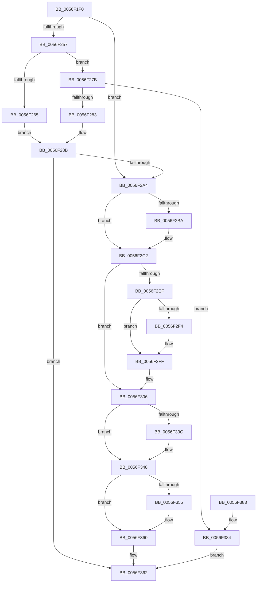

# IvtConfigureAts

- RVA: `0x0056F1F0`–`0x0056F38B` (길이 `411` bytes)
- VA: `0x000000014056F1F0`
- 실행 섹션: `.text`
- PDB 이름 있음: `예`; PDB Function 태그: `아니요`
- unwind 정보 RVA: `0x000C5350`
- 디코드: `117`개 명령, `411/411` bytes 표시
- 미해석 바이트: `0` (있으면 어셈블리에 `.byte`로 보존)

> 이 문서는 커널 이미지의 기계어와 PDB 기호를 분석해 생성했습니다. 4번과 5번은 함수 원형과 자료형을 바이너리 사용 방식에서 추정한 C 해석이며 원본 소스 복구 결과는 아닙니다.

## 1. Dependencies

- 직접 호출 지점: **10**; 고유 호출 대상: **10**
- 직접 호출자로 확인된 함수: **0**
- RIP 상대 이미지 참조: **1**

### Outgoing calls
- `0x0056F248` → [memset](../6C/memset_function_006C6C40.md) (function, `0x006C6C40`)
- `0x0056F271` → [IvtGetBlockedDomain](../4D/IvtGetBlockedDomain_function_004D2204.md) (function, `0x004D2204`)
- `0x0056F295` → [IvtAllocateTranslationStructures](IvtAllocateTranslationStructures_function_0056EC58.md) (function, `0x0056EC58`)
- `0x0056F2BD` → [KiRaiseIrqlProcessIrqlFlags](../4F/KiRaiseIrqlProcessIrqlFlags_function_004F56FC.md) (function, `0x004F56FC`)
- `0x0056F2CD` → [KeAcquireInStackQueuedSpinLockAtDpcLevel](../27/KeAcquireInStackQueuedSpinLockAtDpcLevel_function_00275740.md) (function, `0x00275740`)
- `0x0056F2D8` → [IvtGetDomainId](IvtGetDomainId_function_0056FAD8.md) (function, `0x0056FAD8`)
- `0x0056F325` → [IvtUpdateScalableModeContextEntry](../4C/IvtUpdateScalableModeContextEntry_function_004CD880.md) (function, `0x004CD880`)
- `0x0056F32E` → [KeReleaseInStackQueuedSpinLockFromDpcLevel](../21/KeReleaseInStackQueuedSpinLockFromDpcLevel_function_002171B0.md) (function, `0x002171B0`)
- `0x0056F343` → [KiLowerIrqlProcessIrqlFlags](../4F/KiLowerIrqlProcessIrqlFlags_function_004F5698.md) (function, `0x004F5698`)
- `0x0056F35B` → [IvtFreeScalableModePasidTables](IvtFreeScalableModePasidTables_function_0056F980.md) (function, `0x0056F980`)

### Direct callers
- 이 함수 시작 RVA로 연결되는 직접 call은 확인되지 않았습니다. 간접 호출은 완전히 역산할 수 없습니다.

### Static image references
- `0x0056F2B1` → RVA `0x00FC6D20` (`ALMOSTRO`; read)

## 2. Other-region calls and transfers

- 다른 실행 섹션으로 향하는 call: **0**
- 별도 외부 분기/꼬리 이동을 확인하지 못했습니다.

## 3. Assembly (complete function range)

```asm
0056F1F0  48 8B C4                        mov rax, rsp
0056F1F3  48 89 58 10                     mov qword ptr [rax + 0x10], rbx
0056F1F7  48 89 70 18                     mov qword ptr [rax + 0x18], rsi
0056F1FB  48 89 78 20                     mov qword ptr [rax + 0x20], rdi
0056F1FF  55                              push rbp
0056F200  41 54                           push r12
0056F202  41 55                           push r13
0056F204  41 56                           push r14
0056F206  41 57                           push r15
0056F208  48 8D 68 A1                     lea rbp, [rax - 0x5f]
0056F20C  48 81 EC E0 00 00 00            sub rsp, 0xe0
0056F213  33 C0                           xor eax, eax
0056F215  45 33 FF                        xor r15d, r15d
0056F218  41 F6 D8                        neg r8b
0056F21B  48 89 45 B7                     mov qword ptr [rbp - 0x49], rax
0056F21F  48 8B FA                        mov rdi, rdx
0056F222  45 0F B6 E7                     movzx r12d, r15b
0056F226  45 1B ED                        sbb r13d, r13d
0056F229  4C 89 7D 67                     mov qword ptr [rbp + 0x67], r15
0056F22D  48 8B D9                        mov rbx, rcx
0056F230  44 8D 40 70                     lea r8d, [rax + 0x70]
0056F234  0F 57 C0                        xorps xmm0, xmm0
0056F237  48 8D 4D C7                     lea rcx, [rbp - 0x39]
0056F23B  33 D2                           xor edx, edx
0056F23D  41 83 C5 02                     add r13d, 2
0056F241  0F 11 45 A7                     movups xmmword ptr [rbp - 0x59], xmm0
0056F245  41 8B F7                        mov esi, r15d
0056F248  E8 F3 79 15 00                  call 0x1406c6c40
0056F24D  41 8D 4F 01                     lea ecx, [r15 + 1]
0056F251  4C 39 7F 40                     cmp qword ptr [rdi + 0x40], r15
0056F255  75 4D                           jne 0x14056f2a4
0056F257  8B 83 34 01 00 00               mov eax, dword ptr [rbx + 0x134]
0056F25D  89 4D C7                        mov dword ptr [rbp - 0x39], ecx
0056F260  83 F8 02                        cmp eax, 2
0056F263  75 16                           jne 0x14056f27b
0056F265  89 4D CB                        mov dword ptr [rbp - 0x35], ecx
0056F268  4C 8D 45 67                     lea r8, [rbp + 0x67]
0056F26C  48 8B CB                        mov rcx, rbx
0056F26F  33 D2                           xor edx, edx
0056F271  E8 8E 2F F6 FF                  call 0x1404d2204
0056F276  89 45 F7                        mov dword ptr [rbp - 9], eax
0056F279  EB 10                           jmp 0x14056f28b
0056F27B  3B C1                           cmp eax, ecx
0056F27D  0F 85 01 01 00 00               jne 0x14056f384
0056F283  44 89 7D CB                     mov dword ptr [rbp - 0x35], r15d
0056F287  44 89 7D F7                     mov dword ptr [rbp - 9], r15d
0056F28B  4C 8D 45 C7                     lea r8, [rbp - 0x39]
0056F28F  48 8B D7                        mov rdx, rdi
0056F292  48 8B CB                        mov rcx, rbx
0056F295  E8 BE F9 FF FF                  call 0x14056ec58
0056F29A  8B F0                           mov esi, eax
0056F29C  85 C0                           test eax, eax
0056F29E  0F 88 BE 00 00 00               js 0x14056f362
0056F2A4  45 0F 20 C6                     mov r14, cr8
0056F2A8  BA 0F 00 00 00                  mov edx, 0xf
0056F2AD  44 0F 22 C2                     mov cr8, rdx
0056F2B1  44 39 3D 68 7A A5 00            cmp dword ptr [rip + 0xa57a68], r15d
0056F2B8  74 08                           je 0x14056f2c2
0056F2BA  41 8A CE                        mov cl, r14b
0056F2BD  E8 3A 64 F8 FF                  call 0x1404f56fc
0056F2C2  48 8D 8B D0 00 00 00            lea rcx, [rbx + 0xd0]
0056F2C9  48 8D 55 A7                     lea rdx, [rbp - 0x59]
0056F2CD  E8 6E 64 D0 FF                  call 0x140275740
0056F2D2  48 8B D7                        mov rdx, rdi
0056F2D5  48 8B CB                        mov rcx, rbx
0056F2D8  E8 FB 07 00 00                  call 0x14056fad8
0056F2DD  48 8B 4F 48                     mov rcx, qword ptr [rdi + 0x48]
0056F2E1  33 D2                           xor edx, edx
0056F2E3  4C 8B 7F 40                     mov r15, qword ptr [rdi + 0x40]
0056F2E7  4D 8B C7                        mov r8, r15
0056F2EA  48 85 C9                        test rcx, rcx
0056F2ED  74 17                           je 0x14056f306
0056F2EF  4D 85 FF                        test r15, r15
0056F2F2  74 0B                           je 0x14056f2ff
0056F2F4  49 3B CF                        cmp rcx, r15
0056F2F7  44 8D 42 01                     lea r8d, [rdx + 1]
0056F2FB  45 0F 45 E0                     cmovne r12d, r8d
0056F2FF  48 89 4F 40                     mov qword ptr [rdi + 0x40], rcx
0056F303  4C 8B C1                        mov r8, rcx
0056F306  48 89 44 24 40                  mov qword ptr [rsp + 0x40], rax
0056F30B  45 8B CD                        mov r9d, r13d
0056F30E  89 54 24 38                     mov dword ptr [rsp + 0x38], edx
0056F312  48 8B CB                        mov rcx, rbx
0056F315  89 54 24 20                     mov dword ptr [rsp + 0x20], edx
0056F319  48 89 57 48                     mov qword ptr [rdi + 0x48], rdx
0056F31D  48 8B 57 38                     mov rdx, qword ptr [rdi + 0x38]
0056F321  44 89 6F 50                     mov dword ptr [rdi + 0x50], r13d
0056F325  E8 56 E5 F5 FF                  call 0x1404cd880
0056F32A  48 8D 4D A7                     lea rcx, [rbp - 0x59]
0056F32E  E8 7D 7E CA FF                  call 0x1402171b0
0056F333  83 3D E6 79 A5 00 00            cmp dword ptr [rip + 0xa579e6], 0
0056F33A  74 0C                           je 0x14056f348
0056F33C  44 0F 20 C1                     mov rcx, cr8
0056F340  41 8A D6                        mov dl, r14b
0056F343  E8 50 63 F8 FF                  call 0x1404f5698
0056F348  41 0F B6 C6                     movzx eax, r14b
0056F34C  44 0F 22 C0                     mov cr8, rax
0056F350  45 84 E4                        test r12b, r12b
0056F353  74 0B                           je 0x14056f360
0056F355  49 8B D7                        mov rdx, r15
0056F358  48 8B CB                        mov rcx, rbx
0056F35B  E8 20 06 00 00                  call 0x14056f980
0056F360  8B C6                           mov eax, esi
0056F362  4C 8D 9C 24 E0 00 00 00         lea r11, [rsp + 0xe0]
0056F36A  49 8B 5B 38                     mov rbx, qword ptr [r11 + 0x38]
0056F36E  49 8B 73 40                     mov rsi, qword ptr [r11 + 0x40]
0056F372  49 8B 7B 48                     mov rdi, qword ptr [r11 + 0x48]
0056F376  49 8B E3                        mov rsp, r11
0056F379  41 5F                           pop r15
0056F37B  41 5E                           pop r14
0056F37D  41 5D                           pop r13
0056F37F  41 5C                           pop r12
0056F381  5D                              pop rbp
0056F382  C3                              ret
0056F383  CC                              int3
0056F384  B8 01 00 00 C0                  mov eax, 0xc0000001
0056F389  EB D7                           jmp 0x14056f362
```

## 4. C-style interpretation (structured pseudocode)

```c
__int64 __fastcall IvtConfigureAts(__int64 a1, __int64 a2, unsigned __int8 a3)
{
    __int64 result;
    __int64 v_r12;
    __int64 v_r13;
    __int64 v_r15;
    __int64 v_rsp;
    unsigned __int64 v_stack_m28;
    unsigned __int64 v_stack_mC8;
    unsigned int v_stack_mD0;
    unsigned int v_stack_mE8;

    *(unsigned __int64 *)(v_rsp + 16) = v_rbx;
    *(unsigned __int64 *)(v_rsp + 24) = v_rsi;
    *(unsigned __int64 *)(v_rsp + 32) = v_rdi;
    v_rsp = (v_rsp) - (224);
    result = 0;
    v_r15 = 0;
    a3 = (unsigned __int8)(-(a3));
    *(unsigned __int64 *)(v_rsp - 95 - 73) = 0;
    *(unsigned __int64 *)(v_rsp - 95 + 103) = 0;
    a2 = 0;
    v_r13 = (unsigned int)((v_r13) + (2));
    *(unsigned __int64 *)(v_rsp - 95 - 89) = v_xmm0;
    result = memset(v_rsp - 95 - 57, a2, result + 112, a4);
    if ((*(unsigned __int64 *)(a2 + 64)) != 0) goto loc_0056F2A4;
    *(unsigned int *)(v_rsp - 95 - 57) = (unsigned int)(v_r15 + 1);
    if (((unsigned int)((unsigned int)(*(unsigned int *)(a1 + 308)))) != 2) goto loc_0056F27B;
    *(unsigned int *)(v_rsp - 95 - 53) = (unsigned int)(v_r15 + 1);
    a2 = 0;
    result = IvtGetBlockedDomain(a1, a2, v_rsp - 95 + 103, a4);
    *(unsigned int *)(v_rsp - 95 - 9) = (unsigned int)(result);
    goto loc_0056F28B;
loc_0056F27B:
    if (((unsigned int)(result)) != ((unsigned int)(a1))) goto loc_0056F384;
    *(unsigned int *)(v_rsp - 95 - 53) = 0;
    *(unsigned int *)(v_rsp - 95 - 9) = 0;
loc_0056F28B:
    result = IvtAllocateTranslationStructures(a1, 0, v_rsp - 95 - 57, a4);
    if (sign_flag) goto loc_0056F362;
loc_0056F2A4:
    if ((*(unsigned int *)(v_rip + 10844776)) != 0) {
        a1 = (unsigned __int8)(v_cr8);
        result = KiRaiseIrqlProcessIrqlFlags(a1, 15, v_rsp - 95 - 57, a4);
    }
    result = KeAcquireInStackQueuedSpinLockAtDpcLevel(a1 + 208, v_rsp - 95 - 89, v_rsp - 95 - 57, a4);
    result = IvtGetDomainId(a1, 0, v_rsp - 95 - 57, a4);
    a2 = 0;
    if (*(unsigned __int64 *)(a2 + 72) == 0) goto loc_0056F306;
    v_r12 = 0;
    if (*(unsigned __int64 *)(a2 + 64) != 0) {
        a3 = a2 + 1;
        v_r12 = 0;
        if ((*(unsigned __int64 *)(a2 + 72)) != (*(unsigned __int64 *)(a2 + 64))) { v_r12 = a3; }
    }
    *(unsigned __int64 *)(a2 + 64) = *(unsigned __int64 *)(a2 + 72);
loc_0056F306:
    v_stack_mC8 = result;
    v_stack_mD0 = 0;
    v_stack_mE8 = 0;
    *(unsigned __int64 *)(a2 + 72) = 0;
    *(unsigned int *)(a2 + 80) = (unsigned int)(v_r13);
    result = IvtUpdateScalableModeContextEntry(a1, *(unsigned __int64 *)(a2 + 56), *(unsigned __int64 *)(a2 + 72), (unsigned int)((unsigned int)(v_r13)));
    result = KeReleaseInStackQueuedSpinLockFromDpcLevel(v_rsp - 95 - 89, *(unsigned __int64 *)(a2 + 56), *(unsigned __int64 *)(a2 + 72), (unsigned int)((unsigned int)(v_r13)));
    if ((*(unsigned int *)(v_rip + 10844646)) != 0) {
        a1 = 15;
        a2 = (unsigned __int8)(v_cr8);
        result = KiLowerIrqlProcessIrqlFlags(a1, a2, *(unsigned __int64 *)(a2 + 72), (unsigned int)((unsigned int)(v_r13)));
    }
    result = (unsigned __int8)(v_cr8);
    if ((unsigned __int8)(v_r12) != 0) {
        a2 = *(unsigned __int64 *)(a2 + 64);
        a1 = a1;
        result = IvtFreeScalableModePasidTables(a1, a2, *(unsigned __int64 *)(a2 + 72), (unsigned int)((unsigned int)(v_r13)));
    }
loc_0056F362:
    return (unsigned int)((unsigned int)((unsigned int)((unsigned int)(result))));
loc_0056F384:
    goto loc_0056F362;
}
```

## 5. (Beta) C Style

```c
int64_t IvtConfigureAts(void *Arg1, void *Arg2, uint8_t Arg3)
{
    uint8_t *arg1 = (uint8_t *)Arg1;
    uint8_t *arg2 = (uint8_t *)Arg2;

    int64_t result;
    int64_t local_r12;
    int64_t local_r13;
    int64_t local_r15;
    int64_t local_rsp;
    uint64_t v_stack_m28;
    uint64_t v_stack_mC8;
    uint32_t v_stack_mD0;
    uint32_t v_stack_mE8;

    *(uint64_t *)(local_rsp + 0x10) = local_rbx;
    *(uint64_t *)(local_rsp + 0x18) = local_rsi;
    *(uint64_t *)(local_rsp + 0x20) = local_rdi;
    local_rsp = (local_rsp) - (224);
    result = 0;
    local_r15 = 0;
    Arg3 = (uint8_t)(-(Arg3));
    *(uint64_t *)(local_rsp - 0x5F - 0x49) = 0;
    *(uint64_t *)(local_rsp - 0x5F + 0x67) = 0;
    Arg2 = 0;
    local_r13 = (uint32_t)((local_r13) + (2));
    *(uint64_t *)(local_rsp - 0x5F - 0x59) = v_xmm0;
    result = memset(local_rsp - 95 - 57, Arg2, result + 112, a4);
    if ((*(uint64_t *)(arg2 + 0x40)) != 0) goto loc_0056F2A4;
    *(uint32_t *)(local_rsp - 0x5F - 0x39) = (uint32_t)(local_r15 + 1);
    if (((uint32_t)((uint32_t)(*(uint32_t *)(arg1 + 0x134)))) != 2) goto loc_0056F27B;
    *(uint32_t *)(local_rsp - 0x5F - 0x35) = (uint32_t)(local_r15 + 1);
    Arg2 = 0;
    result = IvtGetBlockedDomain(Arg1, Arg2, local_rsp - 95 + 103, a4);
    *(uint32_t *)(local_rsp - 0x5F - 0x9) = (uint32_t)(result);
    goto loc_0056F28B;
loc_0056F27B:
    if (((uint32_t)(result)) != ((uint32_t)(Arg1))) goto loc_0056F384;
    *(uint32_t *)(local_rsp - 0x5F - 0x35) = 0;
    *(uint32_t *)(local_rsp - 0x5F - 0x9) = 0;
loc_0056F28B:
    result = IvtAllocateTranslationStructures(Arg1, 0, local_rsp - 95 - 57, a4);
    if (sign_flag) goto loc_0056F362;
loc_0056F2A4:
    if ((*(uint32_t *)(v_rip + 0xA57A68)) != 0) {
        Arg1 = (uint8_t)(v_cr8);
        result = KiRaiseIrqlProcessIrqlFlags(Arg1, 15, local_rsp - 95 - 57, a4);
    }
    result = KeAcquireInStackQueuedSpinLockAtDpcLevel(Arg1 + 208, local_rsp - 95 - 89, local_rsp - 95 - 57, a4);
    result = IvtGetDomainId(Arg1, 0, local_rsp - 95 - 57, a4);
    Arg2 = 0;
    if (*(uint64_t *)(arg2 + 0x48) == 0) goto loc_0056F306;
    local_r12 = 0;
    if (*(uint64_t *)(arg2 + 0x40) != 0) {
        Arg3 = Arg2 + 1;
        local_r12 = 0;
        if ((*(uint64_t *)(arg2 + 0x48)) != (*(uint64_t *)(arg2 + 0x40))) { local_r12 = Arg3; }
    }
    *(uint64_t *)(arg2 + 0x40) = *(uint64_t *)(arg2 + 0x48);
loc_0056F306:
    v_stack_mC8 = result;
    v_stack_mD0 = 0;
    v_stack_mE8 = 0;
    *(uint64_t *)(arg2 + 0x48) = 0;
    *(uint32_t *)(arg2 + 0x50) = (uint32_t)(local_r13);
    result = IvtUpdateScalableModeContextEntry(Arg1, *(uint64_t *)(arg2 + 0x38), *(uint64_t *)(arg2 + 0x48), (uint32_t)((uint32_t)(local_r13)));
    result = KeReleaseInStackQueuedSpinLockFromDpcLevel(local_rsp - 95 - 89, *(uint64_t *)(arg2 + 0x38), *(uint64_t *)(arg2 + 0x48), (uint32_t)((uint32_t)(local_r13)));
    if ((*(uint32_t *)(v_rip + 0xA579E6)) != 0) {
        Arg1 = 15;
        Arg2 = (uint8_t)(v_cr8);
        result = KiLowerIrqlProcessIrqlFlags(Arg1, Arg2, *(uint64_t *)(arg2 + 0x48), (uint32_t)((uint32_t)(local_r13)));
    }
    result = (uint8_t)(v_cr8);
    if ((uint8_t)(local_r12) != 0) {
        Arg2 = *(uint64_t *)(arg2 + 0x40);
        Arg1 = Arg1;
        result = IvtFreeScalableModePasidTables(Arg1, Arg2, *(uint64_t *)(arg2 + 0x48), (uint32_t)((uint32_t)(local_r13)));
    }
loc_0056F362:
    return (uint32_t)((uint32_t)((uint32_t)((uint32_t)(result))));
loc_0056F384:
    goto loc_0056F362;
}
```

### 관측된 메모리 오프셋

구조체 형식이 확인되지 않은 접근은 인자 기준의 오프셋으로만 기록했습니다.

| 기준 인자 | 오프셋 표현 | 폭 (bit) | 접근 |
|---|---:|---:|---|
| `Arg1` | `+ 0xD0` | `64` | `R` |
| `Arg1` | `+ 0x134` | `32` | `R` |
| `Arg2` | `+ 0x38` | `64` | `R` |
| `Arg2` | `+ 0x40` | `64` | `R` |
| `Arg2` | `+ 0x40` | `64` | `W` |
| `Arg2` | `+ 0x48` | `64` | `R` |
| `Arg2` | `+ 0x48` | `64` | `W` |
| `Arg2` | `+ 0x50` | `32` | `W` |

## 6. Execution-region graph

[열기: 2D/3D 그래프와 함수 탐색 컨트롤 패널](../../../control-panel.html?section=text&rva=0x0056F1F0&view=graph)

- 2D 그래프는 위에서 아래로 흐르고, 3D 그래프는 빈 공간을 드래그해 회전합니다. Shift+드래그는 이동, 휠은 확대·축소, 함수 노드 선택은 대상 보고서 이동입니다.

### Static fallback


