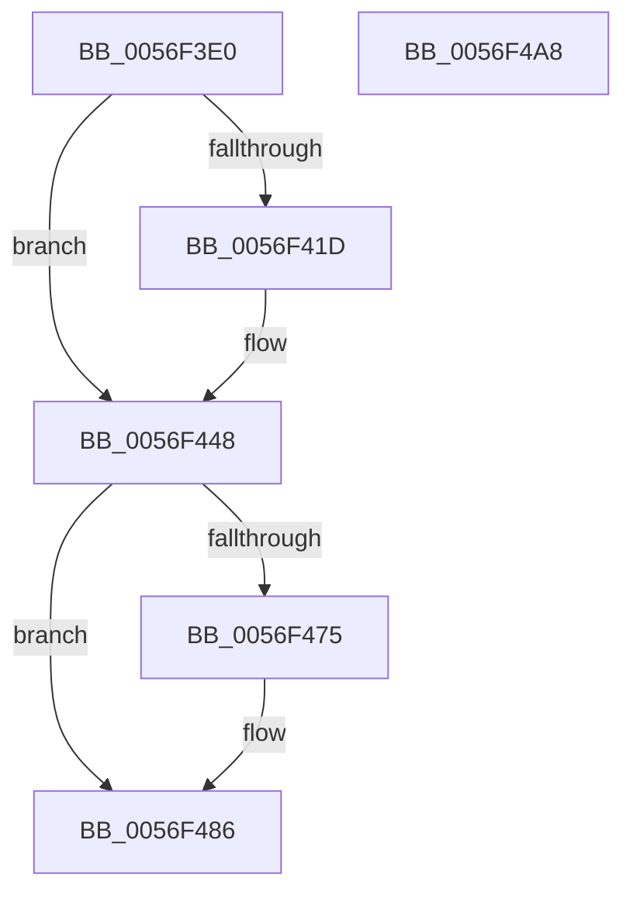

# IvtDismissPageFault

- RVA: `0x0056F3E0`–`0x0056F4A9` (길이 `201` bytes)
- VA: `0x000000014056F3E0`
- 실행 섹션: `.text`
- PDB 이름 있음: `예`; PDB Function 태그: `아니요`
- unwind 정보 RVA: `0x000C5264`
- 디코드: `46`개 명령, `201/201` bytes 표시
- 미해석 바이트: `0` (있으면 어셈블리에 `.byte`로 보존)

> 이 문서는 커널 이미지의 기계어와 PDB 기호를 분석해 생성했습니다. 4번과 5번은 함수 원형과 자료형을 바이너리 사용 방식에서 추정한 C 해석이며 원본 소스 복구 결과는 아닙니다.

## 1. Dependencies

- 직접 호출 지점: **2**; 고유 호출 대상: **2**
- 직접 호출자로 확인된 함수: **0**
- RIP 상대 이미지 참조: **1**

### Outgoing calls
- `0x0056F491` → [IvtIommuSendCommand](../46/IvtIommuSendCommand_function_0046A6E4.md) (function, `0x0046A6E4`)
- `0x0056F49E` → [_security_check_cookie](../6A/_security_check_cookie_function_006AC640.md) (function, `0x006AC640`)

### Direct callers
- 이 함수 시작 RVA로 연결되는 직접 call은 확인되지 않았습니다. 간접 호출은 완전히 역산할 수 없습니다.

### Static image references
- `0x0056F3E7` → RVA `0x00E0A740` (`.data`; read)

## 2. Other-region calls and transfers

- 다른 실행 섹션으로 향하는 call: **0**
- 별도 외부 분기/꼬리 이동을 확인하지 못했습니다.

## 3. Assembly (complete function range)

```asm
0056F3E0  4C 8B DC                        mov r11, rsp
0056F3E3  48 83 EC 58                     sub rsp, 0x58
0056F3E7  48 8B 05 52 B3 89 00            mov rax, qword ptr [rip + 0x89b352]
0056F3EE  48 33 C4                        xor rax, rsp
0056F3F1  48 89 44 24 40                  mov qword ptr [rsp + 0x40], rax
0056F3F6  0F 57 C0                        xorps xmm0, xmm0
0056F3F9  4C 8B D1                        mov r10, rcx
0056F3FC  F3 0F 7F 44 24 28               movdqu xmmword ptr [rsp + 0x28], xmm0
0056F402  49 83 63 E0 00                  and qword ptr [r11 - 0x20], 0
0056F407  49 C7 43 C8 09 00 00 00         mov qword ptr [r11 - 0x38], 9
0056F40F  66 45 89 43 CA                  mov word ptr [r11 - 0x36], r8w
0056F414  49 8B 4B C8                     mov rcx, qword ptr [r11 - 0x38]
0056F418  83 FA FF                        cmp edx, -1
0056F41B  74 2B                           je 0x14056f448
0056F41D  8B C2                           mov eax, edx
0056F41F  48 BA FF FF FF FF 00 00 F0 FF   movabs rdx, 0xfff00000ffffffff
0056F429  48 23 CA                        and rcx, rdx
0056F42C  48 C1 E0 20                     shl rax, 0x20
0056F430  48 BA 00 00 00 00 FF FF 0F 00   movabs rdx, 0xfffff00000000
0056F43A  48 83 C9 10                     or rcx, 0x10
0056F43E  48 23 C2                        and rax, rdx
0056F441  48 33 C8                        xor rcx, rax
0056F444  49 89 4B C8                     mov qword ptr [r11 - 0x38], rcx
0056F448  41 0F B7 C1                     movzx eax, r9w
0056F44C  48 C1 E0 03                     shl rax, 3
0056F450  48 8B D0                        mov rdx, rax
0056F453  48 33 54 24 28                  xor rdx, qword ptr [rsp + 0x28]
0056F458  48 81 E2 07 F0 FF FF            and rdx, 0xfffffffffffff007
0056F45F  48 33 D0                        xor rdx, rax
0056F462  48 83 CA 04                     or rdx, 4
0056F466  83 BC 24 80 00 00 00 00         cmp dword ptr [rsp + 0x80], 0
0056F46E  48 89 54 24 28                  mov qword ptr [rsp + 0x28], rdx
0056F473  7D 11                           jge 0x14056f486
0056F475  48 81 E1 FF 1F FF FF            and rcx, 0xffffffffffff1fff
0056F47C  48 0F BA E9 0C                  bts rcx, 0xc
0056F481  48 89 4C 24 20                  mov qword ptr [rsp + 0x20], rcx
0056F486  45 33 C0                        xor r8d, r8d
0056F489  48 8D 54 24 20                  lea rdx, [rsp + 0x20]
0056F48E  49 8B CA                        mov rcx, r10
0056F491  E8 4E B2 EF FF                  call 0x14046a6e4
0056F496  48 8B 4C 24 40                  mov rcx, qword ptr [rsp + 0x40]
0056F49B  48 33 CC                        xor rcx, rsp
0056F49E  E8 9D D1 13 00                  call 0x1406ac640
0056F4A3  48 83 C4 58                     add rsp, 0x58
0056F4A7  C3                              ret
0056F4A8  CC                              int3
```

## 4. C-style interpretation (structured pseudocode)

```c
__int64 __fastcall IvtDismissPageFault(__int64 a1, int a2, int a3, unsigned __int16 a4, unsigned int a5)
{
    __int64 result;
    __int64 v_rsp;
    unsigned __int64 v_stack_m18;
    unsigned __int64 v_stack_m30;
    unsigned __int64 v_stack_m38;

    v_rsp = (v_rsp) - (88);
    result = (*(unsigned __int64 *)(v_rip + 9024338)) ^ (v_rsp);
    v_stack_m18 = result;
    v_stack_m30 = v_xmm0;
    *(unsigned __int64 *)(v_rsp - 56) = 9;
    *(unsigned __int16 *)(v_rsp - 54) = (unsigned __int16)(a3);
    if (a2 != -1) {
        result = a2;
        a1 = (*(unsigned __int64 *)(v_rsp - 56)) & (a2);
        result = (result) << (32);
        a1 = (a1) | (16);
        result = (result) & (a2);
        a1 = (a1) ^ (result);
        *(unsigned __int64 *)(v_rsp - 56) = a1;
    }
    result = (a4) << (3);
    a2 = (result) ^ (v_stack_m30);
    a2 = (a2) & (0xFFFFFFFFFFFFF007ULL);
    a2 = (a2) ^ (result);
    a2 = (a2) | (4);
    v_stack_m30 = a2;
    if (a5 < 0) {
        a1 = (a1) & (0xFFFFFFFFFFFF1FFFULL);
        v_stack_m38 = a1;
    }
    a3 = 0;
    result = IvtIommuSendCommand(a1, v_stack_m38, a3, a4);
    a1 = (v_stack_m18) ^ (v_rsp);
    result = _security_check_cookie(a1, v_stack_m38, a3, a4);
    v_rsp = (v_rsp) + (88);
    return result;
}
```

## 5. (Beta) C Style

```c
int64_t IvtDismissPageFault(int64_t Arg1, int32_t Arg2, int32_t Arg3, uint16_t Arg4, uint32_t Arg5)
{
    int64_t result;
    int64_t local_rsp;
    uint64_t v_stack_m18;
    uint64_t v_stack_m30;
    uint64_t v_stack_m38;

    local_rsp = (local_rsp) - (88);
    result = (*(uint64_t *)(v_rip + 0x89B352)) ^ (local_rsp);
    v_stack_m18 = result;
    v_stack_m30 = v_xmm0;
    *(uint64_t *)(local_rsp - 0x38) = 9;
    *(uint16_t *)(local_rsp - 0x36) = (uint16_t)(Arg3);
    if (Arg2 != -1) {
        result = Arg2;
        Arg1 = (*(uint64_t *)(local_rsp - 0x38)) & (Arg2);
        result = (result) << (32);
        Arg1 = (Arg1) | (16);
        result = (result) & (Arg2);
        Arg1 = (Arg1) ^ (result);
        *(uint64_t *)(local_rsp - 0x38) = Arg1;
    }
    result = (Arg4) << (3);
    Arg2 = (result) ^ (v_stack_m30);
    Arg2 = (Arg2) & (0xFFFFFFFFFFFFF007ULL);
    Arg2 = (Arg2) ^ (result);
    Arg2 = (Arg2) | (4);
    v_stack_m30 = Arg2;
    if (Arg5 < 0) {
        Arg1 = (Arg1) & (0xFFFFFFFFFFFF1FFFULL);
        v_stack_m38 = Arg1;
    }
    Arg3 = 0;
    result = IvtIommuSendCommand(Arg1, v_stack_m38, Arg3, Arg4);
    Arg1 = (v_stack_m18) ^ (local_rsp);
    result = _security_check_cookie(Arg1, v_stack_m38, Arg3, Arg4);
    local_rsp = (local_rsp) + (88);
    return result;
}
```

## 6. Execution-region graph

[열기: 2D/3D 그래프와 함수 탐색 컨트롤 패널](../../../control-panel.html?section=text&rva=0x0056F3E0&view=graph)

- 2D 그래프는 위에서 아래로 흐르고, 3D 그래프는 빈 공간을 드래그해 회전합니다. Shift+드래그는 이동, 휠은 확대·축소, 함수 노드 선택은 대상 보고서 이동입니다.

### Static fallback


