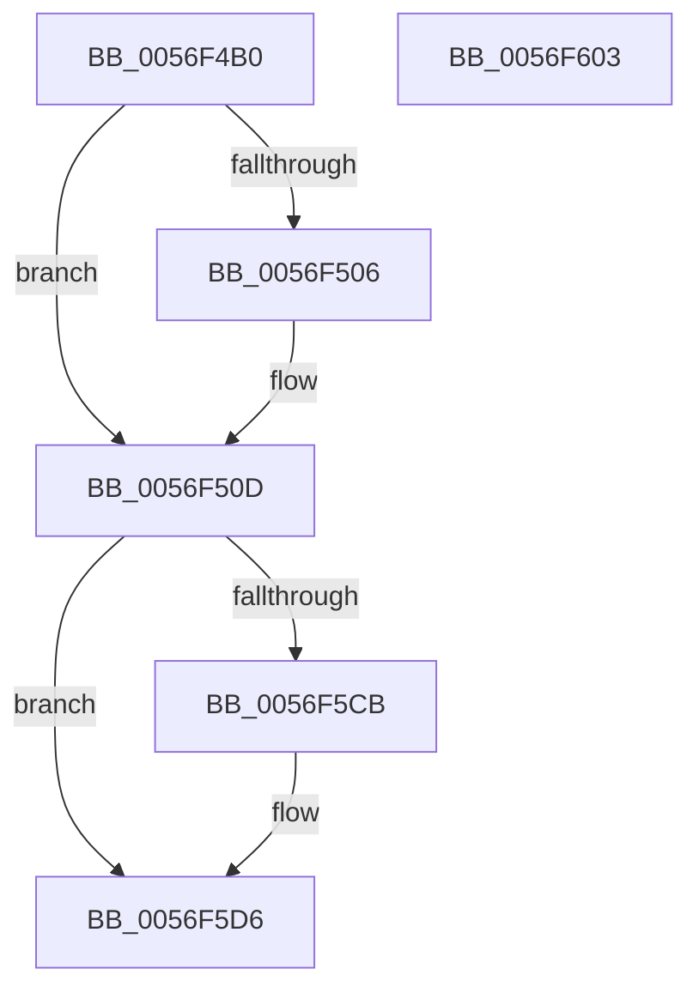

# IvtDrainSvmPageRequests

- RVA: `0x0056F4B0`–`0x0056F604` (길이 `340` bytes)
- VA: `0x000000014056F4B0`
- 실행 섹션: `.text`
- PDB 이름 있음: `예`; PDB Function 태그: `아니요`
- unwind 정보 RVA: `0x000C51DC`
- 디코드: `91`개 명령, `340/340` bytes 표시
- 미해석 바이트: `0` (있으면 어셈블리에 `.byte`로 보존)

> 이 문서는 커널 이미지의 기계어와 PDB 기호를 분석해 생성했습니다. 4번과 5번은 함수 원형과 자료형을 바이너리 사용 방식에서 추정한 C 해석이며 원본 소스 복구 결과는 아닙니다.

## 1. Dependencies

- 직접 호출 지점: **12**; 고유 호출 대상: **7**
- 직접 호출자로 확인된 함수: **0**
- RIP 상대 이미지 참조: **2**

### Outgoing calls
- `0x0056F508` → [KiRaiseIrqlProcessIrqlFlags](../4F/KiRaiseIrqlProcessIrqlFlags_function_004F56FC.md) (function, `0x004F56FC`)
- `0x0056F518` → [KeAcquireInStackQueuedSpinLockAtDpcLevel](../27/KeAcquireInStackQueuedSpinLockAtDpcLevel_function_00275740.md) (function, `0x00275740`)
- `0x0056F52B` → [IvtIommuWaitCommand](../46/IvtIommuWaitCommand_function_0046A594.md) (function, `0x0046A594`)
- `0x0056F542` → [IvtIommuSendCommand](../46/IvtIommuSendCommand_function_0046A6E4.md) (function, `0x0046A6E4`)
- `0x0056F57B` → [IvtIommuSendCommand](../46/IvtIommuSendCommand_function_0046A6E4.md) (function, `0x0046A6E4`)
- `0x0056F588` → [IvtIommuWaitCommand](../46/IvtIommuWaitCommand_function_0046A594.md) (function, `0x0046A594`)
- `0x0056F597` → [IvtIommuSendCommand](../46/IvtIommuSendCommand_function_0046A6E4.md) (function, `0x0046A6E4`)
- `0x0056F5A6` → [IvtIommuSendCommand](../46/IvtIommuSendCommand_function_0046A6E4.md) (function, `0x0046A6E4`)
- `0x0056F5B4` → [IvtIommuWaitCommand](../46/IvtIommuWaitCommand_function_0046A594.md) (function, `0x0046A594`)
- `0x0056F5BD` → [KeReleaseInStackQueuedSpinLockFromDpcLevel](../21/KeReleaseInStackQueuedSpinLockFromDpcLevel_function_002171B0.md) (function, `0x002171B0`)
- `0x0056F5D1` → [KiLowerIrqlProcessIrqlFlags](../4F/KiLowerIrqlProcessIrqlFlags_function_004F5698.md) (function, `0x004F5698`)
- `0x0056F5E4` → [_security_check_cookie](../6A/_security_check_cookie_function_006AC640.md) (function, `0x006AC640`)

### Direct callers
- 이 함수 시작 RVA로 연결되는 직접 call은 확인되지 않았습니다. 간접 호출은 완전히 역산할 수 없습니다.

### Static image references
- `0x0056F4CB` → RVA `0x00E0A740` (`.data`; read)
- `0x0056F4FE` → RVA `0x00FC6D20` (`ALMOSTRO`; read)

## 2. Other-region calls and transfers

- 다른 실행 섹션으로 향하는 call: **0**
- 별도 외부 분기/꼬리 이동을 확인하지 못했습니다.

## 3. Assembly (complete function range)

```asm
0056F4B0  48 89 5C 24 10                  mov qword ptr [rsp + 0x10], rbx
0056F4B5  48 89 74 24 18                  mov qword ptr [rsp + 0x18], rsi
0056F4BA  48 89 7C 24 20                  mov qword ptr [rsp + 0x20], rdi
0056F4BF  55                              push rbp
0056F4C0  41 56                           push r14
0056F4C2  41 57                           push r15
0056F4C4  48 8B EC                        mov rbp, rsp
0056F4C7  48 83 EC 60                     sub rsp, 0x60
0056F4CB  48 8B 05 6E B2 89 00            mov rax, qword ptr [rip + 0x89b26e]
0056F4D2  48 33 C4                        xor rax, rsp
0056F4D5  48 89 45 F8                     mov qword ptr [rbp - 8], rax
0056F4D9  33 C0                           xor eax, eax
0056F4DB  0F 57 C0                        xorps xmm0, xmm0
0056F4DE  48 21 45 E0                     and qword ptr [rbp - 0x20], rax
0056F4E2  41 8B F0                        mov esi, r8d
0056F4E5  0F 11 45 C0                     movups xmmword ptr [rbp - 0x40], xmm0
0056F4E9  48 89 45 D0                     mov qword ptr [rbp - 0x30], rax
0056F4ED  4C 8B F2                        mov r14, rdx
0056F4F0  48 8B F9                        mov rdi, rcx
0056F4F3  44 0F 20 C3                     mov rbx, cr8
0056F4F7  8D 50 0F                        lea edx, [rax + 0xf]
0056F4FA  44 0F 22 C2                     mov cr8, rdx
0056F4FE  39 05 1C 78 A5 00               cmp dword ptr [rip + 0xa5781c], eax
0056F504  74 07                           je 0x14056f50d
0056F506  8A CB                           mov cl, bl
0056F508  E8 EF 61 F8 FF                  call 0x1404f56fc
0056F50D  48 8D 8F D0 00 00 00            lea rcx, [rdi + 0xd0]
0056F514  48 8D 55 C0                     lea rdx, [rbp - 0x40]
0056F518  E8 23 62 D0 FF                  call 0x140275740
0056F51D  41 BF 01 00 00 00               mov r15d, 1
0056F523  33 D2                           xor edx, edx
0056F525  45 8B C7                        mov r8d, r15d
0056F528  48 8B CF                        mov rcx, rdi
0056F52B  E8 64 B0 EF FF                  call 0x14046a594
0056F530  45 8B C7                        mov r8d, r15d
0056F533  48 C7 45 D8 12 00 00 00         mov qword ptr [rbp - 0x28], 0x12
0056F53B  48 8D 55 D8                     lea rdx, [rbp - 0x28]
0056F53F  48 8B CF                        mov rcx, rdi
0056F542  E8 9D B1 EF FF                  call 0x14046a6e4
0056F547  48 B8 01 F8 FF FF FF FF FF 7F   movabs rax, 0x7ffffffffffff801
0056F551  41 0F B7 CE                     movzx ecx, r14w
0056F555  48 C1 E1 0C                     shl rcx, 0xc
0056F559  48 8D 55 E8                     lea rdx, [rbp - 0x18]
0056F55D  48 89 45 F0                     mov qword ptr [rbp - 0x10], rax
0056F561  45 8B C7                        mov r8d, r15d
0056F564  8B C6                           mov eax, esi
0056F566  83 E0 1F                        and eax, 0x1f
0056F569  48 0B C8                        or rcx, rax
0056F56C  48 C1 E1 04                     shl rcx, 4
0056F570  48 83 C9 08                     or rcx, 8
0056F574  48 89 4D E8                     mov qword ptr [rbp - 0x18], rcx
0056F578  48 8B CF                        mov rcx, rdi
0056F57B  E8 64 B1 EF FF                  call 0x14046a6e4
0056F580  45 8B C7                        mov r8d, r15d
0056F583  33 D2                           xor edx, edx
0056F585  48 8B CF                        mov rcx, rdi
0056F588  E8 07 B0 EF FF                  call 0x14046a594
0056F58D  45 8B C7                        mov r8d, r15d
0056F590  48 8D 55 D8                     lea rdx, [rbp - 0x28]
0056F594  48 8B CF                        mov rcx, rdi
0056F597  E8 48 B1 EF FF                  call 0x14046a6e4
0056F59C  45 8B C7                        mov r8d, r15d
0056F59F  48 8D 55 E8                     lea rdx, [rbp - 0x18]
0056F5A3  48 8B CF                        mov rcx, rdi
0056F5A6  E8 39 B1 EF FF                  call 0x14046a6e4
0056F5AB  45 8B C7                        mov r8d, r15d
0056F5AE  41 8B D7                        mov edx, r15d
0056F5B1  48 8B CF                        mov rcx, rdi
0056F5B4  E8 DB AF EF FF                  call 0x14046a594
0056F5B9  48 8D 4D C0                     lea rcx, [rbp - 0x40]
0056F5BD  E8 EE 7B CA FF                  call 0x1402171b0
0056F5C2  83 3D 57 77 A5 00 00            cmp dword ptr [rip + 0xa57757], 0
0056F5C9  74 0B                           je 0x14056f5d6
0056F5CB  44 0F 20 C1                     mov rcx, cr8
0056F5CF  8A D3                           mov dl, bl
0056F5D1  E8 C2 60 F8 FF                  call 0x1404f5698
0056F5D6  0F B6 C3                        movzx eax, bl
0056F5D9  44 0F 22 C0                     mov cr8, rax
0056F5DD  48 8B 4D F8                     mov rcx, qword ptr [rbp - 8]
0056F5E1  48 33 CC                        xor rcx, rsp
0056F5E4  E8 57 D0 13 00                  call 0x1406ac640
0056F5E9  4C 8D 5C 24 60                  lea r11, [rsp + 0x60]
0056F5EE  49 8B 5B 28                     mov rbx, qword ptr [r11 + 0x28]
0056F5F2  49 8B 73 30                     mov rsi, qword ptr [r11 + 0x30]
0056F5F6  49 8B 7B 38                     mov rdi, qword ptr [r11 + 0x38]
0056F5FA  49 8B E3                        mov rsp, r11
0056F5FD  41 5F                           pop r15
0056F5FF  41 5E                           pop r14
0056F601  5D                              pop rbp
0056F602  C3                              ret
0056F603  CC                              int3
```

## 4. C-style interpretation (structured pseudocode)

```c
__int64 __fastcall IvtDrainSvmPageRequests(__int64 a1, __int64 a2, int a3)
{
    __int64 result;
    __int64 v_rsp;
    unsigned __int64 v_stack_m18;
    unsigned __int64 v_stack_m20;
    unsigned __int64 v_stack_m28;
    unsigned __int64 v_stack_m30;
    unsigned __int64 v_stack_m38;
    unsigned __int64 v_stack_m40;
    unsigned __int64 v_stack_m48;
    unsigned __int64 v_stack_m58;
    unsigned __int64 v_stack_p10;
    unsigned __int64 v_stack_p18;
    unsigned __int64 v_stack_p20;

    v_stack_p10 = v_rbx;
    v_stack_p18 = v_rsi;
    v_stack_p20 = v_rdi;
    v_rsp = (v_rsp) - (96);
    result = (*(unsigned __int64 *)(v_rip + 9024110)) ^ (v_rsp);
    v_stack_m20 = result;
    result = 0;
    v_stack_m58 = v_xmm0;
    v_stack_m48 = 0;
    if ((*(unsigned int *)(v_rip + 10844188)) != 0) {
        a1 = (unsigned __int8)(v_cr8);
        result = KiRaiseIrqlProcessIrqlFlags(a1, result + 15, a3, a4);
    }
    result = KeAcquireInStackQueuedSpinLockAtDpcLevel(a1 + 208, v_stack_m58, a3, a4);
    a2 = 0;
    result = IvtIommuWaitCommand(a1, a2, 1, a4);
    v_stack_m40 = 18;
    result = IvtIommuSendCommand(a1, v_stack_m40, 1, a4);
    a1 = (0) << (12);
    v_stack_m28 = result;
    result = (unsigned int)(((unsigned int)((unsigned int)((unsigned int)(a3)))) & (31));
    a1 = (a1) | (result);
    a1 = (a1) << (4);
    a1 = (a1) | (8);
    v_stack_m30 = a1;
    result = IvtIommuSendCommand(a1, v_stack_m30, 1, a4);
    a2 = 0;
    result = IvtIommuWaitCommand(a1, a2, 1, a4);
    result = IvtIommuSendCommand(a1, v_stack_m40, 1, a4);
    result = IvtIommuSendCommand(a1, v_stack_m30, 1, a4);
    result = IvtIommuWaitCommand(a1, 1, 1, a4);
    result = KeReleaseInStackQueuedSpinLockFromDpcLevel(v_stack_m58, 1, 1, a4);
    if ((*(unsigned int *)(v_rip + 10843991)) != 0) {
        a1 = result + 15;
        a2 = (unsigned __int8)(v_cr8);
        result = KiLowerIrqlProcessIrqlFlags(a1, a2, 1, a4);
    }
    a1 = (v_stack_m20) ^ (v_rsp);
    result = _security_check_cookie(a1, a2, 1, a4);
    return result;
}
```

## 5. (Beta) C Style

```c
int64_t IvtDrainSvmPageRequests(void *Arg1, int64_t Arg2, int32_t Arg3)
{
    uint8_t *arg1 = (uint8_t *)Arg1;

    int64_t result;
    int64_t local_rsp;
    uint64_t v_stack_m18;
    uint64_t v_stack_m20;
    uint64_t v_stack_m28;
    uint64_t v_stack_m30;
    uint64_t v_stack_m38;
    uint64_t v_stack_m40;
    uint64_t v_stack_m48;
    uint64_t v_stack_m58;
    uint64_t v_stack_p10;
    uint64_t v_stack_p18;
    uint64_t v_stack_p20;

    v_stack_p10 = local_rbx;
    v_stack_p18 = local_rsi;
    v_stack_p20 = local_rdi;
    local_rsp = (local_rsp) - (96);
    result = (*(uint64_t *)(v_rip + 0x89B26E)) ^ (local_rsp);
    v_stack_m20 = result;
    result = 0;
    v_stack_m58 = v_xmm0;
    v_stack_m48 = 0;
    if ((*(uint32_t *)(v_rip + 0xA5781C)) != 0) {
        Arg1 = (uint8_t)(v_cr8);
        result = KiRaiseIrqlProcessIrqlFlags(Arg1, result + 15, Arg3, a4);
    }
    result = KeAcquireInStackQueuedSpinLockAtDpcLevel(Arg1 + 208, v_stack_m58, Arg3, a4);
    Arg2 = 0;
    result = IvtIommuWaitCommand(Arg1, Arg2, 1, a4);
    v_stack_m40 = 18;
    result = IvtIommuSendCommand(Arg1, v_stack_m40, 1, a4);
    Arg1 = (0) << (12);
    v_stack_m28 = result;
    result = (uint32_t)(((uint32_t)((uint32_t)((uint32_t)(Arg3)))) & (31));
    Arg1 = (Arg1) | (result);
    Arg1 = (Arg1) << (4);
    Arg1 = (Arg1) | (8);
    v_stack_m30 = Arg1;
    result = IvtIommuSendCommand(Arg1, v_stack_m30, 1, a4);
    Arg2 = 0;
    result = IvtIommuWaitCommand(Arg1, Arg2, 1, a4);
    result = IvtIommuSendCommand(Arg1, v_stack_m40, 1, a4);
    result = IvtIommuSendCommand(Arg1, v_stack_m30, 1, a4);
    result = IvtIommuWaitCommand(Arg1, 1, 1, a4);
    result = KeReleaseInStackQueuedSpinLockFromDpcLevel(v_stack_m58, 1, 1, a4);
    if ((*(uint32_t *)(v_rip + 0xA57757)) != 0) {
        Arg1 = result + 15;
        Arg2 = (uint8_t)(v_cr8);
        result = KiLowerIrqlProcessIrqlFlags(Arg1, Arg2, 1, a4);
    }
    Arg1 = (v_stack_m20) ^ (local_rsp);
    result = _security_check_cookie(Arg1, Arg2, 1, a4);
    return result;
}
```

### 관측된 메모리 오프셋

구조체 형식이 확인되지 않은 접근은 인자 기준의 오프셋으로만 기록했습니다.

| 기준 인자 | 오프셋 표현 | 폭 (bit) | 접근 |
|---|---:|---:|---|
| `Arg1` | `+ 0xD0` | `64` | `R` |

## 6. Execution-region graph

[열기: 2D/3D 그래프와 함수 탐색 컨트롤 패널](../../../control-panel.html?section=text&rva=0x0056F4B0&view=graph)

- 2D 그래프는 위에서 아래로 흐르고, 3D 그래프는 빈 공간을 드래그해 회전합니다. Shift+드래그는 이동, 휠은 확대·축소, 함수 노드 선택은 대상 보고서 이동입니다.

### Static fallback


