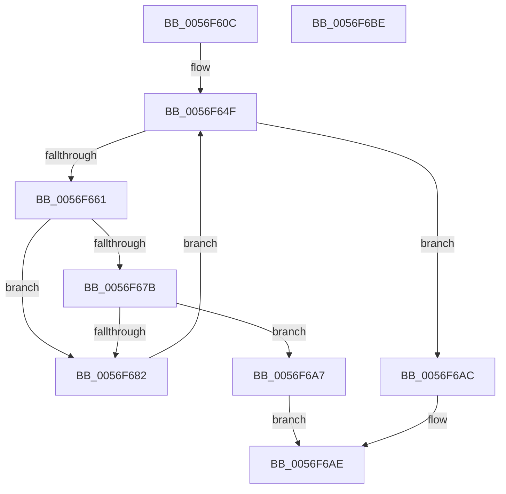

# IvtEnsureNoPendingFaults

- RVA: `0x0056F60C`–`0x0056F6BF` (길이 `179` bytes)
- VA: `0x000000014056F60C`
- 실행 섹션: `.text`
- PDB 이름 있음: `예`; PDB Function 태그: `아니요`
- unwind 정보 RVA: `0x00069588`
- 디코드: `49`개 명령, `179/179` bytes 표시
- 미해석 바이트: `0` (있으면 어셈블리에 `.byte`로 보존)

> 이 문서는 커널 이미지의 기계어와 PDB 기호를 분석해 생성했습니다. 4번과 5번은 함수 원형과 자료형을 바이너리 사용 방식에서 추정한 C 해석이며 원본 소스 복구 결과는 아닙니다.

## 1. Dependencies

- 직접 호출 지점: **0**; 고유 호출 대상: **0**
- 직접 호출자로 확인된 함수: **2**
- RIP 상대 이미지 참조: **0**

### Outgoing calls
- 직접 디코드된 call 명령이 없습니다.

### Direct callers
- [IvtLegacySetPasidAddressSpace](../57/IvtLegacySetPasidAddressSpace_function_00571FD0.md) at `0x00572096`
- [IvtSetPasidAddressSpace](../57/IvtSetPasidAddressSpace_function_00572630.md) at `0x00572722`

### Static image references
- 디코드된 RIP-relative 메모리 참조가 없습니다.

## 2. Other-region calls and transfers

- 다른 실행 섹션으로 향하는 call: **0**
- 별도 외부 분기/꼬리 이동을 확인하지 못했습니다.

## 3. Assembly (complete function range)

```asm
0056F60C  48 89 5C 24 08                  mov qword ptr [rsp + 8], rbx
0056F611  48 89 74 24 10                  mov qword ptr [rsp + 0x10], rsi
0056F616  48 89 7C 24 18                  mov qword ptr [rsp + 0x18], rdi
0056F61B  4C 8B 99 A0 00 00 00            mov r11, qword ptr [rcx + 0xa0]
0056F622  BE FF 3F 00 00                  mov esi, 0x3fff
0056F627  48 8B B9 90 00 00 00            mov rdi, qword ptr [rcx + 0x90]
0056F62E  48 8B 49 08                     mov rcx, qword ptr [rcx + 8]
0056F632  90                              nop
0056F633  49 C1 EB 05                     shr r11, 5
0056F637  8B DA                           mov ebx, edx
0056F639  48 8B 81 C0 00 00 00            mov rax, qword ptr [rcx + 0xc0]
0056F640  90                              nop
0056F641  48 8B 89 C8 00 00 00            mov rcx, qword ptr [rcx + 0xc8]
0056F648  48 C1 E9 05                     shr rcx, 5
0056F64C  48 23 CE                        and rcx, rsi
0056F64F  4C 8B D0                        mov r10, rax
0056F652  49 C1 EA 05                     shr r10, 5
0056F656  4D 8B CA                        mov r9, r10
0056F659  4C 23 CE                        and r9, rsi
0056F65C  4C 3B C9                        cmp r9, rcx
0056F65F  74 4B                           je 0x14056f6ac
0056F661  49 C1 E1 05                     shl r9, 5
0056F665  4C 03 CF                        add r9, rdi
0056F668  4D 8B 01                        mov r8, qword ptr [r9]
0056F66B  49 C1 E8 20                     shr r8, 0x20
0056F66F  41 81 E0 FF FF 0F 00            and r8d, 0xfffff
0056F676  4C 3B C3                        cmp r8, rbx
0056F679  75 07                           jne 0x14056f682
0056F67B  41 F6 41 08 03                  test byte ptr [r9 + 8], 3
0056F680  75 25                           jne 0x14056f6a7
0056F682  44 23 D6                        and r10d, esi
0056F685  33 D2                           xor edx, edx
0056F687  45 8D 42 01                     lea r8d, [r10 + 1]
0056F68B  45 3B C3                        cmp r8d, r11d
0056F68E  41 0F 45 D0                     cmovne edx, r8d
0056F692  44 8B C2                        mov r8d, edx
0056F695  49 C1 E0 05                     shl r8, 5
0056F699  49 33 C0                        xor rax, r8
0056F69C  48 25 1F 00 F8 FF               and rax, 0xfffffffffff8001f
0056F6A2  49 33 C0                        xor rax, r8
0056F6A5  EB A8                           jmp 0x14056f64f
0056F6A7  49 8B C1                        mov rax, r9
0056F6AA  EB 02                           jmp 0x14056f6ae
0056F6AC  33 C0                           xor eax, eax
0056F6AE  48 8B 5C 24 08                  mov rbx, qword ptr [rsp + 8]
0056F6B3  48 8B 74 24 10                  mov rsi, qword ptr [rsp + 0x10]
0056F6B8  48 8B 7C 24 18                  mov rdi, qword ptr [rsp + 0x18]
0056F6BD  C3                              ret
0056F6BE  CC                              int3
```

## 4. C-style interpretation (structured pseudocode)

```c
__int64 __fastcall IvtEnsureNoPendingFaults(__int64 a1, int a2)
{
    __int64 result;
    __int64 v_r10;
    __int64 v_r11;
    unsigned __int64 v_stack_p10;
    unsigned __int64 v_stack_p18;
    unsigned __int64 v_stack_p8;

    v_stack_p8 = v_rbx;
    v_stack_p10 = v_rsi;
    v_stack_p18 = v_rdi;
    v_r11 = (*(unsigned __int64 *)(a1 + 160)) >> (5);
    a1 = (*(unsigned __int64 *)(*(unsigned __int64 *)(a1 + 8) + 200)) >> (5);
    a1 = (a1) & ((unsigned int)(0x3FFFULL));
loc_0056F64F:
    v_r10 = (*(unsigned __int64 *)(*(unsigned __int64 *)(a1 + 8) + 192)) >> (5);
    a4 = (v_r10) & ((unsigned int)(0x3FFFULL));
    if (a4 == a1) goto loc_0056F6AC;
    a4 = (a4) << (5);
    a4 = (a4) + (*(unsigned __int64 *)(a1 + 144));
    a3 = (*(unsigned __int64 *)(a4)) >> (32);
    a3 = (unsigned int)((a3) & (0xFFFFFULL));
    if (a3 != ((unsigned int)(a2))) goto loc_0056F682;
    if (((*(unsigned __int8 *)(a4 + 8)) & (3)) != 0) goto loc_0056F6A7;
loc_0056F682:
    v_r10 = (unsigned int)((v_r10) & ((unsigned int)((unsigned int)(0x3FFFULL))));
    a2 = 0;
    if (((unsigned int)(v_r10 + 1)) != ((unsigned int)(v_r11))) { a2 = (unsigned int)(v_r10 + 1); }
    a3 = ((unsigned int)(a2)) << (5);
    result = (*(unsigned __int64 *)(*(unsigned __int64 *)(a1 + 8) + 192)) ^ (a3);
    result = (result) & (0xFFFFFFFFFFF8001FULL);
    result = (result) ^ (a3);
    goto loc_0056F64F;
loc_0056F6A7:
    goto loc_0056F6AE;
loc_0056F6AC:
    result = 0;
loc_0056F6AE:
    return result;
}
```

## 5. (Beta) C Style

```c
int64_t IvtEnsureNoPendingFaults(void *Arg1, int32_t Arg2)
{
    uint8_t *arg1 = (uint8_t *)Arg1;

    int64_t result;
    int64_t local_r10;
    int64_t local_r11;
    uint64_t v_stack_p10;
    uint64_t v_stack_p18;
    uint64_t v_stack_p8;

    v_stack_p8 = local_rbx;
    v_stack_p10 = local_rsi;
    v_stack_p18 = local_rdi;
    local_r11 = (*(uint64_t *)(arg1 + 0xA0)) >> (5);
    Arg1 = (*(uint64_t *)(*(uint64_t *)(arg1 + 0x8) + 0xC8)) >> (5);
    Arg1 = (Arg1) & ((uint32_t)(0x3FFFULL));
loc_0056F64F:
    local_r10 = (*(uint64_t *)(*(uint64_t *)(arg1 + 0x8) + 0xC0)) >> (5);
    a4 = (local_r10) & ((uint32_t)(0x3FFFULL));
    if (a4 == Arg1) goto loc_0056F6AC;
    a4 = (a4) << (5);
    a4 = (a4) + (*(uint64_t *)(arg1 + 0x90));
    a3 = (*(uint64_t *)(a4)) >> (32);
    a3 = (uint32_t)((a3) & (0xFFFFFULL));
    if (a3 != ((uint32_t)(Arg2))) goto loc_0056F682;
    if (((*(uint8_t *)(a4 + 0x8)) & (3)) != 0) goto loc_0056F6A7;
loc_0056F682:
    local_r10 = (uint32_t)((local_r10) & ((uint32_t)((uint32_t)(0x3FFFULL))));
    Arg2 = 0;
    if (((uint32_t)(local_r10 + 1)) != ((uint32_t)(local_r11))) { Arg2 = (uint32_t)(local_r10 + 1); }
    a3 = ((uint32_t)(Arg2)) << (5);
    result = (*(uint64_t *)(*(uint64_t *)(arg1 + 0x8) + 0xC0)) ^ (a3);
    result = (result) & (0xFFFFFFFFFFF8001FULL);
    result = (result) ^ (a3);
    goto loc_0056F64F;
loc_0056F6A7:
    goto loc_0056F6AE;
loc_0056F6AC:
    result = 0;
loc_0056F6AE:
    return result;
}
```

### 관측된 메모리 오프셋

구조체 형식이 확인되지 않은 접근은 인자 기준의 오프셋으로만 기록했습니다.

| 기준 인자 | 오프셋 표현 | 폭 (bit) | 접근 |
|---|---:|---:|---|
| `Arg1` | `+ 0x8` | `64` | `R` |
| `Arg1` | `+ 0x90` | `64` | `R` |
| `Arg1` | `+ 0xA0` | `64` | `R` |

## 6. Execution-region graph

[열기: 2D/3D 그래프와 함수 탐색 컨트롤 패널](../../../control-panel.html?section=text&rva=0x0056F60C&view=graph)

- 2D 그래프는 위에서 아래로 흐르고, 3D 그래프는 빈 공간을 드래그해 회전합니다. Shift+드래그는 이동, 휠은 확대·축소, 함수 노드 선택은 대상 보고서 이동입니다.

### Static fallback


