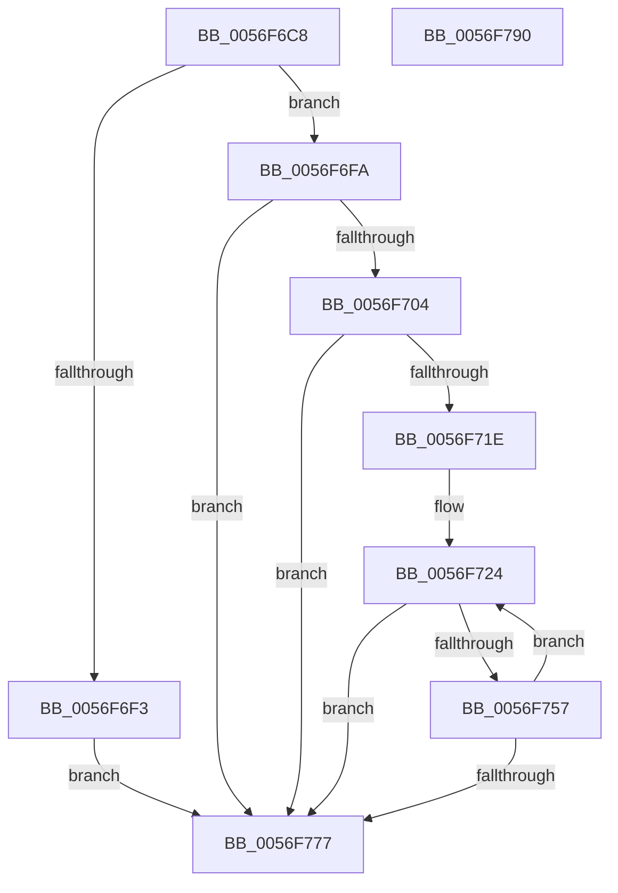

# IvtExtendScalableModePasidTables

- RVA: `0x0056F6C8`–`0x0056F791` (길이 `201` bytes)
- VA: `0x000000014056F6C8`
- 실행 섹션: `.text`
- PDB 이름 있음: `예`; PDB Function 태그: `아니요`
- unwind 정보 RVA: `0x000C517C`
- 디코드: `64`개 명령, `201/201` bytes 표시
- 미해석 바이트: `0` (있으면 어셈블리에 `.byte`로 보존)

> 이 문서는 커널 이미지의 기계어와 PDB 기호를 분석해 생성했습니다. 4번과 5번은 함수 원형과 자료형을 바이너리 사용 방식에서 추정한 C 해석이며 원본 소스 복구 결과는 아닙니다.

## 1. Dependencies

- 직접 호출 지점: **2**; 고유 호출 대상: **2**
- 직접 호출자로 확인된 함수: **2**
- RIP 상대 이미지 참조: **0**

### Outgoing calls
- `0x0056F74C` → [ExtEnvAllocatePhysicalMemory](ExtEnvAllocatePhysicalMemory_function_00561124.md) (function, `0x00561124`)
- `0x0056F768` → [IvtInitializeScalableModePasidTables](../57/IvtInitializeScalableModePasidTables_function_00570728.md) (function, `0x00570728`)

### Direct callers
- [IvtAllocateScalableModePasidTables](IvtAllocateScalableModePasidTables_function_0056E8DC.md) at `0x0056EA89`
- [IvtGrowPasidTable](IvtGrowPasidTable_function_0056FDD0.md) at `0x0056FE43`

### Static image references
- 디코드된 RIP-relative 메모리 참조가 없습니다.

## 2. Other-region calls and transfers

- 다른 실행 섹션으로 향하는 call: **0**
- 별도 외부 분기/꼬리 이동을 확인하지 못했습니다.

## 3. Assembly (complete function range)

```asm
0056F6C8  48 89 5C 24 08                  mov qword ptr [rsp + 8], rbx
0056F6CD  48 89 6C 24 18                  mov qword ptr [rsp + 0x18], rbp
0056F6D2  56                              push rsi
0056F6D3  57                              push rdi
0056F6D4  41 54                           push r12
0056F6D6  41 56                           push r14
0056F6D8  41 57                           push r15
0056F6DA  48 83 EC 30                     sub rsp, 0x30
0056F6DE  48 83 64 24 68 00               and qword ptr [rsp + 0x68], 0
0056F6E4  45 8B E1                        mov r12d, r9d
0056F6E7  48 8B F2                        mov rsi, rdx
0056F6EA  4C 8B F9                        mov r15, rcx
0056F6ED  44 3B 42 24                     cmp r8d, dword ptr [rdx + 0x24]
0056F6F1  72 07                           jb 0x14056f6fa
0056F6F3  BF 01 00 00 C0                  mov edi, 0xc0000001
0056F6F8  EB 7D                           jmp 0x14056f777
0056F6FA  8B 5A 20                        mov ebx, dword ptr [rdx + 0x20]
0056F6FD  33 FF                           xor edi, edi
0056F6FF  41 3B D8                        cmp ebx, r8d
0056F702  77 73                           ja 0x14056f777
0056F704  B8 FF 3F 00 00                  mov eax, 0x3fff
0056F709  C1 EB 06                        shr ebx, 6
0056F70C  45 8D 70 40                     lea r14d, [r8 + 0x40]
0056F710  23 D8                           and ebx, eax
0056F712  41 C1 EE 06                     shr r14d, 6
0056F716  44 23 F0                        and r14d, eax
0056F719  41 3B DE                        cmp ebx, r14d
0056F71C  73 59                           jae 0x14056f777
0056F71E  8D 6B 01                        lea ebp, [rbx + 1]
0056F721  C1 E5 06                        shl ebp, 6
0056F724  45 8B 8F 10 01 00 00            mov r9d, dword ptr [r15 + 0x110]
0056F72B  BA 00 10 00 00                  mov edx, 0x1000
0056F730  8B C3                           mov eax, ebx
0056F732  44 8B C2                        mov r8d, edx
0056F735  48 83 C0 08                     add rax, 8
0056F739  48 8D 0C C6                     lea rcx, [rsi + rax*8]
0056F73D  48 8D 44 24 68                  lea rax, [rsp + 0x68]
0056F742  48 89 4C 24 28                  mov qword ptr [rsp + 0x28], rcx
0056F747  48 89 44 24 20                  mov qword ptr [rsp + 0x20], rax
0056F74C  E8 D3 19 FF FF                  call 0x140561124
0056F751  8B F8                           mov edi, eax
0056F753  85 C0                           test eax, eax
0056F755  78 20                           js 0x14056f777
0056F757  44 8B C3                        mov r8d, ebx
0056F75A  89 6E 20                        mov dword ptr [rsi + 0x20], ebp
0056F75D  48 8B D6                        mov rdx, rsi
0056F760  44 89 64 24 20                  mov dword ptr [rsp + 0x20], r12d
0056F765  49 8B CF                        mov rcx, r15
0056F768  E8 BB 0F 00 00                  call 0x140570728
0056F76D  FF C3                           inc ebx
0056F76F  83 C5 40                        add ebp, 0x40
0056F772  41 3B DE                        cmp ebx, r14d
0056F775  72 AD                           jb 0x14056f724
0056F777  48 8B 5C 24 60                  mov rbx, qword ptr [rsp + 0x60]
0056F77C  8B C7                           mov eax, edi
0056F77E  48 8B 6C 24 70                  mov rbp, qword ptr [rsp + 0x70]
0056F783  48 83 C4 30                     add rsp, 0x30
0056F787  41 5F                           pop r15
0056F789  41 5E                           pop r14
0056F78B  41 5C                           pop r12
0056F78D  5F                              pop rdi
0056F78E  5E                              pop rsi
0056F78F  C3                              ret
0056F790  CC                              int3
```

## 4. C-style interpretation (structured pseudocode)

```c
__int64 __fastcall IvtExtendScalableModePasidTables(__int64 a1, __int64 a2, __int64 a3, int a4)
{
    __int64 result;
    __int64 v_r14;
    __int64 v_rbp;
    __int64 v_rbx;
    __int64 v_rdi;
    __int64 v_rsp;
    unsigned __int64 v_stack_m30;
    unsigned __int64 v_stack_m38;
    unsigned __int64 v_stack_p10;
    unsigned __int64 v_stack_p18;
    unsigned __int64 v_stack_p8;

    v_stack_p8 = v_rbx;
    v_stack_p18 = v_rbp;
    v_rsp = (v_rsp) - (48);
    if (((unsigned int)(a3)) < (*(unsigned int *)(a2 + 36))) goto loc_0056F6FA;
    goto loc_0056F777;
loc_0056F6FA:
    v_rdi = 0;
    if (((unsigned int)((unsigned int)(*(unsigned int *)(a2 + 32)))) > ((unsigned int)(a3))) goto loc_0056F777;
    v_rbx = (unsigned int)(((unsigned int)(*(unsigned int *)(a2 + 32))) >> (6));
    v_rbx = (unsigned int)((v_rbx) & ((unsigned int)((unsigned int)(0x3FFFULL))));
    v_r14 = (unsigned int)((a3 + 64) >> (6));
    v_r14 = (unsigned int)((v_r14) & ((unsigned int)((unsigned int)(0x3FFFULL))));
    if (((unsigned int)(v_rbx)) >= ((unsigned int)(v_r14))) goto loc_0056F777;
    v_rbp = (unsigned int)((v_rbx + 1) << (6));
loc_0056F724:
    result = ((unsigned int)((unsigned int)(v_rbx))) + (8);
    v_stack_m30 = a2 + result * 8;
    v_stack_m38 = v_stack_p10;
    result = ExtEnvAllocatePhysicalMemory(a2 + result * 8, (unsigned int)(0x1000ULL), (unsigned int)((unsigned int)((unsigned int)(0x1000ULL))), (unsigned int)(*(unsigned int *)(a1 + 272)));
    if (sign_flag) goto loc_0056F777;
    *(unsigned int *)(a2 + 32) = (unsigned int)(v_rbp);
    v_stack_m38 = (unsigned int)((unsigned int)(a4));
    result = IvtInitializeScalableModePasidTables(a1, a2, (unsigned int)((unsigned int)(v_rbx)), (unsigned int)(*(unsigned int *)(a1 + 272)));
    v_rbx = (unsigned int)((v_rbx) + 1);
    v_rbp = (unsigned int)((v_rbp) + (64));
    if (((unsigned int)(v_rbx)) < ((unsigned int)(v_r14))) goto loc_0056F724;
loc_0056F777:
    v_rsp = (v_rsp) + (48);
    return (unsigned int)((unsigned int)((unsigned int)((unsigned int)(result))));
}
```

## 5. (Beta) C Style

```c
int64_t IvtExtendScalableModePasidTables(void *Arg1, void *Arg2, int64_t Arg3, int32_t Arg4)
{
    uint8_t *arg1 = (uint8_t *)Arg1;
    uint8_t *arg2 = (uint8_t *)Arg2;

    int64_t result;
    int64_t local_r14;
    int64_t local_rbp;
    int64_t local_rbx;
    int64_t local_rdi;
    int64_t local_rsp;
    uint64_t v_stack_m30;
    uint64_t v_stack_m38;
    uint64_t v_stack_p10;
    uint64_t v_stack_p18;
    uint64_t v_stack_p8;

    v_stack_p8 = local_rbx;
    v_stack_p18 = local_rbp;
    local_rsp = (local_rsp) - (48);
    if (((uint32_t)(Arg3)) < (*(uint32_t *)(arg2 + 0x24))) goto loc_0056F6FA;
    goto loc_0056F777;
loc_0056F6FA:
    local_rdi = 0;
    if (((uint32_t)((uint32_t)(*(uint32_t *)(arg2 + 0x20)))) > ((uint32_t)(Arg3))) goto loc_0056F777;
    local_rbx = (uint32_t)(((uint32_t)(*(uint32_t *)(arg2 + 0x20))) >> (6));
    local_rbx = (uint32_t)((local_rbx) & ((uint32_t)((uint32_t)(0x3FFFULL))));
    local_r14 = (uint32_t)((Arg3 + 64) >> (6));
    local_r14 = (uint32_t)((local_r14) & ((uint32_t)((uint32_t)(0x3FFFULL))));
    if (((uint32_t)(local_rbx)) >= ((uint32_t)(local_r14))) goto loc_0056F777;
    local_rbp = (uint32_t)((local_rbx + 1) << (6));
loc_0056F724:
    result = ((uint32_t)((uint32_t)(local_rbx))) + (8);
    v_stack_m30 = Arg2 + result * 8;
    v_stack_m38 = v_stack_p10;
    result = ExtEnvAllocatePhysicalMemory(Arg2 + result * 8, (uint32_t)(0x1000ULL), (uint32_t)((uint32_t)((uint32_t)(0x1000ULL))), (uint32_t)(*(uint32_t *)(arg1 + 0x110)));
    if (sign_flag) goto loc_0056F777;
    *(uint32_t *)(arg2 + 0x20) = (uint32_t)(local_rbp);
    v_stack_m38 = (uint32_t)((uint32_t)(Arg4));
    result = IvtInitializeScalableModePasidTables(Arg1, Arg2, (uint32_t)((uint32_t)(local_rbx)), (uint32_t)(*(uint32_t *)(arg1 + 0x110)));
    local_rbx = (uint32_t)((local_rbx) + 1);
    local_rbp = (uint32_t)((local_rbp) + (64));
    if (((uint32_t)(local_rbx)) < ((uint32_t)(local_r14))) goto loc_0056F724;
loc_0056F777:
    local_rsp = (local_rsp) + (48);
    return (uint32_t)((uint32_t)((uint32_t)((uint32_t)(result))));
}
```

### 관측된 메모리 오프셋

구조체 형식이 확인되지 않은 접근은 인자 기준의 오프셋으로만 기록했습니다.

| 기준 인자 | 오프셋 표현 | 폭 (bit) | 접근 |
|---|---:|---:|---|
| `Arg1` | `+ 0x110` | `32` | `R` |
| `Arg2` | `+ 0x0 + rax*8` | `64` | `R` |
| `Arg2` | `+ 0x20` | `32` | `R` |
| `Arg2` | `+ 0x20` | `32` | `W` |
| `Arg2` | `+ 0x24` | `32` | `R` |

## 6. Execution-region graph

[열기: 2D/3D 그래프와 함수 탐색 컨트롤 패널](../../../control-panel.html?section=text&rva=0x0056F6C8&view=graph)

- 2D 그래프는 위에서 아래로 흐르고, 3D 그래프는 빈 공간을 드래그해 회전합니다. Shift+드래그는 이동, 휠은 확대·축소, 함수 노드 선택은 대상 보고서 이동입니다.

### Static fallback


