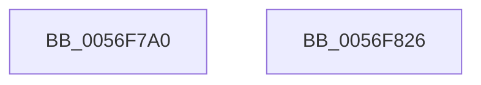

# IvtFlushDeviceTbOnly

- RVA: `0x0056F7A0`–`0x0056F827` (길이 `135` bytes)
- VA: `0x000000014056F7A0`
- 실행 섹션: `.text`
- PDB 이름 있음: `예`; PDB Function 태그: `아니요`
- unwind 정보 RVA: `0x000AB2E4`
- 디코드: `36`개 명령, `135/135` bytes 표시
- 미해석 바이트: `0` (있으면 어셈블리에 `.byte`로 보존)

> 이 문서는 커널 이미지의 기계어와 PDB 기호를 분석해 생성했습니다. 4번과 5번은 함수 원형과 자료형을 바이너리 사용 방식에서 추정한 C 해석이며 원본 소스 복구 결과는 아닙니다.

## 1. Dependencies

- 직접 호출 지점: **3**; 고유 호출 대상: **3**
- 직접 호출자로 확인된 함수: **0**
- RIP 상대 이미지 참조: **1**

### Outgoing calls
- `0x0056F801` → [IvtIommuSendCommand](../46/IvtIommuSendCommand_function_0046A6E4.md) (function, `0x0046A6E4`)
- `0x0056F80E` → [IvtIommuWaitCommand](../46/IvtIommuWaitCommand_function_0046A594.md) (function, `0x0046A594`)
- `0x0056F81B` → [_security_check_cookie](../6A/_security_check_cookie_function_006AC640.md) (function, `0x006AC640`)

### Direct callers
- 이 함수 시작 RVA로 연결되는 직접 call은 확인되지 않았습니다. 간접 호출은 완전히 역산할 수 없습니다.

### Static image references
- `0x0056F7A6` → RVA `0x00E0A740` (`.data`; read)

## 2. Other-region calls and transfers

- 다른 실행 섹션으로 향하는 call: **0**
- 별도 외부 분기/꼬리 이동을 확인하지 못했습니다.

## 3. Assembly (complete function range)

```asm
0056F7A0  40 53                           push rbx
0056F7A2  48 83 EC 40                     sub rsp, 0x40
0056F7A6  48 8B 05 93 AF 89 00            mov rax, qword ptr [rip + 0x89af93]
0056F7AD  48 33 C4                        xor rax, rsp
0056F7B0  48 89 44 24 30                  mov qword ptr [rsp + 0x30], rax
0056F7B5  48 8B 41 08                     mov rax, qword ptr [rcx + 8]
0056F7B9  45 33 C9                        xor r9d, r9d
0056F7BC  0F B7 D2                        movzx edx, dx
0056F7BF  90                              nop
0056F7C0  48 C1 E2 10                     shl rdx, 0x10
0056F7C4  41 81 E1 FE 0F 00 00            and r9d, 0xffe
0056F7CB  48 8B D9                        mov rbx, rcx
0056F7CE  8B 40 1C                        mov eax, dword ptr [rax + 0x1c]
0056F7D1  41 8B C0                        mov eax, r8d
0056F7D4  45 33 C0                        xor r8d, r8d
0056F7D7  83 E0 1F                        and eax, 0x1f
0056F7DA  48 0B D0                        or rdx, rax
0056F7DD  48 B8 01 F0 FF FF FF FF FF 7F   movabs rax, 0x7ffffffffffff001
0056F7E7  48 C1 E2 10                     shl rdx, 0x10
0056F7EB  4C 0B C8                        or r9, rax
0056F7EE  48 83 CA 03                     or rdx, 3
0056F7F2  4C 89 4C 24 28                  mov qword ptr [rsp + 0x28], r9
0056F7F7  48 89 54 24 20                  mov qword ptr [rsp + 0x20], rdx
0056F7FC  48 8D 54 24 20                  lea rdx, [rsp + 0x20]
0056F801  E8 DE AE EF FF                  call 0x14046a6e4
0056F806  45 33 C0                        xor r8d, r8d
0056F809  33 D2                           xor edx, edx
0056F80B  48 8B CB                        mov rcx, rbx
0056F80E  E8 81 AD EF FF                  call 0x14046a594
0056F813  48 8B 4C 24 30                  mov rcx, qword ptr [rsp + 0x30]
0056F818  48 33 CC                        xor rcx, rsp
0056F81B  E8 20 CE 13 00                  call 0x1406ac640
0056F820  48 83 C4 40                     add rsp, 0x40
0056F824  5B                              pop rbx
0056F825  C3                              ret
0056F826  CC                              int3
```

## 4. C-style interpretation (structured pseudocode)

```c
__int64 __fastcall IvtFlushDeviceTbOnly(__int64 a1, unsigned __int16 a2, int a3, int a4)
{
    __int64 result;
    __int64 v_rsp;
    unsigned __int64 v_stack_m18;
    unsigned __int64 v_stack_m20;
    unsigned __int64 v_stack_m28;

    v_rsp = (v_rsp) - (64);
    result = (*(unsigned __int64 *)(v_rip + 9023379)) ^ (v_rsp);
    v_stack_m18 = result;
    a4 = 0;
    a2 = (a2) << (16);
    a4 = (unsigned int)((a4) & (0xFFEULL));
    a3 = 0;
    result = (unsigned int)(((unsigned int)(a3)) & (31));
    a2 = (a2) | (result);
    a2 = (a2) << (16);
    a4 = (a4) | (result);
    a2 = (a2) | (3);
    v_stack_m20 = a4;
    v_stack_m28 = a2;
    result = IvtIommuSendCommand(a1, v_stack_m28, a3, a4);
    a3 = 0;
    a2 = 0;
    result = IvtIommuWaitCommand(a1, a2, a3, a4);
    a1 = (v_stack_m18) ^ (v_rsp);
    result = _security_check_cookie(a1, a2, a3, a4);
    v_rsp = (v_rsp) + (64);
    return result;
}
```

## 5. (Beta) C Style

```c
int64_t IvtFlushDeviceTbOnly(void *Arg1, uint16_t Arg2, int32_t Arg3, int32_t Arg4)
{
    uint8_t *arg1 = (uint8_t *)Arg1;

    int64_t result;
    int64_t local_rsp;
    uint64_t v_stack_m18;
    uint64_t v_stack_m20;
    uint64_t v_stack_m28;

    local_rsp = (local_rsp) - (64);
    result = (*(uint64_t *)(v_rip + 0x89AF93)) ^ (local_rsp);
    v_stack_m18 = result;
    Arg4 = 0;
    Arg2 = (Arg2) << (16);
    Arg4 = (uint32_t)((Arg4) & (0xFFEULL));
    Arg3 = 0;
    result = (uint32_t)(((uint32_t)(Arg3)) & (31));
    Arg2 = (Arg2) | (result);
    Arg2 = (Arg2) << (16);
    Arg4 = (Arg4) | (result);
    Arg2 = (Arg2) | (3);
    v_stack_m20 = Arg4;
    v_stack_m28 = Arg2;
    result = IvtIommuSendCommand(Arg1, v_stack_m28, Arg3, Arg4);
    Arg3 = 0;
    Arg2 = 0;
    result = IvtIommuWaitCommand(Arg1, Arg2, Arg3, Arg4);
    Arg1 = (v_stack_m18) ^ (local_rsp);
    result = _security_check_cookie(Arg1, Arg2, Arg3, Arg4);
    local_rsp = (local_rsp) + (64);
    return result;
}
```

### 관측된 메모리 오프셋

구조체 형식이 확인되지 않은 접근은 인자 기준의 오프셋으로만 기록했습니다.

| 기준 인자 | 오프셋 표현 | 폭 (bit) | 접근 |
|---|---:|---:|---|
| `Arg1` | `+ 0x8` | `64` | `R` |

## 6. Execution-region graph

[열기: 2D/3D 그래프와 함수 탐색 컨트롤 패널](../../../control-panel.html?section=text&rva=0x0056F7A0&view=graph)

- 2D 그래프는 위에서 아래로 흐르고, 3D 그래프는 빈 공간을 드래그해 회전합니다. Shift+드래그는 이동, 휠은 확대·축소, 함수 노드 선택은 대상 보고서 이동입니다.

### Static fallback


