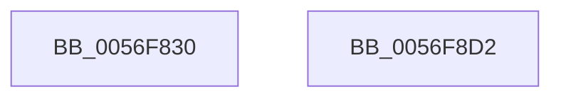

# IvtFlushTb

- RVA: `0x0056F830`–`0x0056F8D3` (길이 `163` bytes)
- VA: `0x000000014056F830`
- 실행 섹션: `.text`
- PDB 이름 있음: `예`; PDB Function 태그: `아니요`
- unwind 정보 RVA: `0x000C5278`
- 디코드: `40`개 명령, `163/163` bytes 표시
- 미해석 바이트: `0` (있으면 어셈블리에 `.byte`로 보존)

> 이 문서는 커널 이미지의 기계어와 PDB 기호를 분석해 생성했습니다. 4번과 5번은 함수 원형과 자료형을 바이너리 사용 방식에서 추정한 C 해석이며 원본 소스 복구 결과는 아닙니다.

## 1. Dependencies

- 직접 호출 지점: **2**; 고유 호출 대상: **2**
- 직접 호출자로 확인된 함수: **0**
- RIP 상대 이미지 참조: **0**

### Outgoing calls
- `0x0056F85C` → [memset](../6C/memset_function_006C6C40.md) (function, `0x006C6C40`)
- `0x0056F8B4` → [IvtFlushTbInternal](../2D/IvtFlushTbInternal_function_002D2548.md) (function, `0x002D2548`)

### Direct callers
- 이 함수 시작 RVA로 연결되는 직접 call은 확인되지 않았습니다. 간접 호출은 완전히 역산할 수 없습니다.

### Static image references
- 디코드된 RIP-relative 메모리 참조가 없습니다.

## 2. Other-region calls and transfers

- 다른 실행 섹션으로 향하는 call: **0**
- 별도 외부 분기/꼬리 이동을 확인하지 못했습니다.

## 3. Assembly (complete function range)

```asm
0056F830  48 8B C4                        mov rax, rsp
0056F833  48 89 58 08                     mov qword ptr [rax + 8], rbx
0056F837  48 89 68 10                     mov qword ptr [rax + 0x10], rbp
0056F83B  48 89 70 18                     mov qword ptr [rax + 0x18], rsi
0056F83F  57                              push rdi
0056F840  48 81 EC C0 00 00 00            sub rsp, 0xc0
0056F847  8B F2                           mov esi, edx
0056F849  49 8B D8                        mov rbx, r8
0056F84C  33 D2                           xor edx, edx
0056F84E  48 8B E9                        mov rbp, rcx
0056F851  48 8D 48 88                     lea rcx, [rax - 0x78]
0056F855  49 8B F9                        mov rdi, r9
0056F858  44 8D 42 70                     lea r8d, [rdx + 0x70]
0056F85C  E8 DF 73 15 00                  call 0x1406c6c40
0056F861  48 8B 45 08                     mov rax, qword ptr [rbp + 8]
0056F865  4C 8D 4C 24 50                  lea r9, [rsp + 0x50]
0056F86A  C7 44 24 54 02 00 00 00         mov dword ptr [rsp + 0x54], 2
0056F872  44 8B C6                        mov r8d, esi
0056F875  89 9C 24 80 00 00 00            mov dword ptr [rsp + 0x80], ebx
0056F87C  33 D2                           xor edx, edx
0056F87E  90                              nop
0056F87F  48 8B CD                        mov rcx, rbp
0056F882  8B 40 1C                        mov eax, dword ptr [rax + 0x1c]
0056F885  48 8B 84 24 00 01 00 00         mov rax, qword ptr [rsp + 0x100]
0056F88D  48 89 44 24 40                  mov qword ptr [rsp + 0x40], rax
0056F892  8B 84 24 F8 00 00 00            mov eax, dword ptr [rsp + 0xf8]
0056F899  89 44 24 38                     mov dword ptr [rsp + 0x38], eax
0056F89D  48 8B 84 24 F0 00 00 00         mov rax, qword ptr [rsp + 0xf0]
0056F8A5  48 89 44 24 30                  mov qword ptr [rsp + 0x30], rax
0056F8AA  48 89 7C 24 28                  mov qword ptr [rsp + 0x28], rdi
0056F8AF  C6 44 24 20 00                  mov byte ptr [rsp + 0x20], 0
0056F8B4  E8 8F 2C D6 FF                  call 0x1402d2548
0056F8B9  4C 8D 9C 24 C0 00 00 00         lea r11, [rsp + 0xc0]
0056F8C1  49 8B 5B 10                     mov rbx, qword ptr [r11 + 0x10]
0056F8C5  49 8B 6B 18                     mov rbp, qword ptr [r11 + 0x18]
0056F8C9  49 8B 73 20                     mov rsi, qword ptr [r11 + 0x20]
0056F8CD  49 8B E3                        mov rsp, r11
0056F8D0  5F                              pop rdi
0056F8D1  C3                              ret
0056F8D2  CC                              int3
```

## 4. C-style interpretation (structured pseudocode)

```c
__int64 __fastcall IvtFlushTb(__int64 a1, int a2, __int64 a3, __int64 a4, __int64 a5, unsigned int a6, __int64 a7)
{
    __int64 result;
    __int64 v_rsp;
    unsigned int v_stack_m48;
    unsigned int v_stack_m74;
    unsigned __int64 v_stack_m78;
    unsigned __int64 v_stack_m8;
    unsigned __int64 v_stack_m88;
    unsigned int v_stack_m90;
    unsigned __int64 v_stack_m98;
    unsigned __int64 v_stack_mA0;
    unsigned __int8 v_stack_mA8;

    *(unsigned __int64 *)(v_rsp + 8) = v_rbx;
    *(unsigned __int64 *)(v_rsp + 16) = v_rbp;
    *(unsigned __int64 *)(v_rsp + 24) = v_rsi;
    v_rsp = (v_rsp) - (192);
    a2 = 0;
    result = memset(v_rsp - 120, a2, a2 + 112, a4);
    v_stack_m74 = 2;
    v_stack_m48 = (unsigned int)(a3);
    a2 = 0;
    v_stack_m88 = a7;
    v_stack_m90 = (unsigned int)((unsigned int)(a6));
    v_stack_m98 = a5;
    v_stack_mA0 = a4;
    v_stack_mA8 = 0;
    result = IvtFlushTbInternal(a1, a2, (unsigned int)((unsigned int)((unsigned int)(a2))), v_stack_m78);
    return result;
}
```

## 5. (Beta) C Style

```c
int64_t IvtFlushTb(void *Arg1, int32_t Arg2, int64_t Arg3, int64_t Arg4, int64_t Arg5, uint32_t Arg6, int64_t Arg7)
{
    uint8_t *arg1 = (uint8_t *)Arg1;

    int64_t result;
    int64_t local_rsp;
    uint32_t v_stack_m48;
    uint32_t v_stack_m74;
    uint64_t v_stack_m78;
    uint64_t v_stack_m8;
    uint64_t v_stack_m88;
    uint32_t v_stack_m90;
    uint64_t v_stack_m98;
    uint64_t v_stack_mA0;
    uint8_t v_stack_mA8;

    *(uint64_t *)(local_rsp + 0x8) = local_rbx;
    *(uint64_t *)(local_rsp + 0x10) = local_rbp;
    *(uint64_t *)(local_rsp + 0x18) = local_rsi;
    local_rsp = (local_rsp) - (192);
    Arg2 = 0;
    result = memset(local_rsp - 120, Arg2, Arg2 + 112, Arg4);
    v_stack_m74 = 2;
    v_stack_m48 = (uint32_t)(Arg3);
    Arg2 = 0;
    v_stack_m88 = Arg7;
    v_stack_m90 = (uint32_t)((uint32_t)(Arg6));
    v_stack_m98 = Arg5;
    v_stack_mA0 = Arg4;
    v_stack_mA8 = 0;
    result = IvtFlushTbInternal(Arg1, Arg2, (uint32_t)((uint32_t)((uint32_t)(Arg2))), v_stack_m78);
    return result;
}
```

### 관측된 메모리 오프셋

구조체 형식이 확인되지 않은 접근은 인자 기준의 오프셋으로만 기록했습니다.

| 기준 인자 | 오프셋 표현 | 폭 (bit) | 접근 |
|---|---:|---:|---|
| `Arg1` | `+ 0x8` | `64` | `R` |

## 6. Execution-region graph

[열기: 2D/3D 그래프와 함수 탐색 컨트롤 패널](../../../control-panel.html?section=text&rva=0x0056F830&view=graph)

- 2D 그래프는 위에서 아래로 흐르고, 3D 그래프는 빈 공간을 드래그해 회전합니다. Shift+드래그는 이동, 휠은 확대·축소, 함수 노드 선택은 대상 보고서 이동입니다.

### Static fallback


