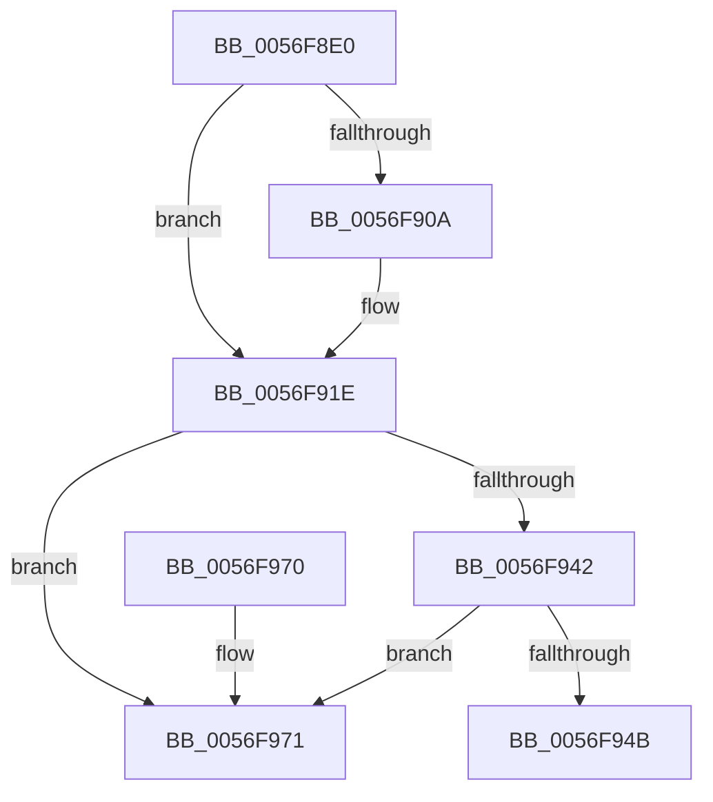

# IvtFreeDomain

- RVA: `0x0056F8E0`–`0x0056F978` (길이 `152` bytes)
- VA: `0x000000014056F8E0`
- 실행 섹션: `.text`
- PDB 이름 있음: `예`; PDB Function 태그: `아니요`
- unwind 정보 RVA: `0x00069D68`
- 디코드: `43`개 명령, `152/152` bytes 표시
- 미해석 바이트: `0` (있으면 어셈블리에 `.byte`로 보존)

> 이 문서는 커널 이미지의 기계어와 PDB 기호를 분석해 생성했습니다. 4번과 5번은 함수 원형과 자료형을 바이너리 사용 방식에서 추정한 C 해석이며 원본 소스 복구 결과는 아닙니다.

## 1. Dependencies

- 직접 호출 지점: **5**; 고유 호출 대상: **5**
- 직접 호출자로 확인된 함수: **0**
- RIP 상대 이미지 참조: **1**

### Outgoing calls
- `0x0056F8F9` → [HalpAcquireHighLevelLock](../2D/HalpAcquireHighLevelLock_function_002D2390.md) (function, `0x002D2390`)
- `0x0056F918` → [ExtEnvCriticalFailure](ExtEnvCriticalFailure_function_00561300.md) (function, `0x00561300`)
- `0x0056F924` → [HalpReleaseHighLevelLock](../2D/HalpReleaseHighLevelLock_function_002D1C58.md) (function, `0x002D1C58`)
- `0x0056F930` → [KeAcquireSpinLockRaiseToDpc](../20/KeAcquireSpinLockRaiseToDpc_function_00208470.md) (function, `0x00208470`)
- `0x0056F95B` → [KeReleaseSpinLock](../39/KeReleaseSpinLock_function_00392BA0.md) (function, `0x00392BA0`)

### Direct callers
- 이 함수 시작 RVA로 연결되는 직접 call은 확인되지 않았습니다. 간접 호출은 완전히 역산할 수 없습니다.

### Static image references
- `0x0056F929` → RVA `0x00F8FC40` (`.data`; read)

## 2. Other-region calls and transfers

- 다른 실행 섹션으로 향하는 call: **0**
- 별도 외부 분기/꼬리 이동을 확인하지 못했습니다.

## 3. Assembly (complete function range)

```asm
0056F8E0  48 89 5C 24 08                  mov qword ptr [rsp + 8], rbx
0056F8E5  48 89 74 24 10                  mov qword ptr [rsp + 0x10], rsi
0056F8EA  57                              push rdi
0056F8EB  48 83 EC 30                     sub rsp, 0x30
0056F8EF  48 8B F9                        mov rdi, rcx
0056F8F2  48 8B DA                        mov rbx, rdx
0056F8F5  48 8D 4A 58                     lea rcx, [rdx + 0x58]
0056F8F9  E8 92 2A D6 FF                  call 0x1402d2390
0056F8FE  4C 8D 43 38                     lea r8, [rbx + 0x38]
0056F902  88 43 60                        mov byte ptr [rbx + 0x60], al
0056F905  4D 39 00                        cmp qword ptr [r8], r8
0056F908  74 14                           je 0x14056f91e
0056F90A  48 83 64 24 20 00               and qword ptr [rsp + 0x20], 0
0056F910  4C 8B CB                        mov r9, rbx
0056F913  4C 8B C7                        mov r8, rdi
0056F916  33 D2                           xor edx, edx
0056F918  E8 E3 19 FF FF                  call 0x140561300
0056F91D  CC                              int3
0056F91E  8A D0                           mov dl, al
0056F920  48 8D 4B 58                     lea rcx, [rbx + 0x58]
0056F924  E8 2F 23 D6 FF                  call 0x1402d1c58
0056F929  48 8D 0D 10 03 A2 00            lea rcx, [rip + 0xa20310]
0056F930  E8 3B 8B C9 FF                  call 0x140208470
0056F935  48 83 C3 48                     add rbx, 0x48
0056F939  4C 8B 03                        mov r8, qword ptr [rbx]
0056F93C  49 39 58 08                     cmp qword ptr [r8 + 8], rbx
0056F940  75 2F                           jne 0x14056f971
0056F942  48 8B 53 08                     mov rdx, qword ptr [rbx + 8]
0056F946  48 39 1A                        cmp qword ptr [rdx], rbx
0056F949  75 26                           jne 0x14056f971
0056F94B  4C 89 02                        mov qword ptr [rdx], r8
0056F94E  48 8D 0D EB 02 A2 00            lea rcx, [rip + 0xa202eb]
0056F955  49 89 50 08                     mov qword ptr [r8 + 8], rdx
0056F959  8A D0                           mov dl, al
0056F95B  E8 40 32 E2 FF                  call 0x140392ba0
0056F960  48 8B 5C 24 40                  mov rbx, qword ptr [rsp + 0x40]
0056F965  48 8B 74 24 48                  mov rsi, qword ptr [rsp + 0x48]
0056F96A  48 83 C4 30                     add rsp, 0x30
0056F96E  5F                              pop rdi
0056F96F  C3                              ret
0056F970  CC                              int3
0056F971  B9 03 00 00 00                  mov ecx, 3
0056F976  CD 29                           int 0x29
```

## 4. C-style interpretation (structured pseudocode)

```c
__int64 __fastcall IvtFreeDomain(__int64 a1, __int64 a2)
{
    __int64 result;
    __int64 v_rbx;
    __int64 v_rsp;
    unsigned __int64 v_stack_m18;
    unsigned __int64 v_stack_p10;
    unsigned __int64 v_stack_p8;

    v_stack_p8 = v_rbx;
    v_stack_p10 = v_rsi;
    v_rsp = (v_rsp) - (48);
    result = HalpAcquireHighLevelLock(a2 + 88, a2, a3, a4);
    *(unsigned __int8 *)(a2 + 96) = (unsigned __int8)(result);
    if ((*(unsigned __int64 *)(a2 + 56)) != (a2 + 56)) {
        a4 = a2;
        a3 = a1;
        a2 = 0;
        result = ExtEnvCriticalFailure(a2 + 88, a2, a3, a4);
    }
    result = HalpReleaseHighLevelLock(a2 + 88, (unsigned __int8)(result), a3, a4);
    result = KeAcquireSpinLockRaiseToDpc(v_rip + 10617616, (unsigned __int8)(result), a3, a4);
    v_rbx = (a2) + (72);
    if ((*(unsigned __int64 *)(*(unsigned __int64 *)(v_rbx) + 8)) != v_rbx) goto loc_0056F971;
    if ((*(unsigned __int64 *)(*(unsigned __int64 *)(v_rbx + 8))) != v_rbx) goto loc_0056F971;
    *(unsigned __int64 *)(*(unsigned __int64 *)(v_rbx + 8)) = *(unsigned __int64 *)(v_rbx);
    *(unsigned __int64 *)(*(unsigned __int64 *)(v_rbx) + 8) = *(unsigned __int64 *)(v_rbx + 8);
    result = KeReleaseSpinLock(v_rip + 10617579, (unsigned __int8)(result), *(unsigned __int64 *)(v_rbx), a4);
    v_rsp = (v_rsp) + (48);
    return result;
loc_0056F971:
    return result;
}
```

## 5. (Beta) C Style

```c
int64_t IvtFreeDomain(int64_t Arg1, void *Arg2)
{
    uint8_t *arg2 = (uint8_t *)Arg2;

    int64_t result;
    int64_t local_rbx;
    int64_t local_rsp;
    uint64_t v_stack_m18;
    uint64_t v_stack_p10;
    uint64_t v_stack_p8;

    v_stack_p8 = local_rbx;
    v_stack_p10 = local_rsi;
    local_rsp = (local_rsp) - (48);
    result = HalpAcquireHighLevelLock(Arg2 + 88, Arg2, a3, a4);
    *(uint8_t *)(arg2 + 0x60) = (uint8_t)(result);
    if ((*(uint64_t *)(arg2 + 0x38)) != (Arg2 + 56)) {
        a4 = Arg2;
        a3 = Arg1;
        Arg2 = 0;
        result = ExtEnvCriticalFailure(Arg2 + 88, Arg2, a3, a4);
    }
    result = HalpReleaseHighLevelLock(Arg2 + 88, (uint8_t)(result), a3, a4);
    result = KeAcquireSpinLockRaiseToDpc(v_rip + 10617616, (uint8_t)(result), a3, a4);
    local_rbx = (Arg2) + (72);
    if ((*(uint64_t *)(*(uint64_t *)(local_rbx) + 0x8)) != local_rbx) goto loc_0056F971;
    if ((*(uint64_t *)(*(uint64_t *)(local_rbx + 0x8))) != local_rbx) goto loc_0056F971;
    *(uint64_t *)(*(uint64_t *)(local_rbx + 0x8)) = *(uint64_t *)(local_rbx);
    *(uint64_t *)(*(uint64_t *)(local_rbx) + 0x8) = *(uint64_t *)(local_rbx + 0x8);
    result = KeReleaseSpinLock(v_rip + 10617579, (uint8_t)(result), *(uint64_t *)(local_rbx), a4);
    local_rsp = (local_rsp) + (48);
    return result;
loc_0056F971:
    return result;
}
```

### 관측된 메모리 오프셋

구조체 형식이 확인되지 않은 접근은 인자 기준의 오프셋으로만 기록했습니다.

| 기준 인자 | 오프셋 표현 | 폭 (bit) | 접근 |
|---|---:|---:|---|
| `Arg2` | `+ 0x0` | `64` | `R` |
| `Arg2` | `+ 0x8` | `64` | `R` |
| `Arg2` | `+ 0x38` | `64` | `R` |
| `Arg2` | `+ 0x58` | `64` | `R` |
| `Arg2` | `+ 0x60` | `8` | `W` |

## 6. Execution-region graph

[열기: 2D/3D 그래프와 함수 탐색 컨트롤 패널](../../../control-panel.html?section=text&rva=0x0056F8E0&view=graph)

- 2D 그래프는 위에서 아래로 흐르고, 3D 그래프는 빈 공간을 드래그해 회전합니다. Shift+드래그는 이동, 휠은 확대·축소, 함수 노드 선택은 대상 보고서 이동입니다.

### Static fallback


