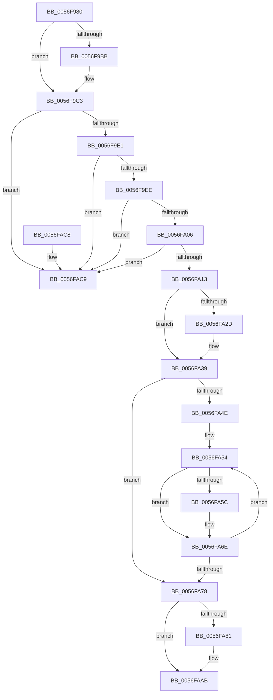

# IvtFreeScalableModePasidTables

- RVA: `0x0056F980`–`0x0056FAD0` (길이 `336` bytes)
- VA: `0x000000014056F980`
- 실행 섹션: `.text`
- PDB 이름 있음: `예`; PDB Function 태그: `아니요`
- unwind 정보 RVA: `0x00073820`
- 디코드: `84`개 명령, `336/336` bytes 표시
- 미해석 바이트: `0` (있으면 어셈블리에 `.byte`로 보존)

> 이 문서는 커널 이미지의 기계어와 PDB 기호를 분석해 생성했습니다. 4번과 5번은 함수 원형과 자료형을 바이너리 사용 방식에서 추정한 C 해석이며 원본 소스 복구 결과는 아닙니다.

## 1. Dependencies

- 직접 호출 지점: **7**; 고유 호출 대상: **6**
- 직접 호출자로 확인된 함수: **7**
- RIP 상대 이미지 참조: **1**

### Outgoing calls
- `0x0056F9BE` → [KiRaiseIrqlProcessIrqlFlags](../4F/KiRaiseIrqlProcessIrqlFlags_function_004F56FC.md) (function, `0x004F56FC`)
- `0x0056F9CF` → [KeAcquireInStackQueuedSpinLockAtDpcLevel](../27/KeAcquireInStackQueuedSpinLockAtDpcLevel_function_00275740.md) (function, `0x00275740`)
- `0x0056FA1F` → [KeReleaseInStackQueuedSpinLockFromDpcLevel](../21/KeReleaseInStackQueuedSpinLockFromDpcLevel_function_002171B0.md) (function, `0x002171B0`)
- `0x0056FA34` → [KiLowerIrqlProcessIrqlFlags](../4F/KiLowerIrqlProcessIrqlFlags_function_004F5698.md) (function, `0x004F5698`)
- `0x0056FA69` → [ExtEnvFreePhysicalMemory](ExtEnvFreePhysicalMemory_function_00561360.md) (function, `0x00561360`)
- `0x0056FAA6` → [ExtEnvFreePhysicalMemory](ExtEnvFreePhysicalMemory_function_00561360.md) (function, `0x00561360`)
- `0x0056FAAE` → [ExtEnvFreeMemory](ExtEnvFreeMemory_function_00561320.md) (function, `0x00561320`)

### Direct callers
- [IvtAllocateScalableModePasidTables](IvtAllocateScalableModePasidTables_function_0056E8DC.md) at `0x0056EC09`
- [IvtAttachDeviceDomainInternal](IvtAttachDeviceDomainInternal_function_0056ED90.md) at `0x0056F076`
- [IvtConfigureAts](IvtConfigureAts_function_0056F1F0.md) at `0x0056F35B`
- [IvtLegacyAllocateScalableModePasidTables](../57/IvtLegacyAllocateScalableModePasidTables_function_00570B20.md) at `0x00570DDC`
- [IvtLegacyGrowPasidTable](../57/IvtLegacyGrowPasidTable_function_00571CA0.md) at `0x00571DBD`
- [IvtSetDevicePasidTable](../57/IvtSetDevicePasidTable_function_005724D0.md) at `0x005725D0`
- [IvtDeleteDevice](../57/IvtDeleteDevice_function_00579ED0.md) at `0x00579EE2`

### Static image references
- `0x0056F9B3` → RVA `0x00FC6D20` (`ALMOSTRO`; read)

## 2. Other-region calls and transfers

- 다른 실행 섹션으로 향하는 call: **0**
- 별도 외부 분기/꼬리 이동을 확인하지 못했습니다.

## 3. Assembly (complete function range)

```asm
0056F980  4C 8B DC                        mov r11, rsp
0056F983  49 89 5B 08                     mov qword ptr [r11 + 8], rbx
0056F987  49 89 6B 10                     mov qword ptr [r11 + 0x10], rbp
0056F98B  49 89 73 18                     mov qword ptr [r11 + 0x18], rsi
0056F98F  57                              push rdi
0056F990  48 83 EC 40                     sub rsp, 0x40
0056F994  0F 57 C0                        xorps xmm0, xmm0
0056F997  33 C0                           xor eax, eax
0056F999  0F 11 44 24 20                  movups xmmword ptr [rsp + 0x20], xmm0
0056F99E  49 89 43 E8                     mov qword ptr [r11 - 0x18], rax
0056F9A2  48 8B DA                        mov rbx, rdx
0056F9A5  48 8B E9                        mov rbp, rcx
0056F9A8  44 0F 20 C7                     mov rdi, cr8
0056F9AC  8D 50 0F                        lea edx, [rax + 0xf]
0056F9AF  44 0F 22 C2                     mov cr8, rdx
0056F9B3  39 05 67 73 A5 00               cmp dword ptr [rip + 0xa57367], eax
0056F9B9  74 08                           je 0x14056f9c3
0056F9BB  40 8A CF                        mov cl, dil
0056F9BE  E8 39 5D F8 FF                  call 0x1404f56fc
0056F9C3  48 8D 8D D0 00 00 00            lea rcx, [rbp + 0xd0]
0056F9CA  48 8D 54 24 20                  lea rdx, [rsp + 0x20]
0056F9CF  E8 6C 5D D0 FF                  call 0x140275740
0056F9D4  48 8B 0B                        mov rcx, qword ptr [rbx]
0056F9D7  48 39 59 08                     cmp qword ptr [rcx + 8], rbx
0056F9DB  0F 85 E8 00 00 00               jne 0x14056fac9
0056F9E1  48 8B 43 08                     mov rax, qword ptr [rbx + 8]
0056F9E5  48 39 18                        cmp qword ptr [rax], rbx
0056F9E8  0F 85 DB 00 00 00               jne 0x14056fac9
0056F9EE  48 89 08                        mov qword ptr [rax], rcx
0056F9F1  48 89 41 08                     mov qword ptr [rcx + 8], rax
0056F9F5  48 8D 4B 10                     lea rcx, [rbx + 0x10]
0056F9F9  48 8B 11                        mov rdx, qword ptr [rcx]
0056F9FC  48 39 4A 08                     cmp qword ptr [rdx + 8], rcx
0056FA00  0F 85 C3 00 00 00               jne 0x14056fac9
0056FA06  48 8B 41 08                     mov rax, qword ptr [rcx + 8]
0056FA0A  48 39 08                        cmp qword ptr [rax], rcx
0056FA0D  0F 85 B6 00 00 00               jne 0x14056fac9
0056FA13  48 89 10                        mov qword ptr [rax], rdx
0056FA16  48 8D 4C 24 20                  lea rcx, [rsp + 0x20]
0056FA1B  48 89 42 08                     mov qword ptr [rdx + 8], rax
0056FA1F  E8 8C 77 CA FF                  call 0x1402171b0
0056FA24  83 3D F5 72 A5 00 00            cmp dword ptr [rip + 0xa572f5], 0
0056FA2B  74 0C                           je 0x14056fa39
0056FA2D  44 0F 20 C1                     mov rcx, cr8
0056FA31  40 8A D7                        mov dl, dil
0056FA34  E8 5F 5C F8 FF                  call 0x1404f5698
0056FA39  40 0F B6 C7                     movzx eax, dil
0056FA3D  44 0F 22 C0                     mov cr8, rax
0056FA41  8B 43 24                        mov eax, dword ptr [rbx + 0x24]
0056FA44  C1 E8 06                        shr eax, 6
0056FA47  25 FF 3F 00 00                  and eax, 0x3fff
0056FA4C  76 2A                           jbe 0x14056fa78
0056FA4E  48 8D 7B 40                     lea rdi, [rbx + 0x40]
0056FA52  8B F0                           mov esi, eax
0056FA54  48 8B 17                        mov rdx, qword ptr [rdi]
0056FA57  48 85 D2                        test rdx, rdx
0056FA5A  74 12                           je 0x14056fa6e
0056FA5C  44 8B 8D 10 01 00 00            mov r9d, dword ptr [rbp + 0x110]
0056FA63  41 B8 00 10 00 00               mov r8d, 0x1000
0056FA69  E8 F2 18 FF FF                  call 0x140561360
0056FA6E  48 83 C7 08                     add rdi, 8
0056FA72  48 83 EE 01                     sub rsi, 1
0056FA76  75 DC                           jne 0x14056fa54
0056FA78  48 8B 53 38                     mov rdx, qword ptr [rbx + 0x38]
0056FA7C  48 85 D2                        test rdx, rdx
0056FA7F  74 2A                           je 0x14056faab
0056FA81  44 8B 43 24                     mov r8d, dword ptr [rbx + 0x24]
0056FA85  44 8B 8D 10 01 00 00            mov r9d, dword ptr [rbp + 0x110]
0056FA8C  41 C1 E8 06                     shr r8d, 6
0056FA90  41 81 E0 FF 3F 00 00            and r8d, 0x3fff
0056FA97  46 8D 04 C5 FF 0F 00 00         lea r8d, [r8*8 + 0xfff]
0056FA9F  41 81 E0 00 F0 FF FF            and r8d, 0xfffff000
0056FAA6  E8 B5 18 FF FF                  call 0x140561360
0056FAAB  48 8B D3                        mov rdx, rbx
0056FAAE  E8 6D 18 FF FF                  call 0x140561320
0056FAB3  48 8B 5C 24 50                  mov rbx, qword ptr [rsp + 0x50]
0056FAB8  48 8B 6C 24 58                  mov rbp, qword ptr [rsp + 0x58]
0056FABD  48 8B 74 24 60                  mov rsi, qword ptr [rsp + 0x60]
0056FAC2  48 83 C4 40                     add rsp, 0x40
0056FAC6  5F                              pop rdi
0056FAC7  C3                              ret
0056FAC8  CC                              int3
0056FAC9  B9 03 00 00 00                  mov ecx, 3
0056FACE  CD 29                           int 0x29
```

## 4. C-style interpretation (structured pseudocode)

```c
__int64 __fastcall IvtFreeScalableModePasidTables(__int64 a1, __int64 a2)
{
    __int64 result;
    __int64 v_rdi;
    __int64 v_rsi;
    __int64 v_rsp;
    unsigned __int64 v_stack_m28;
    unsigned __int64 v_stack_p10;
    unsigned __int64 v_stack_p18;
    unsigned __int64 v_stack_p8;

    *(unsigned __int64 *)(v_rsp + 8) = v_rbx;
    *(unsigned __int64 *)(v_rsp + 16) = v_rbp;
    *(unsigned __int64 *)(v_rsp + 24) = v_rsi;
    v_rsp = (v_rsp) - (64);
    result = 0;
    v_stack_m28 = v_xmm0;
    *(unsigned __int64 *)(v_rsp - 24) = 0;
    if ((*(unsigned int *)(v_rip + 10842983)) != 0) {
        a1 = (unsigned __int8)(v_cr8);
        result = KiRaiseIrqlProcessIrqlFlags(a1, result + 15, a3, a4);
    }
    result = KeAcquireInStackQueuedSpinLockAtDpcLevel(a1 + 208, v_stack_m28, a3, a4);
    if ((*(unsigned __int64 *)(*(unsigned __int64 *)(a2) + 8)) != a2) goto loc_0056FAC9;
    if ((*(unsigned __int64 *)(*(unsigned __int64 *)(a2 + 8))) != a2) goto loc_0056FAC9;
    *(unsigned __int64 *)(*(unsigned __int64 *)(a2 + 8)) = *(unsigned __int64 *)(a2);
    *(unsigned __int64 *)(*(unsigned __int64 *)(a2) + 8) = *(unsigned __int64 *)(a2 + 8);
    if ((*(unsigned __int64 *)(*(unsigned __int64 *)(a2 + 16) + 8)) != (a2 + 16)) goto loc_0056FAC9;
    if ((*(unsigned __int64 *)(*(unsigned __int64 *)(a2 + 16 + 8))) != (a2 + 16)) goto loc_0056FAC9;
    *(unsigned __int64 *)(*(unsigned __int64 *)(a2 + 16 + 8)) = *(unsigned __int64 *)(a2 + 16);
    *(unsigned __int64 *)(*(unsigned __int64 *)(a2 + 16) + 8) = *(unsigned __int64 *)(a2 + 16 + 8);
    result = KeReleaseInStackQueuedSpinLockFromDpcLevel(v_stack_m28, *(unsigned __int64 *)(a2 + 16), a3, a4);
    if ((*(unsigned int *)(v_rip + 10842869)) != 0) {
        a1 = result + 15;
        a2 = (unsigned __int8)(v_cr8);
        result = KiLowerIrqlProcessIrqlFlags(a1, a2, a3, a4);
    }
    result = (unsigned int)(((unsigned int)(*(unsigned int *)(a2 + 36))) >> (6));
    result = (unsigned int)((result) & (0x3FFFULL));
    if (condition_is_below_or_equal) goto loc_0056FA78;
loc_0056FA54:
    if (*(unsigned __int64 *)(a2 + 64) != 0) {
        a4 = *(unsigned int *)(a1 + 272);
        a3 = 0x1000ULL;
        result = ExtEnvFreePhysicalMemory(a1, *(unsigned __int64 *)(a2 + 64), a3, a4);
    }
    v_rdi = (a2 + 64) + (8);
    v_rsi = ((unsigned int)((unsigned int)(result))) - (1);
    if (condition_is_not_equal) goto loc_0056FA54;
loc_0056FA78:
    if (*(unsigned __int64 *)(a2 + 56) != 0) {
        a3 = *(unsigned int *)(a2 + 36);
        a4 = *(unsigned int *)(a1 + 272);
        a3 = (unsigned int)((a3) >> (6));
        a3 = (unsigned int)((a3) & (0x3FFFULL));
        a3 = a3 * 8 + 4095;
        a3 = (unsigned int)((a3) & (0xFFFFF000ULL));
        result = ExtEnvFreePhysicalMemory(a1, *(unsigned __int64 *)(a2 + 56), a3, a4);
    }
    result = ExtEnvFreeMemory(a1, a2, a3, a4);
    v_rsp = (v_rsp) + (64);
    return result;
loc_0056FAC9:
    return result;
}
```

## 5. (Beta) C Style

```c
int64_t IvtFreeScalableModePasidTables(void *Arg1, void *Arg2)
{
    uint8_t *arg1 = (uint8_t *)Arg1;
    uint8_t *arg2 = (uint8_t *)Arg2;

    int64_t result;
    int64_t local_rdi;
    int64_t local_rsi;
    int64_t local_rsp;
    uint64_t v_stack_m28;
    uint64_t v_stack_p10;
    uint64_t v_stack_p18;
    uint64_t v_stack_p8;

    *(uint64_t *)(local_rsp + 0x8) = local_rbx;
    *(uint64_t *)(local_rsp + 0x10) = local_rbp;
    *(uint64_t *)(local_rsp + 0x18) = local_rsi;
    local_rsp = (local_rsp) - (64);
    result = 0;
    v_stack_m28 = v_xmm0;
    *(uint64_t *)(local_rsp - 0x18) = 0;
    if ((*(uint32_t *)(v_rip + 0xA57367)) != 0) {
        Arg1 = (uint8_t)(v_cr8);
        result = KiRaiseIrqlProcessIrqlFlags(Arg1, result + 15, a3, a4);
    }
    result = KeAcquireInStackQueuedSpinLockAtDpcLevel(Arg1 + 208, v_stack_m28, a3, a4);
    if ((*(uint64_t *)(*(uint64_t *)(arg2) + 0x8)) != Arg2) goto loc_0056FAC9;
    if ((*(uint64_t *)(*(uint64_t *)(arg2 + 0x8))) != Arg2) goto loc_0056FAC9;
    *(uint64_t *)(*(uint64_t *)(arg2 + 0x8)) = *(uint64_t *)(arg2);
    *(uint64_t *)(*(uint64_t *)(arg2) + 0x8) = *(uint64_t *)(arg2 + 0x8);
    if ((*(uint64_t *)(*(uint64_t *)(arg2 + 0x10) + 0x8)) != (Arg2 + 16)) goto loc_0056FAC9;
    if ((*(uint64_t *)(*(uint64_t *)(arg2 + 0x10 + 0x8))) != (Arg2 + 16)) goto loc_0056FAC9;
    *(uint64_t *)(*(uint64_t *)(arg2 + 0x10 + 0x8)) = *(uint64_t *)(arg2 + 0x10);
    *(uint64_t *)(*(uint64_t *)(arg2 + 0x10) + 0x8) = *(uint64_t *)(arg2 + 0x10 + 0x8);
    result = KeReleaseInStackQueuedSpinLockFromDpcLevel(v_stack_m28, *(uint64_t *)(arg2 + 0x10), a3, a4);
    if ((*(uint32_t *)(v_rip + 0xA572F5)) != 0) {
        Arg1 = result + 15;
        Arg2 = (uint8_t)(v_cr8);
        result = KiLowerIrqlProcessIrqlFlags(Arg1, Arg2, a3, a4);
    }
    result = (uint32_t)(((uint32_t)(*(uint32_t *)(arg2 + 0x24))) >> (6));
    result = (uint32_t)((result) & (0x3FFFULL));
    if (condition_is_below_or_equal) goto loc_0056FA78;
loc_0056FA54:
    if (*(uint64_t *)(arg2 + 0x40) != 0) {
        a4 = *(uint32_t *)(arg1 + 0x110);
        a3 = 0x1000ULL;
        result = ExtEnvFreePhysicalMemory(Arg1, *(uint64_t *)(arg2 + 0x40), a3, a4);
    }
    local_rdi = (Arg2 + 64) + (8);
    local_rsi = ((uint32_t)((uint32_t)(result))) - (1);
    if (condition_is_not_equal) goto loc_0056FA54;
loc_0056FA78:
    if (*(uint64_t *)(arg2 + 0x38) != 0) {
        a3 = *(uint32_t *)(arg2 + 0x24);
        a4 = *(uint32_t *)(arg1 + 0x110);
        a3 = (uint32_t)((a3) >> (6));
        a3 = (uint32_t)((a3) & (0x3FFFULL));
        a3 = a3 * 8 + 4095;
        a3 = (uint32_t)((a3) & (0xFFFFF000ULL));
        result = ExtEnvFreePhysicalMemory(Arg1, *(uint64_t *)(arg2 + 0x38), a3, a4);
    }
    result = ExtEnvFreeMemory(Arg1, Arg2, a3, a4);
    local_rsp = (local_rsp) + (64);
    return result;
loc_0056FAC9:
    return result;
}
```

### 관측된 메모리 오프셋

구조체 형식이 확인되지 않은 접근은 인자 기준의 오프셋으로만 기록했습니다.

| 기준 인자 | 오프셋 표현 | 폭 (bit) | 접근 |
|---|---:|---:|---|
| `Arg1` | `+ 0xD0` | `64` | `R` |
| `Arg1` | `+ 0x110` | `32` | `R` |
| `Arg2` | `+ 0x0` | `64` | `R` |
| `Arg2` | `+ 0x8` | `64` | `R` |
| `Arg2` | `+ 0x10` | `64` | `R` |
| `Arg2` | `+ 0x24` | `32` | `R` |
| `Arg2` | `+ 0x38` | `64` | `R` |
| `Arg2` | `+ 0x40` | `64` | `R` |

## 6. Execution-region graph

[열기: 2D/3D 그래프와 함수 탐색 컨트롤 패널](../../../control-panel.html?section=text&rva=0x0056F980&view=graph)

- 2D 그래프는 위에서 아래로 흐르고, 3D 그래프는 빈 공간을 드래그해 회전합니다. Shift+드래그는 이동, 휠은 확대·축소, 함수 노드 선택은 대상 보고서 이동입니다.

### Static fallback


