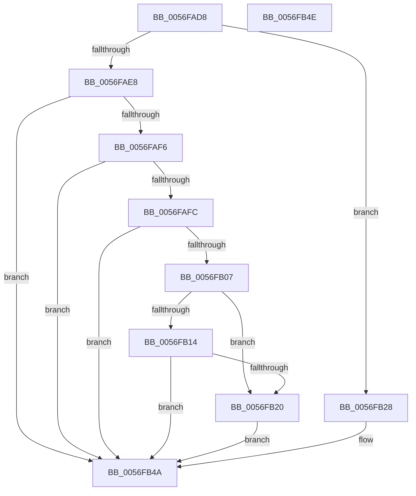

# IvtGetDomainId

- RVA: `0x0056FAD8`–`0x0056FB4F` (길이 `119` bytes)
- VA: `0x000000014056FAD8`
- 실행 섹션: `.text`
- PDB 이름 있음: `예`; PDB Function 태그: `아니요`
- unwind 정보 RVA: `0x000DB714`
- 디코드: `36`개 명령, `119/119` bytes 표시
- 미해석 바이트: `0` (있으면 어셈블리에 `.byte`로 보존)

> 이 문서는 커널 이미지의 기계어와 PDB 기호를 분석해 생성했습니다. 4번과 5번은 함수 원형과 자료형을 바이너리 사용 방식에서 추정한 C 해석이며 원본 소스 복구 결과는 아닙니다.

## 1. Dependencies

- 직접 호출 지점: **0**; 고유 호출 대상: **0**
- 직접 호출자로 확인된 함수: **2**
- RIP 상대 이미지 참조: **0**

### Outgoing calls
- 직접 디코드된 call 명령이 없습니다.

### Direct callers
- [IvtAttachDeviceDomainInternal](IvtAttachDeviceDomainInternal_function_0056ED90.md) at `0x0056EE71`
- [IvtConfigureAts](IvtConfigureAts_function_0056F1F0.md) at `0x0056F2D8`

### Static image references
- 디코드된 RIP-relative 메모리 참조가 없습니다.

## 2. Other-region calls and transfers

- 다른 실행 섹션으로 향하는 call: **0**
- 별도 외부 분기/꼬리 이동을 확인하지 못했습니다.

## 3. Assembly (complete function range)

```asm
0056FAD8  80 B9 40 01 00 00 00            cmp byte ptr [rcx + 0x140], 0
0056FADF  48 8B 42 38                     mov rax, qword ptr [rdx + 0x38]
0056FAE3  44 8B 08                        mov r9d, dword ptr [rax]
0056FAE6  74 40                           je 0x14056fb28
0056FAE8  48 8B 42 40                     mov rax, qword ptr [rdx + 0x40]
0056FAEC  B9 00 00 01 00                  mov ecx, 0x10000
0056FAF1  48 85 C0                        test rax, rax
0056FAF4  74 54                           je 0x14056fb4a
0056FAF6  83 78 20 00                     cmp dword ptr [rax + 0x20], 0
0056FAFA  76 4E                           jbe 0x14056fb4a
0056FAFC  48 8B 50 40                     mov rdx, qword ptr [rax + 0x40]
0056FB00  48 8B 02                        mov rax, qword ptr [rdx]
0056FB03  A8 01                           test al, 1
0056FB05  74 43                           je 0x14056fb4a
0056FB07  25 C0 01 00 00                  and eax, 0x1c0
0056FB0C  48 3D 00 01 00 00               cmp rax, 0x100
0056FB12  74 0C                           je 0x14056fb20
0056FB14  48 83 C0 C0                     add rax, -0x40
0056FB18  48 A9 BF FF FF FF               test rax, -0x41
0056FB1E  75 2A                           jne 0x14056fb4a
0056FB20  8B 42 08                        mov eax, dword ptr [rdx + 8]
0056FB23  0F B7 C8                        movzx ecx, ax
0056FB26  EB 22                           jmp 0x14056fb4a
0056FB28  48 8B 51 20                     mov rdx, qword ptr [rcx + 0x20]
0056FB2C  41 8B C1                        mov eax, r9d
0056FB2F  C1 E8 08                        shr eax, 8
0056FB32  03 C0                           add eax, eax
0056FB34  41 0F B6 C9                     movzx ecx, r9b
0056FB38  48 03 C9                        add rcx, rcx
0056FB3B  48 8B 04 C2                     mov rax, qword ptr [rdx + rax*8]
0056FB3F  8B 4C C8 08                     mov ecx, dword ptr [rax + rcx*8 + 8]
0056FB43  48 C1 E9 08                     shr rcx, 8
0056FB47  0F B7 C9                        movzx ecx, cx
0056FB4A  48 8B C1                        mov rax, rcx
0056FB4D  C3                              ret
0056FB4E  CC                              int3
```

## 4. C-style interpretation (structured pseudocode)

```c
__int64 __fastcall IvtGetDomainId(__int64 a1, __int64 a2)
{
    __int64 result;

    if ((*(unsigned __int8 *)(a1 + 320)) == 0) goto loc_0056FB28;
    if (*(unsigned __int64 *)(a2 + 64) == 0) goto loc_0056FB4A;
    if ((*(unsigned int *)(*(unsigned __int64 *)(a2 + 64) + 32)) <= 0) goto loc_0056FB4A;
    if ((((unsigned __int8)(*(unsigned __int64 *)(*(unsigned __int64 *)(*(unsigned __int64 *)(a2 + 64) + 64)))) & (1)) == 0) goto loc_0056FB4A;
    result = (unsigned int)((*(unsigned __int64 *)(*(unsigned __int64 *)(*(unsigned __int64 *)(a2 + 64) + 64))) & (448));
    if (result == 256) goto loc_0056FB20;
    result = (result) + (-64);
    if (((result) & (-65)) != 0) goto loc_0056FB4A;
loc_0056FB20:
    goto loc_0056FB4A;
loc_0056FB28:
    result = (unsigned int)(((unsigned int)((unsigned int)((unsigned int)(*(unsigned int *)(*(unsigned __int64 *)(a2 + 56)))))) >> (8));
    result = (unsigned int)((result) + ((unsigned int)(result)));
    a1 = ((unsigned __int8)((unsigned int)(*(unsigned int *)(*(unsigned __int64 *)(a2 + 56))))) + ((unsigned __int8)((unsigned int)(*(unsigned int *)(*(unsigned __int64 *)(a2 + 56)))));
    a1 = ((unsigned int)(*(unsigned int *)(*(unsigned __int64 *)(*(unsigned __int64 *)((unsigned __int16)((unsigned int)(*(unsigned int *)(*(unsigned __int64 *)(*(unsigned __int64 *)(a2 + 64) + 64) + 8))) + 32) + result * 8) + a1 * 8 + 8))) >> (8);
loc_0056FB4A:
    return (unsigned __int16)(a1);
}
```

## 5. (Beta) C Style

```c
int64_t IvtGetDomainId(void *Arg1, void *Arg2)
{
    uint8_t *arg1 = (uint8_t *)Arg1;
    uint8_t *arg2 = (uint8_t *)Arg2;

    int64_t result;

    if ((*(uint8_t *)(arg1 + 0x140)) == 0) goto loc_0056FB28;
    if (*(uint64_t *)(arg2 + 0x40) == 0) goto loc_0056FB4A;
    if ((*(uint32_t *)(*(uint64_t *)(arg2 + 0x40) + 0x20)) <= 0) goto loc_0056FB4A;
    if ((((uint8_t)(*(uint64_t *)(*(uint64_t *)(*(uint64_t *)(arg2 + 0x40) + 0x40)))) & (1)) == 0) goto loc_0056FB4A;
    result = (uint32_t)((*(uint64_t *)(*(uint64_t *)(*(uint64_t *)(arg2 + 0x40) + 0x40))) & (448));
    if (result == 256) goto loc_0056FB20;
    result = (result) + (-64);
    if (((result) & (-65)) != 0) goto loc_0056FB4A;
loc_0056FB20:
    goto loc_0056FB4A;
loc_0056FB28:
    result = (uint32_t)(((uint32_t)((uint32_t)((uint32_t)(*(uint32_t *)(*(uint64_t *)(arg2 + 0x38)))))) >> (8));
    result = (uint32_t)((result) + ((uint32_t)(result)));
    Arg1 = ((uint8_t)((uint32_t)(*(uint32_t *)(*(uint64_t *)(arg2 + 0x38))))) + ((uint8_t)((uint32_t)(*(uint32_t *)(*(uint64_t *)(arg2 + 0x38)))));
    Arg1 = ((uint32_t)(*(uint32_t *)(*(uint64_t *)(*(uint64_t *)((uint16_t)((uint32_t)(*(uint32_t *)(*(uint64_t *)(*(uint64_t *)(arg2 + 0x40) + 0x40) + 0x8))) + 0x20) + result * 8) + arg1 * 8 + 0x8))) >> (8);
loc_0056FB4A:
    return (uint16_t)(Arg1);
}
```

### 관측된 메모리 오프셋

구조체 형식이 확인되지 않은 접근은 인자 기준의 오프셋으로만 기록했습니다.

| 기준 인자 | 오프셋 표현 | 폭 (bit) | 접근 |
|---|---:|---:|---|
| `Arg1` | `+ 0x20` | `64` | `R` |
| `Arg1` | `+ 0x140` | `8` | `R` |
| `Arg2` | `+ 0x38` | `64` | `R` |
| `Arg2` | `+ 0x40` | `64` | `R` |

## 6. Execution-region graph

[열기: 2D/3D 그래프와 함수 탐색 컨트롤 패널](../../../control-panel.html?section=text&rva=0x0056FAD8&view=graph)

- 2D 그래프는 위에서 아래로 흐르고, 3D 그래프는 빈 공간을 드래그해 회전합니다. Shift+드래그는 이동, 휠은 확대·축소, 함수 노드 선택은 대상 보고서 이동입니다.

### Static fallback


