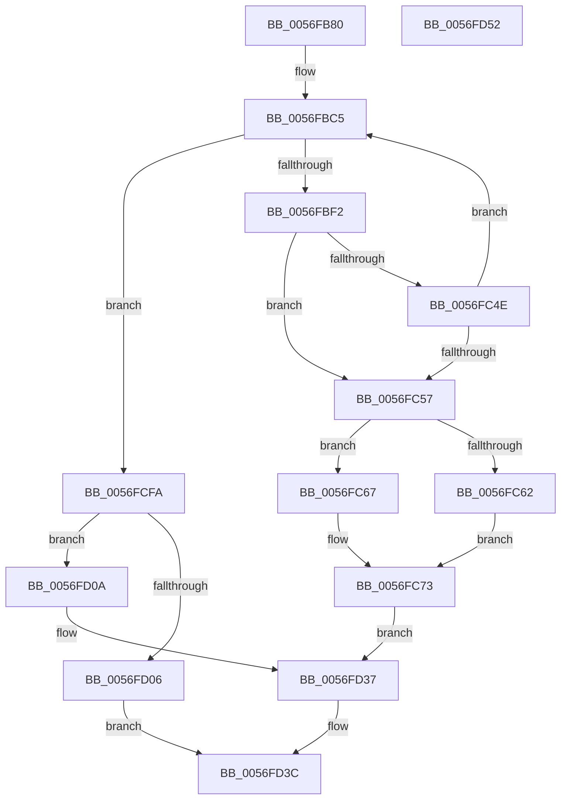

# IvtGetPageFault

- RVA: `0x0056FB80`–`0x0056FD53` (길이 `467` bytes)
- VA: `0x000000014056FB80`
- 실행 섹션: `.text`
- PDB 이름 있음: `예`; PDB Function 태그: `아니요`
- unwind 정보 RVA: `0x000C524C`
- 디코드: `122`개 명령, `467/467` bytes 표시
- 미해석 바이트: `0` (있으면 어셈블리에 `.byte`로 보존)

> 이 문서는 커널 이미지의 기계어와 PDB 기호를 분석해 생성했습니다. 4번과 5번은 함수 원형과 자료형을 바이너리 사용 방식에서 추정한 C 해석이며 원본 소스 복구 결과는 아닙니다.

## 1. Dependencies

- 직접 호출 지점: **0**; 고유 호출 대상: **0**
- 직접 호출자로 확인된 함수: **0**
- RIP 상대 이미지 참조: **0**

### Outgoing calls
- 직접 디코드된 call 명령이 없습니다.

### Direct callers
- 이 함수 시작 RVA로 연결되는 직접 call은 확인되지 않았습니다. 간접 호출은 완전히 역산할 수 없습니다.

### Static image references
- 디코드된 RIP-relative 메모리 참조가 없습니다.

## 2. Other-region calls and transfers

- 다른 실행 섹션으로 향하는 call: **0**
- 별도 외부 분기/꼬리 이동을 확인하지 못했습니다.

## 3. Assembly (complete function range)

```asm
0056FB80  48 8B C4                        mov rax, rsp
0056FB83  48 89 58 08                     mov qword ptr [rax + 8], rbx
0056FB87  48 89 70 10                     mov qword ptr [rax + 0x10], rsi
0056FB8B  48 89 78 18                     mov qword ptr [rax + 0x18], rdi
0056FB8F  41 57                           push r15
0056FB91  48 83 EC 20                     sub rsp, 0x20
0056FB95  4C 8B 99 A0 00 00 00            mov r11, qword ptr [rcx + 0xa0]
0056FB9C  0F 57 C0                        xorps xmm0, xmm0
0056FB9F  4C 8B 51 08                     mov r10, qword ptr [rcx + 8]
0056FBA3  49 8B D9                        mov rbx, r9
0056FBA6  4C 8B 89 90 00 00 00            mov r9, qword ptr [rcx + 0x90]
0056FBAD  49 8B F0                        mov rsi, r8
0056FBB0  0F 11 04 24                     movups xmmword ptr [rsp], xmm0
0056FBB4  48 8B FA                        mov rdi, rdx
0056FBB7  49 C1 EB 05                     shr r11, 5
0056FBBB  0F 11 40 E8                     movups xmmword ptr [rax - 0x18], xmm0
0056FBBF  41 BF FF 3F 00 00               mov r15d, 0x3fff
0056FBC5  90                              nop
0056FBC6  49 8B 8A C0 00 00 00            mov rcx, qword ptr [r10 + 0xc0]
0056FBCD  4C 8B C1                        mov r8, rcx
0056FBD0  90                              nop
0056FBD1  49 8B 82 C8 00 00 00            mov rax, qword ptr [r10 + 0xc8]
0056FBD8  49 C1 E8 05                     shr r8, 5
0056FBDC  48 C1 E8 05                     shr rax, 5
0056FBE0  49 8B D0                        mov rdx, r8
0056FBE3  49 23 D7                        and rdx, r15
0056FBE6  49 23 C7                        and rax, r15
0056FBE9  48 3B D0                        cmp rdx, rax
0056FBEC  0F 84 08 01 00 00               je 0x14056fcfa
0056FBF2  48 C1 E2 05                     shl rdx, 5
0056FBF6  49 8D 40 01                     lea rax, [r8 + 1]
0056FBFA  42 0F 10 04 0A                  movups xmm0, xmmword ptr [rdx + r9]
0056FBFF  42 0F 10 4C 0A 10               movups xmm1, xmmword ptr [rdx + r9 + 0x10]
0056FC05  41 8B D0                        mov edx, r8d
0056FC08  90                              nop
0056FC09  45 33 C0                        xor r8d, r8d
0056FC0C  41 23 D7                        and edx, r15d
0056FC0F  FF C2                           inc edx
0056FC11  41 3B D3                        cmp edx, r11d
0056FC14  0F 11 04 24                     movups xmmword ptr [rsp], xmm0
0056FC18  4C 0F 45 C0                     cmovne r8, rax
0056FC1C  49 C1 E0 05                     shl r8, 5
0056FC20  49 8B C0                        mov rax, r8
0056FC23  48 33 C1                        xor rax, rcx
0056FC26  48 25 1F 00 F8 FF               and rax, 0xfffffffffff8001f
0056FC2C  49 33 C0                        xor rax, r8
0056FC2F  0F 11 4C 24 10                  movups xmmword ptr [rsp + 0x10], xmm1
0056FC34  49 89 82 C0 00 00 00            mov qword ptr [r10 + 0xc0], rax
0056FC3B  F0 83 0C 24 00                  lock or dword ptr [rsp], 0
0056FC40  48 8B 54 24 08                  mov rdx, qword ptr [rsp + 8]
0056FC45  4C 8B C2                        mov r8, rdx
0056FC48  41 83 E0 01                     and r8d, 1
0056FC4C  75 09                           jne 0x14056fc57
0056FC4E  F6 C2 02                        test dl, 2
0056FC51  0F 84 6E FF FF FF               je 0x14056fbc5
0056FC57  4C 8B 0C 24                     mov r9, qword ptr [rsp]
0056FC5B  49 0F BA E1 08                  bt r9, 8
0056FC60  72 05                           jb 0x14056fc67
0056FC62  83 C8 FF                        or eax, 0xffffffff
0056FC65  EB 0C                           jmp 0x14056fc73
0056FC67  49 8B C1                        mov rax, r9
0056FC6A  48 C1 E8 20                     shr rax, 0x20
0056FC6E  25 FF FF 0F 00                  and eax, 0xfffff
0056FC73  89 07                           mov dword ptr [rdi], eax
0056FC75  B9 FF 01 00 00                  mov ecx, 0x1ff
0056FC7A  48 8B C2                        mov rax, rdx
0056FC7D  48 C1 E8 03                     shr rax, 3
0056FC81  66 23 C1                        and ax, cx
0056FC84  48 8B CA                        mov rcx, rdx
0056FC87  66 89 03                        mov word ptr [rbx], ax
0056FC8A  48 81 E1 00 F0 FF FF            and rcx, 0xfffffffffffff000
0056FC91  48 8B 44 24 50                  mov rax, qword ptr [rsp + 0x50]
0056FC96  48 89 08                        mov qword ptr [rax], rcx
0056FC99  48 8B CA                        mov rcx, rdx
0056FC9C  48 C1 E9 02                     shr rcx, 2
0056FCA0  49 8B C1                        mov rax, r9
0056FCA3  48 C1 E8 10                     shr rax, 0x10
0056FCA7  83 E1 01                        and ecx, 1
0056FCAA  48 C1 E1 04                     shl rcx, 4
0056FCAE  0F B7 C0                        movzx eax, ax
0056FCB1  48 89 06                        mov qword ptr [rsi], rax
0056FCB4  48 8B C1                        mov rax, rcx
0056FCB7  48 83 C8 02                     or rax, 2
0056FCBB  F6 C2 02                        test dl, 2
0056FCBE  48 0F 44 C1                     cmove rax, rcx
0056FCC2  48 8B 4C 24 58                  mov rcx, qword ptr [rsp + 0x58]
0056FCC7  48 8B D0                        mov rdx, rax
0056FCCA  48 83 CA 01                     or rdx, 1
0056FCCE  4D 85 C0                        test r8, r8
0056FCD1  48 0F 44 D0                     cmove rdx, rax
0056FCD5  4C 8B C2                        mov r8, rdx
0056FCD8  49 83 C8 08                     or r8, 8
0056FCDC  49 0F BA E1 35                  bt r9, 0x35
0056FCE1  4C 0F 43 C2                     cmovae r8, rdx
0056FCE5  49 8B D0                        mov rdx, r8
0056FCE8  48 83 CA 04                     or rdx, 4
0056FCEC  49 0F BA E1 34                  bt r9, 0x34
0056FCF1  49 0F 43 D0                     cmovae rdx, r8
0056FCF5  48 89 11                        mov qword ptr [rcx], rdx
0056FCF8  EB 3D                           jmp 0x14056fd37
0056FCFA  90                              nop
0056FCFB  41 8B 82 DC 00 00 00            mov eax, dword ptr [r10 + 0xdc]
0056FD02  A8 02                           test al, 2
0056FD04  75 04                           jne 0x14056fd0a
0056FD06  33 C0                           xor eax, eax
0056FD08  EB 32                           jmp 0x14056fd3c
0056FD0A  41 C7 82 DC 00 00 00 02 00 00 00  mov dword ptr [r10 + 0xdc], 2
0056FD15  F0 83 0C 24 00                  lock or dword ptr [rsp], 0
0056FD1A  83 0F FF                        or dword ptr [rdi], 0xffffffff
0056FD1D  48 8B 44 24 50                  mov rax, qword ptr [rsp + 0x50]
0056FD22  66 81 0B FF FF                  or word ptr [rbx], 0xffff
0056FD27  48 83 20 00                     and qword ptr [rax], 0
0056FD2B  48 8B 44 24 58                  mov rax, qword ptr [rsp + 0x58]
0056FD30  48 C7 00 20 00 00 00            mov qword ptr [rax], 0x20
0056FD37  B8 01 00 00 00                  mov eax, 1
0056FD3C  48 8B 5C 24 30                  mov rbx, qword ptr [rsp + 0x30]
0056FD41  48 8B 74 24 38                  mov rsi, qword ptr [rsp + 0x38]
0056FD46  48 8B 7C 24 40                  mov rdi, qword ptr [rsp + 0x40]
0056FD4B  48 83 C4 20                     add rsp, 0x20
0056FD4F  41 5F                           pop r15
0056FD51  C3                              ret
0056FD52  CC                              int3
```

## 4. C-style interpretation (structured pseudocode)

```c
__int64 __fastcall IvtGetPageFault(__int64 a1, __int64 a2, __int64 a3, __int64 a4, __int64 a5, __int64 a6)
{
    __int64 result;
    __int64 v_r11;
    __int64 v_rsp;
    unsigned __int64 v_stack_m18;
    unsigned __int64 v_stack_m20;
    unsigned __int64 v_stack_m28;
    unsigned __int64 v_stack_p10;
    unsigned __int64 v_stack_p18;
    unsigned __int64 v_stack_p8;

    *(unsigned __int64 *)(v_rsp + 8) = v_rbx;
    *(unsigned __int64 *)(v_rsp + 16) = v_rsi;
    *(unsigned __int64 *)(v_rsp + 24) = v_rdi;
    v_rsp = (v_rsp) - (32);
    v_stack_m28 = v_xmm0;
    v_r11 = (*(unsigned __int64 *)(a1 + 160)) >> (5);
    *(unsigned __int64 *)(v_rsp - 24) = v_xmm0;
loc_0056FBC5:
    a3 = (*(unsigned __int64 *)(*(unsigned __int64 *)(a1 + 8) + 192)) >> (5);
    result = (*(unsigned __int64 *)(*(unsigned __int64 *)(a1 + 8) + 200)) >> (5);
    a2 = (a3) & ((unsigned int)(0x3FFFULL));
    result = (result) & ((unsigned int)(0x3FFFULL));
    if (a2 == result) goto loc_0056FCFA;
    a2 = (a2) << (5);
    a3 = 0;
    a2 = (unsigned int)(((unsigned int)((unsigned int)(a3))) & ((unsigned int)((unsigned int)(0x3FFFULL))));
    a2 = (unsigned int)((a2) + 1);
    v_stack_m28 = v_xmm0;
    if (((unsigned int)(a2)) != ((unsigned int)(v_r11))) { a3 = a3 + 1; }
    a3 = (a3) << (5);
    result = (a3) ^ (*(unsigned __int64 *)(*(unsigned __int64 *)(a1 + 8) + 192));
    result = (result) & (0xFFFFFFFFFFF8001FULL);
    result = (result) ^ (a3);
    v_stack_m18 = v_xmm1;
    *(unsigned __int64 *)(*(unsigned __int64 *)(a1 + 8) + 192) = result;
    a3 = (unsigned int)((v_stack_m20) & (1));
    if (condition_is_not_equal) goto loc_0056FC57;
    if ((((unsigned __int8)(v_stack_m20)) & (2)) == 0) goto loc_0056FBC5;
loc_0056FC57:
    if (condition_is_below) goto loc_0056FC67;
    result = (unsigned int)((result) | (0xFFFFFFFFULL));
    goto loc_0056FC73;
loc_0056FC67:
    result = (v_stack_m28) >> (32);
    result = (unsigned int)((result) & (0xFFFFFULL));
loc_0056FC73:
    *(unsigned int *)(a2) = (unsigned int)(result);
    result = (v_stack_m20) >> (3);
    result = (unsigned __int16)((result) & (511));
    *(unsigned __int16 *)(a4) = (unsigned __int16)(result);
    a1 = (v_stack_m20) & (0xFFFFFFFFFFFFF000ULL);
    *(unsigned __int64 *)(a5) = a1;
    a1 = (v_stack_m20) >> (2);
    result = (v_stack_m28) >> (16);
    a1 = (unsigned int)((a1) & (1));
    a1 = (a1) << (4);
    *(unsigned __int64 *)(a3) = (unsigned __int16)(result);
    result = (a1) | (2);
    if ((((unsigned __int8)(v_stack_m20)) & (2)) == 0) { result = a1; }
    a2 = (result) | (1);
    if (a3 == 0) { a2 = result; }
    a3 = (a2) | (8);
    if (condition_is_above_or_equal) { a3 = a2; }
    a2 = (a3) | (4);
    if (condition_is_above_or_equal) { a2 = a3; }
    *(unsigned __int64 *)(a6) = a2;
    goto loc_0056FD37;
loc_0056FCFA:
    if ((((unsigned __int8)((unsigned int)(*(unsigned int *)(*(unsigned __int64 *)(a1 + 8) + 220)))) & (2)) != 0) goto loc_0056FD0A;
    result = 0;
    goto loc_0056FD3C;
loc_0056FD0A:
    *(unsigned int *)(*(unsigned __int64 *)(a1 + 8) + 220) = 2;
    *(unsigned __int64 *)(a6) = 32;
loc_0056FD37:
loc_0056FD3C:
    v_rsp = (v_rsp) + (32);
    return 1;
}
```

## 5. (Beta) C Style

```c
int64_t IvtGetPageFault(void *Arg1, void *Arg2, void *Arg3, void *Arg4, void *Arg5, void *Arg6)
{
    uint8_t *arg1 = (uint8_t *)Arg1;
    uint8_t *arg2 = (uint8_t *)Arg2;
    uint8_t *arg3 = (uint8_t *)Arg3;
    uint8_t *arg4 = (uint8_t *)Arg4;
    uint8_t *arg5 = (uint8_t *)Arg5;
    uint8_t *arg6 = (uint8_t *)Arg6;

    int64_t result;
    int64_t local_r11;
    int64_t local_rsp;
    uint64_t v_stack_m18;
    uint64_t v_stack_m20;
    uint64_t v_stack_m28;
    uint64_t v_stack_p10;
    uint64_t v_stack_p18;
    uint64_t v_stack_p8;

    *(uint64_t *)(local_rsp + 0x8) = local_rbx;
    *(uint64_t *)(local_rsp + 0x10) = local_rsi;
    *(uint64_t *)(local_rsp + 0x18) = local_rdi;
    local_rsp = (local_rsp) - (32);
    v_stack_m28 = v_xmm0;
    local_r11 = (*(uint64_t *)(arg1 + 0xA0)) >> (5);
    *(uint64_t *)(local_rsp - 0x18) = v_xmm0;
loc_0056FBC5:
    Arg3 = (*(uint64_t *)(*(uint64_t *)(arg1 + 0x8) + 0xC0)) >> (5);
    result = (*(uint64_t *)(*(uint64_t *)(arg1 + 0x8) + 0xC8)) >> (5);
    Arg2 = (Arg3) & ((uint32_t)(0x3FFFULL));
    result = (result) & ((uint32_t)(0x3FFFULL));
    if (Arg2 == result) goto loc_0056FCFA;
    Arg2 = (Arg2) << (5);
    Arg3 = 0;
    Arg2 = (uint32_t)(((uint32_t)((uint32_t)(Arg3))) & ((uint32_t)((uint32_t)(0x3FFFULL))));
    Arg2 = (uint32_t)((Arg2) + 1);
    v_stack_m28 = v_xmm0;
    if (((uint32_t)(Arg2)) != ((uint32_t)(local_r11))) { Arg3 = Arg3 + 1; }
    Arg3 = (Arg3) << (5);
    result = (Arg3) ^ (*(uint64_t *)(*(uint64_t *)(arg1 + 0x8) + 0xC0));
    result = (result) & (0xFFFFFFFFFFF8001FULL);
    result = (result) ^ (Arg3);
    v_stack_m18 = v_xmm1;
    *(uint64_t *)(*(uint64_t *)(arg1 + 0x8) + 0xC0) = result;
    Arg3 = (uint32_t)((v_stack_m20) & (1));
    if (condition_is_not_equal) goto loc_0056FC57;
    if ((((uint8_t)(v_stack_m20)) & (2)) == 0) goto loc_0056FBC5;
loc_0056FC57:
    if (condition_is_below) goto loc_0056FC67;
    result = (uint32_t)((result) | (0xFFFFFFFFULL));
    goto loc_0056FC73;
loc_0056FC67:
    result = (v_stack_m28) >> (32);
    result = (uint32_t)((result) & (0xFFFFFULL));
loc_0056FC73:
    *(uint32_t *)(arg2) = (uint32_t)(result);
    result = (v_stack_m20) >> (3);
    result = (uint16_t)((result) & (511));
    *(uint16_t *)(arg4) = (uint16_t)(result);
    Arg1 = (v_stack_m20) & (0xFFFFFFFFFFFFF000ULL);
    *(void **)(arg5) = Arg1;
    Arg1 = (v_stack_m20) >> (2);
    result = (v_stack_m28) >> (16);
    Arg1 = (uint32_t)((Arg1) & (1));
    Arg1 = (Arg1) << (4);
    *(uint64_t *)(arg3) = (uint16_t)(result);
    result = (Arg1) | (2);
    if ((((uint8_t)(v_stack_m20)) & (2)) == 0) { result = Arg1; }
    Arg2 = (result) | (1);
    if (Arg3 == NULL) { Arg2 = result; }
    Arg3 = (Arg2) | (8);
    if (condition_is_above_or_equal) { Arg3 = Arg2; }
    Arg2 = (Arg3) | (4);
    if (condition_is_above_or_equal) { Arg2 = Arg3; }
    *(void **)(arg6) = Arg2;
    goto loc_0056FD37;
loc_0056FCFA:
    if ((((uint8_t)((uint32_t)(*(uint32_t *)(*(uint64_t *)(arg1 + 0x8) + 0xDC)))) & (2)) != 0) goto loc_0056FD0A;
    result = 0;
    goto loc_0056FD3C;
loc_0056FD0A:
    *(uint32_t *)(*(uint64_t *)(arg1 + 0x8) + 0xDC) = 2;
    *(uint64_t *)(arg6) = 32;
loc_0056FD37:
loc_0056FD3C:
    local_rsp = (local_rsp) + (32);
    return 1;
}
```

### 관측된 메모리 오프셋

구조체 형식이 확인되지 않은 접근은 인자 기준의 오프셋으로만 기록했습니다.

| 기준 인자 | 오프셋 표현 | 폭 (bit) | 접근 |
|---|---:|---:|---|
| `Arg1` | `+ 0x8` | `64` | `R` |
| `Arg1` | `+ 0x90` | `64` | `R` |
| `Arg1` | `+ 0xA0` | `64` | `R` |
| `Arg2` | `+ 0x0` | `32` | `R/W` |
| `Arg2` | `+ 0x0` | `32` | `W` |
| `Arg3` | `+ 0x0` | `64` | `W` |
| `Arg4` | `+ 0x0` | `16` | `R/W` |
| `Arg4` | `+ 0x0` | `16` | `W` |
| `Arg5` | `+ 0x0` | `64` | `R/W` |
| `Arg5` | `+ 0x0` | `64` | `W` |
| `Arg6` | `+ 0x0` | `64` | `W` |

## 6. Execution-region graph

[열기: 2D/3D 그래프와 함수 탐색 컨트롤 패널](../../../control-panel.html?section=text&rva=0x0056FB80&view=graph)

- 2D 그래프는 위에서 아래로 흐르고, 3D 그래프는 빈 공간을 드래그해 회전합니다. Shift+드래그는 이동, 휠은 확대·축소, 함수 노드 선택은 대상 보고서 이동입니다.

### Static fallback


