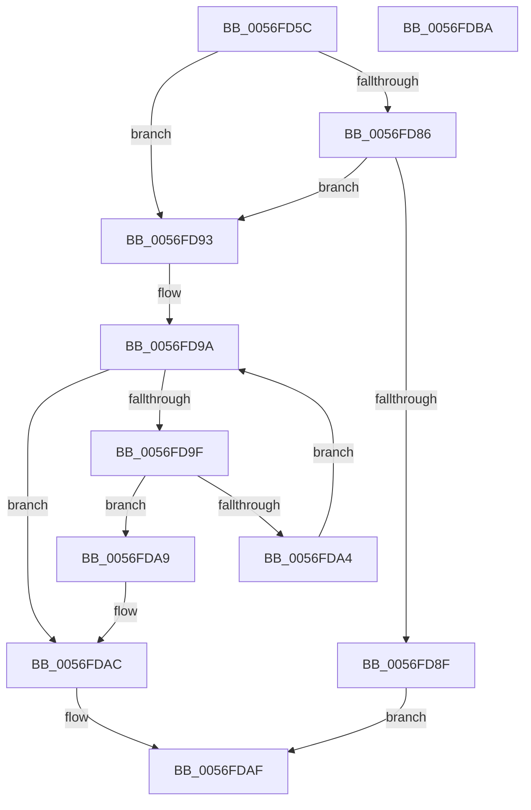

# IvtGetScalableModePasidTables

- RVA: `0x0056FD5C`–`0x0056FDBB` (길이 `95` bytes)
- VA: `0x000000014056FD5C`
- 실행 섹션: `.text`
- PDB 이름 있음: `예`; PDB Function 태그: `아니요`
- unwind 정보 RVA: `0x00065960`
- 디코드: `32`개 명령, `95/95` bytes 표시
- 미해석 바이트: `0` (있으면 어셈블리에 `.byte`로 보존)

> 이 문서는 커널 이미지의 기계어와 PDB 기호를 분석해 생성했습니다. 4번과 5번은 함수 원형과 자료형을 바이너리 사용 방식에서 추정한 C 해석이며 원본 소스 복구 결과는 아닙니다.

## 1. Dependencies

- 직접 호출 지점: **1**; 고유 호출 대상: **1**
- 직접 호출자로 확인된 함수: **4**
- RIP 상대 이미지 참조: **0**

### Outgoing calls
- `0x0056FD7A` → [Feature_Test57481295__private_IsEnabledDeviceUsageNoInline](../4F/Feature_Test57481295__private_IsEnabledDeviceUsageNoInline_function_004F7B90.md) (function, `0x004F7B90`)

### Direct callers
- [IvtLegacyGetDomainId](../57/IvtLegacyGetDomainId_function_00571C14.md) at `0x00571C2E`
- [IvtLegacyUpdateScalableModeContextEntry](../57/IvtLegacyUpdateScalableModeContextEntry_function_005721B8.md) at `0x005722CA`
- [IvtLegacyUpdateScalableModeTranslationStructures](../57/IvtLegacyUpdateScalableModeTranslationStructures_function_0057237C.md) at `0x005723A3`
- [IvtProcessDeviceExceptions](../../pagelk/B6/IvtProcessDeviceExceptions_function_00B62C34.md) at `0x00B62CF7`

### Static image references
- 디코드된 RIP-relative 메모리 참조가 없습니다.

## 2. Other-region calls and transfers

- 다른 실행 섹션으로 향하는 call: **0**
- 별도 외부 분기/꼬리 이동을 확인하지 못했습니다.

## 3. Assembly (complete function range)

```asm
0056FD5C  48 89 5C 24 08                  mov qword ptr [rsp + 8], rbx
0056FD61  57                              push rdi
0056FD62  48 83 EC 40                     sub rsp, 0x40
0056FD66  0F 57 C0                        xorps xmm0, xmm0
0056FD69  33 C0                           xor eax, eax
0056FD6B  0F 11 44 24 20                  movups xmmword ptr [rsp + 0x20], xmm0
0056FD70  48 89 44 24 30                  mov qword ptr [rsp + 0x30], rax
0056FD75  8B FA                           mov edi, edx
0056FD77  48 8B D9                        mov rbx, rcx
0056FD7A  E8 11 7E F8 FF                  call 0x1404f7b90
0056FD7F  45 33 C0                        xor r8d, r8d
0056FD82  85 C0                           test eax, eax
0056FD84  74 0D                           je 0x14056fd93
0056FD86  44 38 83 40 01 00 00            cmp byte ptr [rbx + 0x140], r8b
0056FD8D  75 04                           jne 0x14056fd93
0056FD8F  33 C0                           xor eax, eax
0056FD91  EB 1C                           jmp 0x14056fdaf
0056FD93  48 8D 4B 38                     lea rcx, [rbx + 0x38]
0056FD97  48 8B 01                        mov rax, qword ptr [rcx]
0056FD9A  48 3B C1                        cmp rax, rcx
0056FD9D  74 0D                           je 0x14056fdac
0056FD9F  39 78 28                        cmp dword ptr [rax + 0x28], edi
0056FDA2  74 05                           je 0x14056fda9
0056FDA4  48 8B 00                        mov rax, qword ptr [rax]
0056FDA7  EB F1                           jmp 0x14056fd9a
0056FDA9  4C 8B C0                        mov r8, rax
0056FDAC  49 8B C0                        mov rax, r8
0056FDAF  48 8B 5C 24 50                  mov rbx, qword ptr [rsp + 0x50]
0056FDB4  48 83 C4 40                     add rsp, 0x40
0056FDB8  5F                              pop rdi
0056FDB9  C3                              ret
0056FDBA  CC                              int3
```

## 4. C-style interpretation (structured pseudocode)

```c
__int64 __fastcall IvtGetScalableModePasidTables(__int64 a1, int a2, int a3)
{
    __int64 result;
    __int64 v_rsp;
    unsigned __int64 v_stack_m18;
    unsigned __int64 v_stack_m28;
    unsigned __int64 v_stack_p8;

    v_stack_p8 = v_rbx;
    v_rsp = (v_rsp) - (64);
    result = 0;
    v_stack_m28 = v_xmm0;
    v_stack_m18 = 0;
    result = Feature_Test57481295__private_IsEnabledDeviceUsageNoInline(a1, a2, a3, a4);
    a3 = 0;
    if ((unsigned int)(result) == 0) goto loc_0056FD93;
    if ((*(unsigned __int8 *)(a1 + 320)) != 0) goto loc_0056FD93;
    result = 0;
    goto loc_0056FDAF;
loc_0056FD93:
loc_0056FD9A:
    if ((*(unsigned __int64 *)(a1 + 56)) == (a1 + 56)) goto loc_0056FDAC;
    if ((*(unsigned int *)(*(unsigned __int64 *)(a1 + 56) + 40)) == ((unsigned int)((unsigned int)(a2)))) goto loc_0056FDA9;
    goto loc_0056FD9A;
loc_0056FDA9:
loc_0056FDAC:
loc_0056FDAF:
    v_rsp = (v_rsp) + (64);
    return *(unsigned __int64 *)(*(unsigned __int64 *)(a1 + 56));
}
```

## 5. (Beta) C Style

```c
int64_t IvtGetScalableModePasidTables(void *Arg1, int32_t Arg2, int32_t Arg3)
{
    uint8_t *arg1 = (uint8_t *)Arg1;

    int64_t result;
    int64_t local_rsp;
    uint64_t v_stack_m18;
    uint64_t v_stack_m28;
    uint64_t v_stack_p8;

    v_stack_p8 = local_rbx;
    local_rsp = (local_rsp) - (64);
    result = 0;
    v_stack_m28 = v_xmm0;
    v_stack_m18 = 0;
    result = Feature_Test57481295__private_IsEnabledDeviceUsageNoInline(Arg1, Arg2, Arg3, a4);
    Arg3 = 0;
    if ((uint32_t)(result) == 0) goto loc_0056FD93;
    if ((*(uint8_t *)(arg1 + 0x140)) != 0) goto loc_0056FD93;
    result = 0;
    goto loc_0056FDAF;
loc_0056FD93:
loc_0056FD9A:
    if ((*(uint64_t *)(arg1 + 0x38)) == (Arg1 + 56)) goto loc_0056FDAC;
    if ((*(uint32_t *)(*(uint64_t *)(arg1 + 0x38) + 0x28)) == ((uint32_t)((uint32_t)(Arg2)))) goto loc_0056FDA9;
    goto loc_0056FD9A;
loc_0056FDA9:
loc_0056FDAC:
loc_0056FDAF:
    local_rsp = (local_rsp) + (64);
    return *(uint64_t *)(*(uint64_t *)(arg1 + 0x38));
}
```

### 관측된 메모리 오프셋

구조체 형식이 확인되지 않은 접근은 인자 기준의 오프셋으로만 기록했습니다.

| 기준 인자 | 오프셋 표현 | 폭 (bit) | 접근 |
|---|---:|---:|---|
| `Arg1` | `+ 0x0` | `64` | `R` |
| `Arg1` | `+ 0x38` | `64` | `R` |
| `Arg1` | `+ 0x140` | `8` | `R` |

## 6. Execution-region graph

[열기: 2D/3D 그래프와 함수 탐색 컨트롤 패널](../../../control-panel.html?section=text&rva=0x0056FD5C&view=graph)

- 2D 그래프는 위에서 아래로 흐르고, 3D 그래프는 빈 공간을 드래그해 회전합니다. Shift+드래그는 이동, 휠은 확대·축소, 함수 노드 선택은 대상 보고서 이동입니다.

### Static fallback


