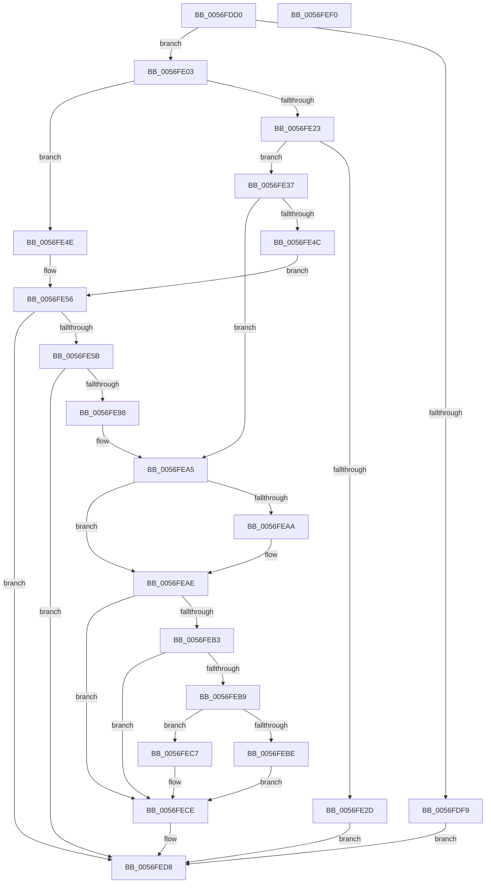

# IvtGrowPasidTable

- RVA: `0x0056FDD0`–`0x0056FEF1` (길이 `289` bytes)
- VA: `0x000000014056FDD0`
- 실행 섹션: `.text`
- PDB 이름 있음: `예`; PDB Function 태그: `아니요`
- unwind 정보 RVA: `0x000C5374`
- 디코드: `81`개 명령, `289/289` bytes 표시
- 미해석 바이트: `0` (있으면 어셈블리에 `.byte`로 보존)

> 이 문서는 커널 이미지의 기계어와 PDB 기호를 분석해 생성했습니다. 4번과 5번은 함수 원형과 자료형을 바이너리 사용 방식에서 추정한 C 해석이며 원본 소스 복구 결과는 아닙니다.

## 1. Dependencies

- 직접 호출 지점: **2**; 고유 호출 대상: **2**
- 직접 호출자로 확인된 함수: **0**
- RIP 상대 이미지 참조: **0**

### Outgoing calls
- `0x0056FE43` → [IvtExtendScalableModePasidTables](IvtExtendScalableModePasidTables_function_0056F6C8.md) (function, `0x0056F6C8`)
- `0x0056FE8F` → [IvtAllocateScalableModePasidTables](IvtAllocateScalableModePasidTables_function_0056E8DC.md) (function, `0x0056E8DC`)

### Direct callers
- 이 함수 시작 RVA로 연결되는 직접 call은 확인되지 않았습니다. 간접 호출은 완전히 역산할 수 없습니다.

### Static image references
- 디코드된 RIP-relative 메모리 참조가 없습니다.

## 2. Other-region calls and transfers

- 다른 실행 섹션으로 향하는 call: **0**
- 별도 외부 분기/꼬리 이동을 확인하지 못했습니다.

## 3. Assembly (complete function range)

```asm
0056FDD0  48 89 5C 24 10                  mov qword ptr [rsp + 0x10], rbx
0056FDD5  55                              push rbp
0056FDD6  56                              push rsi
0056FDD7  57                              push rdi
0056FDD8  41 54                           push r12
0056FDDA  41 55                           push r13
0056FDDC  41 56                           push r14
0056FDDE  41 57                           push r15
0056FDE0  48 83 EC 60                     sub rsp, 0x60
0056FDE4  41 8B E9                        mov ebp, r9d
0056FDE7  45 8B F8                        mov r15d, r8d
0056FDEA  48 8B F2                        mov rsi, rdx
0056FDED  4C 8B E9                        mov r13, rcx
0056FDF0  41 81 F9 00 00 10 00            cmp r9d, 0x100000
0056FDF7  72 0A                           jb 0x14056fe03
0056FDF9  B8 0D 00 00 C0                  mov eax, 0xc000000d
0056FDFE  E9 D5 00 00 00                  jmp 0x14056fed8
0056FE03  48 8B 5A 40                     mov rbx, qword ptr [rdx + 0x40]
0056FE07  33 FF                           xor edi, edi
0056FE09  44 8B A4 24 C0 00 00 00         mov r12d, dword ptr [rsp + 0xc0]
0056FE11  48 89 7C 24 50                  mov qword ptr [rsp + 0x50], rdi
0056FE16  48 89 9C 24 A0 00 00 00         mov qword ptr [rsp + 0xa0], rbx
0056FE1E  48 85 DB                        test rbx, rbx
0056FE21  74 2B                           je 0x14056fe4e
0056FE23  44 8B 73 24                     mov r14d, dword ptr [rbx + 0x24]
0056FE27  44 39 7B 2C                     cmp dword ptr [rbx + 0x2c], r15d
0056FE2B  74 0A                           je 0x14056fe37
0056FE2D  B8 BB 00 00 C0                  mov eax, 0xc00000bb
0056FE32  E9 A1 00 00 00                  jmp 0x14056fed8
0056FE37  41 B9 01 00 00 00               mov r9d, 1
0056FE3D  44 8B C5                        mov r8d, ebp
0056FE40  48 8B D3                        mov rdx, rbx
0056FE43  E8 80 F8 FF FF                  call 0x14056f6c8
0056FE48  85 C0                           test eax, eax
0056FE4A  79 59                           jns 0x14056fea5
0056FE4C  EB 08                           jmp 0x14056fe56
0056FE4E  45 33 F6                        xor r14d, r14d
0056FE51  B8 01 00 00 C0                  mov eax, 0xc0000001
0056FE56  41 3B EE                        cmp ebp, r14d
0056FE59  72 7D                           jb 0x14056fed8
0056FE5B  48 8D 84 24 A0 00 00 00         lea rax, [rsp + 0xa0]
0056FE63  44 8B CD                        mov r9d, ebp
0056FE66  48 89 44 24 40                  mov qword ptr [rsp + 0x40], rax
0056FE6B  45 8B C7                        mov r8d, r15d
0056FE6E  48 8D 44 24 50                  lea rax, [rsp + 0x50]
0056FE73  48 8B D6                        mov rdx, rsi
0056FE76  48 89 44 24 38                  mov qword ptr [rsp + 0x38], rax
0056FE7B  49 8B CD                        mov rcx, r13
0056FE7E  C7 44 24 30 01 00 00 00         mov dword ptr [rsp + 0x30], 1
0056FE86  44 89 64 24 28                  mov dword ptr [rsp + 0x28], r12d
0056FE8B  89 6C 24 20                     mov dword ptr [rsp + 0x20], ebp
0056FE8F  E8 48 EA FF FF                  call 0x14056e8dc
0056FE94  85 C0                           test eax, eax
0056FE96  78 40                           js 0x14056fed8
0056FE98  48 8B 9C 24 A0 00 00 00         mov rbx, qword ptr [rsp + 0xa0]
0056FEA0  48 8B 7C 24 50                  mov rdi, qword ptr [rsp + 0x50]
0056FEA5  48 3B DF                        cmp rbx, rdi
0056FEA8  74 04                           je 0x14056feae
0056FEAA  48 89 7E 48                     mov qword ptr [rsi + 0x48], rdi
0056FEAE  48 85 DB                        test rbx, rbx
0056FEB1  74 1B                           je 0x14056fece
0056FEB3  44 39 63 30                     cmp dword ptr [rbx + 0x30], r12d
0056FEB7  74 15                           je 0x14056fece
0056FEB9  48 85 FF                        test rdi, rdi
0056FEBC  74 09                           je 0x14056fec7
0056FEBE  C7 47 30 01 00 00 00            mov dword ptr [rdi + 0x30], 1
0056FEC5  EB 07                           jmp 0x14056fece
0056FEC7  C7 43 30 01 00 00 00            mov dword ptr [rbx + 0x30], 1
0056FECE  8B 8C 24 C8 00 00 00            mov ecx, dword ptr [rsp + 0xc8]
0056FED5  89 4E 50                        mov dword ptr [rsi + 0x50], ecx
0056FED8  48 8B 9C 24 A8 00 00 00         mov rbx, qword ptr [rsp + 0xa8]
0056FEE0  48 83 C4 60                     add rsp, 0x60
0056FEE4  41 5F                           pop r15
0056FEE6  41 5E                           pop r14
0056FEE8  41 5D                           pop r13
0056FEEA  41 5C                           pop r12
0056FEEC  5F                              pop rdi
0056FEED  5E                              pop rsi
0056FEEE  5D                              pop rbp
0056FEEF  C3                              ret
0056FEF0  CC                              int3
```

## 4. C-style interpretation (structured pseudocode)

```c
__int64 __fastcall IvtGrowPasidTable(__int64 a1, __int64 a2, int a3, int a4, unsigned int a5, unsigned int a6)
{
    __int64 result;
    __int64 v_r14;
    __int64 v_rdi;
    __int64 v_rsp;
    unsigned __int64 v_stack_m48;
    unsigned __int64 v_stack_m58;
    unsigned __int64 v_stack_m60;
    unsigned int v_stack_m68;
    unsigned int v_stack_m70;
    unsigned int v_stack_m78;
    unsigned __int64 v_stack_p10;
    unsigned __int64 v_stack_p8;

    v_stack_p10 = v_rbx;
    v_rsp = (v_rsp) - (96);
    if (a4 < 0x100000ULL) goto loc_0056FE03;
    goto loc_0056FED8;
loc_0056FE03:
    v_rdi = 0;
    v_stack_m48 = 0;
    v_stack_p8 = *(unsigned __int64 *)(a2 + 64);
    if (*(unsigned __int64 *)(a2 + 64) == 0) goto loc_0056FE4E;
    if ((*(unsigned int *)(*(unsigned __int64 *)(a2 + 64) + 44)) == ((unsigned int)((unsigned int)(a3)))) goto loc_0056FE37;
    goto loc_0056FED8;
loc_0056FE37:
    result = IvtExtendScalableModePasidTables(a1, *(unsigned __int64 *)(a2 + 64), (unsigned int)((unsigned int)((unsigned int)(a4))), 1);
    if (!sign_flag) goto loc_0056FEA5;
    goto loc_0056FE56;
loc_0056FE4E:
    v_r14 = 0;
loc_0056FE56:
    if (((unsigned int)((unsigned int)(a4))) < 0) goto loc_0056FED8;
    v_stack_m58 = v_stack_p8;
    v_stack_m60 = v_stack_m48;
    v_stack_m68 = 1;
    v_stack_m70 = (unsigned int)((unsigned int)(a5));
    v_stack_m78 = (unsigned int)((unsigned int)(a4));
    result = IvtAllocateScalableModePasidTables(a1, a2, (unsigned int)((unsigned int)((unsigned int)(a3))), (unsigned int)((unsigned int)((unsigned int)(a4))));
    if (sign_flag) goto loc_0056FED8;
loc_0056FEA5:
    if (v_stack_p8 != v_stack_m48) {
        *(unsigned __int64 *)(a2 + 72) = v_stack_m48;
    }
    if (v_stack_p8 == 0) goto loc_0056FECE;
    if ((*(unsigned int *)(v_stack_p8 + 48)) == ((unsigned int)((unsigned int)(a5)))) goto loc_0056FECE;
    if (v_stack_m48 == 0) goto loc_0056FEC7;
    *(unsigned int *)(v_stack_m48 + 48) = 1;
    goto loc_0056FECE;
loc_0056FEC7:
    *(unsigned int *)(v_stack_p8 + 48) = 1;
loc_0056FECE:
    *(unsigned int *)(a2 + 80) = (unsigned int)((unsigned int)(a6));
loc_0056FED8:
    v_rsp = (v_rsp) + (96);
    return result;
}
```

## 5. (Beta) C Style

```c
int64_t IvtGrowPasidTable(int64_t Arg1, void *Arg2, int32_t Arg3, int32_t Arg4, uint32_t Arg5, uint32_t Arg6)
{
    uint8_t *arg2 = (uint8_t *)Arg2;

    int64_t result;
    int64_t local_r14;
    int64_t local_rdi;
    int64_t local_rsp;
    uint64_t v_stack_m48;
    uint64_t v_stack_m58;
    uint64_t v_stack_m60;
    uint32_t v_stack_m68;
    uint32_t v_stack_m70;
    uint32_t v_stack_m78;
    uint64_t v_stack_p10;
    uint64_t v_stack_p8;

    v_stack_p10 = local_rbx;
    local_rsp = (local_rsp) - (96);
    if (Arg4 < 0x100000ULL) goto loc_0056FE03;
    goto loc_0056FED8;
loc_0056FE03:
    local_rdi = 0;
    v_stack_m48 = 0;
    v_stack_p8 = *(uint64_t *)(arg2 + 0x40);
    if (*(uint64_t *)(arg2 + 0x40) == 0) goto loc_0056FE4E;
    if ((*(uint32_t *)(*(uint64_t *)(arg2 + 0x40) + 0x2C)) == ((uint32_t)((uint32_t)(Arg3)))) goto loc_0056FE37;
    goto loc_0056FED8;
loc_0056FE37:
    result = IvtExtendScalableModePasidTables(Arg1, *(uint64_t *)(arg2 + 0x40), (uint32_t)((uint32_t)((uint32_t)(Arg4))), 1);
    if (!sign_flag) goto loc_0056FEA5;
    goto loc_0056FE56;
loc_0056FE4E:
    local_r14 = 0;
loc_0056FE56:
    if (((uint32_t)((uint32_t)(Arg4))) < 0) goto loc_0056FED8;
    v_stack_m58 = v_stack_p8;
    v_stack_m60 = v_stack_m48;
    v_stack_m68 = 1;
    v_stack_m70 = (uint32_t)((uint32_t)(Arg5));
    v_stack_m78 = (uint32_t)((uint32_t)(Arg4));
    result = IvtAllocateScalableModePasidTables(Arg1, Arg2, (uint32_t)((uint32_t)((uint32_t)(Arg3))), (uint32_t)((uint32_t)((uint32_t)(Arg4))));
    if (sign_flag) goto loc_0056FED8;
loc_0056FEA5:
    if (v_stack_p8 != v_stack_m48) {
        *(uint64_t *)(arg2 + 0x48) = v_stack_m48;
    }
    if (v_stack_p8 == 0) goto loc_0056FECE;
    if ((*(uint32_t *)(v_stack_p8 + 0x30)) == ((uint32_t)((uint32_t)(Arg5)))) goto loc_0056FECE;
    if (v_stack_m48 == 0) goto loc_0056FEC7;
    *(uint32_t *)(v_stack_m48 + 0x30) = 1;
    goto loc_0056FECE;
loc_0056FEC7:
    *(uint32_t *)(v_stack_p8 + 0x30) = 1;
loc_0056FECE:
    *(uint32_t *)(arg2 + 0x50) = (uint32_t)((uint32_t)(Arg6));
loc_0056FED8:
    local_rsp = (local_rsp) + (96);
    return result;
}
```

### 관측된 메모리 오프셋

구조체 형식이 확인되지 않은 접근은 인자 기준의 오프셋으로만 기록했습니다.

| 기준 인자 | 오프셋 표현 | 폭 (bit) | 접근 |
|---|---:|---:|---|
| `Arg2` | `+ 0x40` | `64` | `R` |
| `Arg2` | `+ 0x48` | `64` | `W` |
| `Arg2` | `+ 0x50` | `32` | `W` |

## 6. Execution-region graph

[열기: 2D/3D 그래프와 함수 탐색 컨트롤 패널](../../../control-panel.html?section=text&rva=0x0056FDD0&view=graph)

- 2D 그래프는 위에서 아래로 흐르고, 3D 그래프는 빈 공간을 드래그해 회전합니다. Shift+드래그는 이동, 휠은 확대·축소, 함수 노드 선택은 대상 보고서 이동입니다.

### Static fallback


