# IvtHandleInterrupt

- RVA: `0x0056FF00`–`0x005702A1` (길이 `929` bytes)
- VA: `0x000000014056FF00`
- 실행 섹션: `.text`
- PDB 이름 있음: `예`; PDB Function 태그: `아니요`
- unwind 정보 RVA: `0x000C5220`
- 디코드: `256`개 명령, `929/929` bytes 표시
- 미해석 바이트: `0` (있으면 어셈블리에 `.byte`로 보존)

> 이 문서는 커널 이미지의 기계어와 PDB 기호를 분석해 생성했습니다. 4번과 5번은 함수 원형과 자료형을 바이너리 사용 방식에서 추정한 C 해석이며 원본 소스 복구 결과는 아닙니다.

## 1. Dependencies

- 직접 호출 지점: **11**; 고유 호출 대상: **7**
- 직접 호출자로 확인된 함수: **0**
- RIP 상대 이미지 참조: **5**

### Outgoing calls
- `0x0056FFCA` → [KeBugCheckEx](../4F/KeBugCheckEx_function_004FD660.md) (function, `0x004FD660`)
- `0x005700B1` → [KeBugCheckEx](../4F/KeBugCheckEx_function_004FD660.md) (function, `0x004FD660`)
- `0x005700D1` → [KxTryToAcquireSpinLock](../46/KxTryToAcquireSpinLock_function_0046BE18.md) (function, `0x0046BE18`)
- `0x0057012F` → [KxReleaseSpinLock](../20/KxReleaseSpinLock_function_00206670.md) (function, `0x00206670`)
- `0x0057014D` → [KiRaiseIrqlProcessIrqlFlags](../4F/KiRaiseIrqlProcessIrqlFlags_function_004F56FC.md) (function, `0x004F56FC`)
- `0x0057015E` → [ExTryAcquireSpinLockExclusiveAtDpcLevel](../2B/ExTryAcquireSpinLockExclusiveAtDpcLevel_function_002BB800.md) (function, `0x002BB800`)
- `0x005701AC` → [ExReleaseSpinLockExclusiveFromDpcLevel](../24/ExReleaseSpinLockExclusiveFromDpcLevel_function_002497E0.md) (function, `0x002497E0`)
- `0x005701C1` → [KiLowerIrqlProcessIrqlFlags](../4F/KiLowerIrqlProcessIrqlFlags_function_004F5698.md) (function, `0x004F5698`)
- `0x005701EB` → [KeBugCheckEx](../4F/KeBugCheckEx_function_004FD660.md) (function, `0x004FD660`)
- `0x005701F9` → [KeBugCheckEx](../4F/KeBugCheckEx_function_004FD660.md) (function, `0x004FD660`)
- `0x00570263` → [KeBugCheckEx](../4F/KeBugCheckEx_function_004FD660.md) (function, `0x004FD660`)

### Direct callers
- 이 함수 시작 RVA로 연결되는 직접 call은 확인되지 않았습니다. 간접 호출은 완전히 역산할 수 없습니다.

### Static image references
- `0x005700BA` → RVA `0x00FC3F20` (`.data`; read)
- `0x005700CA` → RVA `0x00FC3F30` (`.data`; read)
- `0x00570141` → RVA `0x00FC6D20` (`ALMOSTRO`; read)
- `0x00570157` → RVA `0x00FC18E0` (`.data`; read)
- `0x00570167` → RVA `0x00FC18D0` (`.data`; read)

## 2. Other-region calls and transfers

- 다른 실행 섹션으로 향하는 call: **0**
- 별도 외부 분기/꼬리 이동을 확인하지 못했습니다.

## 3. Assembly (complete function range)

```asm
0056FF00  48 89 5C 24 10                  mov qword ptr [rsp + 0x10], rbx
0056FF05  48 89 6C 24 18                  mov qword ptr [rsp + 0x18], rbp
0056FF0A  56                              push rsi
0056FF0B  57                              push rdi
0056FF0C  41 54                           push r12
0056FF0E  41 56                           push r14
0056FF10  41 57                           push r15
0056FF12  48 83 EC 40                     sub rsp, 0x40
0056FF16  4C 8B 49 08                     mov r9, qword ptr [rcx + 8]
0056FF1A  40 32 FF                        xor dil, dil
0056FF1D  48 8B D9                        mov rbx, rcx
0056FF20  40 38 B9 3C 01 00 00            cmp byte ptr [rcx + 0x13c], dil
0056FF27  74 1F                           je 0x14056ff48
0056FF29  90                              nop
0056FF2A  41 8B 81 DC 00 00 00            mov eax, dword ptr [r9 + 0xdc]
0056FF31  A8 01                           test al, 1
0056FF33  74 13                           je 0x14056ff48
0056FF35  40 B7 01                        mov dil, 1
0056FF38  41 C7 81 DC 00 00 00 01 00 00 00  mov dword ptr [r9 + 0xdc], 1
0056FF43  F0 83 0C 24 00                  lock or dword ptr [rsp], 0
0056FF48  90                              nop
0056FF49  41 8B 41 34                     mov eax, dword ptr [r9 + 0x34]
0056FF4D  80 B9 40 01 00 00 00            cmp byte ptr [rcx + 0x140], 0
0056FF54  89 44 24 70                     mov dword ptr [rsp + 0x70], eax
0056FF58  74 76                           je 0x14056ffd0
0056FF5A  8B 44 24 70                     mov eax, dword ptr [rsp + 0x70]
0056FF5E  A8 10                           test al, 0x10
0056FF60  75 10                           jne 0x14056ff72
0056FF62  8B 44 24 70                     mov eax, dword ptr [rsp + 0x70]
0056FF66  A8 20                           test al, 0x20
0056FF68  75 08                           jne 0x14056ff72
0056FF6A  8B 44 24 70                     mov eax, dword ptr [rsp + 0x70]
0056FF6E  A8 40                           test al, 0x40
0056FF70  74 5E                           je 0x14056ffd0
0056FF72  8B 44 24 70                     mov eax, dword ptr [rsp + 0x70]
0056FF76  33 D2                           xor edx, edx
0056FF78  0F B6 89 DD 00 00 00            movzx ecx, byte ptr [rcx + 0xdd]
0056FF7F  BE FF 03 00 00                  mov esi, 0x3ff
0056FF84  4C 8B 83 D8 00 00 00            mov r8, qword ptr [rbx + 0xd8]
0056FF8B  FF C1                           inc ecx
0056FF8D  C1 E8 08                        shr eax, 8
0056FF90  90                              nop
0056FF91  0F B6 C0                        movzx eax, al
0056FF94  F7 F1                           div ecx
0056FF96  49 C1 E8 18                     shr r8, 0x18
0056FF9A  8B CA                           mov ecx, edx
0056FF9C  4C 23 C6                        and r8, rsi
0056FF9F  4C 03 C1                        add r8, rcx
0056FFA2  BA 02 05 00 00                  mov edx, 0x502
0056FFA7  4D 03 C0                        add r8, r8
0056FFAA  B9 5C 00 00 00                  mov ecx, 0x5c
0056FFAF  4B 8B 04 C1                     mov rax, qword ptr [r9 + r8*8]
0056FFB3  4C 8B C3                        mov r8, rbx
0056FFB6  48 89 44 24 30                  mov qword ptr [rsp + 0x30], rax
0056FFBB  44 8B 4C 24 70                  mov r9d, dword ptr [rsp + 0x70]
0056FFC0  48 8B 44 24 30                  mov rax, qword ptr [rsp + 0x30]
0056FFC5  48 89 44 24 20                  mov qword ptr [rsp + 0x20], rax
0056FFCA  E8 91 D6 F8 FF                  call 0x1404fd660
0056FFCF  CC                              int3
0056FFD0  8B 44 24 70                     mov eax, dword ptr [rsp + 0x70]
0056FFD4  A8 02                           test al, 2
0056FFD6  0F 84 A8 02 00 00               je 0x140570284
0056FFDC  8B 44 24 70                     mov eax, dword ptr [rsp + 0x70]
0056FFE0  83 F8 FF                        cmp eax, -1
0056FFE3  0F 84 9B 02 00 00               je 0x140570284
0056FFE9  44 0F B6 99 DD 00 00 00         movzx r11d, byte ptr [rcx + 0xdd]
0056FFF1  BE FF 03 00 00                  mov esi, 0x3ff
0056FFF6  8B 44 24 70                     mov eax, dword ptr [rsp + 0x70]
0056FFFA  41 FF C3                        inc r11d
0056FFFD  48 8B 89 D8 00 00 00            mov rcx, qword ptr [rcx + 0xd8]
00570004  48 C1 E9 18                     shr rcx, 0x18
00570008  48 23 CE                        and rcx, rsi
0057000B  C1 E8 08                        shr eax, 8
0057000E  48 C1 E1 04                     shl rcx, 4
00570012  49 03 C9                        add rcx, r9
00570015  44 0F B6 E0                     movzx r12d, al
00570019  45 33 D2                        xor r10d, r10d
0057001C  45 3B D3                        cmp r10d, r11d
0057001F  0F 83 DA 01 00 00               jae 0x1405701ff
00570025  90                              nop
00570026  43 8D 04 22                     lea eax, [r10 + r12]
0057002A  33 D2                           xor edx, edx
0057002C  41 F7 F3                        div r11d
0057002F  44 8B C2                        mov r8d, edx
00570032  4D 03 C0                        add r8, r8
00570035  4A 8B 04 C1                     mov rax, qword ptr [rcx + r8*8]
00570039  90                              nop
0057003A  48 89 44 24 30                  mov qword ptr [rsp + 0x30], rax
0057003F  4A 8B 44 C1 08                  mov rax, qword ptr [rcx + r8*8 + 8]
00570044  48 89 44 24 38                  mov qword ptr [rsp + 0x38], rax
00570049  48 8B 44 24 38                  mov rax, qword ptr [rsp + 0x38]
0057004E  48 85 C0                        test rax, rax
00570051  0F 89 A8 01 00 00               jns 0x1405701ff
00570057  48 8B 44 24 38                  mov rax, qword ptr [rsp + 0x38]
0057005C  48 8B 6C 24 30                  mov rbp, qword ptr [rsp + 0x30]
00570061  44 0F B7 F0                     movzx r14d, ax
00570065  48 8B 44 24 38                  mov rax, qword ptr [rsp + 0x38]
0057006A  48 C1 E8 20                     shr rax, 0x20
0057006E  44 0F B6 F8                     movzx r15d, al
00570072  48 C1 ED 0C                     shr rbp, 0xc
00570076  41 8D 47 E0                     lea eax, [r15 - 0x20]
0057007A  83 F8 08                        cmp eax, 8
0057007D  77 38                           ja 0x1405700b7
0057007F  80 BB 40 01 00 00 00            cmp byte ptr [rbx + 0x140], 0
00570086  75 14                           jne 0x14057009c
00570088  48 8B 44 24 38                  mov rax, qword ptr [rsp + 0x38]
0057008D  4A 89 44 C1 08                  mov qword ptr [rcx + r8*8 + 8], rax
00570092  F0 83 0C 24 00                  lock or dword ptr [rsp], 0
00570097  41 FF C2                        inc r10d
0057009A  EB 80                           jmp 0x14057001c
0057009C  4D 8B C7                        mov r8, r15
0057009F  48 89 6C 24 20                  mov qword ptr [rsp + 0x20], rbp
005700A4  4D 8B CE                        mov r9, r14
005700A7  BA 00 10 00 00                  mov edx, 0x1000
005700AC  B9 FB 01 00 00                  mov ecx, 0x1fb
005700B1  E8 AA D5 F8 FF                  call 0x1404fd660
005700B6  CC                              int3
005700B7  40 32 F6                        xor sil, sil
005700BA  4C 8D 25 5F 3E A5 00            lea r12, [rip + 0xa53e5f]
005700C1  33 C9                           xor ecx, ecx
005700C3  33 FF                           xor edi, edi
005700C5  48 85 C9                        test rcx, rcx
005700C8  75 13                           jne 0x1405700dd
005700CA  48 8D 0D 5F 3E A5 00            lea rcx, [rip + 0xa53e5f]
005700D1  E8 42 BD EF FF                  call 0x14046be18
005700D6  84 C0                           test al, al
005700D8  74 45                           je 0x14057011f
005700DA  49 8B CC                        mov rcx, r12
005700DD  48 8B 09                        mov rcx, qword ptr [rcx]
005700E0  49 3B CC                        cmp rcx, r12
005700E3  74 41                           je 0x140570126
005700E5  48 8B 51 40                     mov rdx, qword ptr [rcx + 0x40]
005700E9  40 B6 01                        mov sil, 1
005700EC  4C 8B 41 48                     mov r8, qword ptr [rcx + 0x48]
005700F0  48 8B FA                        mov rdi, rdx
005700F3  48 85 D2                        test rdx, rdx
005700F6  74 30                           je 0x140570128
005700F8  4D 85 C0                        test r8, r8
005700FB  74 C8                           je 0x1405700c5
005700FD  41 83 38 01                     cmp dword ptr [r8], 1
00570101  75 C2                           jne 0x1405700c5
00570103  41 0F B7 40 0C                  movzx eax, word ptr [r8 + 0xc]
00570108  49 3B C6                        cmp rax, r14
0057010B  75 0D                           jne 0x14057011a
0057010D  41 0F B7 40 08                  movzx eax, word ptr [r8 + 8]
00570112  3B 83 FC 00 00 00               cmp eax, dword ptr [rbx + 0xfc]
00570118  74 0E                           je 0x140570128
0057011A  48 8B FA                        mov rdi, rdx
0057011D  EB A6                           jmp 0x1405700c5
0057011F  40 84 F6                        test sil, sil
00570122  74 10                           je 0x140570134
00570124  EB 02                           jmp 0x140570128
00570126  33 FF                           xor edi, edi
00570128  48 8D 0D 01 3E A5 00            lea rcx, [rip + 0xa53e01]
0057012F  E8 3C 65 C9 FF                  call 0x140206670
00570134  44 0F 20 C6                     mov rsi, cr8
00570138  BA 0F 00 00 00                  mov edx, 0xf
0057013D  44 0F 22 C2                     mov cr8, rdx
00570141  83 3D D8 6B A5 00 00            cmp dword ptr [rip + 0xa56bd8], 0
00570148  74 08                           je 0x140570152
0057014A  40 8A CE                        mov cl, sil
0057014D  E8 AA 55 F8 FF                  call 0x1404f56fc
00570152  48 85 FF                        test rdi, rdi
00570155  75 5A                           jne 0x1405701b1
00570157  48 8D 0D 82 17 A5 00            lea rcx, [rip + 0xa51782]
0057015E  E8 9D B6 D4 FF                  call 0x1402bb800
00570163  85 C0                           test eax, eax
00570165  74 4A                           je 0x1405701b1
00570167  48 8B 0D 62 17 A5 00            mov rcx, qword ptr [rip + 0xa51762]
0057016E  48 8D 05 5B 17 A5 00            lea rax, [rip + 0xa5175b]
00570175  48 3B C8                        cmp rcx, rax
00570178  74 2B                           je 0x1405701a5
0057017A  48 8B 51 10                     mov rdx, qword ptr [rcx + 0x10]
0057017E  83 3A 01                        cmp dword ptr [rdx], 1
00570181  75 15                           jne 0x140570198
00570183  0F B7 42 0C                     movzx eax, word ptr [rdx + 0xc]
00570187  49 3B C6                        cmp rax, r14
0057018A  75 0C                           jne 0x140570198
0057018C  0F B7 42 08                     movzx eax, word ptr [rdx + 8]
00570190  3B 83 FC 00 00 00               cmp eax, dword ptr [rbx + 0xfc]
00570196  74 05                           je 0x14057019d
00570198  48 8B 09                        mov rcx, qword ptr [rcx]
0057019B  EB D1                           jmp 0x14057016e
0057019D  48 8B 41 18                     mov rax, qword ptr [rcx + 0x18]
005701A1  48 8B 78 08                     mov rdi, qword ptr [rax + 8]
005701A5  48 8D 0D 34 17 A5 00            lea rcx, [rip + 0xa51734]
005701AC  E8 2F 96 CD FF                  call 0x1402497e0
005701B1  83 3D 68 6B A5 00 00            cmp dword ptr [rip + 0xa56b68], 0
005701B8  74 0C                           je 0x1405701c6
005701BA  44 0F 20 C1                     mov rcx, cr8
005701BE  40 8A D6                        mov dl, sil
005701C1  E8 D2 54 F8 FF                  call 0x1404f5698
005701C6  40 0F B6 C6                     movzx eax, sil
005701CA  44 0F 22 C0                     mov cr8, rax
005701CE  49 8B C7                        mov rax, r15
005701D1  4C 8B CD                        mov r9, rbp
005701D4  48 89 44 24 20                  mov qword ptr [rsp + 0x20], rax
005701D9  B9 E6 00 00 00                  mov ecx, 0xe6
005701DE  48 85 FF                        test rdi, rdi
005701E1  74 0E                           je 0x1405701f1
005701E3  4C 8B C7                        mov r8, rdi
005701E6  BA 27 00 00 00                  mov edx, 0x27
005701EB  E8 70 D4 F8 FF                  call 0x1404fd660
005701F0  CC                              int3
005701F1  4D 8B C6                        mov r8, r14
005701F4  BA 28 00 00 00                  mov edx, 0x28
005701F9  E8 62 D4 F8 FF                  call 0x1404fd660
005701FE  CC                              int3
005701FF  80 BB 40 01 00 00 00            cmp byte ptr [rbx + 0x140], 0
00570206  74 61                           je 0x140570269
00570208  8B 44 24 70                     mov eax, dword ptr [rsp + 0x70]
0057020C  A8 01                           test al, 1
0057020E  74 59                           je 0x140570269
00570210  8B 44 24 70                     mov eax, dword ptr [rsp + 0x70]
00570214  33 D2                           xor edx, edx
00570216  0F B6 8B DD 00 00 00            movzx ecx, byte ptr [rbx + 0xdd]
0057021D  4C 8B 83 D8 00 00 00            mov r8, qword ptr [rbx + 0xd8]
00570224  FF C1                           inc ecx
00570226  C1 E8 08                        shr eax, 8
00570229  90                              nop
0057022A  0F B6 C0                        movzx eax, al
0057022D  F7 F1                           div ecx
0057022F  49 C1 E8 18                     shr r8, 0x18
00570233  8B CA                           mov ecx, edx
00570235  4C 23 C6                        and r8, rsi
00570238  4C 03 C1                        add r8, rcx
0057023B  BA 02 05 00 00                  mov edx, 0x502
00570240  4D 03 C0                        add r8, r8
00570243  B9 5C 00 00 00                  mov ecx, 0x5c
00570248  4B 8B 04 C1                     mov rax, qword ptr [r9 + r8*8]
0057024C  4C 8B C3                        mov r8, rbx
0057024F  48 89 44 24 30                  mov qword ptr [rsp + 0x30], rax
00570254  44 8B 4C 24 70                  mov r9d, dword ptr [rsp + 0x70]
00570259  48 8B 44 24 30                  mov rax, qword ptr [rsp + 0x30]
0057025E  48 89 44 24 20                  mov qword ptr [rsp + 0x20], rax
00570263  E8 F8 D3 F8 FF                  call 0x1404fd660
00570268  CC                              int3
00570269  8B 4C 24 70                     mov ecx, dword ptr [rsp + 0x70]
0057026D  83 C9 01                        or ecx, 1
00570270  89 4C 24 70                     mov dword ptr [rsp + 0x70], ecx
00570274  8B 54 24 70                     mov edx, dword ptr [rsp + 0x70]
00570278  48 8B 4B 08                     mov rcx, qword ptr [rbx + 8]
0057027C  89 51 34                        mov dword ptr [rcx + 0x34], edx
0057027F  F0 83 0C 24 00                  lock or dword ptr [rsp], 0
00570284  4C 8D 5C 24 40                  lea r11, [rsp + 0x40]
00570289  40 8A C7                        mov al, dil
0057028C  49 8B 5B 38                     mov rbx, qword ptr [r11 + 0x38]
00570290  49 8B 6B 40                     mov rbp, qword ptr [r11 + 0x40]
00570294  49 8B E3                        mov rsp, r11
00570297  41 5F                           pop r15
00570299  41 5E                           pop r14
0057029B  41 5C                           pop r12
0057029D  5F                              pop rdi
0057029E  5E                              pop rsi
0057029F  C3                              ret
005702A0  CC                              int3
```

## 4. C-style interpretation (structured pseudocode)

```c
__int64 __fastcall IvtHandleInterrupt(__int64 a1, int a2)
{
    __int64 result;
    __int64 v_r10;
    __int64 v_r11;
    __int64 v_rbp;
    __int64 v_rdi;
    __int64 v_rsi;
    __int64 v_rsp;
    unsigned __int64 v_stack_m28;
    unsigned __int64 v_stack_m30;
    unsigned __int64 v_stack_m38;
    unsigned __int64 v_stack_m48;
    unsigned int v_stack_m68;
    unsigned __int64 v_stack_p10;
    unsigned __int64 v_stack_p18;
    unsigned int v_stack_p8;

    v_stack_p10 = v_rbx;
    v_stack_p18 = v_rbp;
    v_rsp = (v_rsp) - (64);
    v_rdi = 0;
    if ((*(unsigned __int8 *)(a1 + 316)) == 0) goto loc_0056FF48;
    if ((((unsigned __int8)((unsigned int)(*(unsigned int *)(*(unsigned __int64 *)(a1 + 8) + 220)))) & (1)) != 0) {
        v_rdi = 1;
        *(unsigned int *)(*(unsigned __int64 *)(a1 + 8) + 220) = 1;
    }
    v_stack_p8 = (unsigned int)((unsigned int)(*(unsigned int *)(*(unsigned __int64 *)(a1 + 8) + 52)));
    if ((*(unsigned __int8 *)(a1 + 320)) == 0) goto loc_0056FFD0;
    if ((((unsigned __int8)((unsigned int)(v_stack_p8))) & (16)) != 0) goto loc_0056FF72;
    if ((((unsigned __int8)((unsigned int)(v_stack_p8))) & (32)) != 0) goto loc_0056FF72;
    result = (unsigned int)(v_stack_p8);
    if ((((unsigned __int8)((unsigned int)(v_stack_p8))) & (64)) != 0) {
        result = v_stack_p8;
        a2 = 0;
        a1 = *(unsigned __int8 *)(a1 + 221);
        v_rsi = 0x3FFULL;
        a3 = *(unsigned __int64 *)(a1 + 216);
        a1 = (unsigned int)((a1) + 1);
        result = (unsigned int)((result) >> (8));
        result = (unsigned __int8)(result);
        a3 = (a3) >> (24);
        a1 = 0;
        a3 = (a3) & (v_rsi);
        a3 = (a3) + (a1);
        a2 = 0x502ULL;
        a3 = (a3) + (a3);
        a1 = 92;
        result = *(unsigned __int64 *)(*(unsigned __int64 *)(a1 + 8) + a3 * 8);
        a3 = a1;
        v_stack_m38 = result;
        a4 = v_stack_p8;
        result = v_stack_m38;
        v_stack_m48 = result;
        result = KeBugCheckEx(a1, a2, a3, a4);
    }
    if ((((unsigned __int8)((unsigned int)(v_stack_p8))) & (2)) == 0) goto loc_00570284;
    if (((unsigned int)((unsigned int)(v_stack_p8))) == -1) goto loc_00570284;
    v_r11 = (unsigned int)((*(unsigned __int8 *)(a1 + 221)) + 1);
    a1 = (*(unsigned __int64 *)(a1 + 216)) >> (24);
    a1 = (a1) & ((unsigned int)(0x3FFULL));
    result = (unsigned int)(((unsigned int)(v_stack_p8)) >> (8));
    a1 = (a1) << (4);
    a1 = (a1) + (a4);
    v_r10 = 0;
loc_0057001C:
    if (0 >= ((unsigned int)(v_r11))) goto loc_005701FF;
    a2 = 0;
    a3 = (0) + (0);
    v_stack_m38 = *(unsigned __int64 *)(a1 + a3 * 8);
    v_stack_m30 = *(unsigned __int64 *)(a1 + a3 * 8 + 8);
    if (!sign_flag) goto loc_005701FF;
    result = (v_stack_m30) >> (32);
    v_rbp = (v_stack_m38) >> (12);
    if (((unsigned int)((unsigned __int8)(result) - 32)) > 8) goto loc_005700B7;
    if ((*(unsigned __int8 *)(a1 + 320)) != 0) goto loc_0057009C;
    *(unsigned __int64 *)(a1 + a3 * 8 + 8) = v_stack_m30;
    v_r10 = (unsigned int)((v_r10) + 1);
    goto loc_0057001C;
loc_0057009C:
    v_stack_m48 = v_rbp;
    result = KeBugCheckEx(507, (unsigned int)(0x1000ULL), (unsigned __int8)(result), (unsigned __int16)(v_stack_m30));
loc_005700B7:
    v_rsi = 0;
    a1 = 0;
    v_rdi = 0;
loc_005700C5:
    if (0 != 0) goto loc_005700DD;
    result = KxTryToAcquireSpinLock(v_rip + 10829407, (unsigned int)(0x1000ULL), (unsigned __int8)(result), (unsigned __int16)(v_stack_m30));
    if ((unsigned __int8)(result) == 0) goto loc_0057011F;
loc_005700DD:
    if ((*(unsigned __int64 *)(v_rip + 10829407)) == (v_rip + 10829407)) goto loc_00570126;
    if (*(unsigned __int64 *)(*(unsigned __int64 *)(v_rip + 10829407) + 64) == 0) goto loc_00570128;
    if (*(unsigned __int64 *)(*(unsigned __int64 *)(v_rip + 10829407) + 72) == 0) goto loc_005700C5;
    if ((*(unsigned int *)(*(unsigned __int64 *)(*(unsigned __int64 *)(v_rip + 10829407) + 72))) != 1) goto loc_005700C5;
    if ((*(unsigned __int16 *)(*(unsigned __int64 *)(*(unsigned __int64 *)(v_rip + 10829407) + 72) + 12)) != ((unsigned __int16)(v_stack_m30))) goto loc_0057011A;
    if (((unsigned int)(*(unsigned __int16 *)(*(unsigned __int64 *)(*(unsigned __int64 *)(v_rip + 10829407) + 72) + 8))) == (*(unsigned int *)(a1 + 252))) goto loc_00570128;
loc_0057011A:
    goto loc_005700C5;
loc_0057011F:
    if (1 == 0) goto loc_00570134;
    goto loc_00570128;
loc_00570126:
    v_rdi = 0;
loc_00570128:
    result = KxReleaseSpinLock(v_rip + 10829313, *(unsigned __int64 *)(*(unsigned __int64 *)(v_rip + 10829407) + 64), *(unsigned __int64 *)(*(unsigned __int64 *)(v_rip + 10829407) + 72), (unsigned __int16)(v_stack_m30));
loc_00570134:
    if ((*(unsigned int *)(v_rip + 10841048)) != 0) {
        a1 = (unsigned __int8)(v_cr8);
        result = KiRaiseIrqlProcessIrqlFlags(a1, 15, *(unsigned __int64 *)(*(unsigned __int64 *)(v_rip + 10829407) + 72), (unsigned __int16)(v_stack_m30));
    }
    if (0 != 0) goto loc_005701B1;
    result = ExTryAcquireSpinLockExclusiveAtDpcLevel(v_rip + 10819458, 15, *(unsigned __int64 *)(*(unsigned __int64 *)(v_rip + 10829407) + 72), (unsigned __int16)(v_stack_m30));
    if ((unsigned int)(result) == 0) goto loc_005701B1;
loc_0057016E:
    if ((*(unsigned __int64 *)(v_rip + 10819426)) == (v_rip + 10819419)) goto loc_005701A5;
    if ((*(unsigned int *)(*(unsigned __int64 *)(*(unsigned __int64 *)(v_rip + 10819426) + 16))) != 1) goto loc_00570198;
    if ((*(unsigned __int16 *)(*(unsigned __int64 *)(*(unsigned __int64 *)(v_rip + 10819426) + 16) + 12)) != ((unsigned __int16)(v_stack_m30))) goto loc_00570198;
    if (((unsigned int)(*(unsigned __int16 *)(*(unsigned __int64 *)(*(unsigned __int64 *)(v_rip + 10819426) + 16) + 8))) == (*(unsigned int *)(a1 + 252))) goto loc_0057019D;
loc_00570198:
    goto loc_0057016E;
loc_0057019D:
loc_005701A5:
    result = ExReleaseSpinLockExclusiveFromDpcLevel(v_rip + 10819380, *(unsigned __int64 *)(*(unsigned __int64 *)(v_rip + 10819426) + 16), *(unsigned __int64 *)(*(unsigned __int64 *)(v_rip + 10829407) + 72), (unsigned __int16)(v_stack_m30));
loc_005701B1:
    if ((*(unsigned int *)(v_rip + 10840936)) != 0) {
        a1 = 15;
        a2 = (unsigned __int8)(v_cr8);
        result = KiLowerIrqlProcessIrqlFlags(a1, a2, *(unsigned __int64 *)(*(unsigned __int64 *)(v_rip + 10829407) + 72), (unsigned __int16)(v_stack_m30));
    }
    v_stack_m48 = (unsigned __int8)(result);
    result = (unsigned __int8)(result);
    if (*(unsigned __int64 *)(*(unsigned __int64 *)(*(unsigned __int64 *)(*(unsigned __int64 *)(v_rip + 10819426)) + 24) + 8) != 0) {
        a3 = *(unsigned __int64 *)(*(unsigned __int64 *)(*(unsigned __int64 *)(*(unsigned __int64 *)(v_rip + 10819426)) + 24) + 8);
        a2 = 39;
        result = KeBugCheckEx(230, a2, a3, v_rbp);
    }
    result = KeBugCheckEx(230, 40, (unsigned __int16)(v_stack_m30), v_rbp);
loc_005701FF:
    if ((*(unsigned __int8 *)(a1 + 320)) == 0) goto loc_00570269;
    result = (unsigned int)(v_stack_p8);
    if ((((unsigned __int8)((unsigned int)(v_stack_p8))) & (1)) != 0) {
        result = v_stack_p8;
        a2 = 0;
        a1 = *(unsigned __int8 *)(a1 + 221);
        a3 = *(unsigned __int64 *)(a1 + 216);
        a1 = (unsigned int)((a1) + 1);
        result = (unsigned int)((result) >> (8));
        result = (unsigned __int8)(result);
        a3 = (a3) >> (24);
        a1 = 0;
        a3 = (a3) & (v_cr8);
        a3 = (a3) + (a1);
        a2 = 0x502ULL;
        a3 = (a3) + (a3);
        a1 = 92;
        result = *(unsigned __int64 *)(v_rbp + a3 * 8);
        a3 = a1;
        v_stack_m38 = result;
        a4 = v_stack_p8;
        result = v_stack_m38;
        v_stack_m48 = result;
        result = KeBugCheckEx(a1, a2, a3, a4);
    }
    a1 = (unsigned int)(((unsigned int)(v_stack_p8)) | (1));
    v_stack_p8 = (unsigned int)(a1);
    *(unsigned int *)(*(unsigned __int64 *)(a1 + 8) + 52) = (unsigned int)((unsigned int)(v_stack_p8));
loc_00570284:
    return (unsigned __int8)(*(unsigned __int64 *)(*(unsigned __int64 *)(*(unsigned __int64 *)(*(unsigned __int64 *)(v_rip + 10819426)) + 24) + 8));
}
```

## 5. (Beta) C Style

```c
int64_t IvtHandleInterrupt(void *Arg1, int32_t Arg2)
{
    uint8_t *arg1 = (uint8_t *)Arg1;

    int64_t result;
    int64_t local_r10;
    int64_t local_r11;
    int64_t local_rbp;
    int64_t local_rdi;
    int64_t local_rsi;
    int64_t local_rsp;
    uint64_t v_stack_m28;
    uint64_t v_stack_m30;
    uint64_t v_stack_m38;
    uint64_t v_stack_m48;
    uint32_t v_stack_m68;
    uint64_t v_stack_p10;
    uint64_t v_stack_p18;
    uint32_t v_stack_p8;

    v_stack_p10 = local_rbx;
    v_stack_p18 = local_rbp;
    local_rsp = (local_rsp) - (64);
    local_rdi = 0;
    if ((*(uint8_t *)(arg1 + 0x13C)) == 0) goto loc_0056FF48;
    if ((((uint8_t)((uint32_t)(*(uint32_t *)(*(uint64_t *)(arg1 + 0x8) + 0xDC)))) & (1)) != 0) {
        local_rdi = 1;
        *(uint32_t *)(*(uint64_t *)(arg1 + 0x8) + 0xDC) = 1;
    }
    v_stack_p8 = (uint32_t)((uint32_t)(*(uint32_t *)(*(uint64_t *)(arg1 + 0x8) + 0x34)));
    if ((*(uint8_t *)(arg1 + 0x140)) == 0) goto loc_0056FFD0;
    if ((((uint8_t)((uint32_t)(v_stack_p8))) & (16)) != 0) goto loc_0056FF72;
    if ((((uint8_t)((uint32_t)(v_stack_p8))) & (32)) != 0) goto loc_0056FF72;
    result = (uint32_t)(v_stack_p8);
    if ((((uint8_t)((uint32_t)(v_stack_p8))) & (64)) != 0) {
        result = v_stack_p8;
        Arg2 = 0;
        Arg1 = *(uint8_t *)(arg1 + 0xDD);
        local_rsi = 0x3FFULL;
        a3 = *(uint64_t *)(arg1 + 0xD8);
        Arg1 = (uint32_t)((Arg1) + 1);
        result = (uint32_t)((result) >> (8));
        result = (uint8_t)(result);
        a3 = (a3) >> (24);
        Arg1 = 0;
        a3 = (a3) & (local_rsi);
        a3 = (a3) + (Arg1);
        Arg2 = 0x502ULL;
        a3 = (a3) + (a3);
        Arg1 = 92;
        result = *(uint64_t *)(*(uint64_t *)(arg1 + 0x8) + a3 * 8);
        a3 = Arg1;
        v_stack_m38 = result;
        a4 = v_stack_p8;
        result = v_stack_m38;
        v_stack_m48 = result;
        result = KeBugCheckEx(Arg1, Arg2, a3, a4);
    }
    if ((((uint8_t)((uint32_t)(v_stack_p8))) & (2)) == 0) goto loc_00570284;
    if (((uint32_t)((uint32_t)(v_stack_p8))) == -1) goto loc_00570284;
    local_r11 = (uint32_t)((*(uint8_t *)(arg1 + 0xDD)) + 1);
    Arg1 = (*(uint64_t *)(arg1 + 0xD8)) >> (24);
    Arg1 = (Arg1) & ((uint32_t)(0x3FFULL));
    result = (uint32_t)(((uint32_t)(v_stack_p8)) >> (8));
    Arg1 = (Arg1) << (4);
    Arg1 = (Arg1) + (a4);
    local_r10 = 0;
loc_0057001C:
    if (0 >= ((uint32_t)(local_r11))) goto loc_005701FF;
    Arg2 = 0;
    a3 = (0) + (0);
    v_stack_m38 = *(uint64_t *)(arg1 + a3 * 8);
    v_stack_m30 = *(uint64_t *)(arg1 + a3 * 8 + 0x8);
    if (!sign_flag) goto loc_005701FF;
    result = (v_stack_m30) >> (32);
    local_rbp = (v_stack_m38) >> (12);
    if (((uint32_t)((uint8_t)(result) - 32)) > 8) goto loc_005700B7;
    if ((*(uint8_t *)(arg1 + 0x140)) != 0) goto loc_0057009C;
    *(uint64_t *)(arg1 + a3 * 8 + 0x8) = v_stack_m30;
    local_r10 = (uint32_t)((local_r10) + 1);
    goto loc_0057001C;
loc_0057009C:
    v_stack_m48 = local_rbp;
    result = KeBugCheckEx(507, (uint32_t)(0x1000ULL), (uint8_t)(result), (uint16_t)(v_stack_m30));
loc_005700B7:
    local_rsi = 0;
    Arg1 = 0;
    local_rdi = 0;
loc_005700C5:
    if (0 != 0) goto loc_005700DD;
    result = KxTryToAcquireSpinLock(v_rip + 10829407, (uint32_t)(0x1000ULL), (uint8_t)(result), (uint16_t)(v_stack_m30));
    if ((uint8_t)(result) == 0) goto loc_0057011F;
loc_005700DD:
    if ((*(uint64_t *)(v_rip + 0xA53E5F)) == (v_rip + 10829407)) goto loc_00570126;
    if (*(uint64_t *)(*(uint64_t *)(v_rip + 0xA53E5F) + 0x40) == 0) goto loc_00570128;
    if (*(uint64_t *)(*(uint64_t *)(v_rip + 0xA53E5F) + 0x48) == 0) goto loc_005700C5;
    if ((*(uint32_t *)(*(uint64_t *)(*(uint64_t *)(v_rip + 0xA53E5F) + 0x48))) != 1) goto loc_005700C5;
    if ((*(uint16_t *)(*(uint64_t *)(*(uint64_t *)(v_rip + 0xA53E5F) + 0x48) + 0xC)) != ((uint16_t)(v_stack_m30))) goto loc_0057011A;
    if (((uint32_t)(*(uint16_t *)(*(uint64_t *)(*(uint64_t *)(v_rip + 0xA53E5F) + 0x48) + 0x8))) == (*(uint32_t *)(arg1 + 0xFC))) goto loc_00570128;
loc_0057011A:
    goto loc_005700C5;
loc_0057011F:
    if (1 == 0) goto loc_00570134;
    goto loc_00570128;
loc_00570126:
    local_rdi = 0;
loc_00570128:
    result = KxReleaseSpinLock(v_rip + 10829313, *(uint64_t *)(*(uint64_t *)(v_rip + 0xA53E5F) + 0x40), *(uint64_t *)(*(uint64_t *)(v_rip + 0xA53E5F) + 0x48), (uint16_t)(v_stack_m30));
loc_00570134:
    if ((*(uint32_t *)(v_rip + 0xA56BD8)) != 0) {
        Arg1 = (uint8_t)(v_cr8);
        result = KiRaiseIrqlProcessIrqlFlags(Arg1, 15, *(uint64_t *)(*(uint64_t *)(v_rip + 0xA53E5F) + 0x48), (uint16_t)(v_stack_m30));
    }
    if (0 != 0) goto loc_005701B1;
    result = ExTryAcquireSpinLockExclusiveAtDpcLevel(v_rip + 10819458, 15, *(uint64_t *)(*(uint64_t *)(v_rip + 0xA53E5F) + 0x48), (uint16_t)(v_stack_m30));
    if ((uint32_t)(result) == 0) goto loc_005701B1;
loc_0057016E:
    if ((*(uint64_t *)(v_rip + 0xA51762)) == (v_rip + 10819419)) goto loc_005701A5;
    if ((*(uint32_t *)(*(uint64_t *)(*(uint64_t *)(v_rip + 0xA51762) + 0x10))) != 1) goto loc_00570198;
    if ((*(uint16_t *)(*(uint64_t *)(*(uint64_t *)(v_rip + 0xA51762) + 0x10) + 0xC)) != ((uint16_t)(v_stack_m30))) goto loc_00570198;
    if (((uint32_t)(*(uint16_t *)(*(uint64_t *)(*(uint64_t *)(v_rip + 0xA51762) + 0x10) + 0x8))) == (*(uint32_t *)(arg1 + 0xFC))) goto loc_0057019D;
loc_00570198:
    goto loc_0057016E;
loc_0057019D:
loc_005701A5:
    result = ExReleaseSpinLockExclusiveFromDpcLevel(v_rip + 10819380, *(uint64_t *)(*(uint64_t *)(v_rip + 0xA51762) + 0x10), *(uint64_t *)(*(uint64_t *)(v_rip + 0xA53E5F) + 0x48), (uint16_t)(v_stack_m30));
loc_005701B1:
    if ((*(uint32_t *)(v_rip + 0xA56B68)) != 0) {
        Arg1 = 15;
        Arg2 = (uint8_t)(v_cr8);
        result = KiLowerIrqlProcessIrqlFlags(Arg1, Arg2, *(uint64_t *)(*(uint64_t *)(v_rip + 0xA53E5F) + 0x48), (uint16_t)(v_stack_m30));
    }
    v_stack_m48 = (uint8_t)(result);
    result = (uint8_t)(result);
    if (*(uint64_t *)(*(uint64_t *)(*(uint64_t *)(*(uint64_t *)(v_rip + 0xA51762)) + 0x18) + 0x8) != 0) {
        a3 = *(uint64_t *)(*(uint64_t *)(*(uint64_t *)(*(uint64_t *)(v_rip + 0xA51762)) + 0x18) + 0x8);
        Arg2 = 39;
        result = KeBugCheckEx(230, Arg2, a3, local_rbp);
    }
    result = KeBugCheckEx(230, 40, (uint16_t)(v_stack_m30), local_rbp);
loc_005701FF:
    if ((*(uint8_t *)(arg1 + 0x140)) == 0) goto loc_00570269;
    result = (uint32_t)(v_stack_p8);
    if ((((uint8_t)((uint32_t)(v_stack_p8))) & (1)) != 0) {
        result = v_stack_p8;
        Arg2 = 0;
        Arg1 = *(uint8_t *)(arg1 + 0xDD);
        a3 = *(uint64_t *)(arg1 + 0xD8);
        Arg1 = (uint32_t)((Arg1) + 1);
        result = (uint32_t)((result) >> (8));
        result = (uint8_t)(result);
        a3 = (a3) >> (24);
        Arg1 = 0;
        a3 = (a3) & (v_cr8);
        a3 = (a3) + (Arg1);
        Arg2 = 0x502ULL;
        a3 = (a3) + (a3);
        Arg1 = 92;
        result = *(uint64_t *)(local_rbp + a3 * 8);
        a3 = Arg1;
        v_stack_m38 = result;
        a4 = v_stack_p8;
        result = v_stack_m38;
        v_stack_m48 = result;
        result = KeBugCheckEx(Arg1, Arg2, a3, a4);
    }
    Arg1 = (uint32_t)(((uint32_t)(v_stack_p8)) | (1));
    v_stack_p8 = (uint32_t)(Arg1);
    *(uint32_t *)(*(uint64_t *)(arg1 + 0x8) + 0x34) = (uint32_t)((uint32_t)(v_stack_p8));
loc_00570284:
    return (uint8_t)(*(uint64_t *)(*(uint64_t *)(*(uint64_t *)(*(uint64_t *)(v_rip + 0xA51762)) + 0x18) + 0x8));
}
```

### 관측된 메모리 오프셋

구조체 형식이 확인되지 않은 접근은 인자 기준의 오프셋으로만 기록했습니다.

| 기준 인자 | 오프셋 표현 | 폭 (bit) | 접근 |
|---|---:|---:|---|
| `Arg1` | `+ 0x8` | `64` | `R` |
| `Arg1` | `+ 0xD8` | `64` | `R` |
| `Arg1` | `+ 0xDD` | `8` | `R` |
| `Arg1` | `+ 0xFC` | `32` | `R` |
| `Arg1` | `+ 0x13C` | `8` | `R` |
| `Arg1` | `+ 0x140` | `8` | `R` |

## 6. Execution-region graph

[열기: 2D/3D 그래프와 함수 탐색 컨트롤 패널](../../../control-panel.html?section=text&rva=0x0056FF00&view=graph)

- 2D 그래프는 위에서 아래로 흐르고, 3D 그래프는 빈 공간을 드래그해 회전합니다. Shift+드래그는 이동, 휠은 확대·축소, 함수 노드 선택은 대상 보고서 이동입니다.

### Static fallback

```mermaid
flowchart TD
  bb_0056FF00[BB_0056FF00]
  bb_0056FF29[BB_0056FF29]
  bb_0056FF35[BB_0056FF35]
  bb_0056FF48[BB_0056FF48]
  bb_0056FF5A[BB_0056FF5A]
  bb_0056FF62[BB_0056FF62]
  bb_0056FF6A[BB_0056FF6A]
  bb_0056FF72[BB_0056FF72]
  bb_0056FFD0[BB_0056FFD0]
  bb_0056FFDC[BB_0056FFDC]
  bb_0056FFE9[BB_0056FFE9]
  bb_0057001C[BB_0057001C]
  bb_00570025[BB_00570025]
  bb_00570057[BB_00570057]
  bb_0057007F[BB_0057007F]
  bb_00570088[BB_00570088]
  bb_0057009C[BB_0057009C]
  bb_005700B7[BB_005700B7]
  bb_005700C5[BB_005700C5]
  bb_005700CA[BB_005700CA]
  bb_005700DA[BB_005700DA]
  bb_005700DD[BB_005700DD]
  bb_005700E5[BB_005700E5]
  bb_005700F8[BB_005700F8]
  bb_005700FD[BB_005700FD]
  bb_00570103[BB_00570103]
  bb_0057010D[BB_0057010D]
  bb_0057011A[BB_0057011A]
  bb_0057011F[BB_0057011F]
  bb_00570124[BB_00570124]
  bb_00570126[BB_00570126]
  bb_00570128[BB_00570128]
  bb_00570134[BB_00570134]
  bb_0057014A[BB_0057014A]
  bb_00570152[BB_00570152]
  bb_00570157[BB_00570157]
  bb_00570167[BB_00570167]
  bb_0057016E[BB_0057016E]
  bb_0057017A[BB_0057017A]
  bb_00570183[BB_00570183]
  bb_0057018C[BB_0057018C]
  bb_00570198[BB_00570198]
  bb_0057019D[BB_0057019D]
  bb_005701A5[BB_005701A5]
  bb_005701B1[BB_005701B1]
  bb_005701BA[BB_005701BA]
  bb_005701C6[BB_005701C6]
  bb_005701E3[BB_005701E3]
  bb_005701F1[BB_005701F1]
  bb_005701FF[BB_005701FF]
  bb_00570208[BB_00570208]
  bb_00570210[BB_00570210]
  bb_00570269[BB_00570269]
  bb_00570284[BB_00570284]
  bb_005702A0[BB_005702A0]
  bb_0056FF00 -->|branch| bb_0056FF48
  bb_0056FF00 -->|fallthrough| bb_0056FF29
  bb_0056FF29 -->|branch| bb_0056FF48
  bb_0056FF29 -->|fallthrough| bb_0056FF35
  bb_0056FF35 -->|flow| bb_0056FF48
  bb_0056FF48 -->|branch| bb_0056FFD0
  bb_0056FF48 -->|fallthrough| bb_0056FF5A
  bb_0056FF5A -->|branch| bb_0056FF72
  bb_0056FF5A -->|fallthrough| bb_0056FF62
  bb_0056FF62 -->|branch| bb_0056FF72
  bb_0056FF62 -->|fallthrough| bb_0056FF6A
  bb_0056FF6A -->|branch| bb_0056FFD0
  bb_0056FF6A -->|fallthrough| bb_0056FF72
  bb_0056FF72 -->|flow| bb_0056FFD0
  bb_0056FFD0 -->|branch| bb_00570284
  bb_0056FFD0 -->|fallthrough| bb_0056FFDC
  bb_0056FFDC -->|branch| bb_00570284
  bb_0056FFDC -->|fallthrough| bb_0056FFE9
  bb_0056FFE9 -->|flow| bb_0057001C
  bb_0057001C -->|branch| bb_005701FF
  bb_0057001C -->|fallthrough| bb_00570025
  bb_00570025 -->|branch| bb_005701FF
  bb_00570025 -->|fallthrough| bb_00570057
  bb_00570057 -->|branch| bb_005700B7
  bb_00570057 -->|fallthrough| bb_0057007F
  bb_0057007F -->|branch| bb_0057009C
  bb_0057007F -->|fallthrough| bb_00570088
  bb_00570088 -->|branch| bb_0057001C
  bb_0057009C -->|flow| bb_005700B7
  bb_005700B7 -->|flow| bb_005700C5
  bb_005700C5 -->|branch| bb_005700DD
  bb_005700C5 -->|fallthrough| bb_005700CA
  bb_005700CA -->|branch| bb_0057011F
  bb_005700CA -->|fallthrough| bb_005700DA
  bb_005700DA -->|flow| bb_005700DD
  bb_005700DD -->|branch| bb_00570126
  bb_005700DD -->|fallthrough| bb_005700E5
  bb_005700E5 -->|branch| bb_00570128
  bb_005700E5 -->|fallthrough| bb_005700F8
  bb_005700F8 -->|branch| bb_005700C5
  bb_005700F8 -->|fallthrough| bb_005700FD
  bb_005700FD -->|branch| bb_005700C5
  bb_005700FD -->|fallthrough| bb_00570103
  bb_00570103 -->|branch| bb_0057011A
  bb_00570103 -->|fallthrough| bb_0057010D
  bb_0057010D -->|branch| bb_00570128
  bb_0057010D -->|fallthrough| bb_0057011A
  bb_0057011A -->|branch| bb_005700C5
  bb_0057011F -->|branch| bb_00570134
  bb_0057011F -->|fallthrough| bb_00570124
  bb_00570124 -->|branch| bb_00570128
  bb_00570126 -->|flow| bb_00570128
  bb_00570128 -->|flow| bb_00570134
  bb_00570134 -->|branch| bb_00570152
  bb_00570134 -->|fallthrough| bb_0057014A
  bb_0057014A -->|flow| bb_00570152
  bb_00570152 -->|branch| bb_005701B1
  bb_00570152 -->|fallthrough| bb_00570157
  bb_00570157 -->|branch| bb_005701B1
  bb_00570157 -->|fallthrough| bb_00570167
  bb_00570167 -->|flow| bb_0057016E
  bb_0057016E -->|branch| bb_005701A5
  bb_0057016E -->|fallthrough| bb_0057017A
  bb_0057017A -->|branch| bb_00570198
  bb_0057017A -->|fallthrough| bb_00570183
  bb_00570183 -->|branch| bb_00570198
  bb_00570183 -->|fallthrough| bb_0057018C
  bb_0057018C -->|branch| bb_0057019D
  bb_0057018C -->|fallthrough| bb_00570198
  bb_00570198 -->|branch| bb_0057016E
  bb_0057019D -->|flow| bb_005701A5
  bb_005701A5 -->|flow| bb_005701B1
  bb_005701B1 -->|branch| bb_005701C6
  bb_005701B1 -->|fallthrough| bb_005701BA
  bb_005701BA -->|flow| bb_005701C6
  bb_005701C6 -->|branch| bb_005701F1
  bb_005701C6 -->|fallthrough| bb_005701E3
  bb_005701E3 -->|flow| bb_005701F1
  bb_005701F1 -->|flow| bb_005701FF
  bb_005701FF -->|branch| bb_00570269
  bb_005701FF -->|fallthrough| bb_00570208
  bb_00570208 -->|branch| bb_00570269
  bb_00570208 -->|fallthrough| bb_00570210
  bb_00570210 -->|flow| bb_00570269
  bb_00570269 -->|flow| bb_00570284
```


