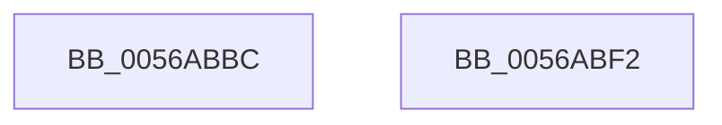

# READ_PORT_USHORT_PAIR

- RVA: `0x0056ABBC`–`0x0056ABF3` (길이 `55` bytes)
- VA: `0x000000014056ABBC`
- 실행 섹션: `.text`
- PDB 이름 있음: `예`; PDB Function 태그: `아니요`
- unwind 정보 RVA: `0x0005CAAC`
- 디코드: `22`개 명령, `55/55` bytes 표시
- 미해석 바이트: `0` (있으면 어셈블리에 `.byte`로 보존)

> 이 문서는 커널 이미지의 기계어와 PDB 기호를 분석해 생성했습니다. 4번과 5번은 함수 원형과 자료형을 바이너리 사용 방식에서 추정한 C 해석이며 원본 소스 복구 결과는 아닙니다.

## 1. Dependencies

- 직접 호출 지점: **1**; 고유 호출 대상: **1**
- 직접 호출자로 확인된 함수: **1**
- RIP 상대 이미지 참조: **0**

### Outgoing calls
- `0x0056ABD2` → [HalpIoDelay](../6A/HalpIoDelay_function_006AC7E0.md) (function, `0x006AC7E0`)

### Direct callers
- [HalpPicSetLineState](HalpPicSetLineState_function_0056AA90.md) at `0x0056AAE9`
- [HalpPicSetLineState](HalpPicSetLineState_function_0056AA90.md) at `0x0056AB2F`

### Static image references
- 디코드된 RIP-relative 메모리 참조가 없습니다.

## 2. Other-region calls and transfers

- 다른 실행 섹션으로 향하는 call: **0**
- 별도 외부 분기/꼬리 이동을 확인하지 못했습니다.

## 3. Assembly (complete function range)

```asm
0056ABBC  48 89 5C 24 08                  mov qword ptr [rsp + 8], rbx
0056ABC1  57                              push rdi
0056ABC2  48 83 EC 20                     sub rsp, 0x20
0056ABC6  90                              nop
0056ABC7  48 8B DA                        mov rbx, rdx
0056ABCA  0F B7 D1                        movzx edx, cx
0056ABCD  EC                              in al, dx
0056ABCE  0F B6 F8                        movzx edi, al
0056ABD1  90                              nop
0056ABD2  E8 09 1C 14 00                  call 0x1406ac7e0
0056ABD7  0F B7 D3                        movzx edx, bx
0056ABDA  90                              nop
0056ABDB  48 8B 5C 24 30                  mov rbx, qword ptr [rsp + 0x30]
0056ABE0  EC                              in al, dx
0056ABE1  0F B6 C0                        movzx eax, al
0056ABE4  90                              nop
0056ABE5  66 C1 E0 08                     shl ax, 8
0056ABE9  66 0B C7                        or ax, di
0056ABEC  48 83 C4 20                     add rsp, 0x20
0056ABF0  5F                              pop rdi
0056ABF1  C3                              ret
0056ABF2  CC                              int3
```

## 4. C-style interpretation (structured pseudocode)

```c
__int64 __fastcall READ_PORT_USHORT_PAIR(unsigned __int16 a1, __int64 a2)
{
    __int64 result;
    __int64 v_rsp;
    unsigned __int64 v_stack_p8;

    v_stack_p8 = v_rbx;
    v_rsp = (v_rsp) - (32);
    result = HalpIoDelay(a1, a1, a3, a4);
    result = (unsigned __int16)(((unsigned __int8)(result)) << (8));
    result = (unsigned __int16)((result) | ((unsigned __int16)((unsigned __int8)(result))));
    v_rsp = (v_rsp) + (32);
    return result;
}
```

## 5. (Beta) C Style

```c
int64_t READ_PORT_USHORT_PAIR(uint16_t Arg1, int64_t Arg2)
{
    int64_t result;
    int64_t local_rsp;
    uint64_t v_stack_p8;

    v_stack_p8 = local_rbx;
    local_rsp = (local_rsp) - (32);
    result = HalpIoDelay(Arg1, Arg1, a3, a4);
    result = (uint16_t)(((uint8_t)(result)) << (8));
    result = (uint16_t)((result) | ((uint16_t)((uint8_t)(result))));
    local_rsp = (local_rsp) + (32);
    return result;
}
```

## 6. Execution-region graph

[열기: 2D/3D 그래프와 함수 탐색 컨트롤 패널](../../../control-panel.html?section=text&rva=0x0056ABBC&view=graph)

- 2D 그래프는 위에서 아래로 흐르고, 3D 그래프는 빈 공간을 드래그해 회전합니다. Shift+드래그는 이동, 휠은 확대·축소, 함수 노드 선택은 대상 보고서 이동입니다.

### Static fallback


