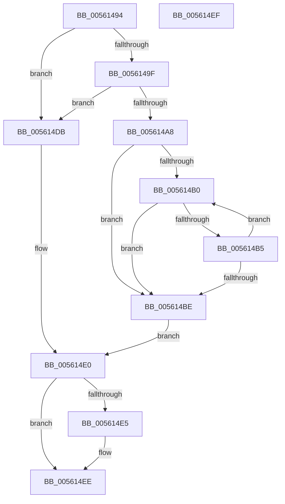

# RtlStringCbLengthA

- RVA: `0x00561494`–`0x005614F0` (길이 `92` bytes)
- VA: `0x0000000140561494`
- 실행 섹션: `.text`
- PDB 이름 있음: `예`; PDB Function 태그: `아니요`
- unwind 정보 RVA: `0x000DB714`
- 디코드: `32`개 명령, `92/92` bytes 표시
- 미해석 바이트: `0` (있으면 어셈블리에 `.byte`로 보존)

> 이 문서는 커널 이미지의 기계어와 PDB 기호를 분석해 생성했습니다. 4번과 5번은 함수 원형과 자료형을 바이너리 사용 방식에서 추정한 C 해석이며 원본 소스 복구 결과는 아닙니다.

## 1. Dependencies

- 직접 호출 지점: **0**; 고유 호출 대상: **0**
- 직접 호출자로 확인된 함수: **2**
- RIP 상대 이미지 참조: **0**

### Outgoing calls
- 직접 디코드된 call 명령이 없습니다.

### Direct callers
- [IopLiveDumpCallRemovePagesCallbacks](../59/IopLiveDumpCallRemovePagesCallbacks_function_0059AC28.md) at `0x0059AD2E`
- [KiValidateComponentName](../5B/KiValidateComponentName_function_005B553C.md) at `0x005B55B4`

### Static image references
- 디코드된 RIP-relative 메모리 참조가 없습니다.

## 2. Other-region calls and transfers

- 다른 실행 섹션으로 향하는 call: **0**
- 별도 외부 분기/꼬리 이동을 확인하지 못했습니다.

## 3. Assembly (complete function range)

```asm
00561494  45 33 C9                        xor r9d, r9d
00561497  45 8B D1                        mov r10d, r9d
0056149A  48 85 C9                        test rcx, rcx
0056149D  74 3C                           je 0x1405614db
0056149F  48 81 FA FF FF FF 7F            cmp rdx, 0x7fffffff
005614A6  77 33                           ja 0x1405614db
005614A8  4C 8B D2                        mov r10, rdx
005614AB  48 85 D2                        test rdx, rdx
005614AE  74 0E                           je 0x1405614be
005614B0  44 38 09                        cmp byte ptr [rcx], r9b
005614B3  74 09                           je 0x1405614be
005614B5  48 FF C1                        inc rcx
005614B8  49 83 EA 01                     sub r10, 1
005614BC  75 F2                           jne 0x1405614b0
005614BE  49 8B C2                        mov rax, r10
005614C1  48 F7 D8                        neg rax
005614C4  1B C0                           sbb eax, eax
005614C6  49 2B D2                        sub rdx, r10
005614C9  F7 D0                           not eax
005614CB  25 0D 00 00 C0                  and eax, 0xc000000d
005614D0  49 F7 DA                        neg r10
005614D3  4D 1B D2                        sbb r10, r10
005614D6  4C 23 D2                        and r10, rdx
005614D9  EB 05                           jmp 0x1405614e0
005614DB  B8 0D 00 00 C0                  mov eax, 0xc000000d
005614E0  4D 85 C0                        test r8, r8
005614E3  74 09                           je 0x1405614ee
005614E5  85 C0                           test eax, eax
005614E7  4D 0F 49 CA                     cmovns r9, r10
005614EB  4D 89 08                        mov qword ptr [r8], r9
005614EE  C3                              ret
005614EF  CC                              int3
```

## 4. C-style interpretation (structured pseudocode)

```c
__int64 __fastcall RtlStringCbLengthA(__int64 a1, __int64 a2, __int64 a3, int a4)
{
    __int64 result;
    __int64 v_r10;

    a4 = 0;
    if (a1 == 0) goto loc_005614DB;
    if (a2 > 0x7FFFFFFFULL) goto loc_005614DB;
    if (a2 == 0) goto loc_005614BE;
loc_005614B0:
    if ((*(unsigned __int8 *)(a1)) == 0) goto loc_005614BE;
    a1 = (a1) + 1;
    v_r10 = (a2) - (1);
    if (condition_is_not_equal) goto loc_005614B0;
loc_005614BE:
    result = -(v_r10);
    a2 = (a2) - (v_r10);
    result = (unsigned int)(~(result));
    result = (unsigned int)((result) & (0xC000000DULL));
    v_r10 = -(v_r10);
    v_r10 = (v_r10) & (a2);
    goto loc_005614E0;
loc_005614DB:
loc_005614E0:
    if (a3 != 0) {
        if (!sign_flag) { a4 = v_r10; }
        *(unsigned __int64 *)(a3) = a4;
    }
    return (unsigned int)(0xC000000DULL);
}
```

## 5. (Beta) C Style

```c
int64_t RtlStringCbLengthA(int64_t Arg1, int64_t Arg2, int64_t Arg3, int32_t Arg4)
{
    int64_t result;
    int64_t local_r10;

    Arg4 = 0;
    if (Arg1 == 0) goto loc_005614DB;
    if (Arg2 > 0x7FFFFFFFULL) goto loc_005614DB;
    if (Arg2 == 0) goto loc_005614BE;
loc_005614B0:
    if ((*(uint8_t *)(Arg1)) == 0) goto loc_005614BE;
    Arg1 = (Arg1) + 1;
    local_r10 = (Arg2) - (1);
    if (condition_is_not_equal) goto loc_005614B0;
loc_005614BE:
    result = -(local_r10);
    Arg2 = (Arg2) - (local_r10);
    result = (uint32_t)(~(result));
    result = (uint32_t)((result) & (0xC000000DULL));
    local_r10 = -(local_r10);
    local_r10 = (local_r10) & (Arg2);
    goto loc_005614E0;
loc_005614DB:
loc_005614E0:
    if (Arg3 != 0) {
        if (!sign_flag) { Arg4 = local_r10; }
        *(uint64_t *)(Arg3) = Arg4;
    }
    return (uint32_t)(0xC000000DULL);
}
```

## 6. Execution-region graph

[열기: 2D/3D 그래프와 함수 탐색 컨트롤 패널](../../../control-panel.html?section=text&rva=0x00561494&view=graph)

- 2D 그래프는 위에서 아래로 흐르고, 3D 그래프는 빈 공간을 드래그해 회전합니다. Shift+드래그는 이동, 휠은 확대·축소, 함수 노드 선택은 대상 보고서 이동입니다.

### Static fallback


