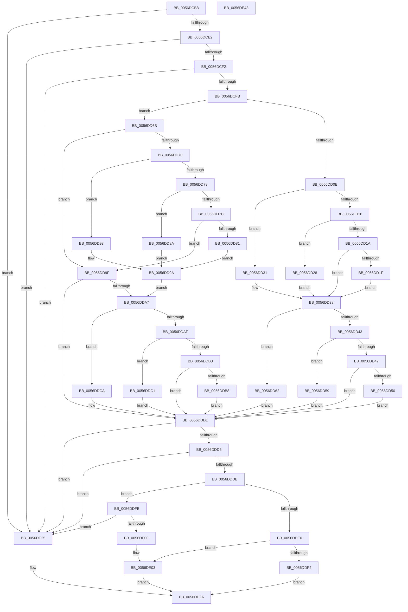

# WdHwCreateHardwareRegister

- RVA: `0x0056DCB8`–`0x0056DE44` (길이 `396` bytes)
- VA: `0x000000014056DCB8`
- 실행 섹션: `.text`
- PDB 이름 있음: `예`; PDB Function 태그: `아니요`
- unwind 정보 RVA: `0x00083688`
- 디코드: `123`개 명령, `396/396` bytes 표시
- 미해석 바이트: `0` (있으면 어셈블리에 `.byte`로 보존)

> 이 문서는 커널 이미지의 기계어와 PDB 기호를 분석해 생성했습니다. 4번과 5번은 함수 원형과 자료형을 바이너리 사용 방식에서 추정한 C 해석이며 원본 소스 복구 결과는 아닙니다.

## 1. Dependencies

- 직접 호출 지점: **1**; 고유 호출 대상: **1**
- 직접 호출자로 확인된 함수: **2**
- RIP 상대 이미지 참조: **12**

### Outgoing calls
- `0x0056DDEA` → [HalMapIoSpace](../4F/HalMapIoSpace_function_004FCD40.md) (function, `0x004FCD40`)

### Direct callers
- [HalpWdatProcessWdrtInternalData](HalpWdatProcessWdrtInternalData_function_00560FC0.md) at `0x00561044`
- [WdInstrInitializeInstruction](WdInstrInitializeInstruction_function_0056E074.md) at `0x0056E0CA`

### Static image references
- `0x0056DD1F` → RVA `0x004BDA40` (`READ_REGISTER_ULONG`; read)
- `0x0056DD28` → RVA `0x0055BE40` (`READ_REGISTER_USHORT`; read)
- `0x0056DD31` → RVA `0x0056DEE0` (`WdHwpReadRegisterUChar`; read)
- `0x0056DD50` → RVA `0x004D26F0` (`WRITE_REGISTER_ULONG`; read)
- `0x0056DD59` → RVA `0x0055BE60` (`WRITE_REGISTER_USHORT`; read)
- `0x0056DD62` → RVA `0x0055BE50` (`WRITE_REGISTER_UCHAR`; read)
- `0x0056DD81` → RVA `0x004C5C20` (`READ_PORT_ULONG`; read)
- `0x0056DD8A` → RVA `0x0056DEC0` (`WdHwpReadPortUShort`; read)
- `0x0056DD93` → RVA `0x0056DEA0` (`WdHwpReadPortUChar`; read)
- `0x0056DDB8` → RVA `0x004BEF80` (`WRITE_PORT_ULONG`; read)
- `0x0056DDC1` → RVA `0x0056DF00` (`WdHwpWritePortUShort`; read)
- `0x0056DDCA` → RVA `0x0056DEF0` (`WdHwpWritePortUChar`; read)

## 2. Other-region calls and transfers

- 다른 실행 섹션으로 향하는 call: **0**
- 별도 외부 분기/꼬리 이동을 확인하지 못했습니다.

## 3. Assembly (complete function range)

```asm
0056DCB8  48 89 5C 24 10                  mov qword ptr [rsp + 0x10], rbx
0056DCBD  48 89 6C 24 18                  mov qword ptr [rsp + 0x18], rbp
0056DCC2  56                              push rsi
0056DCC3  57                              push rdi
0056DCC4  41 54                           push r12
0056DCC6  41 56                           push r14
0056DCC8  41 57                           push r15
0056DCCA  48 83 EC 20                     sub rsp, 0x20
0056DCCE  33 FF                           xor edi, edi
0056DCD0  4D 8B F1                        mov r14, r9
0056DCD3  44 8A E2                        mov r12b, dl
0056DCD6  48 8B D9                        mov rbx, rcx
0056DCD9  48 85 C9                        test rcx, rcx
0056DCDC  0F 84 43 01 00 00               je 0x14056de25
0056DCE2  41 8A C0                        mov al, r8b
0056DCE5  8D 57 01                        lea edx, [rdi + 1]
0056DCE8  2A C2                           sub al, dl
0056DCEA  3C 02                           cmp al, 2
0056DCEC  0F 87 33 01 00 00               ja 0x14056de25
0056DCF2  4D 85 C9                        test r9, r9
0056DCF5  0F 84 2A 01 00 00               je 0x14056de25
0056DCFB  41 0F B6 C8                     movzx ecx, r8b
0056DCFF  44 8B FA                        mov r15d, edx
0056DD02  2B CA                           sub ecx, edx
0056DD04  8B EF                           mov ebp, edi
0056DD06  41 D2 E7                        shl r15b, cl
0056DD09  45 84 E4                        test r12b, r12b
0056DD0C  75 5D                           jne 0x14056dd6b
0056DD0E  41 0F B6 CF                     movzx ecx, r15b
0056DD12  2B CA                           sub ecx, edx
0056DD14  74 1B                           je 0x14056dd31
0056DD16  2B CA                           sub ecx, edx
0056DD18  74 0E                           je 0x14056dd28
0056DD1A  83 F9 02                        cmp ecx, 2
0056DD1D  75 19                           jne 0x14056dd38
0056DD1F  48 8D 2D 1A FD F4 FF            lea rbp, [rip - 0xb02e6]
0056DD26  EB 10                           jmp 0x14056dd38
0056DD28  48 8D 2D 11 E1 FE FF            lea rbp, [rip - 0x11eef]
0056DD2F  EB 07                           jmp 0x14056dd38
0056DD31  48 8D 2D A8 01 00 00            lea rbp, [rip + 0x1a8]
0056DD38  41 0F B6 CF                     movzx ecx, r15b
0056DD3C  48 8B F7                        mov rsi, rdi
0056DD3F  2B CA                           sub ecx, edx
0056DD41  74 1F                           je 0x14056dd62
0056DD43  2B CA                           sub ecx, edx
0056DD45  74 12                           je 0x14056dd59
0056DD47  83 F9 02                        cmp ecx, 2
0056DD4A  0F 85 81 00 00 00               jne 0x14056ddd1
0056DD50  48 8D 35 99 49 F6 FF            lea rsi, [rip - 0x9b667]
0056DD57  EB 78                           jmp 0x14056ddd1
0056DD59  48 8D 35 00 E1 FE FF            lea rsi, [rip - 0x11f00]
0056DD60  EB 6F                           jmp 0x14056ddd1
0056DD62  48 8D 35 E7 E0 FE FF            lea rsi, [rip - 0x11f19]
0056DD69  EB 66                           jmp 0x14056ddd1
0056DD6B  44 3A E2                        cmp r12b, dl
0056DD6E  75 2F                           jne 0x14056dd9f
0056DD70  41 0F B6 CF                     movzx ecx, r15b
0056DD74  2B CA                           sub ecx, edx
0056DD76  74 1B                           je 0x14056dd93
0056DD78  2B CA                           sub ecx, edx
0056DD7A  74 0E                           je 0x14056dd8a
0056DD7C  83 F9 02                        cmp ecx, 2
0056DD7F  75 1E                           jne 0x14056dd9f
0056DD81  48 8D 2D 98 7E F5 FF            lea rbp, [rip - 0xa8168]
0056DD88  EB 10                           jmp 0x14056dd9a
0056DD8A  48 8D 2D 2F 01 00 00            lea rbp, [rip + 0x12f]
0056DD91  EB 07                           jmp 0x14056dd9a
0056DD93  48 8D 2D 06 01 00 00            lea rbp, [rip + 0x106]
0056DD9A  48 8B F7                        mov rsi, rdi
0056DD9D  EB 08                           jmp 0x14056dda7
0056DD9F  48 8B F7                        mov rsi, rdi
0056DDA2  44 3A E2                        cmp r12b, dl
0056DDA5  75 2A                           jne 0x14056ddd1
0056DDA7  41 0F B6 CF                     movzx ecx, r15b
0056DDAB  2B CA                           sub ecx, edx
0056DDAD  74 1B                           je 0x14056ddca
0056DDAF  2B CA                           sub ecx, edx
0056DDB1  74 0E                           je 0x14056ddc1
0056DDB3  83 F9 02                        cmp ecx, 2
0056DDB6  75 19                           jne 0x14056ddd1
0056DDB8  48 8D 35 C1 11 F5 FF            lea rsi, [rip - 0xaee3f]
0056DDBF  EB 10                           jmp 0x14056ddd1
0056DDC1  48 8D 35 38 01 00 00            lea rsi, [rip + 0x138]
0056DDC8  EB 07                           jmp 0x14056ddd1
0056DDCA  48 8D 35 1F 01 00 00            lea rsi, [rip + 0x11f]
0056DDD1  48 85 ED                        test rbp, rbp
0056DDD4  74 4F                           je 0x14056de25
0056DDD6  48 85 F6                        test rsi, rsi
0056DDD9  74 4A                           je 0x14056de25
0056DDDB  45 84 E4                        test r12b, r12b
0056DDDE  75 1B                           jne 0x14056ddfb
0056DDE0  41 0F B6 D7                     movzx edx, r15b
0056DDE4  45 33 C0                        xor r8d, r8d
0056DDE7  48 8B CB                        mov rcx, rbx
0056DDEA  E8 51 EF F8 FF                  call 0x1404fcd40
0056DDEF  48 85 C0                        test rax, rax
0056DDF2  75 0F                           jne 0x14056de03
0056DDF4  BF 9A 00 00 C0                  mov edi, 0xc000009a
0056DDF9  EB 2F                           jmp 0x14056de2a
0056DDFB  44 3A E2                        cmp r12b, dl
0056DDFE  75 25                           jne 0x14056de25
0056DE00  48 8B C3                        mov rax, rbx
0056DE03  41 89 7E 0A                     mov dword ptr [r14 + 0xa], edi
0056DE07  66 41 89 7E 0E                  mov word ptr [r14 + 0xe], di
0056DE0C  49 89 1E                        mov qword ptr [r14], rbx
0056DE0F  45 88 66 08                     mov byte ptr [r14 + 8], r12b
0056DE13  45 88 7E 09                     mov byte ptr [r14 + 9], r15b
0056DE17  49 89 46 10                     mov qword ptr [r14 + 0x10], rax
0056DE1B  49 89 6E 18                     mov qword ptr [r14 + 0x18], rbp
0056DE1F  49 89 76 20                     mov qword ptr [r14 + 0x20], rsi
0056DE23  EB 05                           jmp 0x14056de2a
0056DE25  BF 0D 00 00 C0                  mov edi, 0xc000000d
0056DE2A  48 8B 5C 24 58                  mov rbx, qword ptr [rsp + 0x58]
0056DE2F  8B C7                           mov eax, edi
0056DE31  48 8B 6C 24 60                  mov rbp, qword ptr [rsp + 0x60]
0056DE36  48 83 C4 20                     add rsp, 0x20
0056DE3A  41 5F                           pop r15
0056DE3C  41 5E                           pop r14
0056DE3E  41 5C                           pop r12
0056DE40  5F                              pop rdi
0056DE41  5E                              pop rsi
0056DE42  C3                              ret
0056DE43  CC                              int3
```

## 4. C-style interpretation (structured pseudocode)

```c
__int64 __fastcall WdHwCreateHardwareRegister(__int64 a1, unsigned __int8 a2, int a3, __int64 a4)
{
    __int64 result;
    __int64 v_r15;
    __int64 v_rdi;
    __int64 v_rsp;
    unsigned __int64 v_stack_p10;
    unsigned __int64 v_stack_p18;

    v_stack_p10 = v_rbx;
    v_stack_p18 = v_rbp;
    v_rsp = (v_rsp) - (32);
    v_rdi = 0;
    if (a1 == 0) goto loc_0056DE25;
    result = (unsigned __int8)(((unsigned __int8)(a3)) - ((unsigned __int8)(v_rdi + 1)));
    if (((unsigned __int8)(result)) > 2) goto loc_0056DE25;
    if (a4 == 0) goto loc_0056DE25;
    a1 = (unsigned int)(((unsigned __int8)(a3)) - ((unsigned int)(v_rdi + 1)));
    v_r15 = (unsigned __int8)(((unsigned int)((unsigned int)(v_rdi + 1))) << ((unsigned __int8)(a1)));
    if (a2 != 0) goto loc_0056DD6B;
    a1 = (unsigned int)(((unsigned __int8)(v_r15)) - ((unsigned int)(v_rdi + 1)));
    if (condition_is_equal) goto loc_0056DD31;
    a1 = (unsigned int)((a1) - ((unsigned int)(v_rdi + 1)));
    if (condition_is_equal) goto loc_0056DD28;
    if (((unsigned int)(a1)) != 2) goto loc_0056DD38;
    goto loc_0056DD38;
loc_0056DD28:
    goto loc_0056DD38;
loc_0056DD31:
loc_0056DD38:
    a1 = (unsigned int)(((unsigned __int8)(v_r15)) - ((unsigned int)(v_rdi + 1)));
    if (condition_is_equal) goto loc_0056DD62;
    a1 = (unsigned int)((a1) - ((unsigned int)(v_rdi + 1)));
    if (condition_is_equal) goto loc_0056DD59;
    if (((unsigned int)(a1)) != 2) goto loc_0056DDD1;
    goto loc_0056DDD1;
loc_0056DD59:
    goto loc_0056DDD1;
loc_0056DD62:
    goto loc_0056DDD1;
loc_0056DD6B:
    if (a2 != ((unsigned __int8)(v_rdi + 1))) goto loc_0056DD9F;
    a1 = (unsigned int)(((unsigned __int8)(v_r15)) - ((unsigned int)(v_rdi + 1)));
    if (condition_is_equal) goto loc_0056DD93;
    a1 = (unsigned int)((a1) - ((unsigned int)(v_rdi + 1)));
    if (condition_is_equal) goto loc_0056DD8A;
    if (((unsigned int)(a1)) != 2) goto loc_0056DD9F;
    goto loc_0056DD9A;
loc_0056DD8A:
    goto loc_0056DD9A;
loc_0056DD93:
loc_0056DD9A:
    goto loc_0056DDA7;
loc_0056DD9F:
    if (a2 != ((unsigned __int8)(v_rdi + 1))) goto loc_0056DDD1;
loc_0056DDA7:
    a1 = (unsigned int)(((unsigned __int8)(v_r15)) - ((unsigned int)(v_rdi + 1)));
    if (condition_is_equal) goto loc_0056DDCA;
    a1 = (unsigned int)((a1) - ((unsigned int)(v_rdi + 1)));
    if (condition_is_equal) goto loc_0056DDC1;
    if (((unsigned int)(a1)) != 2) goto loc_0056DDD1;
    goto loc_0056DDD1;
loc_0056DDC1:
    goto loc_0056DDD1;
loc_0056DDCA:
loc_0056DDD1:
    if (v_rip + 262 == 0) goto loc_0056DE25;
    if (v_rip + 287 == 0) goto loc_0056DE25;
    if (a2 != 0) goto loc_0056DDFB;
    a3 = 0;
    result = HalMapIoSpace(a1, (unsigned __int8)(v_r15), a3, a4);
    if (result != 0) goto loc_0056DE03;
    goto loc_0056DE2A;
loc_0056DDFB:
    if (a2 != ((unsigned __int8)((unsigned __int8)(v_r15)))) goto loc_0056DE25;
loc_0056DE03:
    *(unsigned int *)(a4 + 10) = (unsigned int)((unsigned int)(0xC000009AULL));
    *(unsigned __int16 *)(a4 + 14) = (unsigned __int16)((unsigned int)(0xC000009AULL));
    *(unsigned __int64 *)(a4) = a1;
    *(unsigned __int8 *)(a4 + 8) = a2;
    *(unsigned __int8 *)(a4 + 9) = (unsigned __int8)(v_r15);
    *(unsigned __int64 *)(a4 + 16) = a1;
    *(unsigned __int64 *)(a4 + 24) = v_rip + 262;
    *(unsigned __int64 *)(a4 + 32) = v_rip + 287;
    goto loc_0056DE2A;
loc_0056DE25:
loc_0056DE2A:
    v_rsp = (v_rsp) + (32);
    return (unsigned int)((unsigned int)((unsigned int)(0xC000000DULL)));
}
```

## 5. (Beta) C Style

```c
int64_t WdHwCreateHardwareRegister(int64_t Arg1, uint8_t Arg2, int32_t Arg3, void *Arg4)
{
    uint8_t *arg4 = (uint8_t *)Arg4;

    int64_t result;
    int64_t local_r15;
    int64_t local_rdi;
    int64_t local_rsp;
    uint64_t v_stack_p10;
    uint64_t v_stack_p18;

    v_stack_p10 = local_rbx;
    v_stack_p18 = local_rbp;
    local_rsp = (local_rsp) - (32);
    local_rdi = 0;
    if (Arg1 == 0) goto loc_0056DE25;
    result = (uint8_t)(((uint8_t)(Arg3)) - ((uint8_t)(local_rdi + 1)));
    if (((uint8_t)(result)) > 2) goto loc_0056DE25;
    if (Arg4 == NULL) goto loc_0056DE25;
    Arg1 = (uint32_t)(((uint8_t)(Arg3)) - ((uint32_t)(local_rdi + 1)));
    local_r15 = (uint8_t)(((uint32_t)((uint32_t)(local_rdi + 1))) << ((uint8_t)(Arg1)));
    if (Arg2 != 0) goto loc_0056DD6B;
    Arg1 = (uint32_t)(((uint8_t)(local_r15)) - ((uint32_t)(local_rdi + 1)));
    if (condition_is_equal) goto loc_0056DD31;
    Arg1 = (uint32_t)((Arg1) - ((uint32_t)(local_rdi + 1)));
    if (condition_is_equal) goto loc_0056DD28;
    if (((uint32_t)(Arg1)) != 2) goto loc_0056DD38;
    goto loc_0056DD38;
loc_0056DD28:
    goto loc_0056DD38;
loc_0056DD31:
loc_0056DD38:
    Arg1 = (uint32_t)(((uint8_t)(local_r15)) - ((uint32_t)(local_rdi + 1)));
    if (condition_is_equal) goto loc_0056DD62;
    Arg1 = (uint32_t)((Arg1) - ((uint32_t)(local_rdi + 1)));
    if (condition_is_equal) goto loc_0056DD59;
    if (((uint32_t)(Arg1)) != 2) goto loc_0056DDD1;
    goto loc_0056DDD1;
loc_0056DD59:
    goto loc_0056DDD1;
loc_0056DD62:
    goto loc_0056DDD1;
loc_0056DD6B:
    if (Arg2 != ((uint8_t)(local_rdi + 1))) goto loc_0056DD9F;
    Arg1 = (uint32_t)(((uint8_t)(local_r15)) - ((uint32_t)(local_rdi + 1)));
    if (condition_is_equal) goto loc_0056DD93;
    Arg1 = (uint32_t)((Arg1) - ((uint32_t)(local_rdi + 1)));
    if (condition_is_equal) goto loc_0056DD8A;
    if (((uint32_t)(Arg1)) != 2) goto loc_0056DD9F;
    goto loc_0056DD9A;
loc_0056DD8A:
    goto loc_0056DD9A;
loc_0056DD93:
loc_0056DD9A:
    goto loc_0056DDA7;
loc_0056DD9F:
    if (Arg2 != ((uint8_t)(local_rdi + 1))) goto loc_0056DDD1;
loc_0056DDA7:
    Arg1 = (uint32_t)(((uint8_t)(local_r15)) - ((uint32_t)(local_rdi + 1)));
    if (condition_is_equal) goto loc_0056DDCA;
    Arg1 = (uint32_t)((Arg1) - ((uint32_t)(local_rdi + 1)));
    if (condition_is_equal) goto loc_0056DDC1;
    if (((uint32_t)(Arg1)) != 2) goto loc_0056DDD1;
    goto loc_0056DDD1;
loc_0056DDC1:
    goto loc_0056DDD1;
loc_0056DDCA:
loc_0056DDD1:
    if (v_rip + 262 == 0) goto loc_0056DE25;
    if (v_rip + 287 == 0) goto loc_0056DE25;
    if (Arg2 != 0) goto loc_0056DDFB;
    Arg3 = 0;
    result = HalMapIoSpace(Arg1, (uint8_t)(local_r15), Arg3, Arg4);
    if (result != 0) goto loc_0056DE03;
    goto loc_0056DE2A;
loc_0056DDFB:
    if (Arg2 != ((uint8_t)((uint8_t)(local_r15)))) goto loc_0056DE25;
loc_0056DE03:
    *(uint32_t *)(arg4 + 0xA) = (uint32_t)((uint32_t)(0xC000009AULL));
    *(uint16_t *)(arg4 + 0xE) = (uint16_t)((uint32_t)(0xC000009AULL));
    *(uint64_t *)(arg4) = Arg1;
    *(uint8_t *)(arg4 + 0x8) = Arg2;
    *(uint8_t *)(arg4 + 0x9) = (uint8_t)(local_r15);
    *(uint64_t *)(arg4 + 0x10) = Arg1;
    *(uint64_t *)(arg4 + 0x18) = v_rip + 262;
    *(uint64_t *)(arg4 + 0x20) = v_rip + 287;
    goto loc_0056DE2A;
loc_0056DE25:
loc_0056DE2A:
    local_rsp = (local_rsp) + (32);
    return (uint32_t)((uint32_t)((uint32_t)(0xC000000DULL)));
}
```

### 관측된 메모리 오프셋

구조체 형식이 확인되지 않은 접근은 인자 기준의 오프셋으로만 기록했습니다.

| 기준 인자 | 오프셋 표현 | 폭 (bit) | 접근 |
|---|---:|---:|---|
| `Arg4` | `+ 0x0` | `64` | `W` |
| `Arg4` | `+ 0x8` | `8` | `W` |
| `Arg4` | `+ 0x9` | `8` | `W` |
| `Arg4` | `+ 0xA` | `32` | `W` |
| `Arg4` | `+ 0xE` | `16` | `W` |
| `Arg4` | `+ 0x10` | `64` | `W` |
| `Arg4` | `+ 0x18` | `64` | `W` |
| `Arg4` | `+ 0x20` | `64` | `W` |

## 6. Execution-region graph

[열기: 2D/3D 그래프와 함수 탐색 컨트롤 패널](../../../control-panel.html?section=text&rva=0x0056DCB8&view=graph)

- 2D 그래프는 위에서 아래로 흐르고, 3D 그래프는 빈 공간을 드래그해 회전합니다. Shift+드래그는 이동, 휠은 확대·축소, 함수 노드 선택은 대상 보고서 이동입니다.

### Static fallback


