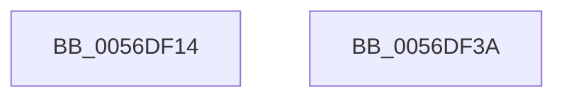

# WdInstrDestroyInstruction

- RVA: `0x0056DF14`–`0x0056DF3B` (길이 `39` bytes)
- VA: `0x000000014056DF14`
- 실행 섹션: `.text`
- PDB 이름 있음: `예`; PDB Function 태그: `아니요`
- unwind 정보 RVA: `0x0005CF00`
- 디코드: `13`개 명령, `39/39` bytes 표시
- 미해석 바이트: `0` (있으면 어셈블리에 `.byte`로 보존)

> 이 문서는 커널 이미지의 기계어와 PDB 기호를 분석해 생성했습니다. 4번과 5번은 함수 원형과 자료형을 바이너리 사용 방식에서 추정한 C 해석이며 원본 소스 복구 결과는 아닙니다.

## 1. Dependencies

- 직접 호출 지점: **2**; 고유 호출 대상: **2**
- 직접 호출자로 확인된 함수: **1**
- RIP 상대 이미지 참조: **0**

### Outgoing calls
- `0x0056DF21` → [WdHwDestroyHardwareRegister](WdHwDestroyHardwareRegister_function_0056DE4C.md) (function, `0x0056DE4C`)
- `0x0056DF2F` → [memset](../6C/memset_function_006C6C40.md) (function, `0x006C6C40`)

### Direct callers
- [HalpWdatExecuteActionBeforeInitialize](HalpWdatExecuteActionBeforeInitialize_function_00560C48.md) at `0x00560CE7`
- [HalpWdatExecuteActionBeforeInitialize](HalpWdatExecuteActionBeforeInitialize_function_00560C48.md) at `0x00560D70`

### Static image references
- 디코드된 RIP-relative 메모리 참조가 없습니다.

## 2. Other-region calls and transfers

- 다른 실행 섹션으로 향하는 call: **0**
- 별도 외부 분기/꼬리 이동을 확인하지 못했습니다.

## 3. Assembly (complete function range)

```asm
0056DF14  40 53                           push rbx
0056DF16  48 83 EC 20                     sub rsp, 0x20
0056DF1A  48 8B D9                        mov rbx, rcx
0056DF1D  48 83 C1 08                     add rcx, 8
0056DF21  E8 26 FF FF FF                  call 0x14056de4c
0056DF26  33 D2                           xor edx, edx
0056DF28  48 8B CB                        mov rcx, rbx
0056DF2B  44 8D 42 40                     lea r8d, [rdx + 0x40]
0056DF2F  E8 0C 8D 15 00                  call 0x1406c6c40
0056DF34  48 83 C4 20                     add rsp, 0x20
0056DF38  5B                              pop rbx
0056DF39  C3                              ret
0056DF3A  CC                              int3
```

## 4. C-style interpretation (structured pseudocode)

```c
__int64 __fastcall WdInstrDestroyInstruction(__int64 a1, int a2)
{
    __int64 result;
    __int64 v_rsp;

    v_rsp = (v_rsp) - (32);
    a1 = (a1) + (8);
    result = WdHwDestroyHardwareRegister(a1, a2, a3, a4);
    a2 = 0;
    result = memset(a1, a2, a2 + 64, a4);
    v_rsp = (v_rsp) + (32);
    return result;
}
```

## 5. (Beta) C Style

```c
int64_t WdInstrDestroyInstruction(int64_t Arg1, int32_t Arg2)
{
    int64_t result;
    int64_t local_rsp;

    local_rsp = (local_rsp) - (32);
    Arg1 = (Arg1) + (8);
    result = WdHwDestroyHardwareRegister(Arg1, Arg2, a3, a4);
    Arg2 = 0;
    result = memset(Arg1, Arg2, Arg2 + 64, a4);
    local_rsp = (local_rsp) + (32);
    return result;
}
```

## 6. Execution-region graph

[열기: 2D/3D 그래프와 함수 탐색 컨트롤 패널](../../../control-panel.html?section=text&rva=0x0056DF14&view=graph)

- 2D 그래프는 위에서 아래로 흐르고, 3D 그래프는 빈 공간을 드래그해 회전합니다. Shift+드래그는 이동, 휠은 확대·축소, 함수 노드 선택은 대상 보고서 이동입니다.

### Static fallback


