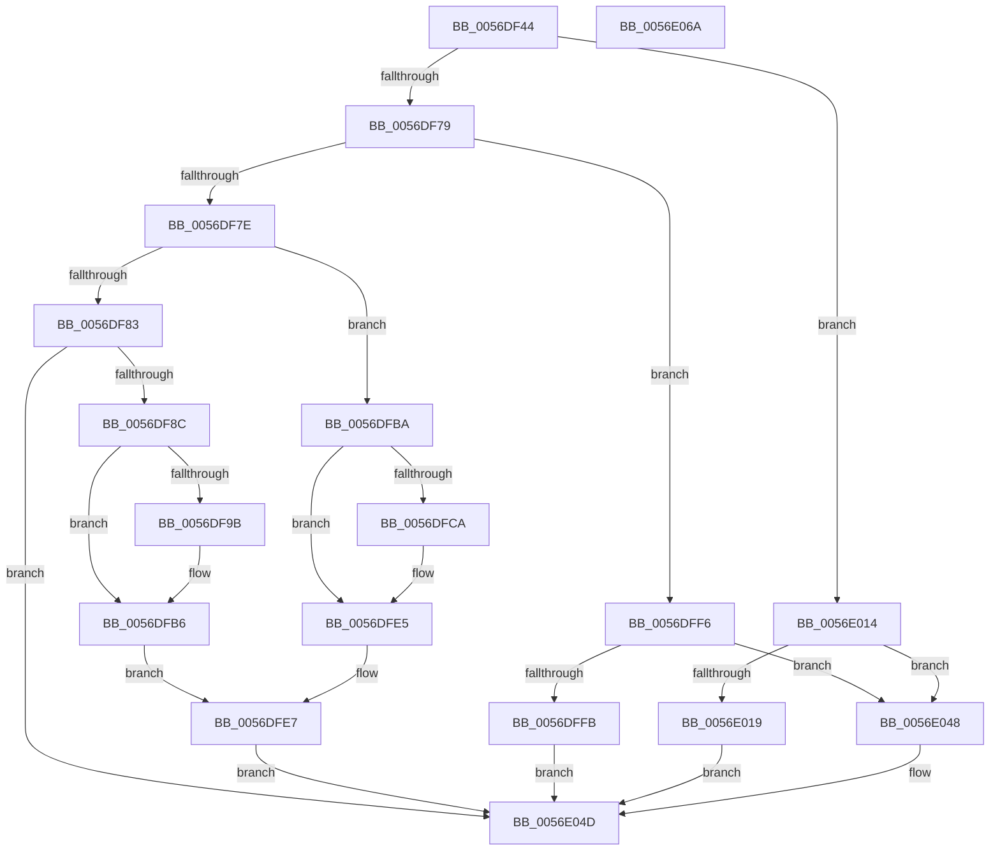

# WdInstrExecuteInstruction

- RVA: `0x0056DF44`–`0x0056E06B` (길이 `295` bytes)
- VA: `0x000000014056DF44`
- 실행 섹션: `.text`
- PDB 이름 있음: `예`; PDB Function 태그: `아니요`
- unwind 정보 RVA: `0x0005E6B4`
- 디코드: `95`개 명령, `295/295` bytes 표시
- 미해석 바이트: `0` (있으면 어셈블리에 `.byte`로 보존)

> 이 문서는 커널 이미지의 기계어와 PDB 기호를 분석해 생성했습니다. 4번과 5번은 함수 원형과 자료형을 바이너리 사용 방식에서 추정한 C 해석이며 원본 소스 복구 결과는 아닙니다.

## 1. Dependencies

- 직접 호출 지점: **5**; 고유 호출 대상: **1**
- 직접 호출자로 확인된 함수: **2**
- RIP 상대 이미지 참조: **0**

### Outgoing calls
- `0x0056DFA3` → [guard_dispatch_icall](../6B/guard_dispatch_icall_function_006BAAD0.md) (function, `0x006BAAD0`)
- `0x0056DFD2` → [guard_dispatch_icall](../6B/guard_dispatch_icall_function_006BAAD0.md) (function, `0x006BAAD0`)
- `0x0056DFEF` → [guard_dispatch_icall](../6B/guard_dispatch_icall_function_006BAAD0.md) (function, `0x006BAAD0`)
- `0x0056E003` → [guard_dispatch_icall](../6B/guard_dispatch_icall_function_006BAAD0.md) (function, `0x006BAAD0`)
- `0x0056E021` → [guard_dispatch_icall](../6B/guard_dispatch_icall_function_006BAAD0.md) (function, `0x006BAAD0`)

### Direct callers
- [WdInstrExecuteAction](../4D/WdInstrExecuteAction_function_004D0928.md) at `0x004D096E`
- [HalpWdatExecuteActionBeforeInitialize](HalpWdatExecuteActionBeforeInitialize_function_00560C48.md) at `0x00560CD8`
- [HalpWdatExecuteActionBeforeInitialize](HalpWdatExecuteActionBeforeInitialize_function_00560C48.md) at `0x00560D61`

### Static image references
- 디코드된 RIP-relative 메모리 참조가 없습니다.

## 2. Other-region calls and transfers

- 다른 실행 섹션으로 향하는 call: **0**
- 별도 외부 분기/꼬리 이동을 확인하지 못했습니다.

## 3. Assembly (complete function range)

```asm
0056DF44  48 8B C4                        mov rax, rsp
0056DF47  48 89 58 08                     mov qword ptr [rax + 8], rbx
0056DF4B  48 89 68 10                     mov qword ptr [rax + 0x10], rbp
0056DF4F  48 89 70 18                     mov qword ptr [rax + 0x18], rsi
0056DF53  48 89 78 20                     mov qword ptr [rax + 0x20], rdi
0056DF57  41 56                           push r14
0056DF59  48 83 EC 20                     sub rsp, 0x20
0056DF5D  48 8B D9                        mov rbx, rcx
0056DF60  49 8B F0                        mov rsi, r8
0056DF63  44 0F B6 41 01                  movzx r8d, byte ptr [rcx + 1]
0056DF68  33 FF                           xor edi, edi
0056DF6A  41 8B C8                        mov ecx, r8d
0056DF6D  81 E1 3F FF FF FF               and ecx, 0xffffff3f
0056DF73  0F 84 9B 00 00 00               je 0x14056e014
0056DF79  83 E9 01                        sub ecx, 1
0056DF7C  74 78                           je 0x14056dff6
0056DF7E  83 E9 01                        sub ecx, 1
0056DF81  74 37                           je 0x14056dfba
0056DF83  83 F9 01                        cmp ecx, 1
0056DF86  0F 85 C1 00 00 00               jne 0x14056e04d
0056DF8C  8B 6B 38                        mov ebp, dword ptr [rbx + 0x38]
0056DF8F  8A 4B 31                        mov cl, byte ptr [rbx + 0x31]
0056DF92  23 EA                           and ebp, edx
0056DF94  D3 E5                           shl ebp, cl
0056DF96  45 84 C0                        test r8b, r8b
0056DF99  79 1B                           jns 0x14056dfb6
0056DF9B  48 8B 43 20                     mov rax, qword ptr [rbx + 0x20]
0056DF9F  48 8B 4B 18                     mov rcx, qword ptr [rbx + 0x18]
0056DFA3  E8 28 CB 14 00                  call 0x1406baad0
0056DFA8  8A 4B 31                        mov cl, byte ptr [rbx + 0x31]
0056DFAB  8B 53 38                        mov edx, dword ptr [rbx + 0x38]
0056DFAE  D3 E2                           shl edx, cl
0056DFB0  F7 D2                           not edx
0056DFB2  23 D0                           and edx, eax
0056DFB4  0B EA                           or ebp, edx
0056DFB6  8B D5                           mov edx, ebp
0056DFB8  EB 2D                           jmp 0x14056dfe7
0056DFBA  8B 73 34                        mov esi, dword ptr [rbx + 0x34]
0056DFBD  23 73 38                        and esi, dword ptr [rbx + 0x38]
0056DFC0  8A 4B 31                        mov cl, byte ptr [rbx + 0x31]
0056DFC3  D3 E6                           shl esi, cl
0056DFC5  45 84 C0                        test r8b, r8b
0056DFC8  79 1B                           jns 0x14056dfe5
0056DFCA  48 8B 43 20                     mov rax, qword ptr [rbx + 0x20]
0056DFCE  48 8B 4B 18                     mov rcx, qword ptr [rbx + 0x18]
0056DFD2  E8 F9 CA 14 00                  call 0x1406baad0
0056DFD7  8A 4B 31                        mov cl, byte ptr [rbx + 0x31]
0056DFDA  8B 53 38                        mov edx, dword ptr [rbx + 0x38]
0056DFDD  D3 E2                           shl edx, cl
0056DFDF  F7 D2                           not edx
0056DFE1  23 D0                           and edx, eax
0056DFE3  0B F2                           or esi, edx
0056DFE5  8B D6                           mov edx, esi
0056DFE7  48 8B 43 28                     mov rax, qword ptr [rbx + 0x28]
0056DFEB  48 8B 4B 18                     mov rcx, qword ptr [rbx + 0x18]
0056DFEF  E8 DC CA 14 00                  call 0x1406baad0
0056DFF4  EB 57                           jmp 0x14056e04d
0056DFF6  48 85 F6                        test rsi, rsi
0056DFF9  74 4D                           je 0x14056e048
0056DFFB  48 8B 43 20                     mov rax, qword ptr [rbx + 0x20]
0056DFFF  48 8B 4B 18                     mov rcx, qword ptr [rbx + 0x18]
0056E003  E8 C8 CA 14 00                  call 0x1406baad0
0056E008  8A 4B 31                        mov cl, byte ptr [rbx + 0x31]
0056E00B  D3 E8                           shr eax, cl
0056E00D  23 43 38                        and eax, dword ptr [rbx + 0x38]
0056E010  89 06                           mov dword ptr [rsi], eax
0056E012  EB 39                           jmp 0x14056e04d
0056E014  48 85 F6                        test rsi, rsi
0056E017  74 2F                           je 0x14056e048
0056E019  48 8B 43 20                     mov rax, qword ptr [rbx + 0x20]
0056E01D  48 8B 4B 18                     mov rcx, qword ptr [rbx + 0x18]
0056E021  E8 AA CA 14 00                  call 0x1406baad0
0056E026  8A 4B 31                        mov cl, byte ptr [rbx + 0x31]
0056E029  D3 E8                           shr eax, cl
0056E02B  23 43 38                        and eax, dword ptr [rbx + 0x38]
0056E02E  8B 4B 34                        mov ecx, dword ptr [rbx + 0x34]
0056E031  3B C1                           cmp eax, ecx
0056E033  40 0F 94 C7                     sete dil
0056E037  2B C1                           sub eax, ecx
0056E039  F7 D8                           neg eax
0056E03B  89 3E                           mov dword ptr [rsi], edi
0056E03D  1B C0                           sbb eax, eax
0056E03F  25 01 00 00 C0                  and eax, 0xc0000001
0056E044  8B F8                           mov edi, eax
0056E046  EB 05                           jmp 0x14056e04d
0056E048  BF 0D 00 00 C0                  mov edi, 0xc000000d
0056E04D  48 8B 5C 24 30                  mov rbx, qword ptr [rsp + 0x30]
0056E052  8B C7                           mov eax, edi
0056E054  48 8B 7C 24 48                  mov rdi, qword ptr [rsp + 0x48]
0056E059  48 8B 6C 24 38                  mov rbp, qword ptr [rsp + 0x38]
0056E05E  48 8B 74 24 40                  mov rsi, qword ptr [rsp + 0x40]
0056E063  48 83 C4 20                     add rsp, 0x20
0056E067  41 5E                           pop r14
0056E069  C3                              ret
0056E06A  CC                              int3
```

## 4. C-style interpretation (structured pseudocode)

```c
__int64 __fastcall WdInstrExecuteInstruction(__int64 a1, int a2, __int64 a3)
{
    __int64 result;
    __int64 v_rbp;
    __int64 v_rdi;
    __int64 v_rsi;
    __int64 v_rsp;
    unsigned __int64 v_stack_p10;
    unsigned __int64 v_stack_p18;
    unsigned __int64 v_stack_p20;
    unsigned __int64 v_stack_p8;

    *(unsigned __int64 *)(v_rsp + 8) = v_rbx;
    *(unsigned __int64 *)(v_rsp + 16) = v_rbp;
    *(unsigned __int64 *)(v_rsp + 24) = v_rsi;
    *(unsigned __int64 *)(v_rsp + 32) = v_rdi;
    v_rsp = (v_rsp) - (32);
    v_rdi = 0;
    a1 = (unsigned int)(((unsigned int)((unsigned int)(*(unsigned __int8 *)(a1 + 1)))) & (0xFFFFFF3FULL));
    if (condition_is_equal) goto loc_0056E014;
    a1 = (unsigned int)((a1) - (1));
    if (condition_is_equal) goto loc_0056DFF6;
    a1 = (unsigned int)((a1) - (1));
    if (condition_is_equal) goto loc_0056DFBA;
    if (((unsigned int)(a1)) != 1) goto loc_0056E04D;
    v_rbp = (unsigned int)(((unsigned int)(*(unsigned int *)(a1 + 56))) & (a2));
    v_rbp = (unsigned int)((v_rbp) << ((unsigned __int8)(*(unsigned __int8 *)(a1 + 49))));
    result = v_rsp;
    if (sign_flag) {
        result = *(unsigned __int64 *)(a1 + 32);
        a1 = *(unsigned __int64 *)(a1 + 24);
        result = guard_dispatch_icall(a1, a2, *(unsigned __int8 *)(a1 + 1), a4);
        a1 = *(unsigned __int8 *)(a1 + 49);
        a2 = *(unsigned int *)(a1 + 56);
        a2 = (unsigned int)((a2) << ((unsigned __int8)(a1)));
        a2 = (unsigned int)(~(a2));
        a2 = (unsigned int)((a2) & ((unsigned int)(result)));
        v_rbp = (unsigned int)((v_rbp) | (a2));
    }
    goto loc_0056DFE7;
loc_0056DFBA:
    v_rsi = (unsigned int)(((unsigned int)(*(unsigned int *)(a1 + 52))) & (*(unsigned int *)(a1 + 56)));
    v_rsi = (unsigned int)((v_rsi) << ((unsigned __int8)(*(unsigned __int8 *)(a1 + 49))));
    if (sign_flag) {
        result = *(unsigned __int64 *)(a1 + 32);
        a1 = *(unsigned __int64 *)(a1 + 24);
        result = guard_dispatch_icall(a1, (unsigned int)((unsigned int)(v_rbp)), *(unsigned __int8 *)(a1 + 1), a4);
        a1 = *(unsigned __int8 *)(a1 + 49);
        a2 = *(unsigned int *)(a1 + 56);
        a2 = (unsigned int)((a2) << ((unsigned __int8)(a1)));
        a2 = (unsigned int)(~(a2));
        a2 = (unsigned int)((a2) & ((unsigned int)(result)));
        v_rsi = (unsigned int)((v_rsi) | (a2));
    }
loc_0056DFE7:
    result = guard_dispatch_icall(*(unsigned __int64 *)(a1 + 24), (unsigned int)((unsigned int)(v_rsi)), *(unsigned __int8 *)(a1 + 1), a4);
    goto loc_0056E04D;
loc_0056DFF6:
    if (v_rsi == 0) goto loc_0056E048;
    result = guard_dispatch_icall(*(unsigned __int64 *)(a1 + 24), (unsigned int)((unsigned int)(v_rsi)), *(unsigned __int8 *)(a1 + 1), a4);
    result = (unsigned int)((result) >> ((unsigned __int8)(*(unsigned __int8 *)(a1 + 49))));
    result = (unsigned int)((result) & (*(unsigned int *)(a1 + 56)));
    *(unsigned int *)(v_rsi) = (unsigned int)(result);
    goto loc_0056E04D;
loc_0056E014:
    if (v_rsi == 0) goto loc_0056E048;
    result = guard_dispatch_icall(*(unsigned __int64 *)(a1 + 24), (unsigned int)((unsigned int)(v_rsi)), *(unsigned __int8 *)(a1 + 1), a4);
    result = (unsigned int)((result) >> ((unsigned __int8)(*(unsigned __int8 *)(a1 + 49))));
    result = (unsigned int)((result) & (*(unsigned int *)(a1 + 56)));
    v_rdi = (((unsigned int)(result)) == ((unsigned int)((unsigned int)(*(unsigned int *)(a1 + 52))))) ? 1 : 0;
    result = (unsigned int)((result) - ((unsigned int)((unsigned int)(*(unsigned int *)(a1 + 52)))));
    result = (unsigned int)(-(result));
    *(unsigned int *)(v_rsi) = (unsigned int)(v_rdi);
    result = (unsigned int)((result) & (0xC0000001ULL));
    goto loc_0056E04D;
loc_0056E048:
loc_0056E04D:
    v_rsp = (v_rsp) + (32);
    return (unsigned int)((unsigned int)((unsigned int)(0xC000000DULL)));
}
```

## 5. (Beta) C Style

```c
int64_t WdInstrExecuteInstruction(void *Arg1, int32_t Arg2, int64_t Arg3)
{
    uint8_t *arg1 = (uint8_t *)Arg1;

    int64_t result;
    int64_t local_rbp;
    int64_t local_rdi;
    int64_t local_rsi;
    int64_t local_rsp;
    uint64_t v_stack_p10;
    uint64_t v_stack_p18;
    uint64_t v_stack_p20;
    uint64_t v_stack_p8;

    *(uint64_t *)(local_rsp + 0x8) = local_rbx;
    *(uint64_t *)(local_rsp + 0x10) = local_rbp;
    *(uint64_t *)(local_rsp + 0x18) = local_rsi;
    *(uint64_t *)(local_rsp + 0x20) = local_rdi;
    local_rsp = (local_rsp) - (32);
    local_rdi = 0;
    Arg1 = (uint32_t)(((uint32_t)((uint32_t)(*(uint8_t *)(arg1 + 0x1)))) & (0xFFFFFF3FULL));
    if (condition_is_equal) goto loc_0056E014;
    Arg1 = (uint32_t)((Arg1) - (1));
    if (condition_is_equal) goto loc_0056DFF6;
    Arg1 = (uint32_t)((Arg1) - (1));
    if (condition_is_equal) goto loc_0056DFBA;
    if (((uint32_t)(Arg1)) != 1) goto loc_0056E04D;
    local_rbp = (uint32_t)(((uint32_t)(*(uint32_t *)(arg1 + 0x38))) & (Arg2));
    local_rbp = (uint32_t)((local_rbp) << ((uint8_t)(*(uint8_t *)(arg1 + 0x31))));
    result = local_rsp;
    if (sign_flag) {
        result = *(uint64_t *)(arg1 + 0x20);
        Arg1 = *(uint64_t *)(arg1 + 0x18);
        result = guard_dispatch_icall(Arg1, Arg2, *(uint8_t *)(arg1 + 0x1), a4);
        Arg1 = *(uint8_t *)(arg1 + 0x31);
        Arg2 = *(uint32_t *)(arg1 + 0x38);
        Arg2 = (uint32_t)((Arg2) << ((uint8_t)(Arg1)));
        Arg2 = (uint32_t)(~(Arg2));
        Arg2 = (uint32_t)((Arg2) & ((uint32_t)(result)));
        local_rbp = (uint32_t)((local_rbp) | (Arg2));
    }
    goto loc_0056DFE7;
loc_0056DFBA:
    local_rsi = (uint32_t)(((uint32_t)(*(uint32_t *)(arg1 + 0x34))) & (*(uint32_t *)(arg1 + 0x38)));
    local_rsi = (uint32_t)((local_rsi) << ((uint8_t)(*(uint8_t *)(arg1 + 0x31))));
    if (sign_flag) {
        result = *(uint64_t *)(arg1 + 0x20);
        Arg1 = *(uint64_t *)(arg1 + 0x18);
        result = guard_dispatch_icall(Arg1, (uint32_t)((uint32_t)(local_rbp)), *(uint8_t *)(arg1 + 0x1), a4);
        Arg1 = *(uint8_t *)(arg1 + 0x31);
        Arg2 = *(uint32_t *)(arg1 + 0x38);
        Arg2 = (uint32_t)((Arg2) << ((uint8_t)(Arg1)));
        Arg2 = (uint32_t)(~(Arg2));
        Arg2 = (uint32_t)((Arg2) & ((uint32_t)(result)));
        local_rsi = (uint32_t)((local_rsi) | (Arg2));
    }
loc_0056DFE7:
    result = guard_dispatch_icall(*(uint64_t *)(arg1 + 0x18), (uint32_t)((uint32_t)(local_rsi)), *(uint8_t *)(arg1 + 0x1), a4);
    goto loc_0056E04D;
loc_0056DFF6:
    if (local_rsi == 0) goto loc_0056E048;
    result = guard_dispatch_icall(*(uint64_t *)(arg1 + 0x18), (uint32_t)((uint32_t)(local_rsi)), *(uint8_t *)(arg1 + 0x1), a4);
    result = (uint32_t)((result) >> ((uint8_t)(*(uint8_t *)(arg1 + 0x31))));
    result = (uint32_t)((result) & (*(uint32_t *)(arg1 + 0x38)));
    *(uint32_t *)(local_rsi) = (uint32_t)(result);
    goto loc_0056E04D;
loc_0056E014:
    if (local_rsi == 0) goto loc_0056E048;
    result = guard_dispatch_icall(*(uint64_t *)(arg1 + 0x18), (uint32_t)((uint32_t)(local_rsi)), *(uint8_t *)(arg1 + 0x1), a4);
    result = (uint32_t)((result) >> ((uint8_t)(*(uint8_t *)(arg1 + 0x31))));
    result = (uint32_t)((result) & (*(uint32_t *)(arg1 + 0x38)));
    local_rdi = (((uint32_t)(result)) == ((uint32_t)((uint32_t)(*(uint32_t *)(arg1 + 0x34))))) ? 1 : 0;
    result = (uint32_t)((result) - ((uint32_t)((uint32_t)(*(uint32_t *)(arg1 + 0x34)))));
    result = (uint32_t)(-(result));
    *(uint32_t *)(local_rsi) = (uint32_t)(local_rdi);
    result = (uint32_t)((result) & (0xC0000001ULL));
    goto loc_0056E04D;
loc_0056E048:
loc_0056E04D:
    local_rsp = (local_rsp) + (32);
    return (uint32_t)((uint32_t)((uint32_t)(0xC000000DULL)));
}
```

### 관측된 메모리 오프셋

구조체 형식이 확인되지 않은 접근은 인자 기준의 오프셋으로만 기록했습니다.

| 기준 인자 | 오프셋 표현 | 폭 (bit) | 접근 |
|---|---:|---:|---|
| `Arg1` | `+ 0x1` | `8` | `R` |
| `Arg1` | `+ 0x18` | `64` | `R` |
| `Arg1` | `+ 0x20` | `64` | `R` |
| `Arg1` | `+ 0x28` | `64` | `R` |
| `Arg1` | `+ 0x31` | `8` | `R` |
| `Arg1` | `+ 0x34` | `32` | `R` |
| `Arg1` | `+ 0x38` | `32` | `R` |

## 6. Execution-region graph

[열기: 2D/3D 그래프와 함수 탐색 컨트롤 패널](../../../control-panel.html?section=text&rva=0x0056DF44&view=graph)

- 2D 그래프는 위에서 아래로 흐르고, 3D 그래프는 빈 공간을 드래그해 회전합니다. Shift+드래그는 이동, 휠은 확대·축소, 함수 노드 선택은 대상 보고서 이동입니다.

### Static fallback


