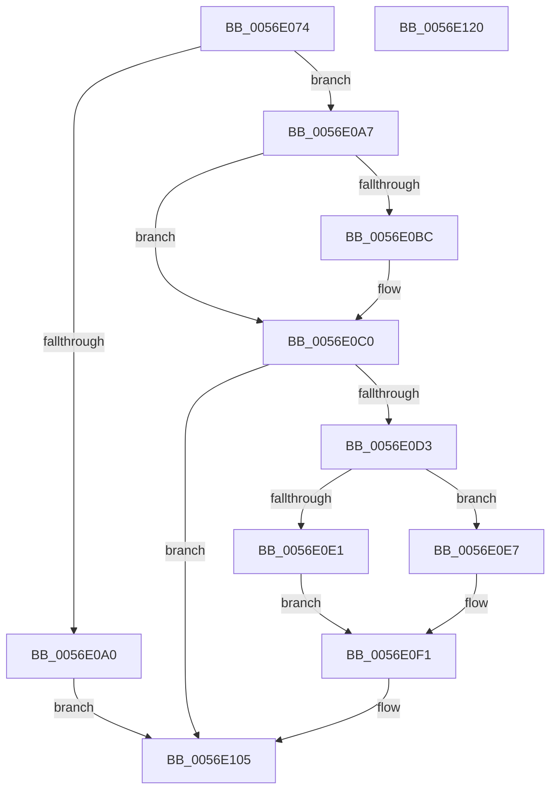

# WdInstrInitializeInstruction

- RVA: `0x0056E074`–`0x0056E121` (길이 `173` bytes)
- VA: `0x000000014056E074`
- 실행 섹션: `.text`
- PDB 이름 있음: `예`; PDB Function 태그: `아니요`
- unwind 정보 RVA: `0x0005E6B4`
- 디코드: `52`개 명령, `173/173` bytes 표시
- 미해석 바이트: `0` (있으면 어셈블리에 `.byte`로 보존)

> 이 문서는 커널 이미지의 기계어와 PDB 기호를 분석해 생성했습니다. 4번과 5번은 함수 원형과 자료형을 바이너리 사용 방식에서 추정한 C 해석이며 원본 소스 복구 결과는 아닙니다.

## 1. Dependencies

- 직접 호출 지점: **2**; 고유 호출 대상: **2**
- 직접 호출자로 확인된 함수: **3**
- RIP 상대 이미지 참조: **0**

### Outgoing calls
- `0x0056E0AD` → [memset](../6C/memset_function_006C6C40.md) (function, `0x006C6C40`)
- `0x0056E0CA` → [WdHwCreateHardwareRegister](WdHwCreateHardwareRegister_function_0056DCB8.md) (function, `0x0056DCB8`)

### Direct callers
- [HalpWdatExecuteActionBeforeInitialize](HalpWdatExecuteActionBeforeInitialize_function_00560C48.md) at `0x00560CC5`
- [HalpWdatExecuteActionBeforeInitialize](HalpWdatExecuteActionBeforeInitialize_function_00560C48.md) at `0x00560D4E`
- [HalpWdatInitializeWdat](HalpWdatInitializeWdat_function_00560E28.md) at `0x00560E96`
- [HalpWdatInitializeWdrt](HalpWdatInitializeWdrt_function_00560EBC.md) at `0x00560F92`

### Static image references
- 디코드된 RIP-relative 메모리 참조가 없습니다.

## 2. Other-region calls and transfers

- 다른 실행 섹션으로 향하는 call: **0**
- 별도 외부 분기/꼬리 이동을 확인하지 못했습니다.

## 3. Assembly (complete function range)

```asm
0056E074  48 8B C4                        mov rax, rsp
0056E077  48 89 58 08                     mov qword ptr [rax + 8], rbx
0056E07B  48 89 68 10                     mov qword ptr [rax + 0x10], rbp
0056E07F  48 89 70 18                     mov qword ptr [rax + 0x18], rsi
0056E083  48 89 78 20                     mov qword ptr [rax + 0x20], rdi
0056E087  41 56                           push r14
0056E089  48 83 EC 20                     sub rsp, 0x20
0056E08D  33 FF                           xor edi, edi
0056E08F  49 8B F1                        mov rsi, r9
0056E092  41 8A E8                        mov bpl, r8b
0056E095  44 8A F2                        mov r14b, dl
0056E098  48 8B D9                        mov rbx, rcx
0056E09B  48 85 C9                        test rcx, rcx
0056E09E  75 07                           jne 0x14056e0a7
0056E0A0  B8 0D 00 00 C0                  mov eax, 0xc000000d
0056E0A5  EB 5E                           jmp 0x14056e105
0056E0A7  33 D2                           xor edx, edx
0056E0A9  44 8D 42 40                     lea r8d, [rdx + 0x40]
0056E0AD  E8 8E 8B 15 00                  call 0x1406c6c40
0056E0B2  41 B0 03                        mov r8b, 3
0056E0B5  40 38 7C 24 60                  cmp byte ptr [rsp + 0x60], dil
0056E0BA  75 04                           jne 0x14056e0c0
0056E0BC  44 8A 46 03                     mov r8b, byte ptr [rsi + 3]
0056E0C0  8A 16                           mov dl, byte ptr [rsi]
0056E0C2  4C 8D 4B 08                     lea r9, [rbx + 8]
0056E0C6  48 8B 4E 04                     mov rcx, qword ptr [rsi + 4]
0056E0CA  E8 E9 FB FF FF                  call 0x14056dcb8
0056E0CF  85 C0                           test eax, eax
0056E0D1  78 32                           js 0x14056e105
0056E0D3  44 88 33                        mov byte ptr [rbx], r14b
0056E0D6  40 88 6B 01                     mov byte ptr [rbx + 1], bpl
0056E0DA  40 38 7C 24 60                  cmp byte ptr [rsp + 0x60], dil
0056E0DF  74 06                           je 0x14056e0e7
0056E0E1  C6 43 30 20                     mov byte ptr [rbx + 0x30], 0x20
0056E0E5  EB 0A                           jmp 0x14056e0f1
0056E0E7  8A 46 01                        mov al, byte ptr [rsi + 1]
0056E0EA  88 43 30                        mov byte ptr [rbx + 0x30], al
0056E0ED  40 8A 7E 02                     mov dil, byte ptr [rsi + 2]
0056E0F1  8B 44 24 50                     mov eax, dword ptr [rsp + 0x50]
0056E0F5  40 88 7B 31                     mov byte ptr [rbx + 0x31], dil
0056E0F9  89 43 34                        mov dword ptr [rbx + 0x34], eax
0056E0FC  8B 44 24 58                     mov eax, dword ptr [rsp + 0x58]
0056E100  89 43 38                        mov dword ptr [rbx + 0x38], eax
0056E103  33 C0                           xor eax, eax
0056E105  48 8B 5C 24 30                  mov rbx, qword ptr [rsp + 0x30]
0056E10A  48 8B 6C 24 38                  mov rbp, qword ptr [rsp + 0x38]
0056E10F  48 8B 74 24 40                  mov rsi, qword ptr [rsp + 0x40]
0056E114  48 8B 7C 24 48                  mov rdi, qword ptr [rsp + 0x48]
0056E119  48 83 C4 20                     add rsp, 0x20
0056E11D  41 5E                           pop r14
0056E11F  C3                              ret
0056E120  CC                              int3
```

## 4. C-style interpretation (structured pseudocode)

```c
__int64 __fastcall WdInstrInitializeInstruction(__int64 a1, int a2, unsigned __int8 a3, __int64 a4, unsigned int a5, unsigned int a6, unsigned __int8 a7)
{
    __int64 result;
    __int64 v_rdi;
    __int64 v_rsp;
    unsigned __int64 v_stack_p10;
    unsigned __int64 v_stack_p18;
    unsigned __int64 v_stack_p20;
    unsigned __int64 v_stack_p8;

    *(unsigned __int64 *)(v_rsp + 8) = v_rbx;
    *(unsigned __int64 *)(v_rsp + 16) = v_rbp;
    *(unsigned __int64 *)(v_rsp + 24) = v_rsi;
    *(unsigned __int64 *)(v_rsp + 32) = v_rdi;
    v_rsp = (v_rsp) - (32);
    v_rdi = 0;
    if (a1 != 0) goto loc_0056E0A7;
    goto loc_0056E105;
loc_0056E0A7:
    a2 = 0;
    result = memset(a1, a2, a2 + 64, a4);
    if (a7 == 0) {
        a3 = *(unsigned __int8 *)(a4 + 3);
    }
    result = WdHwCreateHardwareRegister(*(unsigned __int64 *)(a4 + 4), *(unsigned __int8 *)(a4), a3, a1 + 8);
    if (sign_flag) goto loc_0056E105;
    *(unsigned __int8 *)(a1) = (unsigned __int8)((unsigned __int8)(a2));
    *(unsigned __int8 *)(a1 + 1) = a3;
    if (a7 == 0) goto loc_0056E0E7;
    *(unsigned __int8 *)(a1 + 48) = 32;
    goto loc_0056E0F1;
loc_0056E0E7:
    *(unsigned __int8 *)(a1 + 48) = (unsigned __int8)(*(unsigned __int8 *)(a4 + 1));
loc_0056E0F1:
    *(unsigned __int8 *)(a1 + 49) = (unsigned __int8)(*(unsigned __int8 *)(a4 + 2));
    *(unsigned int *)(a1 + 52) = (unsigned int)((unsigned int)(a5));
    *(unsigned int *)(a1 + 56) = (unsigned int)((unsigned int)(a6));
    result = 0;
loc_0056E105:
    v_rsp = (v_rsp) + (32);
    return result;
}
```

## 5. (Beta) C Style

```c
int64_t WdInstrInitializeInstruction(void *Arg1, int32_t Arg2, uint8_t Arg3, void *Arg4, uint32_t Arg5, uint32_t Arg6, uint8_t Arg7)
{
    uint8_t *arg1 = (uint8_t *)Arg1;
    uint8_t *arg4 = (uint8_t *)Arg4;

    int64_t result;
    int64_t local_rdi;
    int64_t local_rsp;
    uint64_t v_stack_p10;
    uint64_t v_stack_p18;
    uint64_t v_stack_p20;
    uint64_t v_stack_p8;

    *(uint64_t *)(local_rsp + 0x8) = local_rbx;
    *(uint64_t *)(local_rsp + 0x10) = local_rbp;
    *(uint64_t *)(local_rsp + 0x18) = local_rsi;
    *(uint64_t *)(local_rsp + 0x20) = local_rdi;
    local_rsp = (local_rsp) - (32);
    local_rdi = 0;
    if (Arg1 != NULL) goto loc_0056E0A7;
    goto loc_0056E105;
loc_0056E0A7:
    Arg2 = 0;
    result = memset(Arg1, Arg2, Arg2 + 64, Arg4);
    if (Arg7 == 0) {
        Arg3 = *(uint8_t *)(arg4 + 0x3);
    }
    result = WdHwCreateHardwareRegister(*(uint64_t *)(arg4 + 0x4), *(uint8_t *)(arg4), Arg3, Arg1 + 8);
    if (sign_flag) goto loc_0056E105;
    *(uint8_t *)(arg1) = (uint8_t)((uint8_t)(Arg2));
    *(uint8_t *)(arg1 + 0x1) = Arg3;
    if (Arg7 == 0) goto loc_0056E0E7;
    *(uint8_t *)(arg1 + 0x30) = 32;
    goto loc_0056E0F1;
loc_0056E0E7:
    *(uint8_t *)(arg1 + 0x30) = (uint8_t)(*(uint8_t *)(arg4 + 0x1));
loc_0056E0F1:
    *(uint8_t *)(arg1 + 0x31) = (uint8_t)(*(uint8_t *)(arg4 + 0x2));
    *(uint32_t *)(arg1 + 0x34) = (uint32_t)((uint32_t)(Arg5));
    *(uint32_t *)(arg1 + 0x38) = (uint32_t)((uint32_t)(Arg6));
    result = 0;
loc_0056E105:
    local_rsp = (local_rsp) + (32);
    return result;
}
```

### 관측된 메모리 오프셋

구조체 형식이 확인되지 않은 접근은 인자 기준의 오프셋으로만 기록했습니다.

| 기준 인자 | 오프셋 표현 | 폭 (bit) | 접근 |
|---|---:|---:|---|
| `Arg1` | `+ 0x0` | `8` | `W` |
| `Arg1` | `+ 0x1` | `8` | `W` |
| `Arg1` | `+ 0x8` | `64` | `R` |
| `Arg1` | `+ 0x30` | `8` | `W` |
| `Arg1` | `+ 0x31` | `8` | `W` |
| `Arg1` | `+ 0x34` | `32` | `W` |
| `Arg1` | `+ 0x38` | `32` | `W` |
| `Arg4` | `+ 0x0` | `8` | `R` |
| `Arg4` | `+ 0x1` | `8` | `R` |
| `Arg4` | `+ 0x2` | `8` | `R` |
| `Arg4` | `+ 0x3` | `8` | `R` |
| `Arg4` | `+ 0x4` | `64` | `R` |

## 6. Execution-region graph

[열기: 2D/3D 그래프와 함수 탐색 컨트롤 패널](../../../control-panel.html?section=text&rva=0x0056E074&view=graph)

- 2D 그래프는 위에서 아래로 흐르고, 3D 그래프는 빈 공간을 드래그해 회전합니다. Shift+드래그는 이동, 휠은 확대·축소, 함수 노드 선택은 대상 보고서 이동입니다.

### Static fallback


