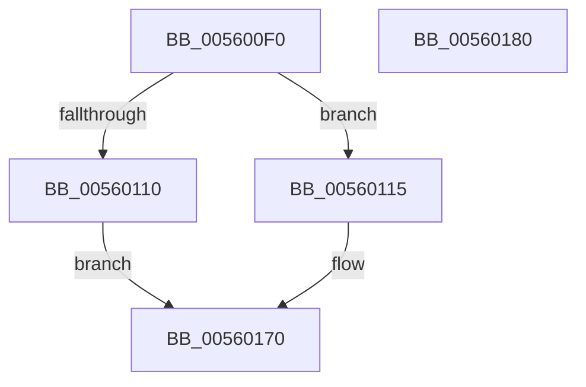

# XmEmulateInterrupt

- RVA: `0x005600F0`–`0x00560181` (길이 `145` bytes)
- VA: `0x00000001405600F0`
- 실행 섹션: `.text`
- PDB 이름 있음: `예`; PDB Function 태그: `아니요`
- unwind 정보 RVA: `0x00060BC4`
- 디코드: `35`개 명령, `145/145` bytes 표시
- 미해석 바이트: `0` (있으면 어셈블리에 `.byte`로 보존)

> 이 문서는 커널 이미지의 기계어와 PDB 기호를 분석해 생성했습니다. 4번과 5번은 함수 원형과 자료형을 바이너리 사용 방식에서 추정한 C 해석이며 원본 소스 복구 결과는 아닙니다.

## 1. Dependencies

- 직접 호출 지점: **3**; 고유 호출 대상: **2**
- 직접 호출자로 확인된 함수: **1**
- RIP 상대 이미지 참조: **7**

### Outgoing calls
- `0x00560136` → [x86BiosTranslateAddress](../47/x86BiosTranslateAddress_function_004736C0.md) (function, `0x004736C0`)
- `0x00560159` → [x86BiosTranslateAddress](../47/x86BiosTranslateAddress_function_004736C0.md) (function, `0x004736C0`)
- `0x0056016B` → [XmEmulateStream](../47/XmEmulateStream_function_00473514.md) (function, `0x00473514`)

### Direct callers
- [x86BiosExecuteInterruptShadowed](../54/x86BiosExecuteInterruptShadowed_function_00547BA8.md) at `0x00547BE4`

### Static image references
- `0x00560104` → RVA `0x01201844` (`CFGRO`; read)
- `0x00560115` → RVA `0x00E119E0` (`.data`; read)
- `0x0056011C` → RVA `0x00E119E2` (`.data`; read)
- `0x00560123` → RVA `0x00E1187C` (`.data`; write)
- `0x0056012A` → RVA `0x00E11868` (`.data`; write)
- `0x00560130` → RVA `0x00E11814` (`.data`; write)
- `0x00560150` → RVA `0x00E11868` (`.data`; read/write)

## 2. Other-region calls and transfers

- 다른 실행 섹션으로 향하는 call: **0**
- 별도 외부 분기/꼬리 이동을 확인하지 못했습니다.

## 3. Assembly (complete function range)

```asm
005600F0  48 89 5C 24 08                  mov qword ptr [rsp + 8], rbx
005600F5  48 89 74 24 10                  mov qword ptr [rsp + 0x10], rsi
005600FA  57                              push rdi
005600FB  48 83 EC 20                     sub rsp, 0x20
005600FF  33 F6                           xor esi, esi
00560101  0F B6 F9                        movzx edi, cl
00560104  40 38 35 39 17 CA 00            cmp byte ptr [rip + 0xca1739], sil
0056010B  48 8B DA                        mov rbx, rdx
0056010E  75 05                           jne 0x140560115
00560110  8D 46 04                        lea eax, [rsi + 4]
00560113  EB 5B                           jmp 0x140560170
00560115  0F B7 0D C4 18 8B 00            movzx ecx, word ptr [rip + 0x8b18c4]
0056011C  0F B7 15 BF 18 8B 00            movzx edx, word ptr [rip + 0x8b18bf]
00560123  66 89 0D 52 17 8B 00            mov word ptr [rip + 0x8b1752], cx
0056012A  89 15 38 17 8B 00               mov dword ptr [rip + 0x8b1738], edx
00560130  89 35 DE 16 8B 00               mov dword ptr [rip + 0x8b16de], esi
00560136  E8 85 35 F1 FF                  call 0x1404736c0
0056013B  B9 FF FF 00 00                  mov ecx, 0xffff
00560140  33 D2                           xor edx, edx
00560142  66 89 48 FA                     mov word ptr [rax - 6], cx
00560146  C7 40 FC FF FF 00 00            mov dword ptr [rax - 4], 0xffff
0056014D  8D 41 FB                        lea eax, [rcx - 5]
00560150  66 01 05 11 17 8B 00            add word ptr [rip + 0x8b1711], ax
00560157  33 C9                           xor ecx, ecx
00560159  E8 62 35 F1 FF                  call 0x1404736c0
0056015E  4C 8B CB                        mov r9, rbx
00560161  0F B7 54 B8 02                  movzx edx, word ptr [rax + rdi*4 + 2]
00560166  44 0F B7 04 B8                  movzx r8d, word ptr [rax + rdi*4]
0056016B  E8 A4 33 F1 FF                  call 0x140473514
00560170  48 8B 5C 24 30                  mov rbx, qword ptr [rsp + 0x30]
00560175  48 8B 74 24 38                  mov rsi, qword ptr [rsp + 0x38]
0056017A  48 83 C4 20                     add rsp, 0x20
0056017E  5F                              pop rdi
0056017F  C3                              ret
00560180  CC                              int3
```

## 4. C-style interpretation (structured pseudocode)

```c
__int64 __fastcall XmEmulateInterrupt(unsigned __int8 a1, __int64 a2)
{
    __int64 result;
    __int64 v_rsi;
    __int64 v_rsp;
    unsigned __int64 v_stack_p10;
    unsigned __int64 v_stack_p8;

    v_stack_p8 = v_rbx;
    v_stack_p10 = v_rsi;
    v_rsp = (v_rsp) - (32);
    v_rsi = 0;
    if ((*(unsigned __int8 *)(v_rip + 13244217)) != 0) goto loc_00560115;
    goto loc_00560170;
loc_00560115:
    *(unsigned __int16 *)(v_rip + 9115474) = (unsigned __int16)(*(unsigned __int16 *)(v_rip + 9115844));
    *(unsigned int *)(v_rip + 9115448) = (unsigned int)(*(unsigned __int16 *)(v_rip + 9115839));
    *(unsigned int *)(v_rip + 9115358) = 0;
    result = x86BiosTranslateAddress(*(unsigned __int16 *)(v_rip + 9115844), *(unsigned __int16 *)(v_rip + 9115839), a3, a4);
    a2 = 0;
    *(unsigned __int16 *)(result - 6) = (unsigned __int16)((unsigned int)(0xFFFFULL));
    *(unsigned int *)(result - 4) = 0xFFFFULL;
    a1 = 0;
    result = x86BiosTranslateAddress(a1, a2, a3, a4);
    result = XmEmulateStream(a1, *(unsigned __int16 *)(result + a1 * 4 + 2), *(unsigned __int16 *)(result + a1 * 4), 0);
loc_00560170:
    v_rsp = (v_rsp) + (32);
    return result;
}
```

## 5. (Beta) C Style

```c
int64_t XmEmulateInterrupt(uint8_t Arg1, int64_t Arg2)
{
    int64_t result;
    int64_t local_rsi;
    int64_t local_rsp;
    uint64_t v_stack_p10;
    uint64_t v_stack_p8;

    v_stack_p8 = local_rbx;
    v_stack_p10 = local_rsi;
    local_rsp = (local_rsp) - (32);
    local_rsi = 0;
    if ((*(uint8_t *)(v_rip + 0xCA1739)) != 0) goto loc_00560115;
    goto loc_00560170;
loc_00560115:
    *(uint16_t *)(v_rip + 0x8B1752) = (uint16_t)(*(uint16_t *)(v_rip + 0x8B18C4));
    *(uint32_t *)(v_rip + 0x8B1738) = (uint32_t)(*(uint16_t *)(v_rip + 0x8B18BF));
    *(uint32_t *)(v_rip + 0x8B16DE) = 0;
    result = x86BiosTranslateAddress(*(uint16_t *)(v_rip + 0x8B18C4), *(uint16_t *)(v_rip + 0x8B18BF), a3, a4);
    Arg2 = 0;
    *(uint16_t *)(result - 0x6) = (uint16_t)((uint32_t)(0xFFFFULL));
    *(uint32_t *)(result - 0x4) = 0xFFFFULL;
    Arg1 = 0;
    result = x86BiosTranslateAddress(Arg1, Arg2, a3, a4);
    result = XmEmulateStream(Arg1, *(uint16_t *)(result + Arg1 * 4 + 0x2), *(uint16_t *)(result + Arg1 * 4), 0);
loc_00560170:
    local_rsp = (local_rsp) + (32);
    return result;
}
```

## 6. Execution-region graph

[열기: 2D/3D 그래프와 함수 탐색 컨트롤 패널](../../../control-panel.html?section=text&rva=0x005600F0&view=graph)

- 2D 그래프는 위에서 아래로 흐르고, 3D 그래프는 빈 공간을 드래그해 회전합니다. Shift+드래그는 이동, 휠은 확대·축소, 함수 노드 선택은 대상 보고서 이동입니다.

### Static fallback


