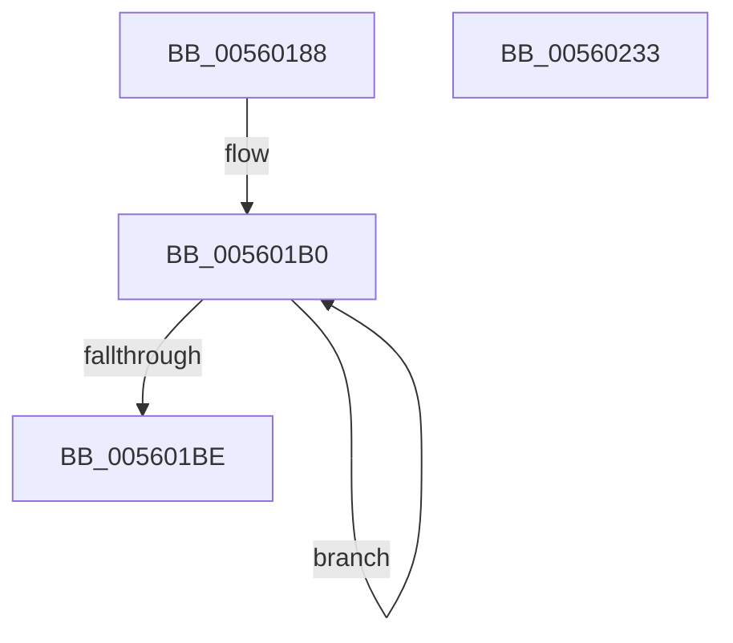

# XmInitializeEmulator

- RVA: `0x00560188`–`0x00560234` (길이 `172` bytes)
- VA: `0x0000000140560188`
- 실행 섹션: `.text`
- PDB 이름 있음: `예`; PDB Function 태그: `아니요`
- unwind 정보 RVA: `0x000AC81C`
- 디코드: `35`개 명령, `172/172` bytes 표시
- 미해석 바이트: `0` (있으면 어셈블리에 `.byte`로 보존)

> 이 문서는 커널 이미지의 기계어와 PDB 기호를 분석해 생성했습니다. 4번과 5번은 함수 원형과 자료형을 바이너리 사용 방식에서 추정한 C 해석이며 원본 소스 복구 결과는 아닙니다.

## 1. Dependencies

- 직접 호출 지점: **2**; 고유 호출 대상: **2**
- 직접 호출자로 확인된 함수: **1**
- RIP 상대 이미지 참조: **13**

### Outgoing calls
- `0x0056019D` → [memset](../6C/memset_function_006C6C40.md) (function, `0x006C6C40`)
- `0x00560208` → [x86BiosTranslateAddress](../47/x86BiosTranslateAddress_function_004736C0.md) (function, `0x004736C0`)

### Direct callers
- [x86BiosInitializeBiosShadowed](../54/x86BiosInitializeBiosShadowed_function_00547D0C.md) at `0x00547D46`

### Static image references
- `0x00560190` → RVA `0x00E11840` (`.data`; read)
- `0x005601A2` → RVA `0x00E1188E` (`.data`; read)
- `0x005601A9` → RVA `0x00E11884` (`.data`; read)
- `0x005601C3` → RVA `0x00E119E0` (`.data`; write)
- `0x005601CD` → RVA `0x00E11868` (`.data`; write)
- `0x005601D5` → RVA `0x00473850` (`x86BiosReadIoSpace`; read)
- `0x005601DC` → RVA `0x00E1187C` (`.data`; write)
- `0x005601E3` → RVA `0x00E119E8` (`.data`; write)
- `0x005601EC` → RVA `0x00472E00` (`x86BiosWriteIoSpace`; read)
- `0x005601F3` → RVA `0x00E119F0` (`.data`; write)
- `0x005601FA` → RVA `0x004736C0` (`x86BiosTranslateAddress`; read)
- `0x00560201` → RVA `0x00E119F8` (`.data`; write)
- `0x00560210` → RVA `0x01201844` (`CFGRO`; write)

## 2. Other-region calls and transfers

- 다른 실행 섹션으로 향하는 call: **0**
- 별도 외부 분기/꼬리 이동을 확인하지 못했습니다.

## 3. Assembly (complete function range)

```asm
00560188  40 57                           push rdi
0056018A  48 83 EC 20                     sub rsp, 0x20
0056018E  33 D2                           xor edx, edx
00560190  48 8D 0D A9 16 8B 00            lea rcx, [rip + 0x8b16a9]
00560197  41 B8 C0 01 00 00               mov r8d, 0x1c0
0056019D  E8 9E 6A 16 00                  call 0x1406c6c40
005601A2  48 8D 05 E5 16 8B 00            lea rax, [rip + 0x8b16e5]
005601A9  48 8D 15 D4 16 8B 00            lea rdx, [rip + 0x8b16d4]
005601B0  66 81 08 FF FF                  or word ptr [rax], 0xffff
005601B5  48 83 E8 02                     sub rax, 2
005601B9  48 3B C2                        cmp rax, rdx
005601BC  7D F2                           jge 0x1405601b0
005601BE  B8 00 08 00 00                  mov eax, 0x800
005601C3  C7 05 13 18 8B 00 00 00 00 08   mov dword ptr [rip + 0x8b1813], 0x8000000
005601CD  89 05 95 16 8B 00               mov dword ptr [rip + 0x8b1695], eax
005601D3  33 C9                           xor ecx, ecx
005601D5  48 8D 05 74 36 F1 FF            lea rax, [rip - 0xec98c]
005601DC  66 89 0D 99 16 8B 00            mov word ptr [rip + 0x8b1699], cx
005601E3  48 89 05 FE 17 8B 00            mov qword ptr [rip + 0x8b17fe], rax
005601EA  33 D2                           xor edx, edx
005601EC  48 8D 05 0D 2C F1 FF            lea rax, [rip - 0xed3f3]
005601F3  48 89 05 F6 17 8B 00            mov qword ptr [rip + 0x8b17f6], rax
005601FA  48 8D 05 BF 34 F1 FF            lea rax, [rip - 0xecb41]
00560201  48 89 05 F0 17 8B 00            mov qword ptr [rip + 0x8b17f0], rax
00560208  E8 B3 34 F1 FF                  call 0x1404736c0
0056020D  48 8B F8                        mov rdi, rax
00560210  C6 05 2D 16 CA 00 01            mov byte ptr [rip + 0xca162d], 1
00560217  B9 00 01 00 00                  mov ecx, 0x100
0056021C  C7 80 00 05 00 00 CF 00 00 00   mov dword ptr [rax + 0x500], 0xcf
00560226  B8 00 05 00 00                  mov eax, 0x500
0056022B  F3 AB                           rep stosd dword ptr [rdi], eax
0056022D  48 83 C4 20                     add rsp, 0x20
00560231  5F                              pop rdi
00560232  C3                              ret
00560233  CC                              int3
```

## 4. C-style interpretation (structured pseudocode)

```c
__int64 __fastcall XmInitializeEmulator(__int64 a1, int a2)
{
    __int64 result;
    __int64 v_rsp;

    v_rsp = (v_rsp) - (32);
    a2 = 0;
    result = memset(v_rip + 9115305, a2, 448, a4);
loc_005601B0:
    result = (v_rip + 9115365) - (2);
    if (result >= (v_rip + 9115348)) goto loc_005601B0;
    *(unsigned int *)(v_rip + 9115667) = 0x8000000ULL;
    *(unsigned int *)(v_rip + 9115285) = (unsigned int)((unsigned int)(0x800ULL));
    a1 = 0;
    *(unsigned __int16 *)(v_rip + 9115289) = 0;
    *(unsigned __int64 *)(v_rip + 9115646) = v_rip - 969100;
    a2 = 0;
    *(unsigned __int64 *)(v_rip + 9115638) = v_rip - 971763;
    *(unsigned __int64 *)(v_rip + 9115632) = v_rip - 969537;
    result = x86BiosTranslateAddress(a1, a2, 448, a4);
    *(unsigned __int8 *)(v_rip + 13243949) = 1;
    *(unsigned int *)(result + 1280) = 207;
    v_rsp = (v_rsp) + (32);
    return (unsigned int)(0x500ULL);
}
```

## 5. (Beta) C Style

```c
int64_t XmInitializeEmulator(int64_t Arg1, int32_t Arg2)
{
    int64_t result;
    int64_t local_rsp;

    local_rsp = (local_rsp) - (32);
    Arg2 = 0;
    result = memset(v_rip + 9115305, Arg2, 448, a4);
loc_005601B0:
    result = (v_rip + 9115365) - (2);
    if (result >= (v_rip + 9115348)) goto loc_005601B0;
    *(uint32_t *)(v_rip + 0x8B1813) = 0x8000000ULL;
    *(uint32_t *)(v_rip + 0x8B1695) = (uint32_t)((uint32_t)(0x800ULL));
    Arg1 = 0;
    *(uint16_t *)(v_rip + 0x8B1699) = 0;
    *(uint64_t *)(v_rip + 0x8B17FE) = v_rip - 969100;
    Arg2 = 0;
    *(uint64_t *)(v_rip + 0x8B17F6) = v_rip - 971763;
    *(uint64_t *)(v_rip + 0x8B17F0) = v_rip - 969537;
    result = x86BiosTranslateAddress(Arg1, Arg2, 448, a4);
    *(uint8_t *)(v_rip + 0xCA162D) = 1;
    *(uint32_t *)(result + 0x500) = 207;
    local_rsp = (local_rsp) + (32);
    return (uint32_t)(0x500ULL);
}
```

## 6. Execution-region graph

[열기: 2D/3D 그래프와 함수 탐색 컨트롤 패널](../../../control-panel.html?section=text&rva=0x00560188&view=graph)

- 2D 그래프는 위에서 아래로 흐르고, 3D 그래프는 빈 공간을 드래그해 회전합니다. Shift+드래그는 이동, 휠은 확대·축소, 함수 노드 선택은 대상 보고서 이동입니다.

### Static fallback


