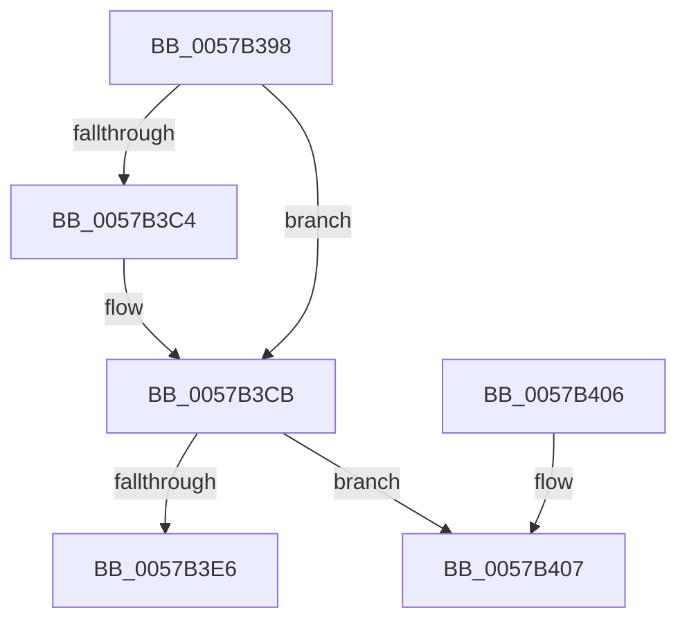

# CcAddExternalCacheInternalEx

- RVA: `0x0057B398`–`0x0057B426` (길이 `142` bytes)
- VA: `0x000000014057B398`
- 실행 섹션: `.text`
- PDB 이름 있음: `예`; PDB Function 태그: `아니요`
- unwind 정보 RVA: `0x000C5770`
- 디코드: `38`개 명령, `142/142` bytes 표시
- 미해석 바이트: `0` (있으면 어셈블리에 `.byte`로 보존)

> 이 문서는 커널 이미지의 기계어와 PDB 기호를 분석해 생성했습니다. 4번과 5번은 함수 원형과 자료형을 바이너리 사용 방식에서 추정한 C 해석이며 원본 소스 복구 결과는 아닙니다.

## 1. Dependencies

- 직접 호출 지점: **3**; 고유 호출 대상: **3**
- 직접 호출자로 확인된 함수: **1**
- RIP 상대 이미지 참조: **3**

### Outgoing calls
- `0x0057B3AF` → [KeAcquireSpinLockRaiseToDpc](../20/KeAcquireSpinLockRaiseToDpc_function_00208470.md) (function, `0x00208470`)
- `0x0057B3F6` → [KeReleaseSpinLock](../39/KeReleaseSpinLock_function_00392BA0.md) (function, `0x00392BA0`)
- `0x0057B420` → [KeBugCheckEx](../4F/KeBugCheckEx_function_004FD660.md) (function, `0x004FD660`)

### Direct callers
- [CcAddExternalCacheToVolumeEx](CcAddExternalCacheToVolumeEx_function_0057B42C.md) at `0x0057B4A1`

### Static image references
- `0x0057B3A8` → RVA `0x00F8F5D0` (`.data`; read)
- `0x0057B3CB` → RVA `0x00F8F500` (`.data`; read)
- `0x0057B3E6` → RVA `0x00F8F500` (`.data`; write)

## 2. Other-region calls and transfers

- 다른 실행 섹션으로 향하는 call: **0**
- 별도 외부 분기/꼬리 이동을 확인하지 못했습니다.

## 3. Assembly (complete function range)

```asm
0057B398  48 89 5C 24 08                  mov qword ptr [rsp + 8], rbx
0057B39D  57                              push rdi
0057B39E  48 83 EC 30                     sub rsp, 0x30
0057B3A2  48 8B D9                        mov rbx, rcx
0057B3A5  48 8B FA                        mov rdi, rdx
0057B3A8  48 8D 0D 21 42 A1 00            lea rcx, [rip + 0xa14221]
0057B3AF  E8 BC D0 C8 FF                  call 0x140208470
0057B3B4  48 8B 4F 08                     mov rcx, qword ptr [rdi + 8]
0057B3B8  48 83 C3 20                     add rbx, 0x20
0057B3BC  44 8A C0                        mov r8b, al
0057B3BF  48 39 39                        cmp qword ptr [rcx], rdi
0057B3C2  74 07                           je 0x14057b3cb
0057B3C4  B9 03 00 00 00                  mov ecx, 3
0057B3C9  CD 29                           int 0x29
0057B3CB  8B 05 2F 41 A1 00               mov eax, dword ptr [rip + 0xa1412f]
0057B3D1  48 89 3B                        mov qword ptr [rbx], rdi
0057B3D4  48 89 4B 08                     mov qword ptr [rbx + 8], rcx
0057B3D8  48 89 19                        mov qword ptr [rcx], rbx
0057B3DB  8D 50 01                        lea edx, [rax + 1]
0057B3DE  48 89 5F 08                     mov qword ptr [rdi + 8], rbx
0057B3E2  3B D0                           cmp edx, eax
0057B3E4  76 21                           jbe 0x14057b407
0057B3E6  89 15 14 41 A1 00               mov dword ptr [rip + 0xa14114], edx
0057B3EC  48 8D 0D DD 41 A1 00            lea rcx, [rip + 0xa141dd]
0057B3F3  41 8A D0                        mov dl, r8b
0057B3F6  E8 A5 77 E1 FF                  call 0x140392ba0
0057B3FB  48 8B 5C 24 40                  mov rbx, qword ptr [rsp + 0x40]
0057B400  48 83 C4 30                     add rsp, 0x30
0057B404  5F                              pop rdi
0057B405  C3                              ret
0057B406  CC                              int3
0057B407  48 83 64 24 20 00               and qword ptr [rsp + 0x20], 0
0057B40D  45 33 C9                        xor r9d, r9d
0057B410  BA CF 23 00 00                  mov edx, 0x23cf
0057B415  49 C7 C0 20 04 00 C0            mov r8, 0xffffffffc0000420
0057B41C  41 8D 49 34                     lea ecx, [r9 + 0x34]
0057B420  E8 3B 22 F8 FF                  call 0x1404fd660
0057B425  CC                              int3
```

## 4. C-style interpretation (structured pseudocode)

```c
__int64 __fastcall CcAddExternalCacheInternalEx(__int64 a1, __int64 a2, __int64 a3, int a4)
{
    __int64 result;
    __int64 v_rbx;
    __int64 v_rsp;
    unsigned __int64 v_stack_p20;
    unsigned __int64 v_stack_p8;

    v_stack_p8 = v_rbx;
    v_rsp = (v_rsp) - (48);
    result = KeAcquireSpinLockRaiseToDpc(v_rip + 10568225, a2, a3, a4);
    v_rbx = (a1) + (32);
    if ((*(unsigned __int64 *)(*(unsigned __int64 *)(a2 + 8))) != a2) {
        a1 = 3;
    }
    *(unsigned __int64 *)(v_rbx) = a2;
    *(unsigned __int64 *)(v_rbx + 8) = a1;
    *(unsigned __int64 *)(a1) = v_rbx;
    *(unsigned __int64 *)(a2 + 8) = v_rbx;
    if (((unsigned int)((unsigned int)(*(unsigned int *)(v_rip + 10567983)) + 1)) <= ((unsigned int)((unsigned int)(*(unsigned int *)(v_rip + 10567983))))) goto loc_0057B407;
    *(unsigned int *)(v_rip + 10567956) = (unsigned int)((unsigned int)(*(unsigned int *)(v_rip + 10567983)) + 1);
    result = KeReleaseSpinLock(v_rip + 10568157, (unsigned __int8)((unsigned __int8)(result)), (unsigned __int8)(result), a4);
    v_rsp = (v_rsp) + (48);
    return result;
loc_0057B407:
    a4 = 0;
    result = KeBugCheckEx(a4 + 52, (unsigned int)(0x23CFULL), 0xFFFFFFFFC0000420ULL, a4);
    return result;
}
```

## 5. (Beta) C Style

```c
int64_t CcAddExternalCacheInternalEx(void *Arg1, void *Arg2, int64_t Arg3, int32_t Arg4)
{
    uint8_t *arg1 = (uint8_t *)Arg1;
    uint8_t *arg2 = (uint8_t *)Arg2;

    int64_t result;
    int64_t local_rbx;
    int64_t local_rsp;
    uint64_t v_stack_p20;
    uint64_t v_stack_p8;

    v_stack_p8 = local_rbx;
    local_rsp = (local_rsp) - (48);
    result = KeAcquireSpinLockRaiseToDpc(v_rip + 10568225, Arg2, Arg3, Arg4);
    local_rbx = (Arg1) + (32);
    if ((*(uint64_t *)(*(uint64_t *)(arg2 + 0x8))) != Arg2) {
        Arg1 = 3;
    }
    *(void **)(local_rbx) = Arg2;
    *(void **)(local_rbx + 0x8) = Arg1;
    *(uint64_t *)(arg1) = local_rbx;
    *(uint64_t *)(arg2 + 0x8) = local_rbx;
    if (((uint32_t)((uint32_t)(*(uint32_t *)(v_rip + 0xA1412F)) + 1)) <= ((uint32_t)((uint32_t)(*(uint32_t *)(v_rip + 0xA1412F))))) goto loc_0057B407;
    *(uint32_t *)(v_rip + 0xA14114) = (uint32_t)((uint32_t)(*(uint32_t *)(v_rip + 0xA1412F)) + 1);
    result = KeReleaseSpinLock(v_rip + 10568157, (uint8_t)((uint8_t)(result)), (uint8_t)(result), Arg4);
    local_rsp = (local_rsp) + (48);
    return result;
loc_0057B407:
    Arg4 = 0;
    result = KeBugCheckEx(Arg4 + 52, (uint32_t)(0x23CFULL), 0xFFFFFFFFC0000420ULL, Arg4);
    return result;
}
```

### 관측된 메모리 오프셋

구조체 형식이 확인되지 않은 접근은 인자 기준의 오프셋으로만 기록했습니다.

| 기준 인자 | 오프셋 표현 | 폭 (bit) | 접근 |
|---|---:|---:|---|
| `Arg1` | `+ 0x0` | `64` | `W` |
| `Arg1` | `+ 0x8` | `64` | `W` |
| `Arg2` | `+ 0x8` | `64` | `R` |
| `Arg2` | `+ 0x8` | `64` | `W` |

## 6. Execution-region graph

[열기: 2D/3D 그래프와 함수 탐색 컨트롤 패널](../../../control-panel.html?section=text&rva=0x0057B398&view=graph)

- 2D 그래프는 위에서 아래로 흐르고, 3D 그래프는 빈 공간을 드래그해 회전합니다. Shift+드래그는 이동, 휠은 확대·축소, 함수 노드 선택은 대상 보고서 이동입니다.

### Static fallback


