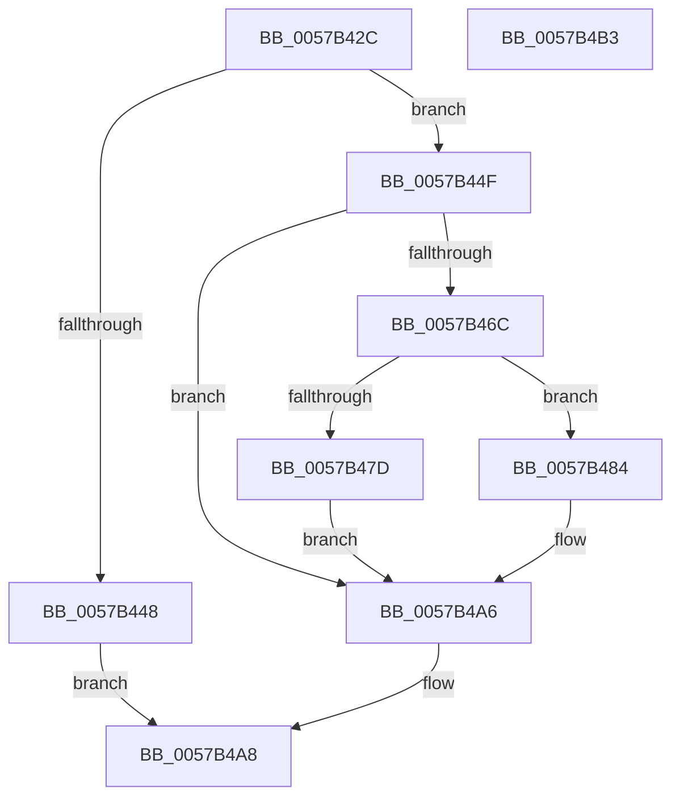

# CcAddExternalCacheToVolumeEx

- RVA: `0x0057B42C`–`0x0057B4B4` (길이 `136` bytes)
- VA: `0x000000014057B42C`
- 실행 섹션: `.text`
- PDB 이름 있음: `예`; PDB Function 태그: `아니요`
- unwind 정보 RVA: `0x0005CAAC`
- 디코드: `36`개 명령, `136/136` bytes 표시
- 미해석 바이트: `0` (있으면 어셈블리에 `.byte`로 보존)

> 이 문서는 커널 이미지의 기계어와 PDB 기호를 분석해 생성했습니다. 4번과 5번은 함수 원형과 자료형을 바이너리 사용 방식에서 추정한 C 해석이며 원본 소스 복구 결과는 아닙니다.

## 1. Dependencies

- 직접 호출 지점: **2**; 고유 호출 대상: **2**
- 직접 호출자로 확인된 함수: **1**
- RIP 상대 이미지 참조: **2**

### Outgoing calls
- `0x0057B461` → [CcCreatePrivateVolumeCacheMap](../3C/CcCreatePrivateVolumeCacheMap_function_003CDB20.md) (function, `0x003CDB20`)
- `0x0057B4A1` → [CcAddExternalCacheInternalEx](CcAddExternalCacheInternalEx_function_0057B398.md) (function, `0x0057B398`)

### Direct callers
- [CcRegisterExternalCacheEx](CcRegisterExternalCacheEx_function_0057C0B0.md) at `0x0057C140`

### Static image references
- `0x0057B43F` → RVA `0x00E65B88` (`.data`; read)
- `0x0057B44F` → RVA `0x00FC6EA0` (`ALMOSTRO`; read)

## 2. Other-region calls and transfers

- 다른 실행 섹션으로 향하는 call: **0**
- 별도 외부 분기/꼬리 이동을 확인하지 못했습니다.

## 3. Assembly (complete function range)

```asm
0057B42C  48 89 5C 24 08                  mov qword ptr [rsp + 8], rbx
0057B431  57                              push rdi
0057B432  48 83 EC 20                     sub rsp, 0x20
0057B436  48 83 64 24 38 00               and qword ptr [rsp + 0x38], 0
0057B43C  48 8B F9                        mov rdi, rcx
0057B43F  80 3D 42 A7 8E 00 00            cmp byte ptr [rip + 0x8ea742], 0
0057B446  75 07                           jne 0x14057b44f
0057B448  B8 BB 00 00 C0                  mov eax, 0xc00000bb
0057B44D  EB 59                           jmp 0x14057b4a8
0057B44F  48 8B 0D 4A BA A4 00            mov rcx, qword ptr [rip + 0xa4ba4a]
0057B456  4C 8D 44 24 38                  lea r8, [rsp + 0x38]
0057B45B  33 D2                           xor edx, edx
0057B45D  48 8B 49 08                     mov rcx, qword ptr [rcx + 8]
0057B461  E8 BA 26 E5 FF                  call 0x1403cdb20
0057B466  8B D8                           mov ebx, eax
0057B468  85 C0                           test eax, eax
0057B46A  78 3A                           js 0x14057b4a6
0057B46C  48 8B 54 24 38                  mov rdx, qword ptr [rsp + 0x38]
0057B471  48 8D 8A E0 04 00 00            lea rcx, [rdx + 0x4e0]
0057B478  48 39 09                        cmp qword ptr [rcx], rcx
0057B47B  74 07                           je 0x14057b484
0057B47D  BB BB 00 00 C0                  mov ebx, 0xc00000bb
0057B482  EB 22                           jmp 0x14057b4a6
0057B484  48 89 57 48                     mov qword ptr [rdi + 0x48], rdx
0057B488  48 8B CF                        mov rcx, rdi
0057B48B  48 8B 42 20                     mov rax, qword ptr [rdx + 0x20]
0057B48F  48 89 47 40                     mov qword ptr [rdi + 0x40], rax
0057B493  83 8A 50 06 00 00 10            or dword ptr [rdx + 0x650], 0x10
0057B49A  48 81 C2 F0 04 00 00            add rdx, 0x4f0
0057B4A1  E8 F2 FE FF FF                  call 0x14057b398
0057B4A6  8B C3                           mov eax, ebx
0057B4A8  48 8B 5C 24 30                  mov rbx, qword ptr [rsp + 0x30]
0057B4AD  48 83 C4 20                     add rsp, 0x20
0057B4B1  5F                              pop rdi
0057B4B2  C3                              ret
0057B4B3  CC                              int3
```

## 4. C-style interpretation (structured pseudocode)

```c
__int64 __fastcall CcAddExternalCacheToVolumeEx(__int64 a1, int a2)
{
    __int64 result;
    __int64 v_rsp;
    unsigned __int64 v_stack_p10;
    unsigned __int64 v_stack_p8;

    v_stack_p8 = v_rbx;
    v_rsp = (v_rsp) - (32);
    if ((*(unsigned __int8 *)(v_rip + 9348930)) != 0) goto loc_0057B44F;
    goto loc_0057B4A8;
loc_0057B44F:
    a2 = 0;
    result = CcCreatePrivateVolumeCacheMap(*(unsigned __int64 *)(*(unsigned __int64 *)(v_rip + 10795594) + 8), a2, v_stack_p10, a4);
    if (sign_flag) goto loc_0057B4A6;
    if ((*(unsigned __int64 *)(v_stack_p10 + 1248)) == (v_stack_p10 + 1248)) goto loc_0057B484;
    goto loc_0057B4A6;
loc_0057B484:
    *(unsigned __int64 *)(a1 + 72) = v_stack_p10;
    *(unsigned __int64 *)(a1 + 64) = *(unsigned __int64 *)(v_stack_p10 + 32);
    a2 = (v_stack_p10) + (0x4F0ULL);
    result = CcAddExternalCacheInternalEx(a1, a2, v_stack_p10, a4);
loc_0057B4A6:
loc_0057B4A8:
    v_rsp = (v_rsp) + (32);
    return (unsigned int)((unsigned int)((unsigned int)(0xC00000BBULL)));
}
```

## 5. (Beta) C Style

```c
int64_t CcAddExternalCacheToVolumeEx(void *Arg1, int32_t Arg2)
{
    uint8_t *arg1 = (uint8_t *)Arg1;

    int64_t result;
    int64_t local_rsp;
    uint64_t v_stack_p10;
    uint64_t v_stack_p8;

    v_stack_p8 = local_rbx;
    local_rsp = (local_rsp) - (32);
    if ((*(uint8_t *)(v_rip + 0x8EA742)) != 0) goto loc_0057B44F;
    goto loc_0057B4A8;
loc_0057B44F:
    Arg2 = 0;
    result = CcCreatePrivateVolumeCacheMap(*(uint64_t *)(*(uint64_t *)(v_rip + 0xA4BA4A) + 0x8), Arg2, v_stack_p10, a4);
    if (sign_flag) goto loc_0057B4A6;
    if ((*(uint64_t *)(v_stack_p10 + 0x4E0)) == (v_stack_p10 + 1248)) goto loc_0057B484;
    goto loc_0057B4A6;
loc_0057B484:
    *(uint64_t *)(arg1 + 0x48) = v_stack_p10;
    *(uint64_t *)(arg1 + 0x40) = *(uint64_t *)(v_stack_p10 + 0x20);
    Arg2 = (v_stack_p10) + (0x4F0ULL);
    result = CcAddExternalCacheInternalEx(Arg1, Arg2, v_stack_p10, a4);
loc_0057B4A6:
loc_0057B4A8:
    local_rsp = (local_rsp) + (32);
    return (uint32_t)((uint32_t)((uint32_t)(0xC00000BBULL)));
}
```

### 관측된 메모리 오프셋

구조체 형식이 확인되지 않은 접근은 인자 기준의 오프셋으로만 기록했습니다.

| 기준 인자 | 오프셋 표현 | 폭 (bit) | 접근 |
|---|---:|---:|---|
| `Arg1` | `+ 0x40` | `64` | `W` |
| `Arg1` | `+ 0x48` | `64` | `W` |

## 6. Execution-region graph

[열기: 2D/3D 그래프와 함수 탐색 컨트롤 패널](../../../control-panel.html?section=text&rva=0x0057B42C&view=graph)

- 2D 그래프는 위에서 아래로 흐르고, 3D 그래프는 빈 공간을 드래그해 회전합니다. Shift+드래그는 이동, 휠은 확대·축소, 함수 노드 선택은 대상 보고서 이동입니다.

### Static fallback


